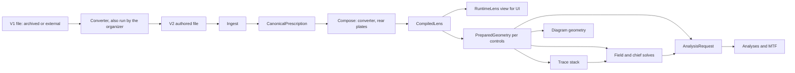
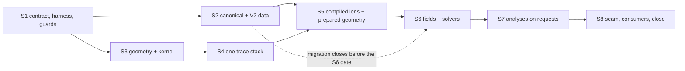

# Optics Engine Rewrite Specification

Restructure the lens optics engine and the authored lens-data format so the engine is easier to understand, change and
verify. Adopt the tighter intersection-accuracy contract from
[PR #774](https://github.com/ronbuening/LensVisualizer/pull/774) everywhere, and take the speed gains the restructure
makes available.

Stages 1 to 5 and Phases 2.1 to 2.5 have merged to `main`: promotion #847, tagged `optics-rewrite/promotion`, and
catalog migration #862. Stages 1 to 5 have passed their gates (tags `optics-rewrite/s1`, `optics-rewrite/s2`,
`optics-rewrite/s3`, `optics-rewrite/s4` and `optics-rewrite/s5`). Phase 2.6 has merged except S2.P6.T5, which is deferred; Stages 6 to 8 are future work.

Priorities, in order: **maintainability**, then **accuracy** (the contract below), then **speed**. When they conflict,
the higher priority wins and the PR description records the trade-off. Speed's gates and targets are under
[Efficiency (secondary)](#efficiency-secondary).

## Outcomes

The program is complete when every outcome below holds on `main`. Each outcome is checked by a guard test or script
where one can be written, and by review otherwise.

| # | Outcome | Checked by |
| --- | --- | --- |
| M1 | One authored lens-data format (V2), with one spec and one template. The app reads only V2. V1 files are read only by the permanent converter, which the organizer runs on any V1 file it finds and which also runs on demand. | Corpus guard: every catalog file is V2; converter and organizer suites; seam guard keeps the V1 mapping out of the app |
| M2 | Lens data is ingested once into a canonical prescription, then compiled once into the engine's lens model. Materials are resolved once, and nothing in the engine clones lens data or points back to the UI view. | The compiler's own tests (S5.P1.T1); architecture guards (S1.P4.T1) |
| M3 | One surface-geometry module and one intersection/trace stack. `src/optics/internal/` and the legacy tracers in `rayTrace.ts` are deleted. | Architecture guards; the Stage 4 and 5 gates; S8.P2.T1 |
| M4 | No runtime import cycles inside `src/optics/`. | Import-cycle guard (S1.P4.T1) |
| M5 | One owner for prepared geometry, with one bounded cache. Every other cache has a named owner, key and capacity. | Cache guard (S1.P4.T1) |
| M6 | Analyses take one explicit request object. There are no `(L, zPos, focusT, zoomT, aberrationT, geometry?)` parameter lists and no `*ForState2` adapters. | Seam guard; review |
| M7 | No `*2` names and no `compat.ts`. Code outside `src/optics/` imports only the public seam: the top-level barrels the seam guard admits, with its one permanent subdirectory entry; `mount/` is outside the seam. | Seam guard (S1.P4.T1; see [Architecture guards](#architecture-guards)) |
| M8 | The accuracy contract holds on every intersection path. | Analytic suite and high-precision fixtures; differential gates while the program runs |
| M9 | The architecture docs, `public-functions.md`, lens-data spec and recipes describe the new structure, and this plan is deleted. | `docDrift.test.ts`; review |

## Evidence

Evidence is a snapshot of the engine at `main` 33ebdb3 and the catalog on 2026-10-13, lens and teleconverter files
together. It includes the fixes that merged with the plan: three duplicate-value corrections in lens data and the
generated rear-plate rim fix. The plan was first written against the 907 lens files at 33ebdb3.

### Engine

Scope: 161 files and 36,774 lines in `src/optics/`, excluding `mount/` and the glass catalog data.

- **Two exact tracers.** The prepared-state tracer is `trace/` with `math/intersection.ts`. The legacy tracer is
  `internal/exactSurfaceTrace.ts` with `internal/surfaceIntersection.ts`; with `rayTrace.ts` and
  `internal/traceSurfaces.ts`, the legacy layer is 2,652 lines. The legacy tracer runs in production in:
  - `buildLens` constants (`runtimeLens.ts`);
  - the chief-relative skew rays of off-axis bundles, coma, spherical aberration, bokeh, field curvature and scalar
    chromatic fans;
  - off-infinity pupil baselines;
  - folded validation.
- **The engine lens is built from the UI view.** `normalizeLensData.ts` builds it from a finished `RuntimeLens` and
  keeps a `runtime` back-pointer, which `prepareState.ts` reads. Twenty-two prepared-state modules read
  `state.lens.runtime`. Materials are resolved twice, and lens data is `structuredClone`d twice.
- **One 13-module runtime import cycle**, around `compat.ts`: `optics.ts`, `projection.ts`, `distortionAnalysis.ts`,
  `vignetteAnalysis.ts`, `pupilAberration.ts`, `groupMovement.ts` and six `analysis/` modules.
- **Duplicated concepts.** About twenty concepts are implemented twice or more ([Module fates](#module-fates)), among
  them layout and thickness, lens compilation, dispersion tables, channel wavelengths, aspheric comparison, chromatic
  bar scaling, display sag, paraxial tracing, pupil geometry, z-position overrides and field barrels. Zoom-table
  interpolation has five copies. Focus breathing has two different infinity thresholds (0.003 and 0.0001).
  Prepared-state caching is an LRU of 96, an unbounded store, and eight uncached call sites in `field/chiefRay.ts`.
- **Adapters and names.** Analyses that take a prepared state unwrap it back into
  `(L, zPos, focusT, zoomT, aberrationT)` and call the `RuntimeLens` implementation. There are 176 `*2` exports, and
  only two of them are imported outside `src/optics/`.
- **The de-facto public surface.** Outside code imports 49 `src/optics/` modules: 32 in the app and 17 in tooling.
  The official barrel `index.ts` has no importers. `RuntimeLens` is used by 52 non-optics source files. 57 test files
  import engine internals or `*2` names, and six test files mock seven engine modules by path.

### Cost

CPU profiles and evaluation counters on the slowest benchmark lens, PC-Nikkor 19mm, put wall time in the number of
kernel evaluations, not in preparation or adapters:

| Measurement | Default analysis | Stopped-close (shift + tilt) |
| --- | --- | --- |
| Sag + slope self time | 42% | 32% |
| Bracket scan (inclusive) | 23% | 26% |
| Garbage collection | 4% | 15% |
| `prepareState` and every adapter function | ≤ 0.6% | ≤ 0.6% |
| Surface-profile evaluations per intersection | 5.8 | 7.8 |
| Dominant nested solve | Distortion's image-height inversion, 58%: bisection over chief solves of ~64 stop traces each | Sensor-locked field sampling, 78%: `solveScalarRoot`, ~86 evaluations per solve |

Spheres and conics have no closed-form path. Every curved surface is bracketed (an endpoint test, then up to 24 samples)
and solved by safeguarded Newton, and each evaluation computes both sag and slope. The Sony FE 24-70mm GM II and Canon
Serenar 50mm f/1.8 show 5.3 and 5.0 evaluations per intersection, so the pattern is general.

### Lens data

922 lens files and 8 teleconverter files: 19,414 surfaces and 10,504 elements.

- **Per surface.** Every surface repeats `nd` and `elemId`, and the 8,900 air surfaces (46%) carry `elemId: 0, nd: 1`.
  Surface and element indices agree in every lens, so one `medium` reference can carry the index.
  - `elemId` means three things: the drawn span, the dispersion medium and the absorbing medium. These diverge on
    mirror and blocker surfaces ([Field mapping](#field-mapping)).
  - Two lenses have non-air media with no element: water in front of the Nikon RUW 20-35, and three cement layers in
    the Hasselblad XCD 90 that are traced but not drawn as elements.
- **Variable gaps.** `var` is `[focusKeyframe]` on primes and `[zoomStation][focusKeyframe]` on zooms; `zoomPositions`
  decides the shape. Its first value duplicates `surface.d`, exactly, in all 2,221 gaps.
- **Per-station facts are spread over six parallel structures:** `zoomPositions`, `nominalFno`,
  `zoomStopSemiDiameters`, `zoomCloseFocusM`, the `var` rows and the `publishedStations` indices.
  - `finiteConjugates` uses a second addressing scheme, normalized `focusT`/`zoomT`.
  - On zooms, `focalLengthDesign` and `zoomLabels` are `[wide, tele]` endpoints in 270 and 243 files, and per-station
    in 27 and 48, with no marker saying which form a file uses.
- **Magic values and padding.**
  - All 1,309 flat surfaces have `R` = 1e15: 1,246 are written `1e15`, and 63 `1000000000000000.0` or
    `1000000000000000`.
  - The V1 schema requires K and A4–A14 on every asphere, so all 1,491 entries list them, zero when unused. Empty
    `asph` objects are counted under [Anchors and comparison coverage](#anchors-and-comparison-coverage).
  - The stop `sd` is required, but the engine overwrites it in 906 of 922 lenses ([Stop radius](#stop-radius)).
    Shrinking all 906 values to 10% (2026-10-14) builds every lens identically but for the copy of the file's data
    the built lens keeps. On the catalog of 2026-10-09, shrinking the 889 then authored the same way changed no
    computed value. Only generated rear-plate rims can read those values, and no current lens triggers that path.
    The V1 spec says the authored value sets the entrance pupil.
- **Fields in the wrong place, or unread.** Display, ray-sampling and validation knobs sit beside optical fields.
  Three authored fields have no reader in the app: `zoomLabels`, `apertureBlades` and `apertureBladeRoundedness`.
  Defaults are merged invisibly in several places, and `src/lens-data/defaults.ts` imports an engine internal.
- **The V1 spec contradicts the code** at each place S2.P4.T1 names.

## Baseline and accuracy contract

- **#774 merged on its own, ahead of the program,** as `79899f4d`.
- **R0** is its parent, `d49857ae`. R0 is measured once, in S1.P1.T1, only to size the contract's own cost. Every
  other base is set under [Anchors and comparison coverage](#anchors-and-comparison-coverage) and
  [Efficiency (secondary)](#efficiency-secondary).
- **The anchors:**
  - **A0** is the Stage 1 PR's merge commit, tagged `optics-rewrite/s1`; it contains #774.
  - **A1** is `6d186968`, tagged `optics-rewrite/a1`: the merge commit of #788, the first merge of `main` that changed
    what the engine computes. Its Tier S check against A0, of the head before the merge, ran after the merge and
    passed under C1 in all 8 shards.
  - **A2** is `6da1d95c`, tagged `optics-rewrite/a2`: the merge commit of #804, the second merge of `main` (four
    catalog glasses and HOYA FCD1's vendor curve). Its Tier S check against A1, the first Tier S run to include
    S3.P2.T1, failed only on S3.P2.T1's three approved divergences once #806 had settled that step's Tier S.
  - **A3** is `fd9c6f48`, tagged `optics-rewrite/a3`: the merge commit of #815, the first engine C3 (the distortion
    curve keeps invalid chief rays off it). Its cumulative Tier S against A2, under C2 (stricter than the rule's C3)
    with the 90 lines declared since A2, failed only on the approved divergences of S3.P2.T1, S3.P2.T3 and S4.P2.T1,
    once #816 and #817 had settled the build pupils' budget.
  - **A4** is `a4183c54`, tagged `optics-rewrite/a4`: the merge commit of #835, S5.P2.T2's C3 (one focus-infinity
    cutoff, 0.003). Its cumulative Tier S against A3, under C3 with no transition declared since A3, passed in all 8
    shards: 221 records differ, all inside their budgets.
  - **A5** is `260137df`, tagged `optics-rewrite/a5`: the merge commit of #843, the third merge of `main` (#807's and
    #829's glass rows change the matched glass for 32 lenses and pairs). Its Tier S of `engine-next` against A4 (run
    38953367618, on `de6fc223`, whose engine is identical to `84b32453`'s) is bit-identical, and #843 carries
    `engine-diff:c3`, as #804 did.
  - **Stage 2** is `20827483`, tagged `optics-rewrite/s2`: the merge commit of #862, which closes the catalog
    migration. Its Tier S against `optics-rewrite/promotion` (run 39078302227, 48 shards, C0) compares 1,019 lenses
    and pairs, 45,591 records and 308.7M numbers: 0 differ, all format-only, no declared exceptions.
- **The intersection contract** is #774's, and its documentation owns it: `agent_docs/architecture/optics-engine.md`
  (Exact Surface Trace) and `agent_docs/decisions.md` (2026-10-08). It covers the `1e-12` mm raw residual target, the
  72-iteration cap, the residual definitions, the raw-target-first roundoff envelope, and cap selection.
- **Closed form gets no exemption.** A closed-form root, which S3.P2.T1 adds for spheres and conics, is accepted only
  at the raw target, under the same residual definition as an iterative one.

The program carries these costs, which #774 reported, as known debt; the first is measured in the Stage 1 baseline
below:

- PC-Nikkor 19mm default analysis +3.5%: 123.84 ms at R0, 128.22 ms at the Stage 1 head;
- the analysis category +8.31%;
- +0.291 Newton steps per curved hit;
- eight accepted Mirotar success→clipped transitions.

**The Stage 1 baseline** (S1.P1.T1) is the paired run of R0 against the Stage 1 PR's head `459e6d01`, on 2026-10-12.

- Machine: Apple M4 Pro, 14 cores, darwin/arm64; Node v24.15.0, V8 13.6.233.17-node.48.
- Samples: 15 after 2 warmups per case, in two processes: 8 pairs with R0's bundle loaded first and 7 with the head's.
- Between R0 and that head the engine differs by #774, by the glass catalog entries #776 and #777 added, and by the
  three unimported modules S1.P4.T1 deleted. The PR's commits after `459e6d01` change documents and records only.

| PC-Nikkor 19mm analysis | Run | R0 median (ms) | Head median (ms) | Head / R0 | 95% interval |
| --- | --- | ---: | ---: | ---: | --- |
| default | whole matrix | 123.84 | 128.22 | 1.035 | 1.030 to 1.054 |
| stopped-close | whole matrix | 2167.17 | 2191.57 | 1.011 | 0.989 to 1.024 |
| default | heavy set | 126.91 | 133.89 | 1.055 | 1.038 to 1.082 |
| stopped-close | heavy set | 2145.59 | 2215.67 | 1.033 | 1.024 to 1.045 |

- **The stored R0 median is 123.84 ms,** from the whole-matrix run, which is the command S1.P1.T1 names. From Stage 3
  on, [Efficiency (secondary)](#efficiency-secondary) gate 3 holds PC-Nikkor 19mm default analysis at or below it,
  within its 3% tolerance: a limit of 127.56 ms.
- A heavy-set median is comparable only with another heavy-set run (`agent_docs/benchmarks/README.md`).
- Retained heap at the end of the memory session: 32.11 MB at R0, 32.50 MB at the head, a ratio of 1.012.
- The three records are `agent_docs/benchmarks/paired/2026-10-12T16-*-base-d49857ae-head-459e6d01*`.

A review of #774 before it merged found five gaps in the contract, and the Stage 1 fixtures found a sixth, the grazing
chord ([#779](https://github.com/ronbuening/LensVisualizer/issues/779)). S3.P2.T1 to S3.P2.T4 each state the gaps they
close and what they leave. The near-tangency C3 before S6.P1.T1 solves the grazing sphere and conic roots; the
short chord a polynomial asphere can leave on the scan is stated in S3.P2.T2.

## Integration model

Stages 1 to 5 merge to an integration branch, `engine-next`, through ordinary squash-merged PRs, except Phases 2.5
and 2.6, which run on `main` after promotion ([Stage dependencies](#stage-dependencies)). `engine-next` merges into
`main` once, after the Stage 5 gate, and Stages 6 to 8 then merge to `main`. On either branch this is
[branch by abstraction](https://martinfowler.com/bliki/BranchByAbstraction.html): there is one engine at every commit.

- **Replacing something too large for one step.** Put the new implementation behind the existing function, move the
  callers over in later steps, then delete the old implementation in the phase's last step.
  - There is no parallel candidate package, no engine selector and no `traceMode`.
  - A step leaves its branch releasable, and each step can be reverted on its own.
- **Why an integration branch through Stage 5.** Production and users stay on the current engine, with no
  intermediate C1 or C2 change, until Stages 1 to 5 are verified together. `main`'s near-daily lens and audit PRs never
  run the harness, so a harness failure cannot block one. The branch ends at Stage 5 because Stages 1 to 5 are
  internal to the engine. Stages 7 and 8 rewrite the analysis hooks and about a hundred importing files, which would
  collide with UI work on `main`.
- **Weekly merge.** `main` is merged into `engine-next` weekly, as a merge commit, through a PR whose own `engine-diff`
  job checks the merge. Tier P of `engine-next` against `main`, which measures drift against production, is then run
  and its result recorded in that PR. A merge of `main` that changes what the engine computes moves the anchor
  ("Baselines and anchor moves" under [Anchors and comparison coverage](#anchors-and-comparison-coverage)).
- **Every engine change goes to `engine-next`** while the branch lives, whether or not it is a step of this plan, and
  passes the same gates as a step. `main` takes lens data, content and UI. The catalog stays V1 on both branches until
  promotion ([Stage dependencies](#stage-dependencies)), so a lens audit on `main` never conflicts with a converted
  file.
  - **What a lens batch on `main` still changes in engine files.** The glass catalog rows it needs, and now and then a
    validator allowance or a teleconverter composition rule. Lens work cannot wait for `engine-next`, so these land on
    `main` and reach `engine-next` in the weekly merge.
- **Promotion.** After the Stage 5 gate, `engine-next` merges into `main` as a merge commit, never a squash, so the
  anchor tags stay reachable from `main`. Promotion needs Phases 2.1 to 2.3 merged, so that the promoted engine reads
  both formats. The promotion PR carries:
  - Tier F of `engine-next` against `main`, under the loosest change class merged, on the promoted head after a last
    merge of `main` into `engine-next`. The promotion PR's own `engine-diff` job, on the merge result, covers what
    `main` takes after that;
  - the benchmark and memory comparison against `main`;
  - a check of the branch's preview deployment;
  - the changelog entries for what users will see.

  The promotion merge commit is tagged `optics-rewrite/promotion`, the Stage 2 gate's base. `engine-next` is kept
  after it has merged, and nothing merges into it again.

- **One step per PR.** This keeps the branch from becoming one large unreviewed change like
  [#518](https://github.com/ronbuening/LensVisualizer/pull/518), the 193-file PR that ended the optics-2 migration.
  - Title: `S<stage>.P<phase>.T<step> <behavior>`.
  - The body states the change class (C0–C3), the gate tier and anchor used, payload and status counts, every
    declared expected difference, and any declared comparison exceptions.
  - **No mixed PRs.** A PR changes engine code or prescription semantics, never both. Format-only data changes
    (unchanged semantic fingerprint), such as the S2.P5 conversion batches, carry no engine code.
  - Steps within a phase merge in order. Phases run in parallel only where [Stage dependencies](#stage-dependencies)
    allow.
  - **Stage 1 is the exception.** It is one PR with one commit per step, in plan order, because every step is C0
    tooling and the harness it adds verifies the PR itself. Each commit message starts with its step ID, and each
    commit passes the checks on its own. S1.P3.T1, structural work counters, is withdrawn: Stage 1 has seven steps,
    with their IDs unchanged.
- **Checkpoints.**
  - The PR that ends a phase or stage carries that gate's results in its description.
  - When a stage gate passes, the commit the gate ran on is tagged `optics-rewrite/s<N>`. From Stage 2 on that is a
    commit of the branch the program merges to, never a PR's head; Stage 1's merge commit carries its tag, and
    The stage tags are on `8ad91bb6` (s1), `6a1067fc` (s3), `387c6a12` (s4) and `8e1142ab` (s5).
  - No empty commits and no custom gate runner: CI on the PR's head commit is the per-step gate.
- **Docs move with the code.** Each step rewrites, in the same PR, the architecture text it makes stale, and
  supersedes any decision it overturns. A step that adds or removes an `src/optics/` directory updates
  `scripts/generate-src-readmes.mjs`, which hard-codes the optics folder list. S8.P2.T3 is a final consistency pass,
  not the first update.
- **Tests move with the code they test.**
  - Behavioral assertions keep their expected values (golden values and rounding pins:
    [Numerical contract](#numerical-contract)).
  - Before an internal is deleted, its tests are rewritten against the replacement at equal or greater strength.
  - Tests that `vi.mock` a module by path are updated in the step that moves that module.

### Anchors and comparison coverage

An anchor is a commit of the branch the program merges to, `engine-next` until promotion and `main` after it, whose
**engine** the stage gates compare against. Anchors track engine revisions only; a changed lens file never moves one.
Three things do: an engine C3, a merge of `main` that changes what the engine computes, and the catalog conversion,
once (see "Baselines and anchor moves" below).

**Semantic fingerprint.** Each prescription has a semantic fingerprint: a hash of every canonical value the engine or
UI reads, taken after the engine's own authority rules. From S2.P1.T1 it hashes the canonical prescription
(`src/optics/prescription/`). A V1 file and its V2 conversion therefore share a fingerprint, while any change the
engine or UI could observe changes it.

- Zero asphere terms count as absent. This applies to terms, never to the entry, so an entry with K = −1 and no
  polynomial term keeps K. Three Kinoptik surfaces carry one: `4A` of `kinoptik-super-tegea-19mm-f19-fisheye`, and
  `2A` of `kinoptik-tegea-57mm-f18` and `kinoptik-tegea-98mm-f18`.
- `R` beyond `FLAT_R_THRESHOLD` counts as flat.
- A stop radius the engine derives or takes from a schedule counts as derived, whatever number was authored.
- Numbers compare bit for bit, with `-0` normalized to `0`.
- Provenance is excluded: source paths, comments, formatting, authored-versus-default flags, and authored values the
  engine ignores.

The maintainer settled three readings on 2026-10-13:

- An asphere entry whose terms are all zero counts as present. The engine builds an aspheric profile for it, which
  keeps that kind's choice of root; since #794 it is solved in closed form where it can be, like any profile with no
  polynomial term. Two catalog surfaces carry such an entry: `12A` of `ricoh-gr3x-26f28` and `9A` of
  `schneider-super-symmar-xl-110-f56`.
- `zoomLabels`, `apertureBlades` and `apertureBladeRoundedness` are semantic and hashed, although the app reads none
  of them, so a conversion that drops one fails the format-only gate.
- A default the engine applies inline equals its omission: authored-or-default is provenance.

The canonical prescription also holds these V1 spellings as one. Each pair shares a fingerprint, and the harness
writes every record that echoes authored data through the fingerprint's equivalences (`normalizeAuthoredData` in
`src/benchmarks/engineDiff/payload.ts`). Counts are of the catalog on 2026-10-13, lens and teleconverter files
together, unless dated.

- A schema default written out or left out (`src/optics/prescription/defaults.ts`): the catalog's merged defaults
  (`visible`, `focusStep`, `apertureStep`, `maxFstop`, the layout, ray and check fields) and those the engine applies
  inline:
  - `focusPositions: [0, 1]` (12 files);
  - `publishedStations` left out (605 files: 225 zooms and 380 primes) or written `{}`, and a declaration of every
    zoom station at infinity alone, which `publishedStationGrid` reads both as. Provenance marks the omission as
    defaulted;
  - `zoomStep: 0.004` (158 files), or any falsy step, as `buildLens` reads `zoomStep || 0.004`;
  - `zoomApertureModel: "from-nominal-fno"` (49 on 2026-10-09);
  - an element's `apd: false` (3,714) and `indexReference: "d"` (2,042);
  - a rear plate's `indexReference: "d"` (9).
- An empty `asph` (509 files), `var` (136), `varLabels` (136) or ring `varLabels`, and no such field.
- A `publishedStations.zoom` left out, written empty, or naming every station (8 files, 5 of them with no focus row
  and so the default declaration).
- One `publishedStations.focus` list, and the same list written once per zoom station; no focus row, and focus lists
  that are all empty. `validateLensData` refuses `publishedStations: {}`, an empty `zoom` or `focus` list and
  all-empty focus lists, so `buildLens` builds only the other spellings. Ingest and the fingerprint still hold each
  refused spelling as one with its valid twin.
- A finite conjugate's `focusT` and `zoomT` within the validator's 1e-8 of the station they name, and the station's
  own coordinates.

**What a differential run compares.** Nothing is skipped silently. A check that fails only on approved divergences is
read as passing; the step names those divergences.

1. **Engine drift.** The base and head engines each evaluate every head prescription, so data changes cannot hide
   engine drift, and no lens is skipped because its data changed.
2. **Format-only data changes.** For each lens whose authored file changed but whose semantic fingerprint did not, the
   base and head prescriptions are evaluated on the head engine and must be bit-identical.
3. **Semantic data changes.** For each lens whose fingerprint changed, and each new lens, the run reports the impact:
   base data against head data, both on the head engine.
   - A changed lens is judged path by path. At a payload path both sides have, each of these blocks the PR:
     - a status that is no failure on the base data and a failure on the head data;
     - a number the engine computed that is finite on the base data and not on the head data;
     - a record, an analysis job or a near-axis probe that returned on the base data and throws on the head data,
       which is how a lens that no longer builds shows.
   - A failure is a status that says `failed`: `failed`, `bracket-failed` and `evaluation-failed`. `clipped`,
     `missed-sensor` and the other statuses are outcomes a prescription may move between. The base status need only
     be no failure, so `clipped` to `failed` blocks as `ok` to `failed` does, with one exception.
   - **A ray's failure after its own first clip does not block.** The ray's clip events on the head data must show a
     clip before the failed intersection. The ray then carries no result, and missing a later surface is a
     continuation diagnostic, counted and listed as a failure after the ray's first clip. A failure at the first clip,
     one without clip events to show the order (a digested nested trace), `bracket-failed` and `evaluation-failed`
     still block.
   - A status or a number at a path only one side has does not block, a failure included. On the head side it is work
     the base data never did, such as the rays of a sample that used to miss the sensor; on the base side, work no
     longer done. An array that changed length is paired by index, and the report lists each such array that holds a
     status, an outcome or a non-finite number.
   - A new lens, or a converter pair the base data did not permit, has nothing to compare against and blocks only by
     not building.
   - Everything else in the impact report is reviewed, not gated. That includes a failure inside a pupil bundle, which
     its digest does not name, and a changed host or converter that loses every pair it had, which the report puts
     first.
4. **Exceptions.** Some prescriptions cannot be evaluated by the base engine, for example a V2 file before V2 ingest
   (S2.P2.T1) exists in the base. The PR lists each such lens under a `## Engine-diff exceptions` heading in its
   description, one backticked lens id per bullet, and the CI job passes the description to `--exceptions`. A stage
   run takes the same ids through the workflow's `exceptions` input. The run fails when the lenses it could not
   compare differ from that list in either direction.
5. **Declared transitions.** Above C0, a status, count, label or shape that differs between the two engines fails the
   run unless the PR declares it, and a declaration the run does not find fails it too.
   - **Where.** Under a `## Engine-diff transitions` heading in the PR description, one bullet per unit. The CI job
     passes the description to `--exceptions`, and the driver reads both headings from it. A stage run takes the same
     bullets through the workflow's `transitions` input, which the maintainer assembles by hand from the PRs merged
     since its base.
   - **Unit.** A difference belongs to the unit its payload path names through its first array index, with any index
     directly behind it: one ray of a fan, one solve, one field sample. A path with no index is its own unit.
   - **Line.** One bullet declares one unit of one record. It gives the lens id, the state id, the request, the path,
     the base and head values of one discrete or shape difference of the unit, a digest of all of them, optionally
     the word `numbers`, and a reason. The harness chooses the named difference and writes the line of every
     undeclared unit, without the reason, to `reports/transitions.md`. A bullet that cannot be read, or has no
     reason, stops the run before it captures anything.
   - **What a line excuses.** The discrete and shape differences of its unit, when the named difference and the
     digest are what the run found.
     - `numbers` also excuses numbers beyond budget, in that unit only, in the fields that have no counterpart once a
       ray ends on another surface or stops. These are the terminal point and direction, the image-plane landing and
       slopes, and the medium the ray ended in.
     - `numbers` applies only to production fan ray units, and only where the unit's own differences show that the
       ray ended elsewhere. It permits without asserting.
     - A line never excuses an aggregate, a number in any other field, a non-finite mismatch, a number with no class
       or a residual outside its tolerance.
   - **Common hits and the head side.** Where a ray's hit columns changed length, the hits both sides still have are
     compared under their usual budgets. Every unit with a discrete or shape difference is also checked on the head
     side alone: every hit's residual within its `effectiveTolerance`, every converged solve's residual within its
     solver's tolerance, and no new non-finite number. A unit that fails either check cannot be declared.
   - **Not declarable.** A record or an analysis job that starts or stops throwing, and any discrete or shape
     difference in a build, composition or layout record.
   - **Both directions.** A line for a record outside the run's tier, shard or lens is listed and not judged. The run
     fails on:
     - a difference in a unit no line declares;
     - a line whose named difference or digest is not what the run found;
     - a line for a compared record in which that unit did not change;
     - a line whose lens the catalog does not have or the base cannot build.
   - **Classes.** A C0 PR declares none, and any line fails a C0 run. Under C3 the lines are matched and reported,
     and gate nothing.
   - **Limits.** A PR description holds about 250 lines. What a transition does to a number computed from many rays
     is never excused, and whether such a number may be declared is left open (see the list after
     [Settled decisions](#settled-decisions)).
6. **No silent pass.**
   - A record that fails to capture on both engines fails the run. A job that throws inside an analysis record is a
     discrete outcome, compared like any other.
   - The permitted converter pairs are computed on both engines from the head prescriptions. Below C3 a difference
     fails the run; under C3 it is reported.

**Baselines and anchor moves.**

- Per-PR gates compare against the PR's merge-base.
- Stage gates compare against the current anchor, catching drift that accumulates across steps that each passed
  alone, with each quantity under the loosest budget among the classes merged since the anchor. The Stage 2 gate is
  the one exception: its base is the promotion merge commit (below).
- Declared transitions do not accumulate by themselves. A stage run is given the lines of the PRs merged since its
  base. Where it meets a state no PR run asked, or a unit two steps changed in turn, it prints the line itself, and the
  gate record says which step each such line belongs to.
- A data correction (a C3 on lens data) never moves the anchor; cross-evaluation keeps comparing its new prescription
  on the anchor's engine.
- An engine C3 moves the anchor only after a cumulative comparison against the previous anchor passes: Tier S, every
  head prescription on both engines, under the loosest class merged since the anchor, the C3 included. It may show
  nothing outside the cumulative budgets except the differences declared and approved for that change. Under C3 the
  driver reports and does not fail (`--class c3`), and the maintainer's reader judges. The PR records the declared
  differences and the result, and its merge commit becomes the new anchor. A3 (#815, checked under the stricter C2)
  and A4 (#835, S5.P2.T2's C3) moved this way.
- **A merge of `main` that changes what the engine computes moves the anchor.** The glass catalog is engine source,
  and each engine is built with its own copy. After a lens batch adds a glass row and relabels a glass to it, the
  anchor's engine cannot resolve that glass, and the two engines disagree on the lens's chromatic indices far beyond
  any budget. A validator rule or a teleconverter composition rule changed on `main` likewise leaves `engine-next`'s
  engine different from the anchor's. A changed lens file does not move the anchor, because both engines are handed
  the same file.
  - **Which merges.** One that changes a file under `src/optics/` other than a `*.md`, or whose own `engine-diff` run
    shows engine drift or a lens the engine before the merge cannot build. A merge that brings only lens data, content
    and UI leaves the anchor where it is.
  - **Before the merge PR merges:** Tier S of the head of `engine-next`, the merge's future first parent, against the
    current anchor, under the loosest class merged since it and with the transitions those PRs declared. It checks
    every step since the old anchor on the lenses then in the catalog. No step merges in between, and a failure holds
    the merge until it is understood and the run repeated.
  - **The merge itself** is checked by its PR's two Tier P runs, its own and the one against `main`. For each lens its
    own run reports as differing, the PR names the change on `main` that explains it; a difference it cannot explain
    holds the merge.
  - **Then** the merge commit is the anchor, and budgets accumulate from it. Every anchor moved before the conversion,
    by a merge or by an engine C3, is tagged `optics-rewrite/a<n>` in order: `optics-rewrite/a1` is the first, and A0
    is `optics-rewrite/s1`. The anchors are listed under
    [Baseline and accuracy contract](#baseline-and-accuracy-contract); A1, A2 and A5 moved by a merge of `main`.
  - **The merge PR** carries `engine-diff:c3`, because `main`'s reviewed engine-file changes arrive in it and are
    reported, not gated. The label classes that one run. The merge is not an engine C3 under the bullet above, and it
    does not count towards the class of a stage or promotion run.
    - It declares as exceptions the lenses the engine before the merge cannot build.
    - The label waives none of the checks that fail under every class: a format-only difference, a record that throws
      on both engines, an exception that does not match, and a data-impact blocker. A blocker in a lens `main` changed
      is fixed on `main` and the merge taken again.
  - **The efficiency gates keep their base.** A glass row or a validator rule changes no timing worth gating, so an
    anchor moved this way is not a timing base ([Gates](#gates)). Each side of a paired run bundles its own catalog
    ([Method](#method)).
  - **What still spans the whole program** is the promotion's Tier F against `main`, which depends on no anchor.
  - **This rule ends at promotion.** After it, a PR that adds or changes a glass catalog row on `main` carries
    `engine-diff:c3`, as #807 and #829 did. The next stage gate lists the lenses it changes as content changes, each
    paired with that PR, as the Stage 2 gate does for content PRs. The anchor does not move.
- **The catalog conversion moves the anchor once.** A base has to build the head's catalog, and no commit older than
  V2 ingest (S2.P2.T1) reads a V2 file. Against an older anchor, every converted lens would be a declared exception
  and a stage gate would compare no engine output.
  - The Stage 2 anchor is the migration's closing merge commit, listed under
    [Baseline and accuracy contract](#baseline-and-accuracy-contract).
  - The Stage 6, 7 and 8 gates compare against the current anchor: `optics-rewrite/s2`, or a later one an engine C3
    sets. The migration therefore closes before the Stage 6 gate.
  - The comparison from the old anchor is carried in three parts. The Stage 5 gate and the promotion's Tier F run on
    the V1 catalog, and the Stage 2 gate compares the new anchor with the promotion merge commit.
  - Budgets accumulate from the new anchor. A Stage 6 step that merges before it is judged in the Stage 2 gate under
    its class and is part of the new anchor, so the Stage 6 gate covers only the steps after it.
  - No engine C3 merges between promotion and the new anchor: its cumulative comparison would need the old anchor,
    which cannot build a converted lens.
  - The efficiency gates' timing base is set under [Gates](#gates).

## Numerical contract

Arithmetic is Float64 throughout. Units are mm, nm for wavelengths, degrees at field APIs and lp/mm for MTF.
Coordinates are X sagittal, Y meridional and Z axial.

Every PR declares exactly one change class:

| Class | Meaning | Gate |
| --- | --- | --- |
| **C0** refactor | No numeric change intended | Every payload number is bit-identical to the merge-base (`Object.is`); discrete fields are equal |
| **C1** equivalent numerics | Same mathematics evaluated differently: reassociation, fused evaluation, a closed-form root under the same residual rule | Quantity budgets below; discrete outcomes identical, or each boundary transition listed and explained |
| **C2** algorithm replacement | A different solver or search with the same or a tighter convergence criterion | Every sample meets its criterion; differences within the C2 budgets; an independent reference shows the error is no worse; discrete transitions explained individually |
| **C3** intentional behavior change | A bug fix, a data correction or a new capability | Maintainer approval; independent evidence (analytic case, comparator or source); for an engine change, the cumulative comparison before the anchor moves; a changelog entry if users can see it |

- **Default class and labels.** The default class is C0. The CI job reads the class from a PR label
  (`engine-diff:c1`, `engine-diff:c2` or `engine-diff:c3`; no label means C0) when it runs, so re-running the job
  picks up a changed label. Only the maintainer applies a label above C0.
- **Golden values.** Golden and analytic test tolerances are ceilings. Only a C3 PR may change a golden value or loosen
  a tolerance, and it must say why.
  - **A pin on rounding-level bits is not a golden value.** A C1 step may update a test that holds a
    rounding-dependent value bit for bit, when the new value is within the quantity budget of the old one. The PR
    lists each pin's file, old value and new value.

### Quantity budgets

S1.P2.T2 checked these values against a known C1 perturbation, the even asphere terms reordered in sag evaluation:
over Tier P the largest difference in any class was 6.8 times inside its budget. The perturbation moves aspheric
surfaces only, so layout sums, refractive indices and the first-order ratios are unmeasured.

Loosening a budget later is itself a C3 change. A budget the maintainer settles for a step, in a harness PR that
changes no engine and moves no anchor, is a settlement and not a later loosening. It does not count towards the class
of a stage or promotion run. S1.P2.T2 lists the settlements of what it left open.

| Quantity | C1 budget | C2 budget |
| --- | --- | --- |
| Unclipped surface hit, image-plane landing | 1e-9 mm | — (traces are not C2) |
| Clipped, exterior or diagnostic hit | 1e-7 mm, or 1e-12 of the point's own size where that is more | — |
| Direction cosines | 1e-10 | — |
| First-order scalars (EFL, BFD, paraxial pupil positions and sizes, stop SD) | 1e-12 relative | — |
| Chief-ray launch height | 1e-9 mm | Twice the solver's stop-residual tolerance (1e-7 mm today), mapped through ∂y_stop/∂y_launch |
| Field angle from image height | 1e-10° | Both solutions' image heights within twice the inversion tolerance (1e-4 mm today) |
| Analysis lengths (focus positions and shifts, axial intercepts, blur, field curves, pupil shifts, the traced exit pupil of a field) | 1e-8 mm, or 1e-10 of the length's own size where that is more | The governing solver criterion, propagated by a finite-difference derivative the harness computes |
| Tangential focus from a parabasal pair, and its shifts, differences and spans, in the field-curvature and colour-focus jobs | 1e-7 mm, or 1e-10 of its own size where that is more | As analysis lengths |
| Percentages (distortion, illumination) | 1e-8 points | As above |
| MTF modulation | 1e-7 | As above, and never looser than 1e-4 |
| Weighted bin statistics of a bokeh profile (bin density and energy share, centre and rim density, their ratio) | 1e-10 relative | Same as C1 |
| Ratio of two analysis lengths (coma tail skew, sagittal over tangential span of a spot) | 1e-8 relative | Same as C1 |
| Statuses, counts, sample positions and order, labels, warnings | exact unless declared | exact unless declared |

S6.P2.T1's harness PR implements the propagated C2 criteria. Each capture supplies finite-difference solver
evidence beside its payload; missing or invalid evidence retains C1. C0 and C1 ignore that evidence.
S3.P2.T4's historical runs used the C1 table.

How `budgets.ts` applies the table:

- **Clipped or not.** A hit takes the unclipped or the clipped budget by its own flags. A flag that differs between the
  two sides is a discrete transition.
- **Relative budgets** bound `|a − b|` by the budget times the larger magnitude, and never below the class's floor:
  - 1e-12 mm for a length, so a length at zero has a bound;
  - the table's absolute budget for a clipped or diagnostic point, an analysis length and a tangential parabasal
    focus: the whole bound up to the size where the share is more;
  - 1e-10 for a smooth dimensionless ratio, which takes the budget of a fraction: 1e-10 relative, the 1e-8 points
    of a percentage restated for a value near 1;
  - none for ratios such as f-numbers and the Petzval sum, a weighted bin statistic, a ratio of two analysis lengths
    and a hit's `effectiveTolerance`.
- **A clipped or diagnostic point far from the lens.** The table's 1e-7 mm is the whole budget within 100 m of the
  lens, and 1e-12 of the point's own size is the bound beyond. Far out, adjacent floating-point values are more than
  1e-7 mm apart, so two engines that agree to rounding cannot meet an absolute bound: on one catalog lens a legacy
  ghost path ran from 3.1e8 mm to 1e250 mm.
- **An analysis length far from the lens.** The table's 1e-8 mm is the whole budget under 100 mm, and 1e-10 of the
  length's own size is the bound beyond. A focus position, an axial intercept or a traced pupil position is a
  crossing of two rays, or of a ray and the axis: a height over a slope. Nearly parallel rays cross metres away,
  where no absolute bound can be met.
  - S3.P2.T2 moved no hit by more than 1.2e-11 mm across Tier S and failed on 11 such crossings of two lenses. An
    off-axis ray of a 70-200 mm zoom on a 1.4x converter, crossing the axis 16 m and 23 m away, moved 5.7e-8 mm
    (2.5e-12 of its position). The traced exit pupil of a near-telecentric field of a compact zoom, 44 m away, moved
    5.0e-7 mm (1.1e-11). No other analysis length in that tier moved more than 4.9e-9 mm.
  - **The share reaches some hundreds of metres.** Rounding moves a slope by an amount independent of where the ray
    crosses, so a crossing z = −y/u moves by z²·δu/y. On those two lenses crossings moved up to 7.3e-16 mm per mm²
    of distance, which 1e-10 of the distance holds to 136 m (the 44 m sample's own rounding, to 388 m). A farther
    crossing that fails by a few times its budget on rounding alone is this limit, and goes to the maintainer.
  - The share goes by the value, in mm, of a member that is a crossing, or a shift or span of crossings. A member in
    micrometres or a drawing's px is divided by its scale first, so the bound is the same physical one in any unit.
  - Axial positions count from the first vertex, so the focus positions of a lens over 100 mm long pass the floor by
    their coordinate alone: at 250 mm the bound is 2.5e-8 mm.
  - A member that is no crossing keeps a plain 1e-8 mm at any size: a field's Petzval focus position (the image
    plane's z plus a closed-form sag) and the MTF best-focus shift (a solver output of a fraction of a millimetre).
  - The C2 column needs no share: a solver criterion carried through a finite-difference derivative grows with the
    crossing's own conditioning.
- **The traced exit pupil of a field is an analysis length.** `samples[].xpZRelLastSurf` of a pupil-aberration
  profile is where one field's solved chief ray crosses the axis: its last-surface height over its slope. It is a
  crossing per field, not a paraxial constant; S3.P2.T2 moved it by up to 6.6e-13 of itself near the lens. An
  on-axis sample repeats the paraxial position, and an entrance-pupil sample holds none. The profile's
  `paraxialXpZRelLastSurf` and `paraxialEpZRelStop` and the posed lens's intrinsic pupils stay first-order scalars.
- **A tangential focus from a parabasal pair.** The field-curvature analysis finds a tangential focus where a ray
  0.01 mm from the chief ray in the pupil crosses it: a height over a slope difference. That magnifies the rounding
  of the last surface's height and slope by about 1/|dU|, roughly 100 times the focal length in mm. On a lens of
  800 mm or more, each float64 evaluation is a few 1e-8 mm off: the anchor's own values are up to 2.28e-8 mm from the
  exact crossing of a 60-digit retrace. The first Tier S run to include S3.P2.T1 moved 180 such numbers on 8 long
  lenses and converter pairs by up to 2.52e-8 mm, none further from exact than the anchor. These members are held to
  1e-7 mm, keeping the 1e-10 share beyond 1 m. The floor holds while two evaluations' errors add to under 1e-7 mm;
  the worst measured is about 0.54 of it.
  - The rows go by job: `computeFieldCurvature`, the `fieldCurvature` and `chromaticFieldCurvature` of
    `computeFieldCurvatureBundle`, and `chromaticFieldFocusSummary`. The members are the tangential focus positions
    and shifts, the astigmatic differences, the chromatic tangential shifts, and the spreads, extremes and edge
    values made of them. A micrometre twin is held to the same physical bound.
  - Sagittal, full-fan diagnostic and Petzval members keep the analysis length's budget (the Petzval focus position
    as a plain 1e-8 mm, above), because their own rounding stays under 1e-3 of it. So do a posed lens's field
    aberrations, a different computation.
- **Fields the table does not name.** Layout lengths, refractive indices and prescription values the engine hands back
  take the first-order budget. Slopes are compared as direction cosines. Count ratios are exact.
- **Bins of a bokeh profile.** A bokeh footprint weighs each ray by its transmission (`points[].weight`) and sums the
  weights into the bins of a radial profile: a bin's density and energy share, the centre and rim densities, and
  their ratio.
  - Where every point has one and the same weight on both sides, as on every lens with no absorbing element, these
    are ratios of counts and stay exact. A difference is a ray that changed bin: a discrete transition, declared like
    any other.
  - Through an absorbing element they are sums of exp(−α · path), whose last bits move when a hit moves inside its
    tolerance; on the Minolta STF 135, S3.P2.T1 moved 328 of them by 1.6e-13 of themselves at most. They are held
    to 1e-10 relative under C1 and C2. The weights are never negative, so a faint bin moves by no more of itself
    than a full one, and a bin zero on one side only has gained a ray. A ray that changes bin here fails as a number
    beyond budget, which no transition line declares.
  - The engine multiplies no transmission into the blur character of spherical aberration, so on every lens its five
    statistics are ratios of counts and stay exact.
- **Ratios of two analysis lengths.** `tailSkewRatio` is a spot's longer extent from its centroid over the shorter,
  and `sagittalToTangentialRatio` one span of a spot over the other. Each length is allowed 1e-8 mm and a sharp spot
  is some thousandths of a millimetre across, so the budget of a fraction cannot hold them: S3.P2.T1 moved the extents
  by 1.2e-13 mm and 17 ratios by 1.07e-10 to 2.95e-10 of themselves. Under C1 and C2 they are held to 1e-8
  relative. That fixed bound is far tighter than the lengths' budget implies for a spot under a millimetre across,
  and looser for a wider one, where the lengths' own rows, in the same record, are the tighter ones.
  - A pupil footprint's aspect and centroid offset are fractions of the pupil and keep the budget of a fraction.
  - Two smooth ratios stay at 1e-10 although their parts imply more, since neither is a ratio of two analysis
    lengths. `chiefRayCorrection` is a solved launch height over a paraxial one that is under 1 mm at the innermost
    fields. `mag` of the LoCA inset is a constant over the largest focus shift where its bars are clamped.
- **A hit's `effectiveTolerance`** is held to 1e-12 relative under C1 and C2. It is the 1e-12 mm target except at a
  stalled root, where it is max(1e-12, 16·ε·scale) over the ray's operands, whose last bits move when arithmetic is
  reordered. A relaxed tolerance is far outside that budget. Which of the two a hit took is a branch of the root
  finder: a tolerance exactly at the target on one side only is a discrete transition, declared with the others, and
  not a number beyond budget.
- **Residuals are contract checks,** not differences. A hit's residual is held to the `effectiveTolerance` beside it,
  and a solver's residual to that solver's own tolerance where the solve converged on both sides.
- **Step-function outputs.** The result of a bisection or an optimizer takes the same budget as any other field of its
  kind. When it fails, the report names the solver and gives the difference in solver quanta, so a boundary transition
  can be told from drift.
- **Nested traces: contract and flags only.** A trace, a posed pair of traces or a pupil bundle nested in an analysis
  result is written as a digest, `{ status, hitCount, hash, outcome, residualShare, largestTolerance }`.
  - `hash` covers the whole normalized content. `outcome` hashes it with every budgeted number masked, so it changes
    exactly when something discrete does: a member present or absent, an array length, a string, a boolean, a null,
    a NaN or infinity, a count, a surface index.
  - `residualShare` is the largest |residual| / `effectiveTolerance` of any hit inside, and `largestTolerance` the
    largest `effectiveTolerance` inside. Each is null when no hit carries it.
  - Under C1 and C2, `status`, `hitCount` and `outcome` are exact; a changed `outcome` is a discrete transition at
    the digest's path. `residualShare` is a contract check: where it differs between the sides, the head's value must
    be at most 1. `largestTolerance` is held as a hit's `effectiveTolerance` is, so the head cannot pass by relaxing
    its tolerance.
  - A `hash` that changed while those hold is reported, not budgeted. How far the coordinates and directions inside
    moved, and an effective tolerance below the trace's largest, go unjudged: that is the accepted limit of this rule.
- **Pupil constants.** The build's pupil positions and sizes come from the engine's two near-axis rays, one at a
  height of 1e-4 mm and one through the first vertex at a slope of 1e-4. They keep the first-order budget with its
  1e-12 mm floor, or 1e-10 of the compared member's own size when the pupil lies more than 100 mm from the lens,
  whichever is more. The maintainer settled the far share on 2026-10-15, at the A3 cumulative check.
  - A position's distance is its own magnitude, a size's that of its sibling position at the same station; the
    larger distance of the two sides counts.
  - The budget is not divided by 1e-4: a hit moving along its ray inside the 1e-12 mm contract moves a stop height by
    that distance times a slope, and both rays' slopes scale with 1e-4, which the quotient removes.
  - When one of those rays fails, the engine takes another value with no flag in any payload. The `traces` record
    therefore probes the production tracer's two basis rays, and a probe that stops returning is an exact status
    difference. The probes copy the prepared tracer's own launch, so a step that changes that launch changes the copy
    with it. A folded lens has no probe.
- **Iteration and evaluation counts** are exact under C0, and above it are reported as a histogram of changes.
- **Non-finite values** compare exactly in every class.
- **A class is required only above C0.** Under C0 every number is compared bit for bit, classed or not. Under C1 or
  C2, a number that moves and has no class fails the run and names its path.

## Verification

### Gates by level

| Level | Where | Required |
| --- | --- | --- |
| Every PR | CI (`.github/workflows/quality.yml`) | lint, format, typecheck, `npm run test`, the tooling suite, build and `seo:audit` (all existing) |
| Engine or lens-data PR: touches `src/optics/**`, `src/types/**`, `src/lens-data/**` other than `*.md`, `src/utils/catalog/**`, `src/utils/featureFlags.ts`, or the harness itself | CI job `engine-diff` (S1.P2.T2) | Tier P against the merge-base under the PR's change class, plus every changed or new lens through every Tier P request |
| Phase end | The PR that ends the phase | Every test the phase's steps added, run together; the phase exit criteria |
| Weekly merge of `main` into `engine-next` | The merge PR's CI, then a run of the driver; a stage run when the anchor moves | The merge PR's own `engine-diff` job under its declared class; then Tier P of `engine-next` against `main`, recorded in that PR. When the merge changes what the engine computes: Tier S of the head before the merge against the anchor, after which the merge commit is the anchor ([Anchors and comparison coverage](#anchors-and-comparison-coverage)) |
| Stage end | `engine-diff-stage.yml` on GitHub Actions by `workflow_dispatch`, sharded as a matrix (S1.P2.T3); timing on the maintainer's machine | Tier S against the current anchor (the Stage 2 gate: against the promotion merge commit); the full suites; build; the stage's efficiency report; then the tag |
| Promotion, after the Stage 5 gate | `engine-diff-stage.yml`, sharded; timing on the maintainer's machine | Tier F of `engine-next` against `main`; the benchmark and memory comparison; the preview deployment; the rest of the promotion PR's contents ([Integration model](#integration-model)); then the merge commit |
| Before S8.P2 deletes code | `engine-diff-stage.yml`, sharded | Tier F against the current anchor |

### Differential harness

The harness is `src/benchmarks/engineDiff/`, driven by `scripts/engine-diff.mjs`, and nothing it produces is committed.
Its own tests (fixtures, budget table, deliberate-drift detection) run in the tooling suite. It is program tooling, and
S8.P2.T3 deletes it after the final verification: after the program, engine changes are not compared between two
commits.

| File | Role |
| --- | --- |
| `captureEntry.ts` | Vite SSR entry. It reaches the engine only through `seamAdapter.ts` and evaluates prescriptions passed in serialized, never its own catalog. It also exports its catalog, serialized, for the driver. |
| `seamAdapter.ts` | Resolves each engine capability from a list of candidate modules and exports, so one entry runs at both refs when an export is renamed or a module is missing. At `84b32453` full hit records come only through `compat.ts` and perspective jobs through `perspective/index.ts`, both seam-guard legacy entries. A PR that changes the seam updates this adapter. |
| `requests.ts` | Defines the tiers as deterministic lens × state × request lists. |
| `payload.ts` | Normalizes payloads: numbers unrounded, in a tagged encoding that keeps `-0`, `NaN` and the infinities; an `undefined` member as absent; arrays in authored order; statuses, counts and labels as discrete fields. It reduces a per-ray trace nested in an analysis result to the digest under [Quantity budgets](#quantity-budgets), and computes semantic fingerprints. |
| `propagation.ts` / `probePlugin.mjs` | Capture-only solver observations in temporary C2 bundles and fresh finite-difference replays. No engine source file is written; C0/C1 bundles are not instrumented. |
| `budgets.ts` | Holds the table in [Quantity budgets](#quantity-budgets), keyed by payload path. |
| `compare.ts` | Reports violations, discrete transitions and the largest difference per quantity, and matches the declared transitions against what a run finds. |

`scripts/engine-diff.mjs --base <ref> [--tier p|s|f] [--class c0|c1|c2|c3] [--shard i/n] [--lens <id>]
[--exceptions <file>] [--out <dir>]` runs in six steps, by default Tier P under C0:

1. Add a git worktree at the base ref, symlinking `node_modules` when `package-lock.json` is unchanged.
2. Copy the head's `engineDiff/` into it.
3. Serialize the head's prescriptions, and the base's for every changed lens, with their semantic fingerprints.
4. Build both captures and run the comparisons in
   [Anchors and comparison coverage](#anchors-and-comparison-coverage).
5. Write NDJSON payloads, the data-impact report and the uncompared lenses to `--out` or a temporary directory. CI
   uploads the small reports in `reports/`. Above C0 these include `transitions.md`: a line to paste for every
   undeclared unit, the units no line can declare, and what each matched line covers.
6. Exit non-zero on any violation, when the uncompared lenses differ from the declared exceptions, or when the
   transitions found differ from the declared ones.

Both captures are built with the head's Vite and no config file, and the bundle imports no package, so the base
worktree needs nothing installed.

### Corpus tiers

The catalog sweep `exactTraceCatalog.test.ts` traces one on-axis meridional ray and one skew ray per lens at zoom 0
and 1, focused at infinity. The tiers below are the program's evidence and do not replace it. If Tier P exceeds 15
minutes in CI, its lens subset shrinks by documented stratification; its assertions never do.

| Tier | Lenses | States | Requests |
| --- | --- | --- | --- |
| **P** | Every catalog lens, visible and hidden | First and last zoom station, infinity focus, wide open | Build constants; layout; meridional fans on- and off-axis, a skew fan and a chromatic fan, each with terminal points and full hits; field geometry; chief solves at 0, 0.5 and 1 of the analysis half-field |
| | The 15 benchmark lenses plus one representative of each feature: fisheye; folded auto and explicit-order paths; diffractive; bulk absorption; rear plates; a converter pair; PC shift + tilt; finite conjugate; fixed-iris zoom; aberration control. Also every lens whose data changed, and every pair of a changed host or converter | The default state, plus one feature state where the default leaves the feature idle: the moved pose, the finite conjugate, the aberration ring at its end | Every analysis job, perspective jobs included; geometric MTF at a 32-cell grid |
| **S** | All, and every permitted converter pair | Every authored zoom × focus station (about 3,400 states) × {wide open, one stop-down ratio}; for an `aberrationControl` lens also the ring's other positions, both ends of a centered ring or the far end of a two-position one; a pair at every station of its host | Everything in Tier P's first row |
| | A stratified set of about 100 lenses: every Tier P analysis lens, one lens per projection kind, every folded lens, every PC lens, every diffractive and absorbing lens, one lens per rear-plate maker, every converter pair, and 10 drawn by a fixed seed | Their authored stations, wide open; a PC lens also in the moved pose | Every analysis job; MTF at both methods and three spectra on the MTF benchmark lenses |
| **F** | All, and every permitted converter pair | Every authored station × {wide open, stopped down}; a PC lens also in the moved pose | Everything in Tier S, with every analysis job on every lens and pair |

- **Each tier holds the one before it.** A test checks that every Tier P request is a Tier S request, and every Tier S
  request a Tier F request.
- **Shards** split a tier by lens (a converter pair is its own id), never inside one. Greedy longest-processing-time
  assignment balances estimated cost from the tier's generated states and weighted request families, with fixed
  premiums for moved analyses, fisheye fields and MTF grid/spectrum/method. Costs use prescription facts, not timings;
  the harness records only phase totals. Descending costs break ties by code-unit lens id, and the least-loaded
  shard breaks ties by index. Each runner assigns the whole tier before lens narrowing. See
  [the harness cost model](agent_docs/architecture/testing.md#tiers) for weights and limitations.
  The stage workflow defaults remain 8 for Tier S and 32 for Tier F.
- **Every analysis job** means the analysis-context accessors, centered and perspective; field curvature; the three
  group-movement modes; cardinal elements; aspheric comparison; and the tab readouts computed outside the context:
  the chromatic field-focus summary, longitudinal chromatic focus, LoCA bar offsets, aspheric departure and the
  effective f-number.
- **A converter pair** is serialized as its host and its converter. Each engine composes them, so composition drift
  shows, and the composed prescription is a payload of its own.
- **Outside the harness:** diagram geometry (`src/optics/diagram/`), the lens-movement transform and the perspective
  diagram fan, which their unit suites cover.

### Independent references

The old engine demonstrates compatibility, not physical correctness. These references stand outside it.

- **Analytic suite.** It holds every existing analytic and golden test, and:
  - closed-form sphere and conic intersections, and asphere roots, checked against roots computed offline to at least
    50 significant digits (S1.P4.T2's fixtures);
  - root-solver convergence on functions whose roots are known.

  Each fixture is committed beside the script that generated it.

- **Comparator report.**
  [LensVisualizerRayTraceComparator](https://github.com/ronbuening/LensVisualizerRayTraceComparator) defines the case
  format (its contract v1) and exports LensVisualizer cases itself, by importing this repository's source. Stage 3
  settled that this repository needs no export script of its own (#810). From Stage 3, each stage PR reports the
  comparison. Like MTF chart agreement, it is a report and never a test threshold.
- **When a reference shows the old engine was wrong.** Either fix it in a separate C3 PR with an analytic test, which
  moves the anchor under the anchor rule, or record an approved divergence with its evidence. Never reproduce a known
  bug for parity.

### Architecture guards

`__tests__/src/optics/opticsArchitecture.test.ts` scans source the way `docDrift.test.ts` does. Each of its three
guards has up to two lists:

- **Legacy exceptions** are existing violations. The list is a one-way ratchet: an entry can only be removed, and
  moving it to the registry counts as a removal. A listed entry that no longer violates fails the test, except in the
  two cache cases below. Every legacy list is empty by S8.
- **The approved registry** holds modules that meet the rule by design. A reviewed PR adds an entry only under that
  guard's admission rule. New barrels and relocated caches enter here, never through the legacy list.

The guards:

- **Import cycles.** The test finds the strongly connected components of the runtime import graph of `src/optics/`.
  An import, re-export or `import()` that carries a value is an edge; a type-only form is not. Legacy exceptions start
  as the 13 cycle modules (see [Engine](#engine)); #836 shrank the list to 12. There is no registry: no cycle is ever
  approved.
- **Seam.**
  - Imports into `src/optics/` from the rest of `src/`, from `scripts/` and from `reports/` must target a registered
    or legacy-listed module. Type-only imports count, and so do the path strings that scripts load.
  - Tests are not importers: they follow the internals they test. Targets under `src/optics/mount/` are out of scope.
  - Registry admission, which the test checks: a top-level `src/optics/*.ts` file that holds only imports, re-exports,
    type declarations and aliases of imported bindings. Alias barrels leave the registry when S8 deletes them.
  - `prescription/teleconverterCompatibility.ts` is a permanent registry entry, because plain-Node build metadata
    imports it directly.
  - Legacy exceptions are the outside-imported modules that fail admission: deep modules and top-level implementation
    files.
- **Caches.**
  - Every module-level `Map`, `WeakMap`, `Set` or `WeakSet` in `src/optics/`, `mount/` and the glass data included,
    is registered or legacy-listed.
  - Registry admission, one of three kinds: a constant lookup table its module never writes; a bounded cache with a
    record of owner, key and capacity; or an owner-keyed `WeakMap` whose per-owner value cannot grow without bound.
  - Legacy exceptions are the one unbounded `Map` and each owner-keyed `WeakMap` whose per-owner store has no cap.
  - The test reads staleness from declarations, so two cases are reviewed by hand: an entry retired by capping, which
    moves to the registry with its capacity, and the strong `DIAGNOSTICS` map, which has no per-owner store to check.

## Efficiency (secondary)

### Gates

These apply at every stage end, and failing one blocks the stage. Gates 1 and 2 read a paired run against the timing
base:

- A0 until the catalog conversion, whatever anchor a merge of `main` or an engine C3 sets;
- the promotion merge commit, for the Stage 2 gate;
- `optics-rewrite/s2`, now the timing base for Stages 6 to 8, with each report also giving the product of the paired
  ratios back to A0.

The Stage 8 gate reads them from S8.P2.T1's final benchmark and memory reports, made before S8.P2.T3 deletes the
paired mode.

1. **No case regresses.** A benchmark case regresses when both of these hold against the timing base:
   - the lower bound of the 95% bootstrap confidence interval of its paired median ratio exceeds 1.05;
   - its median grows by more than 1 ms.
2. **Memory.** The absolute retained heap after the scripted session (Node, `--expose-gc`; S1.P3.T2), run in a child
   process per side, stays within 5% of the timing base.
3. **#774 debt.** From Stage 3 on, PC-Nikkor 19mm default analysis is at or below its stored R0 median, within a
   tolerance of 3%.
   - The R0 median is the one the Stage 1 baseline recorded, with its machine, Node version and sample counts
     ([Baseline and accuracy contract](#baseline-and-accuracy-contract)). R0 is not measured again: later stages
     delete names the benchmark entry needs to build against it.
   - The head's median comes from the paired run of gates 1 and 2, on the same machine.
   - The tolerance covers the method's own offset: two copies of one engine, compared at 15 samples, differed by up
     to 2.7% on a case of 20 ms or more.

### Targets

Targets are reported at stage ends and never block; a miss becomes an item in `EFFICIENCY_IMPROVEMENT_PLAN.md`. A
requirement that must block is a test in its step or one of the gates above. The program commits no work counters:
count targets are measured at the stage end with a throwaway instrumented build.

| Stage | Target | Basis |
| --- | --- | --- |
| 3 | Mean surface-profile evaluations per sphere or conic intersection, closed-form and fallback combined, close to 2 (5.0–7.8 at 33ebdb3); the fallback rate is reported with its reasons | Sag and slope evaluation took 32–42% of self time. The per-success limit is a test in S3.P2.T1, not a target. |
| 3 | Analysis category median ≥ 25% lower than A0 across the benchmark matrix | Same profiles |
| 6 | Median stop traces per centered chief solve ≤ 8, against ~64 at 33ebdb3 on the PC-Nikkor 19mm profile (27 across the Tier P capture) | `computeChiefRaySolve2` scans up to 96 samples per expansion, then bisects to a 1e-7 mm stop residual, on a function that is nearly linear in launch height |
| 6 | Median evaluations per `solveScalarRoot` call ≤ 12, against ~86 at 33ebdb3 on the same profile (40 across the Tier P capture) | It scans from the low end of each interval, not outward from the seed, then bisects up to 30 times |
| 6 | Image-height inversion uses ≤ 6 chief solves per target, against up to 40 bisection steps | `solveFieldAngleForImageHeightLookup2` bisects a smooth monotone function it has already tabulated |
| 6 | Each unique sensor point is solved at most once per perspective context | Five perspective analyses solve the same sensor points independently, and vignetting does so twice |
| 8 | PC-Nikkor 19mm stopped-close analysis ≥ 2× faster than A0, read as the product of the paired ratios back to A0 | Sensor-locked sampling was 78% of that profile |

### Method

- Same machine and Node version on both sides. Timing gates run on the maintainer's machine, never in CI.
- Paired mode times in two child processes that load the engines in opposite orders. Each holds both engines and
  samples every case in pairs, alternating which side runs first, and its first-loaded side starts every case; the
  pairs of both are pooled. This cancels a first-call offset of several per cent that can last a whole process, even
  between two copies of one engine.
- At least 2 warmups and 9 measured samples per case, or 15 samples for cases above 100 ms.
- The run JSON keeps the raw samples. A case's statistic is median(head) / median(base), and its interval a
  percentile bootstrap over pair indices with 10,000 resamples and a fixed seed.
- A base whose `package-lock.json` differs from the head's gets its own installed dependencies, so a dependency bump
  does not end comparisons against an older anchor.
- Each side bundles its own catalog, so differing-prescription warnings on lenses changed since the base are expected
  and listed. The memory record gives each side's lens count and the growth beside the absolute heap.
- Results report completed work (successful, clipped and failed counts; field statuses; grid sizes; convergence), so a
  quick rejection is never mistaken for a speedup. Paired mode leaves a case whose completed work differs between the
  sides out of the regression verdict.
- These never count as speedups: reducing samples, lowering grid caps, returning unsupported results fast, or changing
  a physical model.
- A browser interaction harness (drag and settle times) is deferred: it would only report, and the Node benchmarks
  cover every gate. Add it if interactive feel regresses.

## Target architecture

### Model



| Type | Owns | Lifetime |
| --- | --- | --- |
| `CanonicalPrescription` | The version-independent semantic content, with schema defaults and the engine's authority rules applied. Beside it, kept apart, is provenance: authored-or-default flags, authored values the engine ignores, and, recorded only when a caller asks, source paths: where ingest read each value, for the converter and for diagnostics. The semantic fingerprint covers only the semantic content. | One per authored file; plain data that can be sent to a worker |
| `CompiledLens` (replaces `EngineLens`) | Indexed surfaces with compiled geometry profiles, media and dispersion resolvers, the stop, path plan, station tables, aperture model, annotations and display constants. It has no reference to `RuntimeLens`. | One per canonical identity, immutable |
| `RuntimeLens` (unchanged name) | The frozen read model the UI consumes, derived from `CompiledLens` plus the first-order constants. The engine never takes it as input. | One per compiled lens |
| `PreparedGeometry` (replaces `PreparedOpticalState`) | Vertex positions, current thicknesses, the image plane and iris for one exact `(focusT, zoomT, aberrationT)`. It shares the immutable surface records. | Bounded LRU per compiled lens, retained for the two most recently used compiled lenses |
| `TraceGeometry` | The minimal indexed input the tracer needs: surfaces, vertex z, media, stop index, image plane and path plan. | A view of `PreparedGeometry`, or one built during lens construction |
| `AnalysisRequest` | Prepared geometry, physical aperture, spectrum, field geometry, optional pose, sampling and capture choice. | One per analysis context |

### Directory layout

- **Top-level files** in `src/optics/` are the public seam: barrels and thin facades, as the seam guard admits them.
  Everything else lives in subdirectories that outside code may not import, except the guard's one permanent entry,
  `prescription/teleconverterCompatibility.ts`; `mount/` is outside the seam
  ([Architecture guards](#architecture-guards)).
- **Final barrels.** S8.P1.T1 settles them, and the seam guard enforces them. The proposal: `buildLens.ts`,
  `teleconverter.ts`, `optics.ts`, `fieldGeometry.ts`, `projection.ts`, `analysis.ts`, `mtf.ts`, `perspective.ts`,
  `diagramGeometry.ts`, `chromatic.ts`, `glassCatalog.ts`, `publishedStations.ts`, `validation.ts`, `geometry.ts`,
  `types.ts` and `lensDataConversion.ts`. The last exposes the V1 mapping and the canonical printers to the converter;
  the seam guard admits only `scripts/lens-data-convert/`, the organizer and build metadata
  (`scripts/lens-summaries.mjs`, from S2.P2.T2) as its importers.

| Directory | Contents |
| --- | --- |
| `prescription/` | Canonical types; V2 ingest; schema defaults; source paths; composition (rear plates, teleconverter); the compiler; `validate/`; the V2 view the converter prints; `v1/`, the V1 mapping, reachable only through `lensDataConversion.ts` |
| `geometry/` | Surface profiles; fused sag and slope; bounds; the intersection kernel; tolerance envelopes; planes |
| `trace/` | Interactions; sequential and generalized traversal; path planning; apertures; capture; absorption; ray adapters |
| `state/` | Control interpolation (focus, zoom, aberration); `PreparedGeometry` and its cache; stop and iris; layout; camera anchoring |
| `first-order/` | Lens constants (EFL, BFD, pupils, half-field); cardinals; breathing; f-numbers |
| `field/` | Projection; launch; chief-ray solve; field geometry; image-height inversion |
| `math/` | Vector math; diffractive phase; paraxial tracing; numerics and root solving |
| `chromatic/` | Channels; index resolution; dispersion tables and quality; the glass catalog and its entries |
| `perspective/` | Pose; frames; sensor targeting; trace context; field sampling; diagram fans; `analysis/` |
| `analysis/` | Request and context; jobs; sampling policy; `aberration/`; distortion; vignetting; pupils; bokeh; chromatic; aspheric comparison; group movement; summary; `mtf/` |
| `diagram/` | Coordinate transforms; element shapes; outlines; render diagnostics; folded-path labels |
| `diagnostics/` | Chief-ray status counts |
| `mount/` | Unchanged; outside this program |

### Module fates

The Today column names each module as it stands before the step that moves it.

| Today | Fate | Step |
| --- | --- | --- |
| `index.ts`, root `analysisJobs.ts`, `analysis/fieldCurvature.ts` (no importers) | Deleted | S1.P4.T1 |
| `internal/surfaceMath.ts`, `math/surfaceProfile.ts` | `geometry/surfaceProfile.ts`, one implementation of sag, slope and profiles. `layout.ts` `renderSag`/`sagSlope` and `diagram/surfaceOutline.ts` `surfaceSag2` stay as wrappers that call it. | S3.P1.T1 |
| `constants.ts` flat-radius and rim-slope constants | `geometry/surfaceProfile.ts` | S3.P1.T1 |
| `math/intersection.ts`, `math/intersectionTolerance.ts`, `math/plane.ts` | `geometry/intersect*.ts` | S3.P2 |
| `internal/surfaceIntersection.ts` | Delegates to the kernel in S3.P2.T3, then deleted | S4.P2.T4 |
| `internal/exactSurfaceTrace.ts`; `rayTrace.ts` tracers and `traceToImage`; `internal/traceSurfaces.ts` | Deleted. The pupil samplers from `rayTrace.ts` move to `analysis/sampling.ts`. | S4.P2.T4 |
| `internal/lensState.ts`; `prescription/{labels, aspheres, variables, groups}.ts`; `prescription/normalizeLensData.ts` | One compiler, `prescription/compile*.ts` | S5.P1.T1 |
| `runtimeLens.ts` (1,111 lines at 33ebdb3) | `first-order/lensConstants.ts` plus `prescription/runtimeView.ts` | S5.P1.T2 |
| `validateLensData.ts` (1,838 lines at 33ebdb3), `validateTeleconverterData.ts`, `internal/apertureBands.ts` | `prescription/validate/`, split by concern; the aperture bands to `geometry/apertureBands.ts` | S5.P1.T3 |
| `compat.ts` LRU; `trace/rayAdapters.ts` state store; uncached `prepareState` calls; `stateWithRuntimeZ` and `stateWithDiagramZ2` | `state/preparedGeometry.ts`: one owner, one cache, one z-override | S5.P2.T1 |
| `layout.ts` `thick`/`doLayout`/`*AtZoom`/`eflAtFocus`/`effectiveFNumber`; compat `doLayout2`/`thick2`/`*AtZoom2`; `first-order/{focusBreathing, fNumber}.ts`; `apertureStop.ts`; `focusDistance.ts` | `state/layout.ts`, `state/stationTables.ts` and `first-order/`, one of each | S5.P2.T2 |
| `dispersion.ts`; `chromatic/{dispersionAdapter, dispersionQuality, indexResolver}.ts`; `prescription/dispersion.ts`; channel wavelengths in `constants.ts` | `chromatic/`: one table builder, one quality summary, one channel table | S5.P1.T1; S5.P2.T3 |
| `field/chiefRay.ts` (1,384 lines at 33ebdb3); `field/chiefRayCache.ts` | `field/{fieldGeometry, chiefRaySolve, imageHeight}.ts`; per-geometry cache; `diagnostics/` | S6.P1.T1 |
| `perspective/analysis/shared.ts` sensor helpers duplicating `perspective/fieldGeometry.ts` | One implementation | S6.P3.T3 |
| `analysis/{aberrations, bokeh, distortion, vignetting, pupilAberration, groupMovement, chromatic}.ts` adapters; `analysis/preparedStateAdapters.ts` | Deleted as each family takes `AnalysisRequest` | S7.P2 |
| `aberration/*`, `distortionAnalysis.ts`, `vignetteAnalysis.ts`, `pupilAberration.ts`, `groupMovement.ts`, `chromatic/analysis.ts`, `asphericComparison.ts` (two copies), `chromaticRayFanScaling.ts` (two copies) | `analysis/<family>/`, one copy each | S7.P2 |
| `analysis/mtf*.ts` | `analysis/mtf/`. Inputs change; kernels and orchestration do not. | S7.P4 |
| `compat.ts`; alias barrels (`cardinalElements.ts`, `chiefRayDiagnostics.ts`, `aberrationAnalysis.ts`, `field/fieldGeometry.ts`, the field aliases in `optics.ts`); the `*2` names (176 at 33ebdb3) | Deleted or folded into the final barrels | S8.P1.T1 |

## Lens data V2

### Principles

1. **One fact, one place.** A value the engine reads is authored once. Where V1 holds two copies, the converter checks
   that they agree exactly, and every catalog file does. A file that does not (a new, archived or external V1 file) is
   refused with the pair named, and waits for a C3 data correction under `agent_docs/lens-patent-audit.md`.
2. **Records, not parallel arrays.** Every per-station fact lives on its station record.
3. **Explicit over magic.** `R: "flat"` replaces `1e15`; `medium` replaces `elemId` + `nd`; the stop declares whether
   its radius is authored or derived.
4. **Grouped by consumer.** Identity, catalog, source, prescription, states, aperture, annotations, layout, rays,
   checks.
5. **Lossless, mechanical conversion.** The converter never changes a value the engine or UI reads: the semantic
   fingerprint ([Anchors and comparison coverage](#anchors-and-comparison-coverage)) of a converted file equals that
   of its V1 source. Information that can legitimately differ is derived only in a later, separately reviewed C3 data
   PR, never as a converter side effect: design versus station focal lengths, `specs`, element `fl`.
6. **Defaults belong to the schema.** The spec documents them, and ingest applies them with provenance, never by
   spreading an object of defaults.
7. **Naming.** The names in this section are approved as written (2026-10-09). A rename after S2.P5 would convert the
   catalog a second time, so it is a new format change, not an edit.
   - The prescription columns `R`, `d`, `sd` and `innerSd` keep optical notation, in mm.
   - Every other dimensional field carries a unit suffix, and f-numbers are spelled `fNumber`, except four names
     approved as written: `stopSemiDiameter`, `svgW`, `svgH` and `fStops`.
   - Clear existing names are kept, so the folded-path, projection and plate vocabulary in `CLAUDE.md` and the audits
     stays valid: `opticalPath`, `interaction`, `innerSd`, `projection`, `perspectiveControl`, `rearPlates`,
     `aberrationControl`, `diffractive`, `stopPlacement`, `groups`, `doublets`.

### Shape

Excerpt of `NikonNikkorZ2450mmf463.data.ts` as the converter writes it (2026-10-14); the header comment block is
unchanged, and `// …` marks what the excerpt leaves out:

```ts
const LENS_DATA = {
  /* ── Identity ── */
  schema: 2,
  key: "nikkor-z-24-50-f4-63",
  maker: "Nikon",
  name: "NIKON NIKKOR Z 24-50mm f/4-6.3",
  subtitle: "JP 2021-189377 A EXAMPLE 1 — KONICA MINOLTA / NIKON",

  catalog: {
    lensMounts: ["nikon-z"],
    imageFormat: "135-full-frame",
    specs: ["11 ELEMENTS / 10 GROUPS", "f = 24.7–48.5 mm", "F/4.08–6.34", "2ω = 82.5°–48.2°", "6 ASPHERICAL SURFACES"],
    elementCount: 11,
    groupCount: 10,
    /* ── Explicit metadata ── */
    focalLengthMm: { marketing: [24, 50], design: [24.73, 48.5] },
    fNumber: { marketing: 4, design: 4.08 },
  },

  source: {
    patentNumber: "JP 2021-189377 A",
    patentYear: 2021,
    authors: ["Takakazu Hirose", "Keiko Yamada", "Yasushi Yamamoto", "Hiroshi Yamamoto"],
    assignees: ["Konica Minolta, Inc.", "Nikon Corporation"],
  },

  /* ── Elements ── */
  elements: [
    {
      id: 1,
      name: "L1a",
      label: "Element 1",
      type: "Negative Meniscus",
      nd: 1.6968,
      vd: 55.46,
      focalLengthMm: -28.2,
      glass: "LAC14 (HOYA)",
      apd: false,
      role: "Primary G1 diverging element; convex toward object",
    },
    // …
  ],

  /* ── Surface prescription ── */
  /* (moved from asph) ── Aspherical coefficients (with patent errata corrected) ── */
  surfaces: [
    // ── G1: Negative front group (f₁ = −32.86 mm) ──
    { label: "1", R: 71.885, d: 1.2, sd: 15.5, medium: 1 }, // L1a front
    { label: "2", R: 15.312, d: 7.8, sd: 13.5 }, // L1a rear → air
    {
      label: "3A",
      R: -298.152,
      d: 1.57,
      sd: 12.7,
      medium: 2,
      asphere: { A4: 1.99678e-5, A6: -8.24417e-8, A8: -2.122e-11 },
    }, // L1b front (asph)
    // …
    { label: "6", R: 37.81, sd: 12.0 }, // L1c rear → air [VARIABLE: zoom only]
    // …

    // ── Aperture stop (between G2f and G2r) ──
    { label: "STO", R: "flat", d: 3.41 },
    // …
  ],

  zoom: {
    /* (moved from zoomPositions) ── Zoom positions (3 positions: wide, middle, tele) ── */
    /* (moved from nominalFno) ── Aperture configuration ── */
    stations: [
      { focalLengthMm: 24.726, nominalFNumber: 4.08, label: "Wide" },
      { focalLengthMm: 34.711, nominalFNumber: 5.115 },
      { focalLengthMm: 48.503, nominalFNumber: 6.337, label: "Tele" },
    ],
    apertureModel: "from-nominal-fno",
    step: 0.004,
  },

  /* ── Focus configuration ── */
  focus: {
    closeFocusM: 0.35,
    description:
      "Internal focus via G3 (2 elements, stepping motor). G3 translates toward image for close focus; close-focus gaps are calculated (patent gives infinity gaps only).",
  },

  /* (moved from var) ── Variable air spacings ── */
  gaps: {
    // d6: G1–G2 gap (zoom only — identical inf/close at each position)
    "6": {
      label: "D6",
      values: [
        [19.973, 19.973],
        [10.326, 10.326],
        [3.17, 3.17],
      ],
    },
    // …
  },

  aperture: { fStops: [4.08, 4.5, 5.6, 6.3, 8, 11, 16, 22, 32, 36], maxFNumber: 36, blades: 7, bladeRoundedness: 0.7 },

  /* ── Group and doublet annotations ── */
  groups: [
    { text: "G1 (−)", fromSurface: "1", toSurface: "6" },
    // …
  ],
  doublets: [{ text: "D1", fromSurface: "9", toSurface: "12" }],

  /* ── Layout tuning ── */
  layout: { scFill: 0.48, yScFill: 0.38 },
} satisfies LensDataV2Input;
```

**Field order.** The converter prints each record's fields in the declaration order of the V2 types
(`src/types/lensDataV2.ts`), which the field-mapping table below follows, and opens each top-level group with a blank
line, so diffs between files stay comparable. `toLensDataV2.ts` writes that order and names the group starts
(`V2_GROUP_STARTS`) and the lists of rows (`V2_ROW_LISTS`); the printer holds no list of V2 fields.

### Field mapping

Every V1 field maps to one V2 location, or is dropped by a rule stated in this table. Fields not listed keep their name
and position.

| V1 | V2 | Rule |
| --- | --- | --- |
| *(none)* | `schema: 2` | Discriminator; ingest dispatches on it |
| `key`, `maker`, `name`, `subtitle`, `visible`, `publishedAt` | unchanged, first in the file | Identity readers move from regex to the AST (S2.P2.T2) |
| `lensMounts`, `imageFormat`, `imageCircleMm`, `specs`, `elementCount`, `groupCount`, `acceptsTeleconverters`, `opticalConfiguration` | `catalog.*` | Same names |
| `focalLengthMarketing`, `focalLengthDesign` | `catalog.focalLengthMm.{marketing, design}` | Kept as authored, scalar or `[wide, tele]`. The design value stays authored: it is the source's stated range, and it feeds the EFL sanity check and the MTF scale check. S2.P6.T3 enforces its station-endpoint consistency check. |
| `apertureMarketing`, `apertureDesign` | `catalog.fNumber.{marketing, design}` | Value kept |
| `patentNumber`, `patentYear`, `patentAuthors`, `patentAssignees`, `sourceErrata` | `source.{patentNumber, patentYear, authors, assignees, errata}` | `errata[].surface` keeps the surface label; a teleconverter's source has no `errata`, which V1 holds for a lens alone |
| `surfaces[].nd`, `surfaces[].elemId` | `surfaces[].medium` | An element id, an id in `media`, or omitted for air. Indices come from the medium only. |
| *(air surface with `nd ≠ 1`)* | `media: [{ id, name?, nd }]` | Undrawn media (4 surfaces on 2026-10-13). A medium carries no other field, because the engine traces no dispersion or absorption in an undrawn medium: `vd` and an element's other material fields stay reserved names, refused until an engine step reads them, and a source's value stays in a comment. Such a field is added by an engine C3 on `engine-next`, then its values by a separate data PR. |
| `elements[].fromSurface`/`toSurface` | `elements[].span: [from, to]` | Required where the drawn span is not the medium run: 21 explicit spans and the 14 mirror and blocker surfaces on 2026-10-13. |
| `elements[].fl` | `elements[].focalLengthMm` | Display; authored until S2.P6.T5 derives it |
| `R: 1e15` | `R: "flat"` | Converted only when `R === 1e15`. V2 ingest reads any numeric `R` beyond `FLAT_R_THRESHOLD` as flat and keeps the number as provenance; new V2 files write `"flat"`. |
| `asph[label]` | `surfaces[i].asphere` | Sparse. Zero terms, `K` included, are omitted: V1 required K and A4–A14 on every entry, so a printed zero cannot be told from padding. An entry whose polynomial terms are all zero prints as `asphere: {}`, or with its nonzero `K` alone. Adding a zero term changes no sum. A zero an audit relies on is restored by hand as an explicit `0`, which V2 allows (S2.P5). |
| `asph: {}` | omitted | |
| `var`, `varLabels` | `gaps[label] = { label?, values }` | `values` is always `[zoomStation][focusKeyframe]`; a prime has one row |
| `surfaces[i].d` for a gap in `gaps` | omitted | `values[0][0]` supplies it. The converter requires `d === values[0][0]`. |
| `zoomPositions`, `nominalFno[]`, `zoomStopSemiDiameters`, `zoomCloseFocusM`, `zoomLabels` | `zoom.stations[i].{focalLengthMm, nominalFNumber, stopSemiDiameter, closeFocusM, label}` | `[wide, tele]` labels go to the first and last stations |
| `zoomApertureModel`, `zoomStep` | `zoom.apertureModel`, `zoom.step` | |
| `nominalFno` (scalar) | `aperture.nominalFNumber` | Primes and constant-aperture zooms. Scalar versus per-station stays distinct, because the UI treats an array differently (`marketedApertureNote`). |
| `closeFocusM`, `focusPositions`, `focusStep`, `focusDescription` | `focus.{closeFocusM, keyframes, step, description}` | `keyframes` defaults to `[0, 1]`; a station `closeFocusM` overrides the lens value |
| `publishedStations.zoom` / `.focus` | `zoom.stations[i].published` and `.publishedFocus`; on a prime, `focus.published` | A missing object is the schema default (see [Anchors and comparison coverage](#anchors-and-comparison-coverage)). Focus lists hold keyframe indices ≥ 1, and infinity is implied. V1's "zoom omitted or empty means every station" becomes an explicit flag on every station. |
| `finiteConjugates[]` (`focusT`, `zoomT`) | `focus.conjugates[]` (`zoomStation`, `keyframe`) | Index-addressed. The converter maps each `focusT` to the keyframe it matches within the validator's 1e-8 and refuses otherwise. |
| `fstopSeries`, `maxFstop`, `apertureStep`, `apertureBlades`, `apertureBladeRoundedness` | `aperture.{fStops, maxFNumber, step, blades, bladeRoundedness}` | |
| STO `sd` | Kept as `sd` only where the radius is authored: folded systems and stops inside an element. Otherwise omitted. | The engine overwrites any other authored value with the radius it derives or a published schedule ([Stop radius](#stop-radius)). The conversion report lists each dropped value, as provenance rather than semantics. |
| `aberrationControl.var` / `.varLabels` | `aberrationControl.gaps` | Same tuple forms as V1 |
| `svgW`, `svgH`, `scFill`, `yScFill`, `maxAspectRatio`, `lensShiftFrac` | `layout.*` | |
| `rayFractions`, `rayLeadFrac`, `offAxisFieldFrac`, `offAxisFractions` | `rays.*` | These feed analyses as well as the diagram |
| `gapSagFrac`, `maxRimAngleDeg` | `checks.*` | Validation relaxations |
| explicit defaults (`apd: false` and `indexReference: "d"` on elements, `zoomApertureModel: "from-nominal-fno"`; counts under [Anchors and comparison coverage](#anchors-and-comparison-coverage)) | `apd: false` and `indexReference: "d"` kept as authored; every explicit `"from-nominal-fno"` aperture model dropped in S2.P6.T1 (49 when settled on 2026-10-09) | Each behaves as its omission (every `apd` reader tests truthiness). `apd: false` and `indexReference: "d"` stay because they record that an author checked: the d/e mix-up is real, and #772 moved seven lenses to e-line data. New files may omit them. The no-op aperture model records nothing. |

**Conventions that do not change:**

- R sign;
- `d` as the axial step to the next listed surface, including negative and zero values in folded paths;
- `sd` as a hard clip;
- `[innerSd, sd]` annuli;
- the asphere formula, including the K convention and odd terms in |h|;
- the diffractive phase convention;
- interaction defaults;
- d/e index-reference semantics;
- metre units for close focus;
- reserved labels (`STO`, `RP<n>a`/`RP<n>b`, the `TC` prefix, the `${label}B` backing pair, `IMG`);
- station indexing (zoom station i of n at `zoomT = i/(n−1)`; focus keyframes at their authored coordinates).

**Teleconverter V2** (`schema: 2` in a `*.teleconverter.ts` file):

- Uses the same `elements`, `media`, `surfaces`, `medium`, `asphere`, `catalog` and `source` model, with its
  `lensMounts` at `catalog.lensMounts`.
- Keeps `magnification`, `masterImageDistanceMm`, `minHostFNumber` (renamed from `minHostFno`), `incompatibleLensKeys`
  and `rearPlates` (air-equivalent, as in V1).
- Has no stations, aperture, layout, rays or checks.
- Its `groups` stay optional and are kept by the converter, although composition ignores them.

**Validation diagnostics** name the authored path, for example `surfaces[5].medium: unknown element 13`, through the
canonical provenance map.

### Stop radius

The stop radius has exactly one authority per lens:

| Authority | When | V2 field |
| --- | --- | --- |
| Derived | Every lens not covered by the rows below. The radius is the height at the stop of a real marginal ray launched at the entrance-pupil radius the design f-number implies, traced per zoom station; a fixed-iris zoom holds its wide-station radius at every station. | `aperture.nominalFNumber` or `zoom.stations[i].nominalFNumber` |
| Published schedule | Zooms whose source prints the stop diameter per station (the Sony FE 12-24 GM and Canon RF 15-35) | `zoom.stations[i].stopSemiDiameter` |
| Authored | Folded systems and stops embedded inside an element (16 lenses) | `sd` on the `STO` surface |

- **A prime never takes its radius from a published diameter:** an ordinary prime derives it from its design
  f-number, and a folded or inside-glass prime authors it.
  - A published stop diameter that agrees with the f-number is recorded in a comment. One that disagrees beyond
    rounding is a source-consistency question under the source-errata standard (`agent_docs/lens-patent-audit.md`),
    not settled by letting the diameter override the f-number.
  - Where a source prints both, they agree: the Sony schedule traces to f/2.909, 2.908 and 2.906 against a printed
    f/2.91.
  - An authoritative prime radius (`aperture.stopSemiDiameter`) is deferred until a source needs one. It would be a
    new authority row in this table, not a format change.
- **The 906 authored stop values the engine overwrites are dropped** (906 = 904 derived + 2 scheduled, 2026-10-13).
  They were never used and never audited: the semi-diameter audit procedure said not to touch `STO`.
  - 61 of the 904 derived stops are more than 20% from the radius the engine derives (a zoom's at its wide station,
    the radius that overwrites its authored `sd`); 12 are more than 20% from it at every station.
  - The scheduled Sony FE 12-24mm f/2.8 GM, whose radius is never derived, authors 11.815 mm against its schedule's
    8.115 mm.
- **Comments on dropped values are reviewed once, during migration.** Counted on 2026-10-13 over every comment the
  converter's report lists on a stop entry, leading ones included:
  - 288 of the 906 dropped stop entries carry 364 comments; 3 of those entries span several lines.
  - Most comments justify the stop's position, which stays valid because `d` is unchanged.
  - 75 comments on 73 entries are flagged: hand calibrations to an f-number, which the engine performs, a few figure
    readings, and section headings that name the f-number.
  - 260 comment lines elsewhere in 252 files name the stop and quote its authored radius, as written or rounded to
    the decimals they quote (2026-10-14); they go stale when it is dropped.
  - The conversion report flags them (S2.P3.T1), and each batch PR resolves them (S2.P5).

### Ingest, conversion and comments

- **Shared mapping.** `src/optics/prescription/` holds the object-level mapping (V1 → canonical, V2 → canonical,
  canonical → V1 object, canonical → V2 object). The runtime and the converter share it until S8.P2.T2 retires V1
  ingest from the app; the V1 half then lives in `prescription/v1/` behind `lensDataConversion.ts`.
- **The converter.**
  - Lives in `scripts/lens-data-convert/`, reads source with the TypeScript compiler API (`typescript`, a dev
    dependency), and never executes input.
  - Evaluates the literal forms the corpus uses: object and array literals, numbers with a leading sign, strings,
    booleans, `null`, `undefined`, `Infinity`, `satisfies`, `as const`, and top-level `const` bindings within the
    same file. It also evaluates `+ - * /` between numbers and `+` between strings: on 2026-10-13 the corpus held 20
    computed numbers in 3 files (19 of them a dPgF such as `0.5769 - (0.6438 - 0.001682 * 37.2)`, one the X100's
    `rearPlates[0].gapAfterMm`) and 133 joined strings. No catalog file has a spread. The shared reader is
    `scripts/lens-data-ast.mjs` (S2.P2.T2), which evaluates every catalog file to the value its module exports.
  - Prints V2 deterministically, then formats it with Prettier's API (`format`, parser `typescript`) under the
    repository's configuration, read once from its root. It never uses the CLI, which skips `src/lens-data/` and
    exits 0, and never formats by the output's path. A Prettier error is a refusal, and so is a repository without a
    Prettier configuration. The V1 direction, `--to-version 1`, is S2.P3.T2's.
  - **Literal text.** Each number or string carried over unchanged prints with the source text of its expression: a
    literal, a sign (`fl: +99.5`), a computed number, a `+` chain of strings. Objects and arrays print from structure.
    - The text comes from inside `as`, `satisfies` and parentheses, and those wrappers are dropped (164 in 27 files).
    - It is reused only when it names no binding and evaluates exactly to the printed value. Where V1 holds a value
      twice, the text comes from the copy ingest keeps (an element's `nd`, a gap's value); where several surfaces
      share one medium, from the first.
    - Anything else prints from its value: `"flat"`, a station or keyframe index, anything written through a
      top-level const.
  - **Number tokens survive formatting.** Prettier respells some (`1.05587E-7` as `1.05587e-7`, `1.49700` as `1.497`;
    1,710 of 189,571 catalog tokens, in 63 files). The converter parses its printed text and Prettier's with the AST
    reader, pairs their number tokens in order and puts each printed token back, taking a token's text from the
    source by position. A converted file is therefore in the converter's spelling, not Prettier's (a restored token
    can pass 120 columns), and `src/lens-data/` stays in `.prettierignore`. The converter refuses the file when:
    - the two texts hold different numbers of tokens;
    - a pair differs in value;
    - the restored text, read back by path, does not hold at every value the tokens the printed text has there.
  - **The file's frame.** Everything before the statement that declares the exported const is kept byte for byte,
    except the type import, which names `LensDataV2Input` or `TeleconverterDataV2Input` from `types/lensDataV2.js` at
    the import's own `../` depth. From that statement on, the file is printed and formatted: always
    `const X = {…} satisfies T;` then `export default X;`, the const keeping its name. A file that also exports the
    const where it declares it (`export const X`, as `SigmaDGDNA35mmf14` does) loses that `export`. Any other
    top-level const sits in the header and stays as written.
  - **Gap order.** Gaps print in surface order from the canonical list, because a JavaScript object lists
    integer-like keys first and would move `STO` and `14A` after every numbered gap (210 files at anchor A5). `var`
    prints the same way going to V1.
  - **Blank lines.** Besides the group breaks under [Shape](#shape), a row of a list of rows (`surfaces`, `elements`)
    keeps a blank line its source had before it or before one of its leading comments.
  - **A V2 source** keeps its comments and number tokens at the same paths, its media's ids, names and order, its
    explicit zero aspheric terms (zero padding is dropped only from a V1 source), and a numeric flat radius other
    than `1e15`. Printing the converter's own V2 output again gives the same bytes.
  - **`// prettier-ignore`** is carried like any comment and means nothing to the converter. The printer writes every
    record in Prettier's one-line form (`{ id: 1, name: "L11" }`: bare keys, one space after each colon and comma, no
    trailing comma), so a record under the directive stays on one line as printed. A moved directive takes its prefix
    inside the comment (`// (moved from asph) prettier-ignore`) and no longer applies.
  - **The write check.** The converted text is read back and ingested, and its prescription must equal the source's
    under the fingerprint's number rule (bit for bit, -0 as 0), compared by `prescriptionDifference` in
    `src/optics/prescription/`. The library returns a refusal as a value beside the report; the temp file, the
    rename and the type-check are S2.P3.T2's.
  - **The report** is a value the library returns, printed by whoever runs the converter: files in path order, by
    repository-relative path, with no dates or timings.
- **Path correspondence.** The converter carries comments and literal text by where ingest read each value, never by
  a second statement of the field mapping.
  - Only when asked does ingest record source paths in provenance, as it reads; without the request its result is
    unchanged, and each recording site costs one branch. It records:
    - the authored path each canonical value, record or copied subtree was read from;
    - for each value set aside in `ignored`, its authored path and why;
    - each value the prescription holds in another form: a V1 surface's `nd` and `elemId`, held by its `medium`, and
      a conjugate's coordinates, held by its indices;
    - the home of each V1 container V2 dissolves.
  - The homes: `var` and `varLabels` → `gaps`, or `focus` when they hold no gap; each label pair → the gap it names;
    `asph` → `surfaces`; `zoomPositions`, a per-station `nominalFno`, `zoomCloseFocusM` and
    `zoomStopSemiDiameters` → `zoom.stations`; `publishedStations` → `focus.published` on a prime and
    `zoom.stations` on a zoom.
  - The V2 view (`toLensDataV2.ts`) records the canonical path behind each node it writes, and `v2SourceMap` composes
    the two. Records and containers pair as well as values: a surface, an element, a plate and a conjugate with the
    record each becomes, `asph[label]` with its surface's asphere, `var[label]` with its gap.
  - Comments and number text are two relations. A comment on a V1 surface's `nd` or `elemId` goes to its `medium`;
    an element's `nd` takes the element's own token, and a medium's `nd` the token of the first surface that names
    it. A written value has at most one text source, and an index, flag or reference none.
  - The report lists a set-aside value as dropped only when the V2 view did not write it back. No script recognises a
    dropped stop radius or a zero term by a path's shape or by the label `STO`: ingest says why it set each aside, and
    the source map says how the engine sets a dropped stop's radius.
  - One spelling of a path (`sourcePaths.ts`) serves ingest, the V2 view and the converter's reader: `surfaces[3].R`,
    `zoomPositions[1]`, `asph["3A"].A4`, `gaps["STO"]`.
- **Comments.** Leading and trailing comments are attached to the authored path they annotate and re-emitted at the
  mapped V2 path; a comment after the last entry of a record or list stays after the last entry of its counterpart.
  Comments never become data fields.
  - A comment that led a top-level V1 field leads the V2 record that field opens, when the field is the first member
    written into that record; a comment that led the file's first field leads `schema`. Neither is moved nor
    prefixed. The first field is the first member as written, whatever it holds, and its rule comes first, even for a
    field V2 dissolves (`asph`, `var`). It is a V1 rule: a V2 source's first field keeps its comments. `v2SourceMap`
    in `toLensDataV2.ts` states the rule.
  - A comment whose node has no V2 counterpart leads the nearest mapped ancestor, or the home of the container it sat
    in (or ends the file's object, when that is all it finds). It is prefixed `(moved from <V1 path>)` inside the
    comment, unless it begins so, and listed in the conversion report.
  - A run of consecutive comments moved together from one V1 path takes the prefix once, on its first comment; a
    directive (`// prettier-ignore`) takes its own, so no moved comment is a bare directive. The report lists every
    comment of the run. A node's own comments lead it before every run moved to it, so a note is followed by its run
    alone.
  - A node's trailing comments share its line: its one-line block comments first, then at most one comment that ends
    the line (a line comment, or a block comment spanning lines). When two such comments come to one node, as a V1
    surface's `nd` and `elemId` both come to its `medium`, the first trails the node and each later one leads it,
    after its own leading comments, in source order.
  - In a list of numbers, which Prettier fills, the printer puts the one-line block comments that end an item's
    leading comments before it on its line. A single such comment stays before the item; with several inline block
    comments, the reader can attach earlier ones to the previous item. The converter checks that printing and
    formatting keep each comment on the node and in the placement chosen by the placer.
  - The reader attaches by position, as Prettier does: a block comment with nothing but spaces between it and the next
    entry, on the same line, leads that entry. A comment inside a spread, whose items are never read, is refused, as a
    comment outside the object is.
  - Removing a moved-comment note keeps the space it added after an unspaced opening delimiter: `//x` returns as
    `// x`, and `/**doc */` as `/* *doc */`. The original delimiter spacing is not recoverable from the note.
  - The converter refuses a file unless:
    - every source comment, header included, is in the converted file once, as written or with its prefix;
    - the printed text reads every comment on its node, in the placement the placer gave it;
    - formatting left each there, so that converting the output again carries none elsewhere.
- **Dropped stop radii.** For every dropped stop radius, the conversion report lists:
  - the authored radius as written, then the radius the engine uses in its place, to 0.001 mm, labelled
    "engine radius" with no method:
    - on a prime, the engine's radius;
    - on a fixed-iris zoom, its one radius, marked as held at every station;
    - on a zoom of the default aperture model, one per station, in station order, with no headline number;
    - on a scheduled zoom, the schedule, labelled "schedule" and never "derived";
  - every comment on that stop entry, with those that name the radius (`sd`, iris, radius, calibration, diameter or
    an f-number) flagged for review;
  - "elsewhere in the file": each comment line outside the stop entry that names the stop, `sd`, a semi-diameter,
    the iris or the aperture, and quotes the authored radius as written or rounded to the two or more decimals it is
    quoted with. These are listed only, not rewritten or moved.

  A stop that keeps its `sd` and a teleconverter get no entry. The radii come from `buildLens` on the converted V2
  object (`zoomStopSDs`, else `stopPhysSD`), loaded by its path only when a file drops a stop radius. A build that
  throws on a file that ingests leaves its error's header and first reason, on one line, in place of the radii, and
  the conversion is not refused. Only the build is caught: a `buildLens` that cannot load fails the conversion.

- **V2 to V1** (S2.P3.T2) reads the same relation the other way: the V1 object the V1 view writes is ingested with
  source paths and composed with the V2 source's. `v1SourceMap` in `v1SourceMap.ts` states the rules.
  - First, a comment that leads its node, with a V1 counterpart or not, and opens with the converter's own
    `(moved from X)`, exactly as the conversion to V2 writes it, leads X when the V1 file writes X from inside that
    node. The note is dropped, and the unnoted comments after it in its run follow it. Placement reads that note and
    no other text: any other note, or one that names a node not written from inside, is comment text.
    - "Written from inside" a node: a V1 node whose value, record or held copy was read from at or below it, or a V1
      container V1 ingest homes there (`publishedStations` in the stations), when the V1 file writes the container
      with something in it.
    - A container a note names that the V1 view would leave out (`asph` on an all-spherical lens, an empty `var`) is
      written empty when the node the note's comment leads holds the container's home, and the run returns to it;
      otherwise it is not written.
  - Otherwise a comment keeps its node's V1 counterpart. A comment that leads a member V1 has no counterpart for,
    below no record that has one (`focus`, `gaps`, `catalog.focalLengthMm`, `zoom.stations`), is a banner, the
    inverse of the rule going to V2. It leads the first V1 member written from inside that member, in V1 order with
    `zoomPositions` first; a comment that leads `schema` leads the V1 file's first member. Neither is moved nor
    prefixed, and this rule comes before the homes below.
  - The inverse is exact where a banner led the first member, in `V1_PRINT_ORDER`, of those its V2 record gathers.
    Where the V1 order puts another of them first, the banner comes back on that one: a banner on `lensMounts`, which
    the conversion to V2 put on `catalog`, comes back on `specs`, and one on `maxFstop`, put on `aperture`, would
    come back on `nominalFno`.
  - Any other comment on a V2 node V1 has no counterpart for (a station record, a medium) moves, prefixed, to the V1
    node of its nearest mapped ancestor, or to the first V1 container whose home holds it (`zoomPositions` first,
    then file order). The report lists each move, with the node it went to, and each medium V1 cannot hold, whose
    id, name and place in the list drop.
  - A restored flat radius prints `1e15`, not `String(1e15)`. A value V1 holds twice (a surface's `nd` beside its
    medium, a gap surface's `d` beside its gap) and the zero padding V1 requires print from their values, not from a
    source text.
- **The converter is permanent.** Lens files archived for a later release, and files on external branches, may stay
  V1 long after migration, so the converter, its V1 reader and its tests stay after the program, and V1 files enter
  the catalog only through it:
  - **On arrival.** The organizer (`scripts/organize-lens-data.mjs`, run by `npm run build`,
    `npm run generate:metadata` and `npm run organize:lens-data`) converts any `*.data.ts` or `*.teleconverter.ts`
    without `schema: 2` in place before filing it. A file the converter refuses stays unchanged, and the organizer
    exits non-zero with the converter's diagnostics.
  - **Elsewhere.** `scripts/generate-build-metadata.mjs` (run before `dev`, `test` and `typecheck`) writes no source
    files; on a V1 file it stops and names the command that converts it.
  - **On demand.** `npm run convert:lens-data -- --input <file|dir>` (dry run by default; `--write` to convert).
  - **Edits.** An archived V1 file is converted before it is edited; V1 has no spec of its own after S2.P4.
- **Sidecars stay as written.** `*.audit.md` and `*.analysis.md` sidecars are historical records and are not
  rewritten, although `asph` appears in 345 audits, `rearPlates` in 205, `sd` in 203 and `var` in 99. The V2 spec
  carries a "Reading V1 audits" vocabulary table instead.

## Stages

Each step names its change and its gate class (C0 where it names none, the default), and its files and tests where they
are not evident. Rollback is reverting the step's PR, unless the step says otherwise ([Rollback](#rollback)).

### Stage dependencies



- Stage 2 and Stages 3–4 touch mostly disjoint modules and can run in parallel; where they share a file, the later PR
  merges the earlier one in.
- Stage 5 needs S2.P1, S2.P2.T1 and S4; it does not need the S2.P5 catalog migration.
- Promotion needs Phases 2.1 to 2.3.
- Phase 2.6 needs S2.P5 and blocks only S8.P2.T3.
- Phase 2.5 closes, and the Stage 2 gate passes, before the Stage 6 gate. The commit the Stage 2 gate passes on is the
  Stage 6 gate's anchor ([Anchors and comparison coverage](#anchors-and-comparison-coverage)).

Phases 2.1 to 2.3 run on `engine-next`, so the catalog was V1 on both branches while there were two. Phase 2.5 runs
after promotion on its own branch from `main`, `lens-v2-migration`, and Phase 2.6 on `main` after it. Phase 2.4 is documents only, off the critical path: it is drafted on
`engine-next`, stacked on the converter stack (Phase 2.3), and reaches `main` with promotion. `main` cannot read a V2
file before promotion, so the V2 authoring documents must not reach it earlier. No V2-independent correction to the
V1 spec goes to `main` separately.

### Stage 1 — Contract, evidence and guards

Merged as `8ad91bb6` (#778), tagged `optics-rewrite/s1`.

**Phase 1.1 — Contract and anchors**

- **S1.P1.T1 Record the baseline.**
  - **Precondition:** #774 merged on its own, ahead of the program
    ([Baseline and accuracy contract](#baseline-and-accuracy-contract)), with its Vivitar stop correction and the five
    Planar expectations it updates; S1.P4.T2 re-derives those five.
  - **Change:**
    - shrink [Baseline and accuracy contract](#baseline-and-accuracy-contract) to a pointer at the documented contract,
      keeping the #774 debt list and the Stage 3 requirement;
    - record the R0 and Stage 1 head benchmark medians from one machine, with the PC-Nikkor 19mm medians at both, by
      S1.P3.T2's paired mode (`--base d49857ae`, `--iterations=15 --warmups=2`);
    - restate the PC-Nikkor entry in the #774 debt list from these medians.
  - **Gate:** C0, documentation only.
  - **As built:** the run's head is `459e6d01`; the record is "The Stage 1 baseline" under
    [Baseline and accuracy contract](#baseline-and-accuracy-contract).

**Phase 1.2 — Differential harness**

- **S1.P2.T1 Capture and payloads.**
  - **Change:** the capture entry, seam adapter, requests and payload normalizer of the
    [Differential harness](#differential-harness). Payloads cover build constants (every numeric `RuntimeLens` field),
    layout, field geometry, chief solves, traces (each hit's `residual` and `effectiveTolerance`, terminal point and
    direction, status, clip reason), every analysis job, geometric MTF and a converter pair's composed prescription.
  - **Files:** `src/benchmarks/engineDiff/{captureEntry, seamAdapter, requests, payload}.ts`.
  - **Tests:** `__tests__/src/benchmarks/engineDiff.test.ts`, in the tooling suite.
  - **Gate:** C0, with no engine change.
- **S1.P2.T2 Budgets, comparison, driver and CI job.**
  - **Change:**
    - add the budget table, finalized from a C1 noise floor measured once ([Quantity budgets](#quantity-budgets)), and
      the comparator;
    - add `scripts/engine-diff.mjs`;
    - add an `engine-diff` job to `.github/workflows/quality.yml`. After checking the changed paths, it runs Tier P
      against the PR's merge-base with its base branch, with the class from the PR label and the exceptions from the
      PR description.
  - **Gate:** C0.
  - **As built:** whether a number with no discrete evidence may be declared stays open, on the list after
    [Settled decisions](#settled-decisions). S6.P2.T1's harness PR implements the propagated C2 criteria. The
    maintainer settled the other items in harness PRs that change no engine and move no anchor. The rules are
    under [Quantity budgets](#quantity-budgets) unless named:
    - S3.P1.T1, 2026-10-12, ahead of its engine change: nested traces, `effectiveTolerance` (exact → 1e-12 relative
      above C0), the pupil constants, and declared transitions as rule 5 of
      [Anchors and comparison coverage](#anchors-and-comparison-coverage).
    - S3.P2.T1, 2026-10-13, ahead of its engine change: a bokeh profile's weighted bins (exact → 1e-10 relative above
      C0) and a ratio of two analysis lengths (1e-10 → 1e-8 relative).
    - S3.P2.T2, 2026-10-13, before its engine change #801 merged, so the step is read against them: an analysis
      length (1e-8 mm → 1e-8 mm, or 1e-10 of its own size where that is more); a pupil-aberration sample's traced
      exit pupil (first-order scalar → analysis length).
    - S3.P2.T1's Tier S, 2026-10-14, #806: the tangential parabasal focus; the legacy ghost tail, which S4.P2.T4's
      harness PR retired; a fifth class of discrete change and a second approved divergence under S3.P2.T1; the
      declared #779 lines its Tier S shows.
- **S1.P2.T3 Stage and full tiers.**
  - **Change:**
    - Tier S and Tier F request lists, with `--shard`;
    - `.github/workflows/engine-diff-stage.yml`, a `workflow_dispatch` workflow that runs the shards as a matrix. A push
      to `engine-diff-stage/**` also runs it, on the pushed commit against itself. GitHub dispatches a workflow only
      once its file is on the default branch, so that push is how a PR that adds or changes the workflow gets its run
      before merge;
    - stage and pre-deletion comparisons run on GitHub Actions; timing never runs there and stays on the maintainer's
      machine ([Method](#method)).
  - **Gate:** C0; the two runs of the Stage 1 gate pass before merge.
  - **As built:** a stub of the workflow is on `main` (#789) so that it can be dispatched; a run on `engine-next` uses
    that branch's version.

**Phase 1.3 — Measurement**

- **S1.P3.T2 Paired benchmarks and memory.**
  - **Change:** each part is described in `agent_docs/benchmarks/README.md`:
    - `--base <ref>` paired mode, which runs the head's benchmark entry on both sides in a base worktree, as
      `engine-diff.mjs` does with its capture entry, with AB/BA alternation ([Method](#method));
    - raw samples, bootstrap confidence intervals and completed-work tallies (from a separate untimed pass) in the run
      JSON;
    - the heavy-scenario set, selected with `--heavy`: seven existing cells (Heavy Set in that README);
    - a `--memory` scripted session (lens switches and control sweeps) that reports retained heap, absolute and as
      growth;
    - paired, subset and memory records in `agent_docs/benchmarks/paired/`, not in `runs/`, where they would skew the
      trend report and trigger pruning;
    - in `scripts/benchmark-mtf.mjs`: `--iterations`, `--warmups`, every sample reported, and `--base`.
  - **Files:**
    - `scripts/benchmark-optics-rendering.mjs`
    - `src/benchmarks/opticsRenderingBenchmark.tsx`
    - `src/benchmarks/benchmarkReport.ts`
    - `scripts/benchmark-mtf.mjs`
    - `scripts/base-worktree.mjs`: the base-worktree lifecycle, moved out of `scripts/engine-diff.mjs` so both drivers
      share it
    - `scripts/benchmark-child.mjs`: the child process each measured pass runs in, so a bundler build never shares a
      process with a timed engine
    - `agent_docs/benchmarks/README.md`
  - **Gate:** C0.

**Phase 1.4 — Guards and references**

- **S1.P4.T1 Architecture guards and dead code.**
  - **Change:**
    - add `__tests__/src/optics/opticsArchitecture.test.ts` with the cycle, seam and cache guards and their initial
      lists: legacy exceptions, and a registry where the guard has one ([Architecture guards](#architecture-guards));
    - delete the three unimported modules (`src/optics/index.ts`, the root `src/optics/analysisJobs.ts` and
      `src/optics/analysis/fieldCurvature.ts`), and repoint `agent_docs/architecture/public-functions.md`, which named
      the deleted facade.
  - **Gate:** C0.
- **S1.P4.T2 High-precision fixtures.**
  - **Change:**
    - add fixtures of sphere, conic and asphere roots at 50 or more digits under `__tests__/src/optics/fixtures/`, with
      a dependency-free TypeScript generator on BigInt fixed-point arithmetic that computes each root for the exact
      float64 inputs the solvers receive;
    - hold both solvers to the contract on every fixture. The contract bounds the residual, not the root's position. A
      fixture the kernel fails stays in the set, in an expected-findings table that asserts it still fails, and is
      filed as a C3 finding;
    - commit a 50/80-digit re-derivation of the five Planar pupil expectations #774 updated in `mirrorOptics.test.ts`.
      The original evidence was not recovered, so the file says it is a re-derivation.
  - **Gate:** C0.
  - **As built:**
    - `sphere-grazing-chord` failed in both solvers and was filed as #779. The expected-findings table has been empty
      since S3.P2.T3.
    - `agent_docs/architecture/testing.md` (What Tests Cover) describes the fixtures and the bound they check.

**Stage 1 gate:** before merge, Tier P against the merge-base is bit-identical through the PR's own `engine-diff` job,
and Tier S, the PR head against itself, is identical, which proves determinism; the benchmark baseline is recorded; the
guards pass. After merge, the maintainer tags the merge commit `optics-rewrite/s1`.

### Stage 2 — Canonical prescription and lens data V2

**Phase 2.1 — Canonical prescription**

Merged: S2.P1.T1 (#784) and S2.P1.T2 (#792).

- **S2.P1.T1 Canonical types, V1 ingest and V1 view.**
  - **Change:** add, changing no caller:
    - the `CanonicalPrescription` types, in the V2 semantic model of [Lens data V2](#lens-data-v2), and the
      canonical → V1 `LensData` view the engine consumes;
    - schema defaults with provenance, replacing the spread of `src/lens-data/defaults.ts`. Each default names the
      code that reads it. A missing `publishedStations` is one: every zoom station published at infinity alone;
    - `ingestV1`, which does not validate and refuses only what the canonical form cannot hold (below);
    - the harness's semantic fingerprint (`src/benchmarks/engineDiff/payload.ts`) on the canonical semantic
      projection, so that a V1 file and its V2 conversion share one, as the S2.P5 format-only gate requires.
      Canonical ingest reaches the harness through `src/optics/buildLens.ts` as an optional seam capability, asked of
      the head's bundle alone;
    - `normalizeAuthoredData`, which applies every equivalence listed under
      [Anchors and comparison coverage](#anchors-and-comparison-coverage) to the records that echo authored data. It
      runs on both engines, A0 included, so it uses no canonical code; a tooling test holds its own copy of the inline
      defaults equal to the engine's.

    `ingestV1` refuses, naming the field and its authored path:
    - two V1 copies of one value that are not exactly equal: a surface `nd` and its medium's, or a surface `d` and its
      gap's first value (principle 1);
    - a finite conjugate and the keyframe and station it names, when they disagree by more than the validator's 1e-8,
      with `zoomT` measured in station index as the validator measures it;
    - a zoom field on a prime, `zoomLabels` that are neither `[wide, tele]` nor one per station, or `varLabels` that
      name no gap;
    - a shape the canonical records cannot hold: an `asph` or `var` that is not an object of entries keyed by surface
      label, a label pair that is not `[label, text]`, a surface label used twice, half an element span, a published
      station that does not exist;
    - `varLabels` pairs, or the ring's, out of surface order. Pair order is no spelling, because a V2 `gaps` object
      cannot carry an order, and the records keep the file's order;
    - a field V1 does not define, or one only the engine writes.

    Ingest checks no other types, so wrong-typed input may throw a plain `TypeError`; `buildLens` asks the validator
    about every V1 file first (S2.P1.T2).

    Some refusals are stricter than `validateLensData` (for a converter, `validateTeleconverterData`), so a lens that
    trips one first fails at a merge of `main` into `engine-next`. No catalog file trips one at `84b32453`. The
    validator accepts:
    - a surface `nd` that differs from its element's, and a non-numeric element `nd`, read as one that differs;
    - a surface `d` that differs from its gap's first value by 1e-6 or less;
    - `zoomLabels` or `zoomStep` on a prime, and `zoomLabels` whose length is neither 2 nor the station count;
    - a surface with no `elemId` where air follows it;
    - an unknown field at the top level, or on an element, a surface, a rear plate, `aberrationControl` or a finite
      conjugate;
    - an `asph` or `var` that is anything but an object;
    - in `varLabels` or the ring's: pairs out of surface order, a pair given twice, a pair for a surface with no gap,
      a pair of three members or whose text is not a string, and `varLabels` that is not a list.

    A field added to `LensDataInput` fails the typecheck at ingest's field inventory (`LENS_FIELDS` in
    `ingestV1.ts`), and ingest refuses it until the canonical type, ingest and the V1 view carry it. A lens-data field
    added on `main` therefore needs a matching change on `engine-next` at the next merge of `main`.

  - **Files:** `src/optics/prescription/{canonical, ingestV1, defaults, toLensData}.ts`; `src/optics/buildLens.ts`
    (re-export); `src/benchmarks/engineDiff/{payload, seamAdapter, captureEntry}.ts`.
  - **Gate:** C0.
  - **As built:** no catalog label-pair list is out of surface order (0 of the 590 with two pairs or more,
    2026-10-13).

- **S2.P1.T2 Route production through ingest.**
  - **Change:** the catalogs, `buildLens` and the scripts that spread defaults all ingest through canonical, and
    `src/lens-data/defaults.ts` is deleted.
    - The catalogs ingest lazily, memoized per entry: every read of a key returns the same object, because caches key
      on it.
    - Ingest reads authored files only. `attachTeleconverter()` composes a converter pair and `expandRearPlates()`
      expands plates after ingest, so `attachedTeleconverter`, `synthetic` and `clips` never pass through it.
      `buildLens` knows a composed pair only by the `attachedTeleconverter` marker `attachTeleconverter()` writes, an
      object, never by a caller's flag, and builds it without ingest. This seam is temporary; S5.P1.T4 moves
      composition onto the canonical form.
    - Once `buildLens` ingests, unmerged data takes the table's `lensShiftFrac` and `offAxisFieldFrac` in place of
      the inline `|| 0` and `?? 0.7`. Before changing a test whose expectation moves, list each one with its old and
      new values and stop for the maintainer.
    - Outside tests, only the validator-first spread below spreads the defaults table; a test that needs the raw
      table imports `src/optics/prescription/defaults.ts`. `buildLens.ts` re-exports `toLensData` and
      `toTeleconverterData` for code outside the engine, as the seam guard requires, until the V1 view leaves at
      S8.P1.T2.
    - **The validator is asked about the file on every build**, before ingest. `buildLens` spreads the table under
      every V1 file it is handed and asks the validator first, so the view cannot repair what the validator refuses.
      A file it rejects throws the validator's messages; one it accepts goes through ingest, which throws a refusal
      naming each field and its authored path. Nothing is built from the spread.
    - A catalog getter ingests its entry before `buildLens` sees it, so a catalog file both reject reports ingest's
      refusal. That order is accepted for catalog entries.
    - `buildLens.ts` re-exports the spread and its check as `validateAuthoredLensData`, so that
      `scripts/audit-surface-probe.mjs` asks the validator first as `buildLens` does. S5.P1.T1 carries the spread
      into the compiler's entry; S5.P1.T3 ends it, and the export, by moving validation onto canonical data.
  - **Files:**
    - `src/utils/catalog/{lensCatalog, teleconverterCatalog}.ts`, and `src/components/layout/LensViewer.tsx`, which
      names its lenses through the catalog's authored-name lookup
    - `src/optics/buildLens.ts`, `src/optics/runtimeLens.ts`, `src/optics/validateTeleconverterData.ts` and
      `src/types/optics.ts`
    - `src/optics/prescription/{normalizeLensData, ingestV1, toLensData, defaults}.ts` (`withLensDefaults`: the
      validator first, then ingest)
    - `src/benchmarks/engineDiff/{captureEntry, payload, seamAdapter}.ts` and `reports/glassScanLib.ts`
    - `scripts/audit-surface-probe.mjs` (the validator first, then ingest) and `scripts/audit-field-coverage.mjs`
    - `src/lens-data/defaults.ts`, deleted, and `src/lens-data/TEMPLATE.data.ts.template` and
      `scripts/generate-src-readmes.mjs`, which pointed at it
  - **Tests:** a corpus test reads every lens and converter through its catalog, so a refusal fails CI.
  - **Gate:** C0.
  - **As built:** while the seam stands, a pair composed from a host file without the catalog defaults does not
    build; 31 of the 38 permitted pairs built that way on `engine-next` before this step. S5.P1.T4 restores them.

**Phase 2.2 — V2 schema**

Merged: S2.P2.T1 (#795) and S2.P2.T2 (#796).

- **S2.P2.T1 V2 types and ingest.**
  - **Change:**
    - add `LensDataV2Input`, `TeleconverterDataV2Input` and V2 ingest: `ingestLensV2` and `ingestTeleconverterV2`
      read a `schema: 2` file, and `ingestLens` and `ingestTeleconverter` dispatch either version. The rules both
      share (unknown fields, defaults, aspheres, rear plates) live in `ingestCommon.ts`;
    - the engine's own ingest call sites dispatch on `schema` in this step, since no commit older than S2.P2.T1 reads
      a V2 file ([Anchors and comparison coverage](#anchors-and-comparison-coverage)): `buildLens`
      (`withLensDefaults`), the two catalogs and the harness's ingest capability. One predicate beside the
      dispatchers, `isV1File`, tells the versions apart; the catalog takes it through the `buildLens.ts` barrel;
    - a V1 file keeps the validator-first order of S2.P1.T2. A V2 file's refusals come from V2 ingest at the file's
      own paths (As built), and the validator then reads its V1 view;
    - V2 ingest reads a numeric `R` beyond `FLAT_R_THRESHOLD` as flat, keeping the number as provenance
      ([Field mapping](#field-mapping));
    - undrawn media are numbered by first use, `m1`, `m2`, …, as V1 ingest numbers them. A medium carries `id`, an
      optional `name` and `nd`; its id and name stay in provenance, out of the semantic fingerprint
      ([Field mapping](#field-mapping)).

    **A stop carries `sd` only where its radius is authored:** folded systems and stops inside an element (16
    lenses). A stop whose radius is traced from the design f-number or taken from the station schedule leaves it out,
    since the engine reads it in neither case ([Stop radius](#stop-radius)).
    - The existing validator accepts an absent `sd` on such a stop. `lensDataStopRadiusAuthority` (`canonical.ts`)
      reads the authority from V1 data for the validator, the rims and V1 ingest.
    - Generated rear-plate rims take the largest authored `sd` among surfaces other than such a stop. They never clip
      (`clips: false`), so their size only extends launch and intersection envelopes. This was C0 at #795: no catalog
      lens with generated rims had its stop as its largest authored `sd`.

  - **Files:**
    - `src/types/lensDataV2.ts`; `src/optics/prescription/ingestV2.ts`, and `ingestCommon.ts` beside it
    - `src/optics/validateLensData.ts`; `src/optics/prescription/rearPlates.ts`
    - `src/optics/prescription/{canonical, ingestV1, toLensData}.ts`
    - the dispatch: `src/optics/buildLens.ts`, `src/optics/prescription/normalizeLensData.ts`,
      `src/utils/catalog/{lensCatalog, teleconverterCatalog}.ts`, `src/benchmarks/engineDiff/{payload, seamAdapter}.ts`
  - **Tests:** `__tests__/src/optics/prescription/ingestV2.test.ts` holds one V1/V2 fixture pair per feature family
    (`ingestV2Fixtures.ts`), with equal semantic fingerprints, and a case for each V2 refusal. Each of the 18 lens
    pairs builds to the same harness build record; the converter pair, which builds only on a host, compares its V1
    views.
  - **Gate:** C0.
  - **As built:** **V2's refusals,** each at its authored path. A V2 file has no validator-first pass, so V2 ingest
    refuses every shape it cannot read itself. This is the one list; the `ingestV2.ts` header, `optics-engine.md` and
    `LENS_DATA_SPEC.md` point here, and `ingestV2.test.ts` has a case for each.
    - **Shape:** `schema` other than 2; a field V2 does not define, or one only the engine writes; a required field
      left out; a record that is not an object, a list that is not a list, or a list entry that is not an object (a
      zoom station among them, which the station rules then pass over); `elements` or `surfaces` that is not a list
      of objects, which stops ingest at once; a hole in any list V2 ingest checks entry by entry, refused as `null`
      in its place is. From the shared rules of `ingestCommon.ts`: an `asphere` that is not an object, or a term that
      is no aspheric coefficient; `rearPlates` that is not a list, or a plate that is not an object.
    - **Elements and media:** an element `id` that is not a positive integer, since V1 reads 0 as air; a surface
      medium naming no element or medium, or neither an element id nor a media id; a medium without a non-empty `id`,
      with an `nd` that is not a number, with a field other than `id`, `name` and `nd`, or with a `name` that is no
      non-empty string; a medium id written twice; a medium no surface uses, one with the index of air, and one
      repeating another medium's index, because V1 cannot hold them apart; an element span that is not two surface
      labels, names no surface, or runs backwards.
    - **Surfaces and gaps:** a surface label that is not a string, or repeats another; `gaps` or
      `aberrationControl.gaps` that is not an object keyed by surface label, an entry that is not an object, or one
      keyed by no surface; a gap without `values`, or with a `label` that is not a string; `aberrationControl`
      without `gaps`; gap values that are not rows of numbers, or rows out of step with the station or keyframe
      counts; a gap surface that also writes `d`, even when it equals the gap's first value, or a surface with
      neither.
    - **Zoom and focus:** fewer than two zoom stations; a station without `focalLengthMm`; a station field
      (`nominalFNumber`, `stopSemiDiameter`, `closeFocusM`) on some stations only; station labels other than all, or
      the first and last; a station `published` that is not true or false; no published station; `focus.keyframes`
      that is not a list of at least two numbers, the key frames being counted once, from the checked list;
      `focus.published` on a zoom, where it is a prime field; a published keyframe, or a conjugate's station or
      keyframe, that names none.
    - **Aperture and stop:** a design f-number stated both on the aperture and on the stations, or neither; a stop
      `sd` the engine would not read, or a missing one it would.
    - **Teleconverter:** `source.errata`, which V1 holds for a lens alone.

- **S2.P2.T2 Tooling reads both versions.**
  - **Change:** every lens-data reader accepts V2: the tooling readers and the harness's request and pair readers.
    The engine's own ingest call sites read V2 from S2.P2.T1.
    - Identity extraction moves from regexes to a shared AST reader, `scripts/lens-data-ast.mjs`, which evaluates a
      file's default export without running it ([Ingest, conversion and comments](#ingest-conversion-and-comments)).
      Its `readLensIdentity` reads identity from either version, equal on every lens to what the regexes read.
    - Summaries and converter fit read a V2 file through canonical ingest and its V1 view, which
      `scripts/lens-summaries.mjs` loads on the first V2 file from `src/optics/lensDataConversion.ts`, by its literal
      path so the seam guard sees it. A V1 file is read as it is, leaving its generated metadata byte-identical.
    - `teleconverterCompatibility.ts` is unchanged and import-free. The catalogs and the harness hand it V1 views from
      canonical ingest, converters through `catalogTeleconverterData` behind an optional `teleconverterView` seam
      capability. Build metadata hands it a V1 file as authored and a V2 file as its V1 view.
    - The harness's `requestCatalog` (`src/benchmarks/engineDiff/captureEntry.ts`) reads a V2 file's stations and
      keyframes, and its converter-pair paths (`permittedPairs`, composition and the fresh build) read V2 hosts and
      converters. Read as V1, a V2 zoom is one station and a V2 converter permits no pair, which a run reports only as
      a warning.
    - The organizer's import rewrite (`rewriteLensDataTypesImport`) files a root-level V2 file, whose types come from
      `src/types/lensDataV2.ts`.
    - The glass scan and the field-coverage, surface-probe, aperture, image-circle and patent-figure audits read
      canonical ingest's V1 view (`toLensData(ingestLens(file))`); the surface probe prints a refusal's issues as
      `ERR` lines, exit 1. The MTF chart report reads its corrected-errata flag from the built lens's `data`. The dPgF
      scripts and `audit-mtf-dispersion.mjs` read only fields both versions keep in place.
  - **Page dates do not move with the conversion.** A lens or teleconverter page's modified date is the date of the
    newest commit that touched its data file or its analysis sidecar. That commit sets `lastModified`,
    `lastModifiedAt` and `lastModifiedCommit` in the build metadata, the JSON-LD `dateModified` and the sitemap's
    `lastmod`. Freshness skips the format-only conversion commits and takes the newest commit before them.
    - **Recognized by subject.** A commit whose subject begins with a conversion step's ID and a space is skipped:
      `S2.P5.T1` to `S2.P5.T9`, and `S2.P6.T1`. A squash merge takes its subject from the PR title and appends
      ` (#NNN)`. Every commit on such a PR's branch begins with the step ID too, so the PR's own build sees the same
      dates.
    - **Or by id.** A committed list of commit ids, `scripts/format-only-commits.mjs` (empty at `84b32453`), covers
      what a subject cannot: a batch merged under another title, a revert, a rollback with `--to-version 1`, a
      fix-up.
    - **Where.** The skip is applied where `scripts/build-metadata-lib.mjs` reads a file's git dates, to the modified
      date only. `publishedOn` stays the oldest commit. A file whose every commit is skipped takes its oldest commit
      for the modified date too, so a later conversion commit does not move it.
  - **Files:**
    - `scripts/lens-data-lib.mjs`, and `scripts/lens-data-ast.mjs` beside it
    - `scripts/build-metadata-lib.mjs`, and `scripts/format-only-commits.mjs`
    - `scripts/generate-build-metadata.mjs`, and `scripts/lens-summaries.mjs`
    - `src/optics/lensDataConversion.ts`, the conversion seam
    - `scripts/organize-lens-data.mjs` (through `rewriteLensDataTypesImport` in `lens-data-lib.mjs`)
    - `scripts/audit-dpgf.mjs`, `scripts/extract-dpgf.mjs`, `scripts/audit-mtf-dispersion.mjs` (checked; unchanged)
    - `scripts/audit-field-coverage.mjs`, `scripts/audit-surface-probe.mjs`, `scripts/audit-aperture.mjs`,
      `scripts/audit-image-circle.mjs`, `scripts/audit-patent-figure.mjs`
    - `reports/glassScanLib.ts`, `reports/mtfChartRegression.report.ts` and `reports/mtfChartLib.ts`
    - `src/benchmarks/engineDiff/{captureEntry, seamAdapter}.ts`
    - `src/optics/prescription/teleconverterCompatibility.ts` (checked; unchanged)
  - **Gate:** C0.
  - **As built:**
    - A converter of the head catalog that the head engine cannot read (ingest refuses it or its view fails) fails
      the run in every class before pair selection (`exportCatalog` in `captureEntry.ts`, called by the driver).
    - A base converter that the base engine cannot read is still handed on as authored, so the base side behaves as
      before this step.

**Phase 2.3 — Converter**

- **S2.P3.T1 AST reader, printer and comment mapping.**
  - **Change:** the converter library. `convertLensDataSource(text, { file, kind })` converts a lens or teleconverter
    file's text to V2 text and returns it with its conversion report, or returns why it refuses the file. It writes
    nothing. Ingest records source paths on request; the V2 view and its composition with them live in
    `src/optics/prescription/` (see [Ingest, conversion and comments](#ingest-conversion-and-comments)). S2.P3.T2
    adds the V1 direction.
  - **Files:**
    - `src/optics/prescription/{canonical, ingestCommon, ingestV1, ingestV2, sourcePaths, toLensDataV2}.ts`
    - `src/optics/lensDataConversion.ts`; `src/optics/buildLens.ts`, unchanged, which the stop report loads by its path
    - `scripts/lens-data-convert/{read, print, comments, report, convert}.mjs`, with `.d.mts` declarations for the
      modules tests import
    - `scripts/lens-data-ast.mjs` and its `.d.mts`: `walkLensDataSource` shows the reader the syntax behind each value
    - `scripts/lens-summaries.mjs` and its `.d.mts`: the seam loads through `loadLensDataConversion`, whose return type
      names every export of the seam; the converter calls it before it loads `buildLens.ts`
    - `agent_docs/architecture/{optics-engine, public-functions, routing-and-content, testing}.md`
    - the existing tests `__tests__/src/optics/opticsArchitecture.test.ts`,
      `__tests__/src/optics/prescription/ingestV2.test.ts` and `__tests__/src/optics/prescription/ingestV2Fixtures.ts`
    - the regenerated readmes of `src/optics/`, `src/optics/prescription/` and `src/types/`
  - **Tests:** synthetic fixtures only, in `__tests__/scripts/convertLensData.test.ts` with its source-text fixtures,
    and `__tests__/src/optics/prescription/toLensDataV2.test.ts`; `agent_docs/architecture/testing.md` (Refactor Test
    Expectations) describes them. Each S2.P2.T1 fixture pair, a fixed-iris zoom added, is converted and ingested to
    the pair's prescription.
  - **Gate:** C0.
- **S2.P3.T2 CLI and safety.**
  - **Change:** the command line and the library's V1 direction.
    - `scripts/convert-lens-data.mjs` (`npm run convert:lens-data`) runs `scripts/lens-data-convert/cli.mjs`. Its
      usage text lists the flags: `--input <file|dir>`, `--to-version 1|2` (default 2), at most one of `--dry-run`
      (the default), `--check` or `--write`, and `--output <dir>` (with `--write` only). Every mode converts, checks
      and prints the same report; only `--write` writes. stdout is the conversion report and nothing else, the same
      bytes in every mode; stderr has a line for each file converted or refused, and one closing count, after a
      failed write too.
    - `--input` follows no symbolic link under a directory, and refuses a file input that is one before anything
      converts, since a write would replace the link with a file. An input that cannot be read is that file's
      refusal; a directory under `--input` that cannot be listed refuses the run before anything converts.
    - **Exit codes,** each listed in the usage text with what gives it: 0; 1 for `--check` when an input would
      convert and none is refused; 2 for a refused input, a type diagnostic outside the converted files or a failure
      of the type-check itself, a collision, a failed write or rename, SIGINT or SIGTERM while writing, a usage
      error, and an error writing stdout or stderr once the run is over. A reader closing its pipe (`EPIPE`) is no
      error: the run goes on and its exit code is unchanged.
    - Version: the engine's rule, `lensDataVersion` beside `isV1File` in `ingestV2.ts`, read through
      `lensDataConversion.ts`. No `schema` is V1, `schema: 2` is V2, and any other `schema` is refused as ingest
      refuses it. An input already at `--to-version` is left as it is in every mode, with no line, and nothing is
      written for it; an `--output` directory holds only the converted files. `--to-version 1` restores a file's
      prescription, not its bytes. A CR LF source is read as LF and written as LF; a lone CR is a refusal.
    - Collisions exit 2 before anything converts, naming both paths: two destinations that are one path, an
      `--output` directory inside `--input` or `--input` inside it, a destination that exists under `--output`, and a
      backup a run left beside an input. Paths compare after `realpath`, as directories (not string prefixes) and
      without regard to case. The organizer's maker folders are S2.P5.T9's.
    - Checks, in every mode before anything is written: the output re-ingests to the source's prescription and holds
      each comment once, and one TypeScript program under the repository's `tsconfig.json` type-checks every
      converted text at the path it will be written to. A diagnostic in a converted file refuses it.
    - Writes, under `--write` and only when no input is refused, go through temp files created exclusively (`wx`)
      beside each destination. In place, each input's bytes are kept beside it until its temp file is renamed over
      it, and the backup is then removed; one that cannot be removed then is a warning and stays, the run being
      done. Under `--output`, each temp file is linked to its destination, so a destination made after the check is
      not overwritten. Temp files and backups take their input's permissions, so a converted file keeps them. A
      failed write, rename or link, or SIGINT or SIGTERM while writing, puts back every input already replaced (or
      removes what the run wrote) and exits 2; before the writes, a signal stops the run as it stops any process,
      with nothing written. A run removes only files it created. A SIGKILL can leave temp files and backups, so
      `*.convert-tmp` and `*.convert-bak` are in `.gitignore`.
    - V2 to V1: the V1 view without catalog defaults, its top-level members printed in `V1_PRINT_ORDER` (the
      declaration order of `LensData` and `TeleconverterData`) with the blank lines `V1_GROUP_STARTS` and
      `V1_ROW_LISTS` give, all in `toLensData.ts`. The view keeps its own key order. A record below the top prints as
      the view writes it (a surface's `elemId` before its `sd`, as all 17,933 catalog surface rows write it). The
      comment mapping is engine-owned, `v1SourceMap`, as "V2 to V1" under
      [Ingest, conversion and comments](#ingest-conversion-and-comments) states it. The report lists each moved
      comment and each medium V1 cannot hold, with its id and any name.
    - A stop without `sd`, going to V1, gets the engine's radius to 0.001 mm from `buildLens` on the source: a
      prime's radius, a zoom's at the wide station, a scheduled zoom's first schedule value. `v1StopRadius` names the
      surface, the V1 view writes the value it is given (`V1FileOptions.stopRadius`), and V1 ingest sets it aside, as
      the report says. A file whose radius cannot be derived is refused, and `LensDataInput` is unchanged.
  - **Files:**
    - `scripts/convert-lens-data.mjs`;
      `scripts/lens-data-convert/{cli, typecheck, convert, comments, print, report}.mjs` and their `.d.mts` (none
      for `print`); `scripts/{lens-data-ast, lens-summaries}.mjs` and their `.d.mts`
    - `src/optics/prescription/{ingestV2, toLensData, toLensDataV2, sourcePaths, v1SourceMap}.ts` and
      `improvementsuggestions.md`; `src/optics/lensDataConversion.ts`
    - `package.json`, `.gitignore`, `agent_docs/workflow.md`,
      `agent_docs/architecture/{testing, optics-engine, public-functions}.md`
    - the regenerated readmes of `src/optics/`, `src/optics/prescription/` and `src/types/`
    - the tests `__tests__/scripts/{convertLensDataCli, convertLensData, lensDataV2Readers}.test.ts`,
      `__tests__/scripts/convertLensDataFixtures.ts`, `__tests__/src/optics/prescription/ingestV2Fixtures.ts`,
      `__tests__/src/optics/prescription/toLensDataV2.test.ts` and `__tests__/node-builtins.d.ts`
  - **Tests:** `__tests__/scripts/convertLensDataCli.test.ts`, and the V1 direction in `convertLensData.test.ts`, both
    in `npm test` beside the library's.
    - The V2 → V1 → V2 round trip asserts semantic identity and that every comment appears once, as written or with
      its move prefix, not byte identity.
    - A V1 prime and zoom in the template's sections go V1 → V2 → V1 with every banner back on the member it led.
    - `lensDataV2Readers.test.ts` holds the scripts' copies of the V1 rule to `isV1File`.
  - **Gate:** C0.
- **S2.P3.T3 Corpus conversion sweep.**
  - **Change:** add `__tests__/scripts/convertLensDataCorpus.test.ts`. For every lens and converter, through the
    command line into a temp directory, each leg type-checking what it writes, it:
    - converts the file to the other version, and checks that it re-ingests to the same canonical prescription;
    - converts it back to its own version, and checks that it re-ingests to the same canonical prescription again and
      holds every comment of the source once, as written or with the converter's note;
    - checks idempotence as a second round trip: from the first round trip's output, to the other version and back
      writes byte-identical files in both versions.

    The first round trip is not held to bytes: comment order and place may change, by the V1 order's limits, and so
    may V1's default spelling (`published: true`). A V1 file goes V1 → V2 → V1 and a V2 file V2 → V1 → V2, so
    the sweep holds before, during and after S2.P5.

    The sweep's offender list must be empty. A refused file is a case, and the other files go on. Every catalog file
    must go through every leg of its version's group: a file that a leg neither writes nor refuses is a case too. A
    case stops the sweep and is resolved by a C3 data correction in its own PR on `main`; the sweep stays C0.

  - **Where:** the tooling suite (`npm run test:tooling`), which CI runs on every PR; `npm run test` stays fast.
  - **Files:** `vite.config.js` (the tooling suite's list), `agent_docs/architecture/testing.md`,
    `scripts/lens-data-convert/read.d.mts`
  - **Gate:** C0.

**Phase 2.4 — Authoring documents**

This phase is drafted on `engine-next`, stacked on the converter stack, and reaches `main` with promotion. No
correction to the V1 spec goes to `main` separately: S2.P4.T1 fixes the spec–code contradictions in the V2 rewrite.

- **S2.P4.T1 V2 lens-data spec and templates.** Rewrite `src/lens-data/LENS_DATA_SPEC.md` in authoring order:
  for V2, from Quick Start to "Reading V1 audits". Its stop section states the three stop-radius authorities and the
  prime rule from [Stop radius](#stop-radius).
  - **Spec–code contradictions:** fix each while rewriting, by making the spec say what the code does:
    - the stop `sd`: derived from the design f-number or a schedule, and authored only for a folded system or a stop
      inside an element; the entrance pupil comes from the f-number for every lens;
    - `zoomCloseFocusM` listed as required: a station's close focus is optional, and refused on a prime;
    - the `lensShiftFrac` default: 0.08, the catalog's value, as in the canonical defaults table (S5.P2.T3 removed the
      dead `|| 0` reader fallback);
    - the `offAxisFieldFrac` default: 0.6, the catalog's value, as in the table (S5.P2.T3 removed the dead `?? 0.7`
      chromatic ray-fan fallback);
    - stale `var` pair wording: a prime's gap holds one thickness per focus keyframe;
    - "groups are purely visual": authored groups are also the group-movement analysis's moving groups;
    - a gap surface's `d`: exact equality with the gap's first value, as ingest requires, not a 1e-6 tolerance;
    - `zoomLabels`: compiled to `L.zoomLabels`, which nothing displays, not a slider label;
    - glass mismatches: the dispersion engine does not log them; the glass reports list them;
    - smaller errors: `K > 0` is an oblate ellipsoid, not a hyperboloid; the minimal example's focal length; the
      corpus sweeps' shrink-only lists; `catalog.imageFormat` required with `perspectiveControl`; the
      `maxInteractions` image-plane allowance only with `imagePlane`.
  - **Also update:**
    - `src/lens-data/TEMPLATE.data.ts.template`
    - `src/lens-data/TEMPLATE.teleconverter.ts.template`
    - `src/lens-data/TELECONVERTER_DATA_SPEC.md`
    - `src/lens-data/LENS_MOUNT_FORMAT_OPTIONS.md`
    - `src/lens-data/LENS_ANALYSIS_SPEC.md` (the patent fields, as `source.*`)
  - **Tests:** `__tests__/docDrift.test.ts` reads the spec's three example blocks, ingests each and builds it.
  - **Gate:** C0.
  - **As built:**
    - The spec has 20 sections. "Scope: What to Include" keeps its own section, under the same heading, after Quick
      Start, so the sections lens files cite still resolve.
    - The spec is V2 only. "Reading V1 audits" maps each V1 field to its V2 path and states the V1 conventions an
      audit may assume.
    - Each validation rule names its function and file.
    - The `zoomStep` default is no contradiction: spec and code agree on 0.004.
- **S2.P4.T2 Recipes and procedures.** Update these to V2 vocabulary:
  - `agent_docs/adding_a_lens.md`
  - `agent_docs/adding_a_teleconverter.md`
  - `agent_docs/lens-patent-audit.md`
  - `agent_docs/patent-figure-sd-audit-procedure.md` (also correct its stale stop-`sd` claim)
  - `agent_docs/lens-data-integration-handoff.md`
  - the `LensData` field names in `CLAUDE.md` and `AGENTS.md` (byte copies)
  - **Gate:** C0.
  - **As built:**
    - The documents use V2 authoring paths and link to the spec for field rules and for reading V1.
    - Their stop-radius guidance and the authoring vocabulary of `agent_docs/architecture/optics-engine.md` are
      corrected too.
    - Catalog conversion stays with S2.P5.

**Phase 2.5 — Catalog migration**

Merged: S2.P5.T1 (#852), T2 (#854), T3 (#853), T4 (#856), T5 (#855), T6 (#857), T7 (#858), T8 (#859), T9 (#861),
and the CI limit raise (#860); closed into `main` by #862 (merge commit `20827483`).

This phase runs after promotion on `lens-v2-migration`, a branch from `main` at `ee51f344`. `main` and its lens PRs
stay V1 until the migration closes, and the converted catalog is tested in the branch's preview before it reaches
`main`.

**As built:** batches are built fresh from the migration branch with only their maker folders. T1 makes the test
suites read either version. #862 merges without waiting for its own PR `engine-diff`, by the maintainer's call. The
Stage 2 gate's Tier S stands in.

- **The migration branch.**
  - Each step is a PR into `lens-v2-migration`, squash-merged. The branch carries only this phase's steps: an engine
    change goes to `main`. Its pull requests get `main`'s checks (`.github/workflows/quality.yml`); only `main` deploys.
  - `main` is merged into the branch often, and before each batch PR is opened, as a merge commit through a PR whose
    own `engine-diff` job checks the merge under its declared class (C3 when `main`'s changes move outputs, as #843's
    glass rows did). Tier P of the merged head against `main` is then run and recorded in that PR: every lens is a
    format-only change or unchanged, and the run is bit-identical.
  - **Conflicts.** A lens a batch converted and `main` then edited conflicts in that merge. The merge takes `main`'s V1
    file, converts it, and re-applies the batch's hand resolutions from its conversion report: stop comments, printed
    values and restored zeros. A V1 file new on `main` whose maker's batch has merged is converted in the merge too.
    The merge PR lists each file it converted.
  - **Page dates.** The freshness query, `git log --follow`, lists no merge commit, so a conversion made while
    resolving a merge moves no page date. A conversion made in a later commit begins its subject with the step ID.

- **S2.P5.T1–T8 Convert by maker batches.**
  - **Batches:** eight PRs, one per alphabetical group of maker directories under `src/lens-data/`. Each runs
    `convert-lens-data --write` on its batch and attaches the batch's conversion report.
  - **Flagged stop comments:** each batch PR resolves the flagged stop comments for its lenses.
    - A calibration note becomes "radius derived from the design f-number".
    - A figure reading stays as text, for example "Fig. 2 draws ≈ 8.4 mm".
    - A flagged value found to come from a printed table, as the maintainer settled on 2026-10-16: the batch stays C0
      and keeps the derived radius. It writes the printed values into the V2 file as a comment naming the source
      table, and lists the lens in its report. A separate C3 data PR per zoom then adds the station schedule, with the
      table as evidence, no anchor move and a changelog line. A prime keeps the derived radius under the prime rule in
      [Stop radius](#stop-radius); a printed value that disagrees is its own investigation.
  - **Zero asphere terms:** the conversion report lists the zero terms it dropped, by surface. The batch PR restores,
    as an explicit `0`, any zero that the lens's audit log or analysis relies on.
  - **V1 PRs on `main`:** `main` stays V1 until the migration merges, so a lens PR there changes V1 files as before,
    and the next merge of `main` into the branch converts them. From the migration's merge, `main`'s checks fail on a
    V1 file.
    - A new V1 file is then converted by `npm run organize:lens-data` after `main` is merged into the PR.
    - A PR that edits a converted lens takes `main`'s V2 file and applies its own edit there. Converting a V1 copy
      instead would lose the batch's hand resolutions, the restored zeros among them, and no gate would notice: a
      restored zero does not change the fingerprint.
  - **Tests:** a test that reads a catalog file's authored fields changes in the batch that converts the file, to
    read the V2 shape or to go through the catalog. S2.P4.T1 already made the catalog suites (patent metadata,
    published stations, the catalog, canonical round trips, zoom aperture models) read a file of either version.
  - **Gate:** C0. Semantic fingerprints are unchanged, so the format-only comparison (rule 2 of
    [Anchors and comparison coverage](#anchors-and-comparison-coverage)) must be bit-identical for every lens in the
    batch, and `npm run build` must produce byte-identical generated metadata.
  - **Rollback:** a batch reverts as [Rollback](#rollback) states.
- **S2.P5.T9 Close the migration and convert on arrival.**
  - **Change:**
    - first convert, under the batch gate, any V1 file still on the branch;
    - add `__tests__/src/lens-data/schemaVersion.test.ts`, which requires every catalog file to be V2;
    - the organizer converts any V1 lens or converter file it finds, and `generate-build-metadata.mjs` stops on one
      with the command to run ([Ingest, conversion and comments](#ingest-conversion-and-comments));
    - `agent_docs/adding_a_lens.md` and `agent_docs/workflow.md` describe adding an archived V1 file: drop it into
      `src/lens-data/`, run `npm run organize:lens-data`, review the conversion report, commit the V2 file;
    - the scripts' copies of the V1 rule (`isV1LensData` in `scripts/lens-data-ast.mjs` and
      `scripts/lens-summaries.mjs`, which mirror `isV1File`) give way to the engine's rule, read through the
      conversion seam that every metadata run then loads; their agreement test in
      `__tests__/scripts/lensDataV2Readers.test.ts` goes with them.
  - **Files:** `scripts/organize-lens-data.mjs`, `scripts/lens-data-lib.mjs`, `scripts/generate-build-metadata.mjs`,
    `scripts/lens-data-ast.mjs`, `scripts/lens-summaries.mjs`, the two docs.
  - **Tests:** `__tests__/scripts/lensDataScripts.test.ts`:
    - a V1 file at the `src/lens-data/` root is converted and filed under its maker;
    - a V1 file already under a maker folder is converted in place;
    - a V1 file the converter refuses is left byte-identical, and the organizer exits non-zero naming the refusal;
    - a V2 catalog is left untouched;
    - the metadata generator stops on a V1 file without writing it.
  - **Policy:** V1 stays readable only through ingest and the converter, and enters the catalog only as converted V2.
  - **Gate:** C0.
  - **As built:**
    - Batches T1–T8 converted every maker folder but one: an accented folder name (`p.-angénieux`) kept its three
      files out of every batch's maker list. This step converts them under the batch gate, so `schemaVersion.test.ts`
      holds on the whole catalog.
    - The organizer reuses the converter's checked, transactional runner before filing root-level lenses or
      teleconverters. An archived file's maker-folder imports are normalized in memory before the conversion's
      type-check.
  - **Close:** after this step, a last merge of `main` and a check of the branch's preview against production,
    `lens-v2-migration` merges into `main` through one PR, as a merge commit, never a squash, so each batch stays a
    commit of its own. That PR's checks run on the merge result: a V1 file that reached `main` after the last merge
    fails them, and `main` is merged again. Its merge commit closes the migration.

**Phase 2.6 — Settled follow-ups**

Each step is its own PR after S2.P5. The phase blocks only S8.P2.T3.

Merged: S2.P6.T1 (#866), S2.P6.T2 (#864), S2.P6.T3 (#867, after the ten corrections of #863) and S2.P6.T4 (#868).

- **S2.P6.T1 Drop the no-op aperture models.**
  - **Change:** remove every explicit `zoom.apertureModel: "from-nominal-fno"` entry (49 when settled on 2026-10-09),
    which states the default. `apd: false` and `indexReference: "d"` stay (see [Field mapping](#field-mapping)).
  - **Gate:** C0, format-only. Authored-versus-default is provenance, so fingerprints are unchanged and base and head
    prescriptions must be bit-identical on the head engine.
- **S2.P6.T2 Single-lens corpus rules into the validator.**
  - **Promote now**, because every catalog lens passes: the per-lens parts of
    `__tests__/src/lens-data/patentMetadata.test.ts`. A patent-backed lens has a patent number, authors and
    assignees. Names are trimmed, unique, explicit (no "et al."), romanized, NFKC-normalized, without honorifics or
    parentheses, and conventionally capitalized. Corporate suffixes are canonical, and no inventor is repeated as an
    assignee.
  - **Promote once their exception lists are empty.** Each list is a ratchet that can only shrink, queued in
    `agent_docs/sd-audit-queue.md`:
    - nominal f-number no faster than the design f-number: 22 lenses, Section H;
    - fixed-iris consistency: 3 lenses, Sections H and I. This rule needs traced stations, so it runs where station
      constants are computed (`first-order/lensConstants.ts`) and fails like a validation error.
  - **Stay corpus tests:** rules that compare files or read paths: cross-lens author and assignee spelling and name
    order, reference fixtures carrying no patent metadata, and configuration parity
    (`opticalConfigurationParity.test.ts`).
  - **Tests:** a negative fixture per promoted rule in `__tests__/src/optics/validateLensData.test.ts`. Each promoted
    assertion leaves its corpus test, so every rule lives in one place.
  - **Gate:** C0; no catalog verdict changes.
- **S2.P6.T3 Design focal-length check.**
  - **Precondition met:** #863 settled the ten zooms; the check has no exception list.
  - **Change:** the validator requires `catalog.focalLengthMm.design` to match the first and last stations'
    `focalLengthMm` within 1%, to catch transcription errors.
  - **Gate:** C0 for the check; the corrections before it are C3 data.
- **S2.P6.T4 Element focal-length report.**
  - **Change:** a generated report, `agent_docs/generated/element-focal-lengths.generated.md`, compares every authored
    element focal length with the thick-lens value computed from the element's surfaces and medium in air at the
    reference line. It also lists the elements that have none (83 on 2026-10-09). No authored value has ever been
    checked.
  - **Gate:** C0; report only.
- **S2.P6.T5 Derived element focal lengths.**
  - **Change:** after the maintainer reviews the S2.P6.T4 report, the inspector shows the computed focal length and
    catalog files drop `focalLengthMm`. `specs`, element `type`, `cemented` tags and `subtitle` stay authored: they are
    curated text, or serve a different purpose from what they resemble.
  - **Gate:** C3 on what the UI shows, with the report as evidence and a changelog entry.
  - **Open:** what its edits do to page modified dates (the list after [Settled decisions](#settled-decisions)).
  - **Deferred** (maintainer, 2026-10-17): the S2.P6.T4 report is first the work list for an element focal-length
    audit of the authored values; T5 is decided after that audit. It blocks only S8.P2.T3, like the rest of the phase.

**Stage 2 gate:** on `main` after promotion, on the merge commit that closes the migration (S2.P5.T9) or a later one, and
before the Stage 6 gate. A stage run takes a branch's head, so the gate runs through a temporary ref at that commit,
or on a later commit of `main`. Its base is the promotion merge commit, `optics-rewrite/promotion`.

- `schemaVersion.test.ts` holds, so every catalog file is V2.
- Tier S against the promotion merge commit, under the loosest class merged between the two: C0 unless a Stage 6 step
  has merged.
  - That base reads both formats, so nothing is a declared exception.
  - Every lens and pair is listed as a format-only change, except those a content PR added or changed since the
    promotion. The gate record pairs each lens in the data-impact report with the content commit that changed it. The
    green check alone shows neither.
  - Every lens is a changed lens in this run, so every analysis job runs on every lens. The shard count is set from
    one timed shard, and is more than the default 8.
- For every lens no content commit has touched since the promotion, its entry in `lens-summaries.json` and its
  freshness dates and commits equal the promotion merge commit's. `publicationOrder` is left out, because one new lens
  shifts it for every older one. The gate record gives the command used.
- The full suites and build.
- Efficiency gates 1 and 2 against the promotion merge commit, and gate 3 read from the same paired run. Each side
  bundles its own catalog, in its own format ([Method](#method)).

Passed on `20827483`, signed off under the maintainer's delegation on 2026-10-17:

- Tier S against `optics-rewrite/promotion`: run 39078302227, 48 shards, C0; 1,019 lenses and pairs, 45,591 records
  and 308.7M numbers; 0 differ, all format-only, no declared exceptions.
- Summaries and freshness equal for all 946 lenses. No content commit touched a lens since promotion. Command:
  `node .lens-work/audit-tools/s2p5/stage2-freshness.mjs --base optics-rewrite/promotion --head 20827483` (a local tool).
- `schemaVersion.test.ts`, the suites and build are green in `main`'s CI.
- Efficiency on the maintainer's Mac (M4 Pro, Node 24.15.0, 15 samples after 2 warmups): 0 of 1,652 cases and 0 of
  167 heavy cases regressed; retained heap 0.924×; PC-Nikkor 19mm default analysis 77.4 ms against the 127.56 ms R0
  bound. The benchmark warns that 15 case lenses' prescriptions differ between the sides. This is the V1 and V2
  serialization; Tier S shows identical engine output.

The anchor is recorded under [Baseline and accuracy contract](#baseline-and-accuracy-contract); its comparison
coverage is set under [Anchors and comparison coverage](#anchors-and-comparison-coverage).

- Phases 2.1 to 2.3 are covered before promotion by their own steps, the Stage 5 gate and the promotion's Tier F.
- Phase 2.4 reaches `main` with promotion, before S2.P5.T9 edits a recipe that Phase 2.4 rewrites.
- Phase 2.6 is outside this gate. Its steps are gated one by one, fall under the next stage gate, and land before
  S8.P2.T3 deletes the harness that S2.P6.T1's format-only check needs.

### Stage 3 — Geometry and intersection kernel

- **S3.P1.T1 One surface-geometry module.**
  - **Change:**
    - `internal/surfaceMath.ts` and `math/surfaceProfile.ts` merge into `geometry/surfaceProfile.ts`, the one
      implementation of surface sag, slope and profiles. The step moves and fuses only: flat, spherical and
      tilted-plane results stay bit-identical, and aspheric sag and slope move by rounding.
    - Profiles keep the four kinds `flat`, `spherical`, `aspheric` and `tilted-plane`, with no "conic" kind and no
      surface reclassified, because a kind decides cap selection, the slope bound and the MTF miss proofs. The base
      conic is exposed as data (`curvature`, `conic`, `hasPolynomial`, `planeNormal`) for S3.P2.T1.
    - Both sphere clamps stay: `sag(h, R)` clamps the root argument to 0 and the conic path to 1e-12, and they differ
      at |R| and beyond. The conic-domain clamp stays separate from polynomial evaluation, and tests take finite
      differences only away from it (decision 2026-08-04, which also single-sources the coefficient set).
    - A fused `evaluate(r, out?) → { sag, slope }` is bit-identical to `sag(r)` and `slope(r)`. The addition order is
      conic + even + odd. Each parity is one Horner chain by power from its highest nonzero term, with slots taken
      from `ASPHERIC_POLYNOMIAL_TERMS`, so the order of the schema list does not affect a result
      (`agent_docs/architecture/optics-engine.md`, Surface Geometry).
    - The positional `sag`, `conicPolySag` and `sagSlopeRaw`, the absolute-term slope bound and the finite-domain
      radius move unchanged. The kernel reads sag and slope from one `evaluate` call per point, which alone is
      bit-neutral.
    - Engine modules import `geometry/surfaceProfile.ts`. Code outside `src/optics/` imports the new `geometry.ts`
      barrel, its only outside door, and `optics.ts` drops its four re-exports.
    - Derived surface geometry outside the module stays where it is (`agent_docs/architecture/optics-engine.md`,
      Surface Geometry, "Not in the module yet"). The `layout.ts` wrappers `renderSag`, `sagSlope`, `gapTrimHeight`
      and `slopeTrimHeight`, and the path builders in `diagram/surfaceOutline.ts`, call the module.
    - `scripts/generate-src-readmes.mjs` gains the new `geometry/` directory ([Integration model](#integration-model)).
  - **Gate:** C1.
  - **As built:** neither Tier P nor Tier S shows three properties of the Horner form on the lenses named; a later
    Tier S may show them on another lens:
    - a ray grazing the rim of an ill-conditioned asphere can carry a 1e-12 mm hit move past 1e-9 mm downstream
      (Fujifilm XF 27mm, surface 8A);
    - an aspheric hit can switch, in either direction, between converging at the raw target and stalling at the
      roundoff envelope, a discrete transition (Fujifilm GF 23mm, surface 18A);
    - sag and slope are finite where a zero coefficient once met an overflowed power, beyond about 2.5e15 mm, which
      only a legacy ghost path that has left the lens reaches.
- **S3.P2.T1 Closed-form plane, sphere and conic roots.**
  - **Change:**
    - The kernel moves from `math/` to `geometry/intersect*.ts` in its own bit-neutral commit.
    - `geometry/intersectConic.ts` adds closed-form roots: a numerically stable quadratic in the curvature form
      c(X² + Y² + κZ²) − 2Z = 0 of the conic in Spencer & Murty's general ray-tracing procedure
      (_J. Opt. Soc. Am._ 52(6), 672, 1962, [doi:10.1364/JOSA.52.000672](https://doi.org/10.1364/JOSA.52.000672)).
      A sphere, and an aspheric profile with no polynomial term, take it; a call that sets `maxIterations` or
      `bracketSamples` takes the iterative path.
    - A closed-form hit is accepted only at the raw target, from one profile evaluation at the point returned. A miss
      uses none and rests on the profile's `curvature` and `conic`. A root within rounding of a bound is proposed at
      the bound and validated there.
    - Where the answer rests on rounding, or on a rule the iterative path has for the points it tests, the closed
      form decides nothing and the iterative path runs unchanged with its normal budget. The reason is
      `closedFormFallback` on the kernel's result (null, a reason, or absent), and no trace record carries it.
      `agent_docs/architecture/optics-engine.md` (Exact Surface Trace, "Fallback") states every case with its numbers.
    - The cap interval is also searched, in ray order, after `noConvergedIntersection` and never after `noBracket`,
      so a numerical failure outside the cap does not hide a root inside it.
    - `intersectRayPlane` validates the point it returns at the raw target, then at the plane's operand envelope.
  - **Tests:** every closed-form hit uses one profile evaluation and every closed-form miss none, counted by a profile
    the test wraps.
  - **Gate:** C1, with these classes of discrete change:
    - a root the 24-sample scan does not resolve (#779): a chord, or the ray's span inside the domain, shorter than
      one scan step, which the closed form resolves for spheres and conics above the slope floors;
    - a hit accepted at the raw target where the iterative path stalled into the envelope on the same root;
    - a plane at zero gap behind a surface that overlaps it off the axis, lost where the iterative path had stopped
      on the vertex plane;
    - two surfaces on one vertex whose hits the iterative path returned as equal floats. The candidate search keeps
      the lower index on a tie, so a closed-form root an ulp nearer changes which surface the ray meets;
    - a transfer that starts within rounding of the raw target where two surfaces cross beyond their rims, named on
      2026-10-14. The Olympus Zuiko Auto-W 18mm's full-field chief ray meets surface 16 4.7e-12 to 4.9e-12 mm past
      where it crosses 17, and a move of 1.5e-13 mm upstream decides whether the transfer to 17 starts at the raw
      target.
  - **As built:**
    - For finite input the plane's envelope covers the residual's rounding, so `intersectRayPlane` rejects only a
      non-finite landing.
    - Two landings do not pass through it: a sequential trace's returned x and y, and a camera trace whose terminal
      point is within 1e-9 mm of the sensor plane.
  - **Approved divergence, Zeiss Mirotar 500mm f/4.5** (`carl-zeiss-mirotar-500f45`), 2026-10-13. Surfaces "4" and "6"
    share a vertex and lie 3.8e-15 mm apart at the tested ray. The base returned one float for both and the lower
    index won; the closed form puts "6", the secondary's blocked side, first, as the prescription has it. The state's
    raw half-field, a bisection ending on such a ray, moves one step, 8.62e-5° to 4.31e-5°, and every field-dependent
    output follows: 4,080 differences at Tier P, 4,033 of them numbers. The shared-vertex class occurs once in the
    catalog and cannot be declared as transitions, so the maintainer merged the step with its check failing on this
    lens alone.
  - **Approved divergence, reference spherical primary mirror** (`reference-spherical-primary-mirror`), settled at
    the step's first Tier S run (2026-10-14). The traced exit pupil of one field sample lies 26.9 km from the mirror,
    beyond the reach of the far analysis length's share, and moved by 1.7e-10 of itself. An exact solve puts the new
    value nearer: 5.0e-11 of its distance off, against 1.21e-10 for the anchor's.
  - **Approved divergence, Samyang XP 35mm f/1.2** (`samyang-xp-35mm-f1p2`), settled at A2's Tier S check
    (2026-10-14). At focus 1 the raw half-field's test ray grazes surface "19" over a 0.50 mm chord, shorter than one
    1.74 mm step of the 24-sample scan, so A1 missed it (#779). The closed form finds it, then one bisection step later
    falls back near tangency and leaves a similar ray to the same scan. Both raw half-fields are artifacts, 30 steps
    apart, and the exact one differs from both; with the scan misses solved exactly the two engines agree to
    2.8e-14°. Nothing discrete changes.
  - A run whose base predates this step (A1 or earlier, or `main` before promotion) shows these three divergences.
    It is read as passing when its failing findings are confined to these lenses and are the ones recorded here; on
    the Mirotar, its raw half-field takes this step.
- **S3.P2.T2 Conic-seeded asphere solve.**
  - **Change:**
    - A polynomial asphere with an authored cap first tries a seeded route (`seedAsphereSolve` in
      `geometry/intersect.ts`) in front of the iterative path, which is not edited. Newton starts from the ray's first
      root on the base conic's sag sheet inside the cap interval (`baseConicRoot` in `geometry/intersectConic.ts`),
      with no bracket and at most 6 profile evaluations.
    - Its point is returned only at the raw target, under a certificate decided at solve time that the iterative
      path returns the same root. By the slope bound, the residual is strictly monotone over every cap point of the
      ray from the lower bound to one step of the 24-sample scan past the point. A short chord on a polynomial
      asphere therefore stays the scan's miss (#779).
    - The certificate's coordinate rounding has its own bound, held to the clear-aperture tolerance
      max(1e-9, sd·1e-12) mm and added to every radius the certificate compares. The residual's rounding, the
      iterative path's envelope at the point under the stretch's slope bound, is held within 31/32 of the residual
      tolerance.
    - Where the route is refused or not tried, it decides nothing and the iterative path runs unchanged with its full
      budget. `agent_docs/architecture/optics-engine.md` (Exact Surface Trace, "Refusal" and "Not tried") states
      every case with its numbers.
    - The gate inside `selectAsphericCapHit`, on the iterative path that every explicit-budget call reaches, is
      unchanged. It refuses a certificate when coordinate roundoff exceeds the residual tolerance: at 1e-12 mm, a
      transverse operand sum of 281 mm. A certificate granted there beyond 281 mm would return another point than
      the ordered scan does, and off the catalog another root.
    - No result and no trace record gains a member. A seeded hit reports its evaluations as `iterations`.
  - **Gate:** C1. Every hit the seeded route returns is on the root the iterative path returns for the same input, at
    the raw target, within 5e-10 mm and 5e-11 of normal, so the kernel changes no discrete outcome on a given input.
    - A hit on an ill-conditioned asphere that changes between the raw target and the envelope, because its incoming
      ray moved by rounding upstream, is a named class: a later tier that shows one declares it line by line.
    - S3.P2.T1's shared-vertex class is narrowed, not excluded: two surfaces on one vertex can return floats an ulp or
      two apart wherever the hit is more than twice the target of sag from the vertex plane. No catalog polynomial
      asphere is where the generalized tracer's candidate search chooses between two such surfaces.
  - **As built:** of 927 `selectAsphericCapHit` refusals in one Tier P capture, 62 have no other cause, all on
    Fujifilm GF 30mm T/S 1A. The seeded route takes 36 of them, the measured ray among them (25 → 4 profile
    evaluations); the other 26 have a residual rounding over 31/32 of the target and keep the scan.
- **S3.P2.T3 Legacy intersection delegates.**
  - **Change:**
    - `intersectSagSurface` in `internal/surfaceIntersection.ts` is one call of `intersectSurfaceProfile` on the
      profile `createSurfaceProfile({ R }, asphere)` builds, with the caller's options and the surface's `sd` as
      `clearRadius`. It adds the surface index, names `invalidDirection` `invalidRayDirection`, copies point and
      normal into the caller's tuples and leaves `closedFormFallback` behind.
    - Its Newton, bracket scan, plane solve, envelope closure, cap re-selection and `MIN_DZ` are deleted, and
      `selectAsphericCapHit` is no longer exported.
    - A hit carries the kernel's normal; `surfaceNormalAtHit` is left to the stack tracer's ghost fallback point. The
      stack tracer's tilted plane, candidate search, fallback point and clip test are unchanged.
  - **Gate:** C1. The declared class is a solve on the clamped sag beyond the conic domain, converged or not, that
    becomes the kernel's domain rejection: a legacy hit there, or a legacy solve that ran out of its 72 iterations
    there. S3.P2.T1's classes reach the stack tracer with it: #779 (the Kinoptik Super Tegea 19mm f/1.9 at Tier F) and
    two surfaces on one vertex (the Mirotar).
  - **As built:** the legacy hits beyond |R| that the declared class removes were floor-assisted without being
    roundoff-limited, with residuals up to 6.8e-6 mm on far ghost rays. With the rim checks on they were exterior and
    always clipped; no build trace of the catalog, where the rim checks are off, met one.
  - **Approved divergence, Zeiss Mirotar 500mm f/4.5,** extended from S3.P2.T1 (2026-10-14). The closed form orders
    the lens's two surfaces on one vertex for the stack tracer too, so the chief ray of its 0.75 field sample is
    blocked as the prepared tracer blocks it: 87 differences at Tier P, none discrete. The maintainer merged the step
    with its check failing on this lens alone. A run whose base predates this step, A2 among them, is read under
    S3.P2.T1's rule.
  - **Intended divergence, Kinoptik Super Tegea 19mm f/1.9** (`kinoptik-super-tegea-19mm-f19-fisheye`), recorded
    2026-10-14. #779 closing on the stack tracer makes its full-field bundle meet the first surface, and the last
    field sample of four analysis jobs becomes usable (usable fields 4 to 5). Tier F shows it at promotion, where the
    visible change on the lens's field-curvature and colour tabs gets a changelog line.
- **S3.P2.T4 Roundoff-limited roots without bracket collapse.**
  - **Change:**
    - With one kernel left, a Newton correction of a few ulps whose residual is inside the envelope counts as a
      stall, and a fixed point the envelope rejects fails at once. Without the rule, Newton creeps on a
      roundoff-limited root and no stall test fires until bisection has collapsed the bracket: up to 63 iterations.
    - `INTERSECTION_MAX_ITERATIONS` stays 72, as the maintainer settled on 2026-10-14. The fixtures need 23, and
      Tier P's slowest solves, four Zeiss ZX1 analysis solves making slow progress on an asphere's polynomial
      continuation, need 71, so a cap under 71 loses rays.
    - The acceptance bound does not change: the raw target first, then `max(tolerance, envelope)` only at a stall.
  - **Gate:** C2, on the C1 table: the step runs under `--class c2`, and the propagated C2 criteria come with
    S6.P2.T1, the first step whose solver output can move beyond a C1 budget. On Tier P no payload number moves, and
    no solve changes route, fails, or flips between the raw target and the envelope.
  - **As built:**
    - The three stalls, the handling of a creep and the pending step after the cap are stated in
      `agent_docs/architecture/optics-engine.md` (Exact Surface Trace).
    - A stall's ulps are the coordinates', because the residual is computed from them: the rim's corrections are 19
      and 95 ulps of t, but 0.15 and 0.74 of its coordinates.

**Stage 3 gate:**

- the analytic suite;
- Tier S under C2, on the C1 table, against A2, which holds S3.P2.T1's approved divergences, read with S3.P2.T3's
  approved divergence on the Mirotar;
- the Stage 3 targets are reported ([Targets](#targets));
- PC-Nikkor 19mm default analysis is at or below its stored R0 median, within the tolerance of
  [Efficiency (secondary)](#efficiency-secondary) gate 3;
- the comparator report.

### Stage 4 — One trace stack

- **S4.P1.T1 Traversal over `TraceGeometry`.**
  - **Change:** `trace/sequentialTrace.ts`, `trace/generalizedTrace.ts` and `trace/pathPlanner.ts` take `TraceGeometry`.
    `PreparedOpticalState` provides one. The sequential/generalized dispatch is decided once per geometry, not per ray.
  - **Gate:** C0.
  - **As built:** geometry caches full and partial traversal entries; the `stopAt` check stays per request.
- **S4.P2.T1 Chief-relative skew rays on the production stack.**
  - **Change:** `traceChiefRelativeSkewRay` and its chromatic variant move to `trace/`, taking their callers onto the
    production stack: `aberration/offAxis.ts` (scalar path), `aberration/fieldCurvature.ts` (parabasal rays),
    `analysis/chromatic.ts` (scalar branch), and through them coma, spherical aberration, bokeh and chromatic field
    analysis.
  - **Gate:** C1 (the legacy path recomputed z per ray and differed in its lead distance).
  - **As built:**
    - The wrappers live in `trace/chiefRelative.ts`; `agent_docs/architecture/optics-engine.md` (Exact Surface Trace)
      states their lead and control rules.
    - The chromatic fan's reducer reads the plane each ray ended on, which moves with focus on a folded lens.
  - **Approved divergence, three legacy chromatic faults** (2026-10-15). Three faults of the legacy tracer change the
    off-axis chromatic ray fan and field focus summary of six of the seven folded lenses the step moves. With each
    fault patched in a scratch copy, the two stacks agree within the C1 budgets. The step merges with its checks
    failing on these lenses alone, and a changelog line at promotion says their off-axis chromatic figures were
    corrected.
    - On a mirror's return pass the legacy tracer took the index of the wrong surface's medium (`resolvedNextIndex`):
      `carl-zeiss-mirotar-500f45`, `minolta-af-reflex-500mm-f8`, `nikon-reflex-nikkor-c-500mm-f8`,
      `nikon-reflex-nikkor-1000mm-f11`, `nikon-reflex-nikkor-500mm-f8-new`.
    - It clipped rays on surfaces extended past their finite apertures, so `vivitar-s1-450-f45`'s off-axis spread was
      null; on the production stack four rays reach the image.
    - At close focus it ended `nikon-reflex-nikkor-500mm-f8-new`'s rays on the static image plane (143.216 mm), not
      the focused one (151.266 mm), shortening the authored rear gap by 8.05 mm.
- **S4.P2.T2 Build-time traces on the production stack.**
  - **Change:** these traces in `runtimeLens.ts` run on a `TraceGeometry` built from the authored surfaces: stop SD,
    EP/XP basis rays, the half-field bisection, zoom stations, and the folded branch.
  - **Gate:** C1.
  - **As built:** the geometry is built directly from the plate-expanded authored surfaces
    (`agent_docs/architecture/optics-engine.md`, Exact Surface Trace).
- **S4.P2.T3 Pupil baselines and folded validation probe.**
  - **Change:** the remaining legacy callers move to the production stack: `pupilAberration.ts` `traceStateSurfacesReal`
    and `validateLensData.ts` `validateFoldedImagePlaneReachability`.
  - **Gate:** C1.
  - **As built:** state pupil bases reuse prepared `TraceGeometry`. The folded probe compiles its surfaces before
    runtime construction and reports a malformed surface as a validation error.
- **S4.P2.T4 Delete the legacy stack.**
  - **Harness, in its own C0 PR ahead of deletion,** as the maintainer settled on 2026-10-15. It changes no optics
    source.
    - It retires the legacy on-axis fan and near-axis probes from every tier's `traces` payload, the `legacyTraceRay`
      / `legacyTraceToImage` seam entries and their module, `legacyMissTail` and its selectors and rows, and the
      legacy ray's `numbers` permission (`pts`, `ghostPts`, `y`, `u`, `transmission`). The production probes and the
      unrelated legacy layout, aspheric and bar-scaling readouts stay.
    - It removes `rayTrace.ts` from the architecture guard's `SEAM_LEGACY` list, and updates the rules in
      [Quantity budgets](#quantity-budgets) and `agent_docs/architecture/testing.md`.
    - For engine drift alone, an older capture's base-only `traces.legacy` and `traces.nearAxisProbes.legacy` are
      omitted only where the matching successful head object exists and lacks that key. Retained members, additions,
      other missing members, record identities and record order stay inside C0.
  - **Change:**
    - repoint the remaining importers of `internal/traceSurfaces.ts` (`validateTeleconverterData.ts`,
      `prescription/teleconverter.ts` and `layout.ts`) to `math/paraxial.ts`;
    - delete `internal/exactSurfaceTrace.ts`, `internal/surfaceIntersection.ts`, `internal/traceSurfaces.ts`, and the
      `rayTrace.ts` tracers and `traceToImage`;
    - move the pupil samplers, their constants and sample types to `analysis/sampling.ts`, and the live image-plane
      intercept and its types to a production helper; remove `optics.ts`'s `traceToImage` re-export;
    - port the legacy stack's tests to the production stack, keeping their independent sampling, chromatic and skew
      coverage, and drop the legacy arms of the intersection tests;
    - supersede decision 2026-08-04 (the two tracer stacks) in `agent_docs/decisions.md`, and rewrite "Exact Surface
      Trace" in `agent_docs/architecture/optics-engine.md` to describe the one remaining tracer.
  - **Gate:** C0, against the harness above, with no request for a deleted export.
  - **As built:** `rayTrace.ts` is deleted outright, and the intercept helper lives in `trace/rayAdapters.ts`.
- **S4.P3.T1 Capture policy.**
  - **Change:** `trace/capture.ts` chooses terminal-only, hits, or diagnostics before the loop. A terminal-only trace
    allocates no hit array and no diagnostics, but keeps enough to classify a failure as physical or numerical.
  - **Gate:** C0.
  - **As built:** heights and OPL are opt-in in every mode; `agent_docs/architecture/optics-engine.md` (Exact Surface
    Trace) lists the callers of each capture mode.
- **S4.P3.T2 Per-ray adapter overhead.**
  - **Change:** `trace/rayAdapters.ts` stops resolving state per call and stops spreading options per ray.
    `trace/bulkAbsorption.ts` reads compiled media instead of `RuntimeLens`.
  - **Gate:** C0.
  - **As built:** adapters, and the engine-native MTF and chief searches, bind state, capture options and traversal
    once per fan; public per-call signatures stay compatible (`agent_docs/architecture/optics-engine.md`, Bulk
    Absorption And Apodization).

**Stage 4 gate:**

- Tier S, C0/C1 against the anchor.
- The legacy tracer files are gone: `internal/exactSurfaceTrace.ts`, `internal/surfaceIntersection.ts`,
  `internal/traceSurfaces.ts`, and the `rayTrace.ts` tracers.
- `internal/lensState.ts` and `internal/apertureBands.ts` remain until Stage 5.
- The guards pass.

### Stage 5 — Compiled lens and prepared geometry

- **S5.P1.T1 One compiler from canonical.**
  - **Change:** `prescription/compile.ts` builds `CompiledLens` from `CanonicalPrescription`.
    - Materials are resolved once.
    - Rear plates are expanded once, by `prescription/rearPlates.ts` operating on canonical data, keeping the S2.P2.T1
      rim rule.
    - It replaces `internal/lensState.ts`, the `prescription/` compilers and `normalizeLensData.ts`.
    - It carries S2.P1.T2's validator-first spread into the compiler's entry; S5.P1.T3 ends it.
    - `EngineLens` is renamed `CompiledLens`.
  - **Tests:** one compilation and one material resolution per identity, shown by spying on the compiler and the
    resolver.
  - **Gate:** C0.
  - **As built:**
    - `prescription/compile.ts` owns the canonical-identity compile cache and `prescription/identity.ts` the weak
      associations, as `agent_docs/decisions.md` (2026-08-04, single homes) and
      `agent_docs/architecture/optics-engine.md` (buildLens.ts) state.
    - `prescription/dispersion.ts` is deleted. Per-surface dispersion resolution, with `normalLinePgF` and
      `abbeLineIndices`, moves from `dispersion.ts` to `chromatic/materialResolver.ts`.
    - A freshly ingested prescription with the same key compiles on its own, a change to the identity contract.
- **S5.P1.T2 Lens constants and the `RuntimeLens` view.**
  - **Change:** `first-order/lensConstants.ts` computes the constants from `CompiledLens`, using the trace stack and
    paraxial primitives:
    - EFL is traced paraxially for refractive lenses and is the reference focal length for folded ones;
    - pupils;
    - stop sizing, with the derived/authored authority from V2;
    - the half-field bisection;
    - per-station arrays.

    `prescription/runtimeView.ts` assembles the frozen `RuntimeLens`. The `runtime` back-pointer and the
    `prepareState.ts` reads of `lens.runtime` are deleted.

  - **Gate:** C0.
  - **As built:**
    - All 23 readers of the back-pointer, MTF included, move off it under C0, as the maintainer accepted on
      2026-10-16. `agent_docs/architecture/optics-engine.md` (buildLens.ts) states what they read instead.
    - Publication keeps only the surface rows the runtime view needs.
    - `runtimeView.ts` holds one frozen view per compiled identity, weakly, for UI and legacy analyses until S7, so an
      unused view and its chief-ray result cache can be collected without the compiled lens (#837).

- **S5.P1.T3 Validation on canonical and compiled data.**
  - **Change:** `prescription/validate/{schema, references, geometry, aperture, folded, diffractive, controls}.ts`
    replace `validateLensData.ts`, `validateTeleconverterData.ts` and `internal/apertureBands.ts`. Messages keep their
    authored paths. Validation of canonical data ends S2.P1.T2's validator-first spread of the defaults table.
  - **Gate:** C0.
  - **As built:**
    - The concern modules keep the authored refusals and the ordered V1 messages. The canonical entry validates once,
      before compiled publication, translating V2 diagnostic paths from the projection.
    - `validateLensData.ts` and `validateTeleconverterData.ts` remain public facades. The radial bands live in
      `geometry/apertureBands.ts`, shared with rendering.
    - The defaults spread and its `validateAuthoredLensData` export are removed, and `internal/` is gone.
- **S5.P1.T4 Composition on canonical data, and MTF worker init.**
  - **Change:**
    - `attachTeleconverter` composes canonical prescriptions, and the compatibility predicate stays import-free. This
      retires the S2.P1.T2 seam where `buildLens` builds a composed pair, known by its `attachedTeleconverter`
      marker, without ingest;
    - the MTF worker receives the canonical prescription and compiles it once, which deletes the strip-and-rebuild of
      synthetic plates in `src/components/hooks/mtf.worker.ts`.
  - **Gate:** C0.
  - **As built:**
    - A composed pair builds only through its canonical association, and a copy is refused. A host without catalog
      defaults composes and builds through validator-first ingest.
    - The trusted composed-pair adapter and its ingest allowance are removed.
    - `agent_docs/architecture/optics-engine.md` (Teleconverter Composition; Simulated MTF) states the composer and
      the worker's canonical input.
- **S5.P2.T1 One owner for prepared geometry.**
  - **Change:** `state/preparedGeometry.ts` replaces every other prepared-state path with one bounded LRU (96 states per
    compiled lens, retained for only the two most recently used compiled lenses). A cache hit refreshes lens recency;
    evicting a lens releases its prepared-state cache without invalidating states held by callers.
    - **Replaces:** the `compat.ts` LRU; the `trace/rayAdapters.ts` store; the uncached calls in `field/chiefRay.ts`,
      `first-order/{cardinals, focusBreathing}.ts` and `diagram/runtimeDiagramAdapter.ts`; and
      `scripts/audit-field-coverage.mjs`'s direct call.
    - **Key:** compiled identity plus the control numbers, after the existing clamping and with `-0` normalized to
      `0`, compared exactly. No string formatting.
    - **One z-override helper** replaces `stateWithRuntimeZ` and `stateWithDiagramZ2`.
    - Supersede decision 2026-07-06 (the `prepareState` cache).
  - **Gate:** C0.
  - **As built:**
    - `agent_docs/architecture/optics-engine.md` (Prepared Geometry) states the shared callers, the uncached reference
      builder, the z helper's two modes and the field audit's route through the public build barrel.
    - The two-lens bound comes from a Stage 5 gate PR, #837.
- **S5.P2.T2 One layout and one interpolation.**
  - **Change:** `state/layout.ts` and `state/stationTables.ts` replace the duplicate thickness, layout and zoom-table
    implementations listed in [Module fates](#module-fates). The two focus-infinity thresholds, 0.003 and 0.0001 for
    traced conjugate correction, both mean focus is treated as infinity. As the maintainer settled on 2026-10-16, they
    are unified at 0.003, restoring the pre-optics-2 conjugate-correction behavior.
  - **Gate:** C0. The unified cutoff is its own C3 PR, #835, whose merge commit is anchor A4.
  - **As built:**
    - `agent_docs/architecture/optics-engine.md` (Prepared Geometry) states the owners of layout, station tables and
      the first-order adapters, and lists the predicates the cutoff gates.
    - URL zoom conversion reaches its table reader through the public optics barrel. Zoom-track sums use the shared
      layout accumulator with exact authored rows, and interpolated gaps are not snapped.
    - `FOCUS_INFINITY_CUTOFF` (0.003, in `focusDistance.ts`) gates every treated-as-infinity predicate, comparison
      readouts included; the unused infinity alias is removed.
    - Under the C3, `conjugateK` is zero below 0.003, the former 0.0001–0.003 interval included.
- **S5.P2.T3 One chromatic table.**
  - **Change:** one dispersion table builder, one quality summary and one channel table in `chromatic/`.
    `src/types/optics.ts` stops importing a type from `src/optics/dispersion.ts`; the shared type moves into
    `src/types/`.
  - **Gate:** C0.
  - **As built:**
    - `chromatic/dispersionTable.ts` builds the material table and both descriptor views. Channel wavelengths,
      reference-aware text and traversal order derive from `chromatic/channels.ts`.
    - The shared dispersion types live in `src/types/dispersion.ts`.
    - The construction projection requires the defaulted `lensShiftFrac`. Its dead fallback, the chromatic
      field-fraction fallback and the `defaults.ts` reader strings that quoted them are removed; the defaults table
      keeps 0.08 and 0.6.

**Stage 5 gate:** Tier S against the anchor; S5.P1.T1's tests show one compile and one material resolution per identity;
`src/optics/internal/` is gone (its last files leave in S5.P1.T1 and S5.P1.T3); the cycle guard's legacy list has
shrunk (to 12 entries, #836).

**Promotion:** once the Stage 5 gate has passed and Phases 2.1 to 2.3 have merged, `engine-next` merges into `main`,
carrying Phase 2.4 ([Integration model](#integration-model)). Stages 6 to 8 and Phases 2.5 and 2.6 follow on `main`.

### Stage 6 — Fields, chief rays and solvers

- **Before S6.P1.T1: near-tangency roots (engine C3).**
  - **Change:** solve sphere and conic roots marked `nearTangency` without the 24-sample scan, which can miss a short
    chord, as the Samyang XP 35mm's field shows. Widen the harness report's solver-failure table beyond its first 40
    failures, which hid that lens.
  - **Gate:** C3, with before/after evidence for the maintainer.
  - **Issue:** #779.
- **S6.P1.T1 Field module on prepared geometry.**
  - **Change:** `field/` functions take `PreparedGeometry` plus request options.
    - `field/chiefRay.ts` is split into `field/{fieldGeometry, chiefRaySolve, imageHeight}.ts`.
    - The chief cache is bounded per prepared geometry and keyed by field angle, launch surface and channel.
    - Status diagnostics move to `diagnostics/`, keyed by compiled identity rather than `L.data.key`.
  - **Gate:** C0. Supersede the caching half of decision 2026-05-20; its memoization rationale stands
    ([Decisions to supersede or preserve](#decisions-to-supersede-or-preserve)).
- **S6.P2.T1 `solveScalarRoot`.**
  - **Harness, before the engine change:** its separate C0 PR implements the propagated C2 criteria, because
    this is the first step whose solver output can move beyond a C1 budget. No engine file or anchor changes.
  - **Change:** scan outward from the seed, and once bracketed use Brent's method (Brent, _Algorithms for Minimization
    without Derivatives_, 1973, ch. 4). Residual and interval criteria and null-domain splitting are unchanged. The
    callers affected are perspective chief solves, sensor targeting and MTF field solves; this is a solver change, not
    an MTF model change.
  - **Tests:** known-root fixtures; discontinuous domains.
  - **Gate:** C2, including MTF in Tier S at both methods.
- **S6.P2.T2 Object-plane and bounding-sphere chief solves.**
  - **Change:** a safeguarded secant from the paraxial seed. The scan runs only on failure, and the 1e-7 mm stop
    residual is unchanged.
  - **Gate:** C2.
- **S6.P2.T3 Image-height inversion.**
  - **Change:** seed by inverse interpolation on the table the solver builds, then a bracketed secant with the 1e-4 mm
    criterion unchanged.
  - **Gate:** C2.
- **S6.P3.T1 Shared sensor-locked solves.**
  - **Change:** the perspective context memoizes sensor-locked solves by sensor point, chief options and channel. Focus,
    vignetting (active and zero pose), field aberrations, chromatic, pupils and distortion all share them.
  - **Gate:** C0.
- **S6.P3.T2 Warm-started sensor solves.**
  - **Change:** the two-coordinate solve seeds from the neighboring converged sample.
  - **Gate:** C2.
- **S6.P3.T3 One set of sensor helpers.**
  - **Change:** merge `perspective/analysis/shared.ts` `sensorUvInsideFormat` and `sensorPointForUv` into
    `perspective/fieldGeometry.ts`.
  - **Gate:** C0.

**Stage 6 gate:** Tier S against the anchor, under the loosest class merged since it; the Stage 6 targets are reported.

### Stage 7 — Analyses on request objects

- **S7.P1.T1 `AnalysisRequest`.**
  - **Change:** `analysis/request.ts` builds the request. `analysis/analysisContext.ts` memoizes by object identity
    instead of a `JSON.stringify` key.
  - **Gate:** C0.
- **S7.P2.T1–T10 Centered families, one per step.** In order:
  1. summary, cardinals, breathing and group movement;
  2. spherical aberration, SA profile, blur character and best focus;
  3. field curvature and astigmatism, including chromatic field curvature;
  4. coma (meridional, sagittal, previews);
  5. distortion curve and grid;
  6. vignetting;
  7. pupil aberration;
  8. bokeh;
  9. chromatic (LoCA, lateral color, fans);
  10. aspheric comparison.

  Each step:
  - moves the module to `analysis/<family>/`, taking `AnalysisRequest`;
  - deletes its `*ForState2` adapter and its `RuntimeLens`-signature entry;
  - collapses the tab hook's three-way fallback (`analysisContext ?? analysisJobsForState2 ?? legacy`) into the request
    path;
  - ports that family's tests.

  **Gate:** C0.

- **S7.P3.T1–T3 Perspective families.**
  1. focus and field aberrations;
  2. chromatic and distortion;
  3. vignetting and pupils.

  **Gate:** C0.

- **S7.P4.T1 MTF on the request.**
  - **Change:** `analysis/mtf/` consumes `AnalysisRequest` and `PreparedGeometry`. Orchestration, OTF kernels, spectra,
    focus and field logic are unchanged, as decision 2026-10-07 requires.
  - **Tests:** `mtf`, `mtfConjugates`, `mtfDiffraction`, `mtfSpectral` and `mtfWavefront` unchanged.
  - **Gate:** C0.
- **S7.P5.T1 One sampling policy where samplers are identical.**
  - **Change:** identical pupil and field samplers merge into `analysis/sampling.ts`. Samplers that differ on purpose
    stay separate, with a comment saying why. The MTF lattice is untouched.
  - **Gate:** C0.

**Stage 7 gate:** Tier S against the anchor; `analysis/preparedStateAdapters.ts` and every `*ForState2` adapter are
gone.

### Stage 8 — Public seam, consumers and close

- **S8.P1.T1 Final barrels.**
  - **Change:**
    - settle the top-level barrel list;
    - move the remaining implementations out of the top level;
    - codemod away the `*2` names;
    - delete `compat.ts` and the alias barrels;
    - update the 103 importing files, the 7 scripts that load by path, and the tests.

    After this step the seam guard's legacy list is empty. Its registry holds the final barrels and the permanent
    `prescription/teleconverterCompatibility.ts` entry.

  - **Gate:** C0.

- **S8.P1.T2 Retire `RuntimeLens.data`.**
  - **Change:**
    - the nine non-optics files that read `L.data` use explicit view fields or `L.source` (the canonical
      prescription);
    - `LENS_CATALOG` exposes canonical prescriptions to its seven non-test readers;
    - the V1 view survives only for the converter and its tests.
  - **Gate:** C0.
- **S8.P1.T3 Scripts and reports through the seam.**
  - **Change:**
    - the audits, benchmarks and reports import only barrels;
    - `__tests__/scripts/scriptImports.test.ts` resolves every `load()`/`pathToFileURL` module path in `scripts/`,
      so a moved module fails CI instead of failing the next manual run.
  - **Gate:** C0.
- **S8.P2.T1 Final verification.**
  - **Checks:**
    - every guard's legacy-exception list is empty;
    - the seam and cache registries are final;
    - Tier F against the anchor;
    - the final benchmark and memory reports.
  - **Change:** after the Tier F run passes, delete any module the fate table marks deleted that still exists
    ([Module fates](#module-fates)).
- **S8.P2.T2 Retire V1 ingest from the app.**
  - **Precondition:** S8.P2.T1's Tier F run has passed.
  - **Change:**
    - `ingest` accepts only `schema: 2`. A V1 file fails with its path and the `npm run convert:lens-data` command.
    - The V1 mapping moves to `prescription/v1/`, reachable only through `lensDataConversion.ts`.
    - Lens-data readers in `scripts/` and `reports/` drop V1, except the organizer's detection, the converter, and the
      metadata generator's stop on a V1 file.
  - **Kept permanently:** the converter, its V1 reader and printer, the organizer's conversion on arrival, and the V1/V2
    fixture pairs from S2.P2.T1 as the converter's regression suite.
  - **Tests:** the seam guard gains a rule per importer and admits only the converter, the organizer and build
    metadata as importers of `lensDataConversion.ts`; a V1 file passed to `buildLens` fails with the convert command.
  - **Gate:** C0; by this step every catalog file is V2.
- **S8.P2.T3 Documentation and close.**
  - **Rewrite:**
    - `agent_docs/architecture/optics-engine.md` (structure and contracts)
    - `agent_docs/architecture/public-functions.md`
    - `agent_docs/architecture/testing.md`
    - `agent_docs/gotchas.md`
  - **Settle:** every row of [Decisions to supersede or preserve](#decisions-to-supersede-or-preserve).
  - **Record in `agent_docs/decisions.md`:**
    - the prime stop-radius rule from [Stop radius](#stop-radius), and that dropped authored stop radii are not to
      return;
    - that the converter and the organizer's conversion on arrival are permanent, while the app reads only V2;
    - that page freshness skips the format-only conversion commits, and how they are recognized.
  - **Regenerate:** `src/**/readme.md`.
  - **Update:** `CLAUDE.md` and `AGENTS.md` where names changed.
  - **Delete the differential harness:**
    - `src/benchmarks/engineDiff/`, `scripts/engine-diff.mjs` and its typings;
    - the `engine-diff` job in `.github/workflows/quality.yml`, and `.github/workflows/engine-diff-stage.yml`;
    - its tests, their tooling-suite entries, and the harness sections of the docs;
    - the harness from the refactor gate in `agent_docs/decisions.md` (2026-08-04), which goes back to the golden
      values, the full suite and the report byte-diffs.
  - **Delete the paired benchmark mode,** which compares timings at two commits:
    - `--base` in `scripts/benchmark-optics-rendering.mjs` and `scripts/benchmark-mtf.mjs`, with the pairing
      statistics and the unequal-work comparison in `src/benchmarks/benchmarkReport.ts`;
    - `scripts/base-worktree.mjs` and its typings;
    - the records under `agent_docs/benchmarks/paired/` that came from paired runs, and the paired sections of
      `agent_docs/benchmarks/README.md`.

    These stay:
    - the plain benchmark run, with its record and trend report as they were before the program, and its timed pass
      in a child process (`scripts/benchmark-child.mjs`);
    - the heavy set and the memory session, in their single-commit form;
    - the architecture guards and the high-precision fixtures.

  - **Delete:** this plan and its `agent_docs/README.md` entry, as the documentation policy requires.

**Stage 8 gate:** every outcome M1–M9 holds, and the efficiency gates pass, read from the reports [Gates](#gates)
names. S8.P2.T1's Tier F stands in for this gate's Tier S only if nothing that changes engine output merges between
S8.P2.T1 and S8.P2.T3. Otherwise, Tier S against the anchor runs on the commit just before S8.P2.T3 deletes the
harness. Tag `optics-rewrite/s8`.

## Decisions to supersede or preserve

| Decision (`agent_docs/decisions.md`) | Action | Where |
| --- | --- | --- |
| 2026-08-04: unifying the two tracer stacks is out of scope | Supersede | S4.P2.T4 |
| 2026-05-20: do not consolidate chief-ray solvers; per-`RuntimeLens` cache; no structural tracer rewrite | Cache superseded: bounded per-`PreparedGeometry` solves keyed by field angle, launch surface and channel; preserve the memoization rationale and vector-native tracer guidance | S6.P1.T1 |
| 2026-07-06: `prepareState` cache adequate; no further layer | Supersede: one owner replaces three paths | S5.P2.T1 |
| 2026-08-04: single homes (`normalizeRuntimeLens` cache; `traceSurfaces` wraps `math/paraxial`) | Update the homes; keep `interactRefractiveSurface`, `normalLinePgF`, `abbeLineIndices`, `decodeCode6` | S4.P2.T4; S5.P1.T1 |
| 2026-08-04: validation centralized in `validateLensData.ts` | Update to `prescription/validate/` | S5.P1.T3 |
| 2026-08-05: on folded systems `RuntimeLens.EFL` comes from metadata, not tracing | Preserve: `first-order/lensConstants.ts` keeps both branches | S5.P1.T2 |
| 2026-08-04: behavior-preserving refactor gate | Extend with the differential harness while the program runs; golden, full-test and report byte-diff checks remain, and the harness leaves the gate when it is deleted | S1.P2; S8.P2.T3 |
| 2026-10-07: MTF core verified; do not rebuild | Preserve: only its inputs change | S7.P4.T1 |
| 2026-10-07: retired diffraction estimators; field targets on the authored plane | Preserve | — |
| 2026-10-05: `publishedStations` is the only station provenance; not normalized onto `RuntimeLens` | Preserve: the data moves onto V2 station records but is still read only by `publishedStations.ts` | S2, S8.P1.T2 |
| 2026-10-04: build and analyses converter-unaware; compatibility predicate import-free | Preserve: composition stays canonical → canonical before compile | S5.P1.T4 |
| 2026-09-23: one rear-plate expansion | Preserve: the expansion moves into compile, and generated rims keep `clips: false` | S5.P1.T1 |
| 2026-05-20/21: fisheye-only safety factor; fisheye dispatch; z-projected `maxT`; rectilinear diagram unchanged | Preserve | — |
| 2026-06-22: no post-miss ghost geometry | Preserve | — |
| 2026-07-06: three ray hooks stay separate. 2026-05-20: no interactive sampling multiplier | Preserve | — |
| 2026-08-04: aspheric coefficient set single-sourced; clamp kept separate from polynomial evaluation | Preserve | S3.P1.T1 |
| 2026-09-24: no real chief ray in `computeFieldGeometryAtState2` | Preserve | S6.P1.T1 |

## Settled decisions

The maintainer settled every decision below. Each is recorded where it applies; this index only points there.

Settled on 2026-10-09:

| # | Decision | Where |
| --- | --- | --- |
| 1 | #774 merges on its own, ahead of the program | [Baseline and accuracy contract](#baseline-and-accuracy-contract); S1.P1.T1 |
| 2 | Generated rear-plate rims never clip or limit the field (`clips: false`); fixed with this plan | `agent_docs/architecture/optics-engine.md` (Rear Plates); S2.P2.T1 |
| 3 | The browser interaction harness is deferred | [Method](#method) |
| 4 | Tier S and F run on GitHub Actions; timing stays on the maintainer's machine | [Gates by level](#gates-by-level); S1.P2.T3 |
| 5 | The V2 names are approved as written | [Principles](#principles), item 7 |
| 6 | Zero asphere terms are dropped; zeros an audit relies on are restored by hand | [Field mapping](#field-mapping); S2.P5 |
| 7–9 | The XF18mm f/2 element indices, the Minolta AF 35mm f/1.4 stop gap and the Nikon Ai 35mm f/1.4 S back-focus gap take their surface or focus-row values; fixed with this plan | Each lens's `*.audit.md` |
| 10 | `apd: false` and `indexReference: "d"` stay; the 49 no-op aperture models go | [Field mapping](#field-mapping); S2.P6.T1 |
| 11 | Element focal lengths are derived after a comparison report; other display text stays authored | S2.P6.T4–T5 |
| 12 | The design focal length stays authored, with a 1% station-endpoint check and no exceptions; #863 settled the ten zooms | [Field mapping](#field-mapping); S2.P6.T3 |
| 13 | Single-lens corpus rules move into the validator, two of them once their exception lists are empty; rules that compare files stay tests | S2.P6.T2 |
| 14 | The app reads only V2 after S8; the converter is permanent and runs on arrival and on demand | [Ingest, conversion and comments](#ingest-conversion-and-comments); S2.P5.T9; S8.P2.T2 |

Settled on 2026-10-11 to 2026-10-14, except decision 44 and the tracer named in decision 30 (2026-10-15, for
S4.P2.T4):

| # | Decision | Where |
| --- | --- | --- |
| 15 | Stages 1 to 5 land on an integration branch, `engine-next`, promoted to `main` after the Stage 5 gate | [Integration model](#integration-model) |
| 16 | `main` merges into `engine-next` weekly, and Tier P of the branch against `main` is recorded each time | [Integration model](#integration-model); [Gates by level](#gates-by-level) |
| 17 | The catalog conversion and its follow-ups wait until after promotion. Row 89 (Q57) supersedes the rest, that the V2 authoring documents land on `main` with them: they reach `main` with promotion | [Stage dependencies](#stage-dependencies); S2.P4; S2.P5 |
| 18 | The differential harness and the paired benchmark mode are deleted at the close | S8.P2.T3 |
| 21 | The work counters are withdrawn from Stage 1 and from the program; count-based targets are measured with a throwaway instrumented build | [Efficiency](#efficiency-secondary) |
| 22 | Every engine change goes to `engine-next` while the branch lives | [Integration model](#integration-model) |
| 23 | The #774 debt gate reads the stored R0 median with a 3% tolerance | [Efficiency](#efficiency-secondary), gate 3 |
| 24 | A budget class is required only above C0, and a paired run installs a base's dependencies when its lockfile differs | [Quantity budgets](#quantity-budgets); [Method](#method) |
| 19 | A commit that adds or changes the stage workflow gets its Tier S run through a push to `engine-diff-stage/**` | S1.P2.T3 |
| 20 | The Planar generator is a re-derivation, and the comparator export waits for Stage 3 | S1.P4.T2; [Independent references](#independent-references) |
| 25 | The commit that closes the catalog migration becomes the anchor for Stages 6 to 8, tagged `optics-rewrite/s2` | [Anchors and comparison coverage](#anchors-and-comparison-coverage) |
| 26 | The conversion does not move a lens page's modified date | S2.P2.T2 |
| 27 | Above C0 a nested trace is judged by its contract and its flags; how far its coordinates moved is reported and not budgeted | [Quantity budgets](#quantity-budgets) |
| 28 | A PR declares its discrete transitions in its description, and a stage run takes them as an input assembled by hand | [Anchors and comparison coverage](#anchors-and-comparison-coverage), rule 5 |
| 29 | A hit's `effectiveTolerance` is held to 1e-12 relative above C0 | [Quantity budgets](#quantity-budgets) |
| 30 | The pupil constants keep the first-order budget, and two near-axis rays are probed on the production tracer | [Quantity budgets](#quantity-budgets) |
| 31 | A C1 step may update a test that pins rounding-level bits, listing each pin | [Numerical contract](#numerical-contract) |
| 32 | S3.P1.T1 moves and fuses only: four profile kinds, both sphere clamps, and only aspheric numbers move | S3.P1.T1 |
| 33 | A merge of `main` that changes what the engine computes moves the anchor, after a Tier S check of everything since the old one | [Anchors and comparison coverage](#anchors-and-comparison-coverage) |
| 34 | A clipped or diagnostic point is held to 1e-7 mm, or to 1e-12 of its own size where that is more | [Quantity budgets](#quantity-budgets) |
| 35 | The bin statistics of a bokeh profile whose rays weigh differently are held to 1e-10 relative above C0; counts, count ratios and the bins of a footprint of one weight stay exact | [Quantity budgets](#quantity-budgets) |
| 36 | A ratio of two analysis lengths is held to 1e-8 relative above C0 | [Quantity budgets](#quantity-budgets) |
| 37 | The Zeiss Mirotar 500mm f/4.5's tie between two surfaces on one vertex is an approved divergence, and S3.P2.T1 merges with its check failing on that lens alone | S3.P2.T1 |
| 38 | S3.P2.T2's coordinate bound is the seeded route's own; the gate inside `selectAsphericCapHit` is unchanged | S3.P2.T2 |
| 39 | A short chord on a polynomial asphere stays the scan's miss in S3.P2.T2 (#779) | S3.P2.T2 |
| 40 | A hit that changes between the raw target and the envelope because its incoming ray moved by rounding is a declared transition | S3.P2.T2 |
| 41 | An analysis length is held to 1e-8 mm, or to 1e-10 of its own size where that is more, and the traced exit pupil of a pupil-aberration sample is an analysis length | [Quantity budgets](#quantity-budgets) |
| 42 | A ray's failure after its own first clip is counted and listed and does not block a data change | [Anchors and comparison coverage](#anchors-and-comparison-coverage), rule 3 |
| 43 | A tangential focus from a parabasal pair, and what is made of it in the field-curvature and colour-focus jobs, is held to 1e-7 mm or 1e-10 of its own size | [Quantity budgets](#quantity-budgets) |
| 44 | The legacy fan, probes and their special rules retire in the harness PR before legacy-stack deletion | S4.P2.T4 |
| 45 | S3.P2.T1 names a fifth class: a transfer that starts within rounding of the raw target where two surfaces cross beyond their rims | S3.P2.T1 |
| 46 | The reference spherical primary mirror's far exit-pupil sample is S3.P2.T1's second approved divergence | S3.P2.T1 |

Settled on 2026-10-13, reviewing S2.P1.T1:

| # | Decision | Where |
| --- | --- | --- |
| 47 | The fingerprint's three readings: an asphere entry with all-zero terms is present, `zoomLabels` and the blade fields are semantic, and a default the engine applies inline equals its omission | [Anchors and comparison coverage](#anchors-and-comparison-coverage) |
| 48 | A missing `publishedStations` is a schema default: every zoom station published at infinity alone, as `publishedStationGrid` reads it | [Anchors and comparison coverage](#anchors-and-comparison-coverage); S2.P1.T1 |
| 49 | The order of label pairs is no spelling: ingest refuses pairs out of surface order, and the records keep the file's order | S2.P1.T1 |
| 50 | Before changing a test whose expectation moves with the two reader fallbacks, S2.P1.T2 lists each one with its old and new values and stops for the maintainer | S2.P1.T2 |

Settled on 2026-10-14, at anchor A2 and building S3.P2.T3:

| # | Decision | Where |
| --- | --- | --- |
| 51 | The Samyang XP 35mm f/1.2's raw half-field, decided by a scan miss on A1 and by the closed form's fallback after S3.P2.T1, is S3.P2.T1's third approved divergence | S3.P2.T1 |
| 52 | S3.P2.T3 merges with its check failing on the Mirotar alone, the approved divergence extended to it | S3.P2.T3 |
| 53 | Closing #779 on the stack tracer makes the Kinoptik Super Tegea 19mm's last field sample usable: an intended divergence at promotion, with a changelog line | S3.P2.T3 |

Settled on 2026-10-13, answering the Stage 2 questions:

| # | Decision | Where |
| --- | --- | --- |
| 54 | An undrawn medium carries `id`, an optional `name` and `nd`; other material fields are refused until an engine step reads them | [Field mapping](#field-mapping); S2.P2.T1 |
| 55 | The engine's own ingest call sites read V2 from S2.P2.T1, telling the versions apart by one predicate | S2.P2.T1 |
| 56 | A V2 stop carries `sd` only where its radius is authored, and V2 ingest reads a numeric radius past the flat threshold as flat | [Field mapping](#field-mapping); S2.P2.T1 |

Settled on 2026-10-14, designing S3.P2.T4:

| # | Decision | Where |
| --- | --- | --- |
| 57 | `INTERSECTION_MAX_ITERATIONS` stays 72: the fixtures need 23 and Tier P's slowest solves 71 | S3.P2.T4 |
| 58 | S6.P2.T1's harness PR implements the propagated C2 criteria, before the first solver change that can move beyond a C1 budget; S3.P2.T4 ran under `--class c2` with the C1 table. Missing or invalid propagation evidence keeps C1; C0 and C1 verdicts are unchanged | S3.P2.T4; S6.P2.T1 |

Also settled on 2026-10-13, answering the Stage 2 questions:

| # | Decision | Where |
| --- | --- | --- |
| 59 | Ingest records source paths only when asked; the reader records them, not the V1 view, and the converter carries comments and literal text by their composition with the V2 view | [Ingest, conversion and comments](#ingest-conversion-and-comments); S2.P3.T1 |

Settled on 2026-10-15, building S4.P2.T1:

| # | Decision | Where |
| --- | --- | --- |
| 60 | Three legacy chromatic faults on seven folded lenses are S4.P2.T1's approved divergence, with a changelog line at promotion | S4.P2.T1 |

Settled on 2026-10-15, at the A3 cumulative check:

| # | Decision | Where |
| --- | --- | --- |
| 61 | A build pupil position or size traced from the basis rays keeps 1e-12 relative, or 1e-10 of its own size where the pupil lies more than 100 mm from the lens, whichever is more, with the first-order 1e-12 mm floor; near pupils keep the first-order budget and C0 stays bit-exact, refining decision 30 (the floor corrected on 2026-10-15) | [Quantity budgets](#quantity-budgets) |

Settled on 2026-10-16, on S5.P2.T2:

| # | Decision | Where |
| --- | --- | --- |
| 62 | Use one 0.003 cutoff for treating focus as infinity, including traced conjugate correction; restore the pre-optics-2 behavior (maintainer ruling) | S5.P2.T2; `src/optics/focusDistance.ts` |

Settled on 2026-10-15, answering the S2.P3.T2 questions, except decisions 73, 75 and 78 (2026-10-16):

| # | Decision | Where |
| --- | --- | --- |
| 63 | Going to V1, a stop without `sd` takes the engine's radius to 0.001 mm (a zoom's at the wide station, a scheduled zoom's first schedule value), which V1 ingest sets aside; a file whose radius cannot be derived is refused, and `LensDataInput` stays as it is | S2.P3.T2 |
| 64 | Nothing is written for an input already at `--to-version`, under `--output` too, which holds only the converted files | S2.P3.T2 |
| 65 | The V1 print order and `V1_GROUP_STARTS` are stated beside the V1 view, whose own key order stays | S2.P3.T2 |
| 66 | Collisions compare paths after `realpath`, as directories and without regard to case; `--output` publishes by link, so a destination made after the check is not overwritten | S2.P3.T2 |
| 67 | A failed rename or a signal while writing puts back every input already replaced, from a backup beside it, and a run refuses while a backup is left | S2.P3.T2 |
| 68 | The command line reads CR LF as LF and writes LF; a lone CR is refused | S2.P3.T2 |
| 69 | The type-check reads each converted text at the path it will be written to | S2.P3.T2 |
| 70 | The V2-to-V1 comment mapping is engine-owned, and the round trip is tested for semantic identity and each comment once, not for bytes | S2.P3.T2 |
| 71 | The command line's tests are in `npm test` beside the library's | S2.P3.T2 |
| 72 | Going to V1, a comment that leads a member with no V1 counterpart, below no record with one, leads unmoved the first V1 member written from inside it (`zoomPositions` first), before V1 ingest's homes; one on `schema` leads the file's first member | [Ingest, conversion and comments](#ingest-conversion-and-comments); S2.P3.T2 |
| 73 | A leading comment, on any node, that opens with the converter's own exact `(moved from X)` leads X, the note dropped and its run's unnoted comments following, when the V1 file writes X from inside that node, a container counting from its home when it holds something; placement reads no other text | [Ingest, conversion and comments](#ingest-conversion-and-comments); S2.P3.T2 |
| 74 | Where V1 lists compete for a station's comment, `zoomPositions` comes first, then file order, and the report line names the list | S2.P3.T2 |
| 75 | The banner round trip is tested on synthetic V1 files in the template's sections; the catalog's goes in the PR, with the banners that return on another member through `V1_PRINT_ORDER` | S2.P3.T2 |
| 76 | The scripts keep their copies of the V1 rule, the engine's expression verbatim and tested to agree with `isV1File`, until S2.P5.T9 | S2.P3.T2; S2.P5.T9 |
| 77 | A V1 surface prints `elemId` before `sd`, as the V1 view writes it | S2.P3.T2 |
| 78 | Going to V1, a container a converter note names that the V1 view would leave out (`asph: {}`) is written empty, and the note's run returns to it (Q48) | [Ingest, conversion and comments](#ingest-conversion-and-comments); S2.P3.T2 |

Settled on 2026-10-16, answering the S2.P3.T3 questions:

| # | Decision | Where |
| --- | --- | --- |
| 79 | The corpus sweep's idempotence is a second round trip, byte-identical in both versions; one round trip is held only to the prescription and to each comment once | S2.P3.T3 |
| 80 | The corpus sweep runs in the tooling suite | S2.P3.T3 |
| 81 | The corpus sweep converts each file to the other version and back to its own | S2.P3.T3 |
| 82 | A case the corpus sweep finds stops it; its C3 data correction is a separate PR on `main` | S2.P3.T3 |

Settled on 2026-10-16, answering the S2.P4.T1 questions:

| # | Decision | Where |
| --- | --- | --- |
| 83 | `LENS_DATA_SPEC.md` keeps "Scope: What to Include" as its own section, under the same heading, after Quick Start, so the sections lens files cite still resolve | S2.P4.T1 |
| 84 | `LENS_ANALYSIS_SPEC.md` names the patent fields by their V2 `source.*` paths, updated with the spec | S2.P4.T1 |
| 85 | The spec gives the defaults table's `lensShiftFrac` and `offAxisFieldFrac`; the two unreachable code fallbacks, and the `defaults.ts` reader strings that quoted them, were removed in S5.P2.T3 | S2.P4.T1; S5.P2.T3 |
| 86 | The spec's three examples are ingested and built in `docDrift.test.ts`, with no assertion beyond that | S2.P4.T1 |
| 87 | The spec is V2 only, with the V1 → V2 field map in "Reading V1 audits"; it reaches `main` with promotion | S2.P4.T1 |
| 88 | The spec says what the code does at each contradiction S2.P4.T1 names; the plan names them and gives no count | S2.P4.T1 |
| 89 | Phase 2.4 is drafted on `engine-next`, stacked on the converter stack, and reaches `main` with promotion; no V2-independent correction to the V1 spec goes to `main` separately (Q57) | [Stage dependencies](#stage-dependencies); Phase 2.4 |

Settled on 2026-10-17, after promotion:

| # | Decision | Where |
| --- | --- | --- |
| 90 | `engine-next` is kept after promotion; nothing merges into it again | [Integration model](#integration-model) |
| 91 | Phase 2.5 runs on `lens-v2-migration`; `main` merges into it often, and it merges into `main` once, as a merge commit, on which the Stage 2 gate runs | Phase 2.5; S2.P5.T9 |
| 92 | A PR adding or changing a glass catalog row on `main` carries `engine-diff:c3`; the next stage gate pairs each affected lens with that PR as a content change, and the anchor stays | [Anchors and comparison coverage](#anchors-and-comparison-coverage) |
| 93 | The near-tangency root fix and wider solver-failure table go first in Stage 6 as an engine C3, with before/after evidence for the maintainer (#779) | Before S6.P1.T1 |
| 94 | S8.P2.T1's Tier F stands in for the Stage 8 gate's Tier S only if no intervening merge changes engine output; otherwise Tier S runs against the anchor just before the harness is deleted | Stage 8 gate |

The maintainer settled the Olympus Zuiko Auto-W 18mm's distortion on 2026-10-15; its engine C3 is #815, whose merge
commit is anchor A3:

- The lens's format-corner field inversion ends, at every station, on the jump in image height where surfaces 16 and
  17 cross beyond their rims. Before #815 its edge distortion was an artifact on both engines: +106.8% at focus 0;
  at focus 1, +110.4% on A1 and -3.9% since S3.P2.T1.
- Each distortion sample must have its own complete chief ray within the existing 1e-4 mm inversion tolerance.
  Invalid samples drop individually, later valid samples stay, and the corner figure is suppressed only when its own
  inversion has no valid ray.
- The original brackets, bisection, floats, normalization, Edge figure and label stay at every all-valid station.
  `agent_docs/architecture/optics-engine.md` (Distortion) states the rule as built.
- This C3 filters invalid samples; S6.P2.T2 (object-plane and bounding-sphere chief solves) owns the chief-solve
  bracket-failed fallback jumps. Tier F at promotion shows the earlier focus-1 change.

Left to evidence gathered during the program: the final barrel list (S8.P1.T1) and whether a number with no discrete
evidence (an aggregate moved by one boundary sample, or a bisected output moved by one quantum) may be declared, each
such number going to the maintainer meanwhile.

Open:

- S2.P6.T5 drops `focalLengthMm` from nearly every catalog file, so as written it moves nearly every page's modified
  date soon after the conversion, which is kept from doing so (S2.P2.T2).

## Rollback

- Every step reverts on its own, except a catalog batch after S2.P5.T9, and anchors show which outputs a revert
  changes.
- Until promotion, `main` keeps its pre-program engine, apart from the glass rows and rules that lens batches add
  ([Integration model](#integration-model)). Not promoting `engine-next` rolls back everything on it.
- Until the migration merges into `main`, a catalog batch reverts on `lens-v2-migration`, and not merging the branch
  rolls back the whole migration. Until S2.P5.T9, a batch also reverts with `convert-lens-data --to-version 1`. From
  S2.P5.T9 the schema test and the organizer hold the catalog at V2, so a batch goes back only after S2.P5.T9 is
  reverted.
- From S8.P2.T2 the app reads only V2, and a revert of S8.P2.T2 restores V1 ingest.
- There is no in-tree old engine to fall back to. A failing step is fixed or reverted, never routed around.
