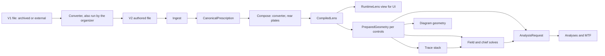
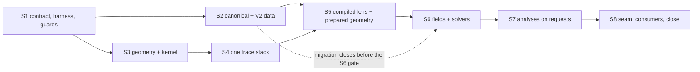

# Optics Engine Rewrite Specification

Restructure the lens optics engine and the authored lens-data format so the engine is easier to understand, change and
verify. Adopt the tighter intersection-accuracy contract from
[PR #774](https://github.com/ronbuening/LensVisualizer/pull/774) everywhere, and take the speed gains the restructure
makes available. Stage 1 has merged to `engine-next`; Stages 2 to 8 are future work.

Priorities, in order: **maintainability**, then **accuracy** (the contract below), then **speed**. When they conflict,
the higher priority wins and the PR description records the trade-off.

## Outcomes

The program is complete when every outcome below holds on `main`. Each outcome is checked by a guard test or script
wherever one can be written, and by review otherwise.

| # | Outcome | Checked by |
| --- | --- | --- |
| M1 | One authored lens-data format (V2), with one spec and one template. The app reads only V2. V1 files are read only by the permanent converter, which the organizer runs on any V1 file it finds and which also runs on demand. | Corpus guard: every catalog file is V2; converter and organizer suites; seam guard keeps the V1 mapping out of the app |
| M2 | Lens data is ingested once into a canonical prescription, then compiled once into the engine's lens model. Materials are resolved once, and nothing in the engine clones lens data or points back to the UI view. | The compiler's own tests (S5.P1.T1); architecture guards (S1.P4.T1) |
| M3 | One surface-geometry module and one intersection/trace stack. `src/optics/internal/` and the legacy tracers in `rayTrace.ts` are deleted. | Architecture guards |
| M4 | No runtime import cycles inside `src/optics/`. | Import-cycle guard (S1.P4.T1) |
| M5 | One owner for prepared geometry, with one bounded cache. Every other cache has a named owner, key and capacity. | Cache guard (S1.P4.T1) |
| M6 | Analyses take one explicit request object. There are no `(L, zPos, focusT, zoomT, aberrationT, geometry?)` parameter lists and no `*ForState2` adapters. | Seam guard; review |
| M7 | No `*2` names and no `compat.ts`. Code outside `src/optics/` imports only the public seam (top-level `src/optics/*.ts`). | Seam guard (S1.P4.T1) |
| M8 | The accuracy contract holds on every intersection path. | Analytic suite and high-precision fixtures; differential gates while the program runs |
| M9 | The architecture docs, `public-functions.md`, lens-data spec and recipes describe the new structure, and this plan is deleted. | `docDrift.test.ts`; review |

Speed is a secondary goal. Its gates and targets are under [Efficiency](#efficiency-secondary).

## Evidence

This plan is grounded in the engine and catalog at `main` 33ebdb3, plus the fixes that merged with the plan: three
duplicate-value corrections in lens data and the generated rear-plate rim fix.

### Engine

Scope: 161 files and 36,774 lines in `src/optics/`, excluding `mount/` and the glass catalog data.

- **Two exact tracers.**
  - The prepared-state tracer lives in `trace/` and `math/intersection.ts`.
  - The legacy tracer is `internal/exactSurfaceTrace.ts` plus `internal/surfaceIntersection.ts`; with `rayTrace.ts` and
    `internal/traceSurfaces.ts`, the legacy layer is 2,652 lines.
  - The legacy tracer still runs in production: in `buildLens` constants (`runtimeLens.ts`), in the chief-relative skew
    rays used by off-axis bundles, coma, spherical aberration, bokeh, field curvature and scalar chromatic fans, in
    off-infinity pupil baselines, and in folded validation.
- **The engine lens is built from the UI view.**
  - `normalizeLensData.ts` builds the engine lens from a finished `RuntimeLens` and keeps a `runtime` back-pointer.
  - `prepareState.ts` reads that back-pointer.
  - Twenty-two prepared-state modules read `state.lens.runtime`.
  - Materials are resolved twice, and lens data is `structuredClone`d twice.
- **One 13-module runtime import cycle**, around `compat.ts`: `optics.ts`, `projection.ts`, `distortionAnalysis.ts`,
  `vignetteAnalysis.ts`, `pupilAberration.ts`, `groupMovement.ts` and six `analysis/` modules.
- **Duplicated concepts.** About twenty concepts are implemented twice or more:
  - layout and thickness;
  - zoom-table interpolation (five copies);
  - focus breathing, with two different infinity thresholds (0.003 and 0.0001);
  - lens compilation;
  - dispersion tables;
  - channel wavelengths;
  - aspheric comparison;
  - chromatic bar scaling;
  - display sag;
  - paraxial tracing;
  - pupil geometry;
  - prepared-state caching (an LRU of 96, an unbounded store, and eight uncached call sites in `field/chiefRay.ts`);
  - z-position overrides;
  - field barrels.
- **Adapters and names.**
  - Analyses that take a prepared state unwrap it back into `(L, zPos, focusT, zoomT, aberrationT)` and call the
    `RuntimeLens` implementation.
  - There are 176 `*2` exports, and only two of them are imported outside `src/optics/`.
- **The de-facto public surface.**
  - Outside code imports 49 `src/optics/` modules: 32 in the app and 17 in tooling.
  - The official barrel `index.ts` has no importers.
  - `RuntimeLens` is used by 52 non-optics source files.
  - 57 test files import engine internals or `*2` names, and six test files mock seven engine modules by path.

### Cost

Measured with CPU profiles and evaluation counters on the slowest benchmark lens, PC-Nikkor 19mm. Wall time goes to
the number of kernel evaluations, not to preparation or adapters:

| Measurement | Default analysis | Stopped-close (shift + tilt) |
| --- | --- | --- |
| Sag + slope self time | 42% | 32% |
| Bracket scan (inclusive) | 23% | 26% |
| Garbage collection | 4% | 15% |
| `prepareState` and every adapter function | ≤ 0.6% | ≤ 0.6% |
| Surface-profile evaluations per intersection | 5.8 | 7.8 |
| Dominant nested solve | Distortion's image-height inversion, 58%: bisection over chief solves of ~64 stop traces each | Sensor-locked field sampling, 78%: `solveScalarRoot`, ~86 evaluations per solve |

Spheres and conics have no closed-form path. Every curved surface is bracketed (an endpoint test, then up to 24 samples)
and solved by safeguarded Newton, and each evaluation computes both sag and slope. The Sony FE 24-70mm GM II and Canon
Serenar 50mm f/1.8 show 5.3 and 5.0 evaluations per intersection, so the pattern is general.

### Lens data

907 files: 18,991 surfaces and 10,265 elements.

- **Per surface.**
  - Every surface repeats `nd` and `elemId`. The 8,719 air surfaces (46%) carry `elemId: 0, nd: 1`.
  - Surface and element indices agree in every lens, so one `medium` reference can carry the index.
  - `elemId` means three things: the drawn span, the dispersion medium and the absorbing medium. These diverge on the 14
    mirror and blocker surfaces.
  - Four surfaces in two lenses are non-air media with no element: water in front of the Nikon RUW 20-35, and three
    cement layers in the Hasselblad XCD 90 that are traced but not drawn as elements.
- **Variable gaps.**
  - `var` is `[focusKeyframe]` on primes and `[zoomStation][focusKeyframe]` on zooms; the shape is decided by
    `zoomPositions`.
  - Its first value duplicates `surface.d`; the two are exactly equal in all 2,195 gaps.
- **Per-station facts are spread across parallel structures.**
  - Six parallel per-station structures: `zoomPositions`, `nominalFno`, `zoomStopSemiDiameters`, `zoomCloseFocusM`, the
    `var` rows and the `publishedStations` indices.
  - `finiteConjugates` uses a second addressing scheme, normalized `focusT`/`zoomT`.
  - On zooms, `focalLengthDesign` and `zoomLabels` are `[wide, tele]` endpoints in 270 and 243 files, and per-station in
    27 and 48, with no marker saying which form a file uses.
- **Magic values and padding.**
  - All 1,288 flat surfaces are written `R: 1e15`.
  - The V1 schema requires K and A4–A14 on every asphere, so all 1,456 entries list them, zero when unused.
  - 499 files author an empty `asph`.
  - The stop `sd` is required, but the engine overwrites it in 891 of 907 lenses: from `nominalFno` in 889 and from a
    published radius schedule in 2.
    - Shrinking all 889 authored values to 10% changes no computed value.
    - The only path that can read them is generated rear-plate rims, and no current lens triggers it.
    - The spec says the authored value sets the entrance pupil.
- **Fields in the wrong place, or unread.**
  - Display, ray-sampling and validation knobs sit beside optical fields.
  - Three authored fields have no reader: `zoomLabels`, `apertureBlades` and `apertureBladeRoundedness`.
  - Defaults are merged invisibly in several places, and `src/lens-data/defaults.ts` imports an engine internal.
- **The spec contradicts the code in nine places.**

## Baseline and accuracy contract

- **#774 merged on its own, ahead of the program,** as `79899f4d`.
- **R0** is its parent, `d49857ae`. **A0** is the Stage 1 PR's merge commit on `engine-next`, tagged
  `optics-rewrite/s1`; it contains #774.
- Every differential comparison and speed measurement uses A0 or a later anchor (see
  [Anchors and comparison coverage](#anchors-and-comparison-coverage)), or the promotion merge commit for the
  Stage 2 gate alone. R0 is measured once, in S1.P1.T1, only to size the contract's own cost.
- **The intersection contract** is #774's, and its documentation owns it: `agent_docs/architecture/optics-engine.md`
  (Exact Surface Trace) and `agent_docs/decisions.md` (2026-10-08). It covers the `1e-12` mm raw residual target and
  the 72-iteration cap, the residual definitions, the raw-target-first roundoff envelope, and cap selection.
- **Closed form gets no exemption.** A closed-form root, which Stage 3 adds for spheres and conics, is accepted under
  the same residual definition and rule as an iterative one (S3.P2.T1).

#774 reported these costs, which this program carries as known debt:

- PC-Nikkor 19mm default analysis +3.5% in the Stage 1 baseline below: 123.84 ms at R0, 128.22 ms at the Stage 1
  head. #774 itself reported +91.88% on linux/x64, with follow-up pairs that disagreed (−5.60% isolated, +10.19%
  replayed); the baseline does not reproduce that figure;
- the analysis category +8.31%;
- +0.291 Newton steps per curved hit;
- eight accepted Mirotar success→clipped transitions.

**The Stage 1 baseline** (S1.P1.T1) is the paired run of R0 against the Stage 1 PR's head `459e6d01`, on 2026-10-12.

- Machine: Apple M4 Pro, 14 cores, darwin/arm64; Node v24.15.0, V8 13.6.233.17-node.48.
- Samples: 15 after 2 warmups per case, in two processes, 8 pairs with R0's bundle loaded first and 7 with the
  head's.
- Between R0 and that head the engine differs by #774, by the glass catalog entries #776 and #777 added, and by the
  three unimported modules S1.P4.T1 deleted. The PR's commits after `459e6d01` change documents and records only.

| PC-Nikkor 19mm analysis | Run | R0 median (ms) | Head median (ms) | Head / R0 | 95% interval |
| --- | --- | ---: | ---: | ---: | --- |
| default | whole matrix | 123.84 | 128.22 | 1.035 | 1.030 to 1.054 |
| stopped-close | whole matrix | 2167.17 | 2191.57 | 1.011 | 0.989 to 1.024 |
| default | heavy set | 126.91 | 133.89 | 1.055 | 1.038 to 1.082 |
| stopped-close | heavy set | 2145.59 | 2215.67 | 1.033 | 1.024 to 1.045 |

- **The stored R0 median is 123.84 ms,** from the whole-matrix run, which is the command S1.P1.T1 names. With the 3%
  tolerance of gate 3 the limit is 127.56 ms.
- A heavy-set median is comparable only with another heavy-set run, whose cells run on the caches the cells before
  them left (`agent_docs/benchmarks/README.md`).
- Retained heap at the end of the memory session: 32.11 MB at R0, 32.50 MB at the head, a ratio of 1.012.
- The three records are in `agent_docs/benchmarks/paired/`, named `2026-10-12T16-*-base-d49857ae-head-459e6d01*`.

Stage 3 must bring PC-Nikkor 19mm default analysis back to at or below its stored R0 median, within the tolerance
of [Efficiency](#efficiency-secondary) gate 3.

A review of #774 before it merged found these, which Stage 3 closes:

- **Stall rule.** A roundoff-limited root leaves Newton taking steps of a few ulps, never exactly zero, so neither
  stall test fires until bisection has collapsed the bracket. That takes up to 63 iterations, and about one rim or
  exterior ray in a million failed at the original cap of 48. #774 raises the cap to 72 and leaves the rule as it is
  (S3.P2.T4).
- **The cap search depends on the unbounded solve.** `intersectSurfaceProfile` returns before the cap search when the
  unbounded solve fails, so a numerical failure outside the cap can hide a root inside it (S3.P2.T1).
- **Certificate gate.** The asphere uniqueness certificate is refused when coordinate roundoff exceeds the residual
  tolerance. At 1e-12 mm that is an operand sum of 281 mm (281 m at 1e-9), and beyond it each in-cap hit pays the
  ordered 24-sample scan: 6 → 25 profile evaluations on one measured ray. Stage 1 counted 927 refusals in one Tier
  P capture of 5,847 records, and S3.P2.T2 fixes it.
- **Legacy hits beyond |R|** are floor-assisted without being roundoff-limited, up to about 1e-8 mm. They are
  exterior and always clipped, and they go when the legacy solver delegates (S3.P2.T3).
- **`intersectRayPlane`,** which lands rays on the image and sensor planes, does not validate its residual (S3.P2.T1).

The Stage 1 fixtures added one more, which Stage 3 also closes:

- **Grazing chord** ([#779](https://github.com/ronbuening/LensVisualizer/issues/779)). A ray whose chord through a
  sphere is shorter than one step of the 24-sample bracket scan is reported as a miss by both solvers. Closed-form
  roots close it for spheres and conics (S3.P2.T1), and for the legacy solver when it delegates (S3.P2.T3). A short
  chord on a polynomial asphere still depends on the scan, and S3.P2.T2 checks it.

## Integration model

Stages 1 to 5 merge to an integration branch, `engine-next`, through ordinary squash-merged PRs. `engine-next` merges
into `main` once, after the Stage 5 gate, and Stages 6 to 8 then merge to `main`. On either branch this is
[branch by abstraction](https://martinfowler.com/bliki/BranchByAbstraction.html): there is one engine at every commit.

- **Replacing something too large for one step.** Put the new implementation behind the existing function, move the
  callers over in later steps, then delete the old implementation in the phase's last step.
  - There is no parallel candidate package, no engine selector and no `traceMode`.
  - A step leaves its branch releasable, and each step can be reverted on its own.
- **Why an integration branch through Stage 5.**
  - Production stays on the engine it has until Stages 1 to 5 are verified together. No intermediate C1 or C2
    change reaches users, and the program can be paused or dropped at no cost to `main`.
  - `main` takes lens and audit PRs almost daily. They do not run the harness, and a harness failure cannot block
    one.
  - The branch's engine can be compared with `main`'s at any time, which measures drift against production itself.
  - The branch ends at Stage 5 because Stages 1 to 5 are internal to the engine. Stages 7 and 8 rewrite the analysis
    hooks and about a hundred importing files, which would collide with UI work on `main`.
- **What keeps the branch from becoming one large unreviewed change.** The optics-2 migration ended as
  [#518](https://github.com/ronbuening/LensVisualizer/pull/518), a 193-file PR.
  - Steps stay one PR each, into `engine-next`, under the same gates.
  - `main` is merged into `engine-next` weekly, as a merge commit, through a PR whose own `engine-diff` job checks
    the merge. Tier P of `engine-next` against `main` is then run, and its result recorded in that PR. A merge that
    brings engine-file changes from `main` moves the anchor
    (see [Anchors and comparison coverage](#anchors-and-comparison-coverage)).
  - The catalog stays V1 on both branches until promotion: Phases 2.5 and 2.6 run on `main` afterwards. A lens
    audit on `main` therefore never conflicts with a converted file.
- **Every engine change goes to `engine-next`** while the branch lives, whether or not it is a step of this plan, and
  passes the same gates as a step. `main` takes lens data, content and UI. An intentional engine behavior change moves
  the anchor only under the rule in [Anchors and comparison coverage](#anchors-and-comparison-coverage).
  - **What a lens batch on `main` still changes in engine files.** The glass catalog rows it needs, and now and then
    a validator allowance or a teleconverter composition rule. Lens work cannot wait for `engine-next`, so these land
    on `main`,
    reach `engine-next` in the weekly merge, and move the anchor there.
- **Promotion.** After the Stage 5 gate, `engine-next` merges into `main` as a merge commit, never a squash, so the
  anchor tags stay reachable from `main`. The promotion PR carries:
  - Tier F of `engine-next` against `main`, under the loosest change class merged. It runs on the head that is
    promoted, after a last merge of `main` into `engine-next`. A change `main` takes after that is covered by the
    promotion PR's own `engine-diff` job, which runs on the merge result;
  - the benchmark and memory comparison against `main`;
  - a check of the branch's preview deployment;
  - the changelog entries for what users will see.

  Promotion needs Phases 2.1 to 2.3 merged, so that the promoted engine reads both formats. The promotion merge
  commit is tagged `optics-rewrite/promotion`: the Stage 2 gate compares against it. `engine-next` is deleted once it
  has merged.
- **One step per PR.**
  - Title: `S<stage>.P<phase>.T<step> <behavior>`.
  - The body states the change class (C0–C3), the gate tier and anchor used, payload and status counts, every
    declared expected difference, and any declared comparison exceptions.
  - **No mixed PRs.** A PR changes engine code or prescription semantics, never both. Format-only data changes
    (unchanged semantic fingerprint), such as the S2.P5 conversion batches, carry no engine code.
  - Steps within a phase merge in order. Phases run in parallel only where [Stage dependencies](#stage-dependencies)
    allow.
  - **Stage 1 is the exception.** It is one PR with one commit per step, in plan order, because every step is C0
    tooling and the harness it adds verifies the PR itself. Each commit message starts with its step ID, and each
    commit passes the checks on its own. Later stages stay one step per PR. S1.P3.T1, structural work counters, was
    built in that PR and withdrawn from it: Stage 1 has seven steps, and their IDs are unchanged.
- **Checkpoints.**
  - The PR that ends a phase or stage carries that gate's results in its description.
  - When a stage gate passes, the commit the gate ran on is tagged `optics-rewrite/s<N>`. From Stage 2 on that is a
    commit of the branch the program merges to, never a PR's head. Stage 1's gate ran before merge, and its merge
    commit carries the tag.
  - No empty commits and no custom gate runner: CI on the PR's head commit is the per-step gate.
- **Docs move with the code.** Each step rewrites, in the same PR, the architecture text it makes stale, and
  supersedes any decision it overturns. For example, S4.P2.T4 rewrites the two-tracer description in "Exact Surface
  Trace" in `agent_docs/architecture/optics-engine.md`. S8.P2.T3 is a final consistency pass, not the first update.
- **Tests move with the code they test.**
  - Behavioral assertions keep their expected values.
  - Before an internal is deleted, its tests are rewritten against the replacement at equal or greater strength.
  - Tests that `vi.mock` a module by path are updated in the step that moves that module.

### Anchors and comparison coverage

An anchor is a commit of the branch the program merges to, `engine-next` until promotion and `main` after it, whose
**engine** the stage gates compare against. Anchors track engine revisions only, and a changed lens file never moves
one. Three things do: an engine C3, a merge of `main` that changes engine files, and the catalog conversion, once
(see "Baselines and anchor moves" below).

**Semantic fingerprint.** Each prescription has a semantic fingerprint: a hash of every canonical value the engine or
UI reads, taken after the engine's own authority rules.

- Zero asphere terms count as absent.
- `R` beyond `FLAT_R_THRESHOLD` counts as flat.
- A stop radius the engine derives counts as derived, whatever number was authored.
- Numbers compare bit for bit, with `-0` normalized to `0`.
- Provenance is excluded: source paths, comments, formatting, authored-versus-default flags, and authored values the
  engine ignores.

A V1 file and its V2 conversion therefore share a fingerprint, while any change the engine or UI could observe changes
it.

Before S2.P1.T1, the fingerprint hashes the evaluated prescription after the lens defaults, under the rules above. Three
readings are fixed until the canonical prescription replaces it:

- An asphere entry whose terms are all zero still counts as present, because the engine builds an aspheric profile for
  it.
- `zoomLabels`, `apertureBlades` and `apertureBladeRoundedness` are hashed: conversion preserves them.
- A default the engine applies inline (`apd: false`, `indexReference: "d"`, an empty `asph`) is not yet equated with
  its omission, so writing one out counts as a semantic change.

**What a differential run compares.** Nothing is skipped silently.

1. **Engine drift.** Every head prescription is evaluated by both the base engine and the head engine. Data changes
   therefore cannot hide engine drift, and no lens is skipped because its data changed.
2. **Format-only data changes.** For each lens whose authored file changed but whose semantic fingerprint did not, the
   base and head prescriptions are evaluated on the head engine and must be bit-identical.
3. **Semantic data changes.** For each lens whose fingerprint changed, and each new lens, the run reports the impact:
   base data against head data, both on the head engine.
   - A changed lens is judged path by path. These block the PR, each at a payload path that both sides have: a
     status that is no failure on the base data and a failure on the head data; a number the engine computed that
     is finite on the base data and not on the head data; and a record, an analysis job or a near-axis probe that
     returned on the base data and throws on the head data, which is how a lens that no longer builds shows.
   - A failure is a status that says `failed`: `failed`, `bracket-failed` and `evaluation-failed`. `clipped`,
     `missed-sensor` and the other statuses are outcomes a prescription may move between. The base status need
     only be no failure, so `clipped` to `failed` blocks as `ok` to `failed` does.
   - A status or a number at a path only one side has does not block, a failure among them included. On the head
     side it is work the base data never did, such as the rays of a sample that used to miss the sensor. On the
     base side it is work no longer done. An array that changed length is paired by index, and the report lists
     each such array that holds a status, an outcome or a non-finite number.
   - A new lens, or a converter pair the base data did not permit, has nothing to compare against and blocks only
     by not building.
   - Everything else in the impact report is reviewed rather than gated. That includes a failure inside a pupil
     bundle, which its digest does not name, and a changed host or converter that loses every pair it had, which
     the report puts first.
4. **Exceptions.** Some prescriptions cannot be evaluated by the base engine, for example a V2 file before V2 ingest
   (S2.P2.T1) exists in the base. The PR lists each such lens under a `## Engine-diff exceptions` heading in its
   description, one backticked lens id per bullet, and the CI job passes the description to `--exceptions`. A stage
   run takes the same ids through the workflow's `exceptions` input. The run fails when the lenses it could not
   compare differ from that list in either direction.
5. **Declared transitions.** Above C0, a status, count, label or shape that differs between the two engines fails the
   run unless the PR declares it, and a declaration the run does not find fails it too.
   - **Where.** Under a `## Engine-diff transitions` heading in the PR description, one bullet per unit. The CI job
     passes the description to `--exceptions`, and the driver reads both headings from it. A stage run takes the
     same bullets through the workflow's `transitions` input, which the maintainer assembles by hand from the PRs
     merged since its base.
   - **Unit.** A difference belongs to the unit its payload path names through its first array index, with any
     index directly behind it: one ray of a fan, one solve, one field sample. A path with no index is its own unit.
   - **Line.** One bullet declares one unit of one record: the lens id, the state id, the request, the path and the
     base and head values of one discrete or shape difference of the unit, a digest of all of them, optionally the
     word `numbers`, and a reason. The harness chooses the named difference and writes the line of every undeclared
     unit to `reports/transitions.md` with the reason left out. A bullet that cannot be read, or has no reason,
     stops the run before it captures anything.
   - **What a line excuses.** The discrete and shape differences of its unit, when the named difference and the
     digest are what the run found. With `numbers` it also excuses, in that unit only, numbers beyond budget in the
     fields that have no counterpart once a ray ends on another surface or stops: the terminal point and direction,
     the image-plane landing and slopes, the medium the ray ended in, and the legacy tracer's `pts`, `ghostPts`,
     `y`, `u` and transmission. `numbers` counts only where the unit's own differences show that the ray ended
     elsewhere, and it permits without asserting. A line never excuses an aggregate, a number in any other field, a
     non-finite mismatch, a number with no class or a residual outside its tolerance.
   - **Common hits and the head side.** Where a ray's hit columns changed length, the hits both sides still have
     are compared under their usual budgets. In every unit with a discrete or shape difference the head side is also
     checked alone: every hit's residual within its `effectiveTolerance`, every converged solve's residual within
     its solver's tolerance, and no new non-finite number. A unit that fails either check cannot be declared.
   - **Not declarable.** A record or an analysis job that starts or stops throwing, and any discrete or shape
     difference in a build, composition or layout record.
   - **Both directions.** The run fails on a difference in a unit no line declares; on a line whose named difference
     or digest is not what the run found; on a line for a compared record in which that unit did not change; and on
     a line whose lens the catalog does not have or the base cannot build. A line for a record outside the run's
     tier, shard or lens is listed and not judged.
   - **Classes.** A C0 PR declares none, and any line fails a C0 run. Under C3 the lines are matched and reported,
     and gate nothing.
   - **Limits.** A PR description holds about 250 lines. What a transition does to a number computed from many rays
     is never excused, and whether such a number may be declared is left open (see S1.P2.T2).
6. **No silent pass.**
   - A record that fails to capture on both engines fails the run. A job that throws inside an analysis record is a
     discrete outcome, compared like any other.
   - The permitted converter pairs are computed on both engines from the head prescriptions, and a difference fails
     the run.

**Baselines and anchor moves.**

- Per-PR gates compare against the PR's merge-base.
- Stage gates compare against the current anchor, catching drift that accumulates across steps that each passed
  alone. Each quantity uses the loosest budget among the change classes merged since the anchor. The Stage 2 gate is
  the one exception: its base is the promotion merge commit (below).
- Declared transitions do not accumulate by themselves. A stage run is given the lines of the PRs merged since its
  base. Where it meets a state no PR run asked, or a unit two steps changed in turn, it prints the line itself, and
  the gate record says which step each such line belongs to.
- A data correction (a C3 on lens data) never moves the anchor. Cross-evaluation keeps comparing its new prescription
  on the anchor's engine.
- An engine C3 moves the anchor only after a cumulative comparison against the previous anchor passes: Tier S, every
  head prescription on both engines. That comparison may show nothing outside the cumulative budgets except the
  differences declared and approved for that change. The PR records the declared differences and the result, and its
  merge commit becomes the new anchor.
- **A merge of `main` that changes what the engine computes moves the anchor.** The glass catalog is engine source,
  and each engine is built with its own copy. A lens batch on `main` that adds a glass row and relabels a glass to
  it leaves `engine-next`'s engine different from the anchor's: the anchor's engine cannot resolve the new glass, so
  the two disagree on that lens's chromatic indices by far more than any budget. A validator rule or a teleconverter
  composition rule changed on `main` does the same. A changed lens file does not, because both engines are handed
  the same file.
  - **Which merges.** One that changes a file under `src/optics/` other than a `*.md`, or whose own `engine-diff`
    run shows engine drift or a lens the engine before the merge cannot build. A merge that brings only lens data,
    content and UI leaves the anchor where it is.
  - **Before the merge PR merges:** Tier S of the head of `engine-next`, the commit that will be the merge's first
    parent, against the current anchor, under the loosest class merged since it and with the transitions those PRs
    declared. It checks every step since the old anchor on the lenses then in the catalog. No step merges in
    between, and a failure holds the merge until it is understood and the run repeated. The first such merge, #788,
    landed before its run; the rule is as written from the next one.
  - **The merge itself** is checked by its PR's two Tier P runs, its own and the one against `main`. The PR names,
    for each lens its own run reports as differing, the change on `main` that explains it, and a difference it
    cannot explain holds the merge.
  - **Then** the merge commit is the anchor. Every anchor moved before the conversion, by a merge or by an engine
    C3, is tagged `optics-rewrite/a<n>` in order: `optics-rewrite/a1` is the first, and A0 is `optics-rewrite/s1`.
    Budgets accumulate from the new anchor.
  - **The merge PR** carries `engine-diff:c3`, because `main`'s reviewed engine-file changes arrive in it and are
    reported, not gated. The label classes that one run. The merge is not an engine C3 under the bullet above, and
    it does not count towards the class of a stage or promotion run.
    - It declares as exceptions the lenses the engine before the merge cannot build.
    - The label waives none of the checks that fail under every class: a format-only difference, a record that
      throws on both engines, an exception that does not match, and a data-impact blocker. A blocker in a lens
      `main` changed is fixed on `main` and the merge taken again.
  - **The efficiency gates keep their base.** A glass row or a validator rule changes no timing worth gating, so an
    anchor moved this way is not a timing base. Each side of a paired run bundles its own catalog, so against A0 the
    differing-prescription warnings on a lens `main` has since changed are expected and listed, and the memory
    record gives each side's lens count and the growth figure beside the absolute one.
  - **What still spans the whole program** is the promotion's Tier F against `main`, which depends on no anchor.
  - **This rule ends at promotion.** After it, lens batches add glass rows on `main` directly, and what that does
    to the Stage 2 gate's base and to the anchor of Stages 6 to 8 is open (see the list after the settled
    decisions).
- **The catalog conversion moves the anchor once.** A base has to build the head's catalog, and no commit older than
  V2 ingest (S2.P2.T1) reads a V2 file. Against an older anchor, every converted lens would be a declared exception
  and a stage gate would compare no engine output.
  - The commit of `main` on which the Stage 2 gate passes becomes the anchor and is tagged `optics-rewrite/s2`. It is
    the commit that closes the migration (S2.P5.T9), or a later one if the gate needed a fix.
  - The Stage 6, 7 and 8 gates compare against it, so the migration closes before the Stage 6 gate.
  - The comparison from the anchor before it is carried in three parts: the Stage 5 gate and the promotion's Tier F,
    both on the V1 catalog, and the Stage 2 gate, which compares the new anchor with the promotion merge commit.
  - Budgets accumulate from the new anchor. A Stage 6 step that merges before it is judged in the Stage 2 gate under
    its class and is part of the new anchor, so the Stage 6 gate covers only the steps after it.
  - No engine C3 merges between promotion and the new anchor: its cumulative comparison would need the old anchor,
    which cannot build a converted lens.
  - The efficiency gates move with the anchor. From the Stage 6 gate on, gates 1 and 2 are judged against
    `optics-rewrite/s2`, and each stage's report also gives the product of the paired ratios back to A0.

## Numerical contract

Arithmetic is Float64 throughout. Units are mm, nm for wavelengths, degrees at field APIs and lp/mm for MTF.
Coordinates are X sagittal, Y meridional and Z axial.

Every PR declares exactly one change class:

| Class | Meaning | Gate |
| --- | --- | --- |
| **C0** refactor | No numeric change intended | Every payload number is bit-identical to the merge-base (`Object.is`); discrete fields are equal |
| **C1** equivalent numerics | Same mathematics evaluated differently: reassociation, fused evaluation, a closed-form root under the same residual rule | Quantity budgets below; discrete outcomes identical, or each boundary transition listed and explained |
| **C2** algorithm replacement | A different solver or search with the same or a tighter convergence criterion | Every sample meets its criterion; differences within the C2 budgets; an independent reference shows the error is no worse; discrete transitions explained individually |
| **C3** intentional behavior change | A bug fix, a data correction or a new capability | Maintainer approval; independent evidence (analytic case, comparator or source); for an engine change, the cumulative comparison before the anchor moves; a changelog entry if users can see it |

- **Default class and labels.** The default class is C0. The CI job reads the class from a PR label
  (`engine-diff:c1`, `engine-diff:c2` or `engine-diff:c3`; no label means C0) when it runs, so re-running the job
  picks up a changed label. Only the maintainer applies a label above C0.
- **Golden values.** Golden and analytic test tolerances are ceilings. Only a C3 PR may change a golden value or loosen
  a tolerance, and it must say why.
  - **A pin on rounding-level bits is not a golden value.** A test that holds a rounding-dependent value bit for bit
    may be updated by a C1 step when the new value is within the quantity budget of the old one. The PR lists each
    pin with its file, its old value and its new one.

### Quantity budgets

S1.P2.T2 confirmed these values against the payload differences a known C1 perturbation produces: reordering the even
asphere terms in sag evaluation. Over the whole of Tier P the largest difference in any class was 6.8 times inside its
budget. That perturbation moves aspheric surfaces only, so layout sums, refractive indices and the first-order ratios
are unmeasured. Loosening a budget later is itself a C3 change.

| Quantity | C1 budget | C2 budget |
| --- | --- | --- |
| Unclipped surface hit, image-plane landing | 1e-9 mm | — (traces are not C2) |
| Clipped, exterior or diagnostic hit | 1e-7 mm, or 1e-12 of the point's own size where that is more | — |
| Direction cosines | 1e-10 | — |
| First-order scalars (EFL, BFD, pupil positions and sizes, stop SD) | 1e-12 relative | — |
| Chief-ray launch height | 1e-9 mm | Twice the solver's stop-residual tolerance (1e-7 mm today), mapped through ∂y_stop/∂y_launch |
| Field angle from image height | 1e-10° | Both solutions' image heights within twice the inversion tolerance (1e-4 mm today) |
| Analysis lengths (focus shifts, blur, field curves, pupil shifts) | 1e-8 mm | The governing solver criterion, propagated by a finite-difference derivative the harness computes |
| Percentages (distortion, illumination) | 1e-8 points | As above |
| MTF modulation | 1e-7 | As above, and never looser than 1e-4 |
| Weighted bin statistics of a bokeh profile (bin density and energy share, centre and rim density, their ratio) | 1e-10 relative | Same as C1 |
| Ratio of two analysis lengths (coma tail skew, sagittal over tangential span of a spot) | 1e-8 relative | Same as C1 |
| Statuses, counts, sample positions and order, labels, warnings | exact unless declared | exact unless declared |

How `budgets.ts` applies the table:

- **Clipped or not.** A hit takes the unclipped or the clipped budget by its own flags. A flag that differs between the
  two sides is a discrete transition.
- **Relative budgets** bound `|a − b|` by the budget times the larger magnitude. Lengths also have an absolute floor of
  1e-12 mm, so a length at zero has a bound. Ratios such as f-numbers and the Petzval sum have no floor, and neither
  has a weighted bin statistic or a ratio of two analysis lengths.
- **A clipped or diagnostic point far from the lens.** The 1e-7 mm of the table is the whole budget for a point
  within 100 m of the lens. Beyond that the bound is 1e-12 of the point's own size. A clipped ray that the legacy
  tracer follows as a ghost path can leave the lens altogether: on one catalog lens its points run from 3.1e8 mm to
  1e250 mm, where adjacent floating-point values are more than 1e-7 mm apart and two engines that agree to rounding
  cannot meet an absolute bound. The first Tier S against A0 failed on that one ray and on nothing else.
- **Fields the table does not name.** Layout lengths, refractive indices and prescription values the engine hands back
  take the first-order budget. Slopes are compared as direction cosines. Count ratios are exact.
- **Bins of a bokeh profile.** A bokeh footprint weighs each ray by its transmission and sums the weights into the
  bins of a radial profile: a bin's density and energy share, the centre and rim densities, and the centre-to-rim
  ratio. The footprint's record holds the weights, as `points[].weight`.
  - Where every point has one and the same weight on both sides, these are ratios of counts and stay exact. That is
    every lens with no absorbing element. A difference is a ray that changed bin: a discrete transition, declared
    like any other.
  - Through an absorbing element they are sums of exp(−α · path), whose last bits move when a hit moves inside its
    tolerance: on the Minolta STF 135, S3.P2.T1 moved 328 of them, by 1.6e-13 of themselves at most. They are
    bit-exact under C0 and held to 1e-10 relative under C1 and C2, with no floor. The weights are never negative,
    so a faint bin moves by no more of itself than a full one, and a bin that is zero on one side only has gained a
    ray. A ray that changes bin in such a footprint fails as a number beyond budget, which no transition line
    declares.
  - The blur character of spherical aberration bins rays of one weight on every lens: the engine multiplies no
    transmission into it. Its five statistics are ratios of counts and stay exact.
- **Ratios of two analysis lengths.** `tailSkewRatio` is the longer extent of a spot from its centroid over the
  shorter, and `sagittalToTangentialRatio` one span of a spot over the other. Each length is allowed 1e-8 mm and a
  sharp spot is some thousandths of a millimetre across, so such a ratio cannot be held to the 1e-10 of a fraction:
  S3.P2.T1 moved the extents by 1.2e-13 mm and 17 ratios by 1.07e-10 to 2.95e-10 of themselves. They are held to
  1e-8 relative under C1 and C2, with no floor. That is a fixed bound: far tighter than the lengths' own budget
  implies for a spot under a millimetre across, and looser for a wider one, where the lengths' own rows, in the
  same record, are the tighter ones. A pupil footprint's aspect and centroid offset are measured in fractions of
  the pupil and keep the budget of a fraction.
  - Two smooth ratios stay at 1e-10 although their parts imply more: `chiefRayCorrection`, a solved launch height
    over a paraxial one that is under 1 mm at the innermost fields, and `mag` of the LoCA inset, a constant over
    the largest focus shift where its bars are clamped. Neither is a ratio of two analysis lengths.
- **A hit's `effectiveTolerance`** is bit-exact under C0, as every number is, and held to 1e-12 relative under C1 and
  C2, with no absolute floor.
  - It is the 1e-12 mm target except at a stalled root, where it is a computed float, max(1e-12, 16·ε·scale) over the
    ray's operands, whose last bits move when arithmetic is reordered. A relaxed tolerance is far outside that budget.
  - Which of the two a hit was accepted under is a branch of the root finder. A tolerance that is exactly the target
    on one side and not on the other is a discrete transition, declared with the others, and not a number beyond
    budget.
- **Residuals are contract checks,** not differences. A hit's residual is held to the `effectiveTolerance` beside it,
  and a solver's residual to that solver's own tolerance where the solve converged on both sides.
- **Step-function outputs.** The result of a bisection or an optimizer takes the same budget as any other field of its
  kind. When it fails, the report names the solver and gives the difference in solver quanta, so a boundary transition
  can be told from drift.
- **Nested traces: contract and flags only.** A trace, a posed pair of traces or a pupil bundle nested in an analysis
  result is written as a digest, `{ status, hitCount, hash, outcome, residualShare, largestTolerance }`.
  - `hash` covers the whole normalized content. `outcome` is a second hash of the same content with every budgeted
    number masked, so it changes exactly when something discrete does: a member present or absent, an array length,
    a string, a boolean, a null, a NaN or infinity, a count, a surface index.
  - `residualShare` is the largest |residual| / `effectiveTolerance` of any hit inside, and `largestTolerance` the
    largest `effectiveTolerance` inside. Each is null when no hit carries it.
  - Under C1 and C2, `status`, `hitCount` and `outcome` are exact, and a difference in `outcome` is a discrete
    transition at the digest's path. `residualShare` is a contract check: where it differs between the two sides,
    the head's value must be at most 1. `largestTolerance` is held as a hit's `effectiveTolerance` is, so the head
    cannot meet that contract by relaxing the tolerance.
  - A `hash` that changed while those hold is reported and not budgeted. How far the coordinates and directions
    inside a nested trace moved is not judged, nor is an effective tolerance below the largest of its trace: that
    is the accepted limit of this rule.
- **Pupil constants.** The pupil positions and sizes built from the engine's two near-axis rays, one at a height of
  1e-4 mm and one through the first vertex at a slope of 1e-4, keep the first-order budget.
  - The budget is not divided by 1e-4. A hit that moves along its ray inside the 1e-12 mm contract moves a stop
    height by that distance times a slope, and both rays' slopes scale with 1e-4, which the quotient removes.
  - When one of those rays fails, the engine takes another value with no flag in any payload. The `traces` record
    therefore traces two such rays as probes on each tracer, and a probe that stops returning is an exact status
    difference.
  - On the prepared tracer the probes are the engine's own launches. On the stack tracer they are the same two ray
    lines through that tracer's public entry, so a basis ray that fails only from the engine's own start point is
    not shown. A folded lens has no probe.
- **Iteration and evaluation counts** are exact under C0, and above it are reported as a histogram of changes.
- **Non-finite values** compare exactly in every class.
- **A class is required only above C0.** Under C0 every number is compared bit for bit, classed or not. Under C1 or
  C2, a number that moves and has no class fails the run and names its path.

## Verification

### Gates by level

| Level | Where | Required |
| --- | --- | --- |
| Every PR | CI (`.github/workflows/quality.yml`) | lint, format, typecheck, `npm run test`, the tooling suite, build and `seo:audit` (all existing) |
| Engine or lens-data PR: touches `src/optics/**`, `src/types/**`, `src/lens-data/**` other than `*.md`, `src/utils/catalog/**`, `src/utils/featureFlags.ts`, or the harness itself | CI job `engine-diff` (S1.P2.T2) | Tier P against the merge-base under the PR's change class, plus every changed or new lens through every Tier P request |
| Phase end | The PR that ends the phase | Every test the phase's steps added, run together; the phase exit criteria |
| Weekly merge of `main` into `engine-next` | The merge PR's CI, then a run of the driver; a stage run when the anchor moves | The merge PR's own `engine-diff` job under its declared class; then Tier P of `engine-next` against `main`, recorded in that PR. When the merge changes what the engine computes: Tier S of the head before the merge against the anchor, after which the merge commit is the anchor |
| Stage end | GitHub Actions: `engine-diff-stage.yml` by `workflow_dispatch`, sharded as a matrix (S1.P2.T3). Dispatch needs the workflow file on `main`, so a stub of it is on `main` (#789); a run on `engine-next` then uses that branch's version. A push to `engine-diff-stage/<name>` runs Tier S of the pushed commit against itself, which is what the Stage 1 gate and a PR that changes the workflow need. Timing runs on the maintainer's machine. | Tier S against the current anchor (the Stage 2 gate: against the promotion merge commit); the full suites; build; the stage's efficiency report; then the tag |
| Promotion, after the Stage 5 gate | `engine-diff-stage.yml`, sharded; timing on the maintainer's machine | Tier F of `engine-next` against `main`; the benchmark and memory comparison; the preview deployment; then the merge commit |
| Before S8.P2 deletes code | `engine-diff-stage.yml`, sharded | Tier F against the current anchor |

### Differential harness

The harness lives in `src/benchmarks/engineDiff/` and is driven by `scripts/engine-diff.mjs`. Nothing it produces is
committed. Its own tests (fixtures, budget table and deliberate-drift detection) run in the tooling suite.

It is program tooling. It exists to prove each step of this plan, and S8.P2.T3 deletes it once the final verification
has passed: after the program, engine changes are not compared between two commits.

| File | Role |
| --- | --- |
| `captureEntry.ts` | Vite SSR entry, built like the rendering benchmark. It reaches the engine only through `seamAdapter.ts`, and evaluates prescriptions supplied as serialized input rather than reading its own catalog. It also exports its own catalog as serialized prescriptions, for the driver. |
| `seamAdapter.ts` | Resolves each engine capability from a list of candidate modules and exports, so the same entry runs at both refs when an export is renamed or a module is missing. Today full hit records come only through `compat.ts`, and perspective jobs through `perspective/index.ts`; both are seam-guard legacy entries. A PR that changes the seam updates this adapter in the same PR. |
| `requests.ts` | Defines the tiers as deterministic lens × state × request lists. |
| `payload.ts` | Normalizes payloads: numbers unrounded, in a tagged encoding that keeps `-0`, `NaN` and the infinities; an `undefined` member treated as absent; arrays in authored order; statuses, counts and labels as discrete fields. A per-ray trace nested inside an analysis result is reduced to its status, its hit count, a digest, an outcome digest of its discrete members, its largest residual share and its largest effective tolerance. It also computes each prescription's semantic fingerprint. |
| `budgets.ts` | Holds the quantity table above, keyed by payload path. |
| `compare.ts` | Reports violations, discrete transitions and the largest difference per quantity, and holds the declared transitions to what a run finds. |

`scripts/engine-diff.mjs --base <ref> [--tier p|s|f] [--class c0|c1|c2|c3] [--shard i/n] [--lens <id>]
[--exceptions <file>] [--out <dir>]` runs in six steps, by default Tier P under C0:

1. Add a git worktree at the base ref, symlinking `node_modules` when `package-lock.json` is unchanged.
2. Copy the head's `engineDiff/` into the worktree.
3. Serialize the head's prescriptions, plus the base's for every changed lens, and compute their semantic
   fingerprints.
4. Build both captures and run the comparisons in
   [Anchors and comparison coverage](#anchors-and-comparison-coverage).
5. Write NDJSON payloads, the data-impact report and the list of uncompared lenses to `--out`, or to a temporary
   directory. The small reports sit in a `reports/` folder of their own, which CI uploads. Above C0 they include
   `transitions.md`: a line to paste for every undeclared unit, the units no line can declare, and what each matched
   line covers.
6. Exit non-zero on any violation, when the uncompared lenses differ from the declared exceptions, or when the
   transitions found differ from the declared ones.

Both captures are built with the head's Vite and no config file, and the capture bundle imports no package, so the
base worktree needs nothing installed.

### Corpus tiers

Today's sweep, `exactTraceCatalog.test.ts`, traces one on-axis meridional ray and one skew ray per lens at zoom 0 and 1,
focused at infinity. The tiers below are the program's evidence; they do not replace that sweep.

S1.P2.T3 measures each tier's runtime and records it in that PR. If Tier P exceeds 15 minutes in CI, its lens subset
shrinks by documented stratification; its assertions never do.

| Tier | Lenses | States | Requests |
| --- | --- | --- | --- |
| **P** | Every catalog lens, visible and hidden | First and last zoom station, infinity focus, wide open | Build constants; layout; meridional fans on- and off-axis, a skew fan and a chromatic fan, each with terminal points and full hits, and one on-axis fan through the legacy tracer; field geometry; chief solves at 0, 0.5 and 1 of the analysis half-field |
| | The 15 benchmark lenses plus one representative of each feature: fisheye; folded auto and explicit-order paths; diffractive; bulk absorption; rear plates; a converter pair; PC shift + tilt; finite conjugate; fixed-iris zoom; aberration control. Also every lens whose data changed, and every pair of a changed host or converter | The default state, plus one feature state where the default leaves the feature idle: the moved pose, the finite conjugate, the aberration ring at its end | Every analysis job, perspective jobs included; geometric MTF at a 32-cell grid |
| **S** | All, and every permitted converter pair | Every authored zoom × focus station (about 3,400 states) × {wide open, one stop-down ratio}; for an `aberrationControl` lens also the ring's other positions, both ends of a centered ring or the far end of a two-position one; a pair at every station of its host | Everything in Tier P's first row |
| | A stratified set of about 100 lenses: every Tier P analysis lens, one lens per projection kind, every folded lens, every PC lens, every diffractive and absorbing lens, one lens per rear-plate maker, every converter pair, and 10 drawn by a fixed seed | Their authored stations, wide open; a PC lens also in the moved pose | Every analysis job; MTF at both methods and three spectra on the MTF benchmark lenses |
| **F** | All, and every permitted converter pair | Every authored station × {wide open, stopped down}; a PC lens also in the moved pose | Everything in Tier S, with every analysis job on every lens and pair |

- **Each tier holds the one before it.** Every Tier P request is a Tier S request, and every Tier S request a Tier F
  request; a test holds both.
- **Shards** split a tier by lens, never inside one. The stage workflow defaults to 8 shards for Tier S and 32 for
  Tier F.
- **Every analysis job** means the analysis-context accessors, centered and perspective; field curvature; the three
  group-movement modes; cardinal elements; aspheric comparison; and the readouts the analysis tabs compute outside the
  context: the chromatic field-focus summary, longitudinal chromatic focus, LoCA bar offsets, aspheric departure and
  the effective f-number. A job that throws is recorded as a discrete outcome.
- **A converter pair** is serialized as its host and its converter. Each engine composes them itself, so composition
  drift is visible, and the composed prescription is a payload of its own.
- **Outside the harness:** diagram geometry (`src/optics/diagram/`), the lens-movement transform and the perspective
  diagram fan. Their unit suites cover them.

### Independent references

The old engine demonstrates compatibility, not physical correctness. These references stand outside it.

- **Analytic suite.** Keep every existing analytic and golden test, and add:
  - closed-form sphere and conic intersections, checked against roots computed offline to at least 50 significant
    digits;
  - asphere roots, checked against the same kind of reference;
  - root-solver convergence on functions whose roots are known.

  Each fixture is committed beside the script that generated it.
- **Comparator report.**
  - [LensVisualizerRayTraceComparator](https://github.com/ronbuening/LensVisualizerRayTraceComparator) defines the
    case format (its contract v1) and exports LensVisualizer cases itself, by importing this repository's source.
    Stage 1 therefore ships no export script. Stage 3 decides whether this repository needs one.
  - From Stage 3, each stage PR reports the comparison.
  - Like MTF chart agreement, it is a report and never a test threshold.
- **When a reference shows the old engine was wrong.** Either fix it in a separate C3 PR with an analytic test, which
  moves the anchor under the anchor rule, or record an approved divergence with its evidence. Never reproduce a known
  bug for parity.

### Architecture guards

`__tests__/src/optics/opticsArchitecture.test.ts` scans source the way `docDrift.test.ts` does. It holds three guards,
each with up to two lists:

- **Legacy exceptions** are today's violations. This list is a one-way ratchet: an entry can only be removed, and the
  test fails when a listed entry no longer violates, so the list cannot go stale. Moving an entry to the registry
  counts as a removal. It is empty by S8.
- **The approved registry** holds modules that meet the rule by design. A reviewed PR may add an entry only if it meets
  that guard's admission rule. New barrels and relocated caches enter here, never through the legacy list.

The guards:

- **Import cycles.**
  - The test builds the runtime import graph of `src/optics/` and computes strongly connected components. An edge is
    an import, re-export or `import()` that carries at least one value; type-only forms add none.
  - Legacy exceptions start as today's 13 cycle modules.
  - There is no registry: no cycle is ever approved.
- **Seam.**
  - Imports into `src/optics/` from the rest of `src/`, from `scripts/` and from `reports/` must target a registered
    or legacy-listed module. Type-only imports count, and so do the path strings that scripts load.
  - Tests are not importers: they follow the internals they test. Targets under `src/optics/mount/` are out of scope.
  - Registry admission, which the test checks: a top-level `src/optics/*.ts` file that holds only imports, re-exports,
    type declarations and aliases of imported bindings. Alias barrels due for deletion in S8 leave the registry when
    they are deleted.
  - Legacy exceptions are today's outside-imported modules that fail admission: deep modules and top-level
    implementation files.
  - `prescription/teleconverterCompatibility.ts` is a permanent registry entry, because plain-Node build metadata
    imports it directly.
- **Caches.**
  - Every module-level `Map`, `WeakMap`, `Set` or `WeakSet` in `src/optics/` must be registered or legacy-listed,
    `mount/` and the glass data included.
  - Legacy exceptions are today's unbounded caches: the one unbounded `Map`, and each owner-keyed `WeakMap` whose
    per-owner store has no cap.
  - Registry admission, one of three kinds: a constant lookup table its module never writes; a bounded cache with a
    record of owner, key and capacity; or a `WeakMap` keyed by its owner whose per-owner value cannot grow without
    bound.

## Efficiency (secondary)

### Gates

These apply at every stage end, and failing one blocks the stage. Their base is A0 until the catalog conversion: an
anchor moved by a merge of `main` is not a timing base. The Stage 2 gate reads them against the promotion merge
commit.

1. **No case regresses.** A benchmark case regresses when, against the anchor, both of these hold:
   - the lower bound of the 95% bootstrap confidence interval of its paired median ratio exceeds 1.05;
   - its median grows by more than 1 ms.
2. **Memory.** Retained heap after the scripted session (Node, `--expose-gc`; S1.P3.T2) stays within 5% of the anchor.
   The session runs in a child process per side, and the gate reads the absolute retained heap.
3. **#774 debt.** From Stage 3 on, PC-Nikkor 19mm default analysis is at or below its stored R0 median, within a
   tolerance of 3%.
   - The R0 median is the one the Stage 1 baseline recorded, with its machine, Node version and sample counts. R0 is
     not measured again: later stages delete names the benchmark entry needs to build against it.
   - The head's median comes from a paired run against the current anchor, on the same machine.
   - The tolerance covers the method's own offset. Two copies of one engine, compared at 15 samples, differed by up
     to 2.7% on a case of 20 ms or more.

### Targets

Targets are reported at stage ends and never block. A miss becomes an item in `EFFICIENCY_IMPROVEMENT_PLAN.md`. Any
requirement that must block is written as a test in its step, or as one of the gates above. The targets that are
counts are measured at the stage end with a throwaway instrumented build, which is not committed.

| Stage | Target | Basis |
| --- | --- | --- |
| 3 | Mean surface-profile evaluations per sphere or conic intersection, closed-form and fallback combined, close to 2 (5.0–7.8 today); the fallback rate is reported with its reasons | Sag and slope evaluation took 32–42% of self time. The per-success limit is a test in S3.P2.T1, not a target. |
| 3 | Analysis category median ≥ 25% lower than A0 across the benchmark matrix | Same profiles |
| 6 | Median stop traces per centered chief solve ≤ 8, against ~64 today on the PC-Nikkor 19mm profile (27 across the Tier P capture) | `computeChiefRaySolve2` scans up to 96 samples per expansion, then bisects to a 1e-7 mm stop residual, on a function that is nearly linear in launch height |
| 6 | Median evaluations per `solveScalarRoot` call ≤ 12, against ~86 today on the same profile (40 across the Tier P capture) | It scans from the low end of each interval, not outward from the seed, then bisects up to 30 times |
| 6 | Image-height inversion uses ≤ 6 chief solves per target, against up to 40 bisection steps today | `solveFieldAngleForImageHeightLookup2` bisects a smooth monotone function it has already tabulated |
| 6 | Each unique sensor point is solved at most once per perspective context | Five perspective analyses solve the same sensor points independently, and vignetting does so twice |
| 8 | PC-Nikkor 19mm stopped-close analysis ≥ 2× faster than A0, read as the product of the paired ratios back to A0 | Sensor-locked sampling was 78% of that profile |

### Method

- Same machine and Node version on both sides. Paired mode times in two child processes. Each holds both engines and
  samples every case in pairs, alternating which side runs first; the two processes load the engines in opposite
  orders, and their pairs are pooled.
- At least 2 warmups and 9 measured samples per case, or 15 samples for cases above 100 ms.
- Raw samples are kept in the run JSON. The statistic for a case is median(head) / median(base). Its interval is a
  percentile bootstrap over pair indices, with 10,000 resamples and a fixed seed.
- Timing gates run on the maintainer's machine, never in CI.
- A base whose `package-lock.json` differs from the head's gets its own installed dependencies, so a dependency bump
  does not end comparisons against an older anchor.
- Results report completed work (successful, clipped and failed counts; field statuses; grid sizes; convergence), so a
  quick rejection is never mistaken for a speedup. Paired mode compares completed work between the sides and sets a
  case with unequal work aside from the regression verdict.
- These never count as speedups: reducing samples, lowering grid caps, returning unsupported results fast, or changing
  a physical model.
- A browser interaction harness (drag and settle times) is deferred: it would only report, and the Node benchmarks
  cover every gate. Add it if interactive feel regresses.

## Target architecture

### Model



| Type | Owns | Lifetime |
| --- | --- | --- |
| `CanonicalPrescription` | The version-independent semantic content, with schema defaults and the engine's authority rules applied. Beside it, kept apart, is provenance: source paths for diagnostics, authored-or-default flags, and authored values the engine ignores. The semantic fingerprint covers only the semantic content. | One per authored file; plain data that can be sent to a worker |
| `CompiledLens` (replaces `EngineLens`) | Indexed surfaces with compiled geometry profiles, media and dispersion resolvers, the stop, path plan, station tables, aperture model, annotations and display constants. It has no reference to `RuntimeLens`. | One per canonical identity, immutable |
| `RuntimeLens` (unchanged name) | The frozen read model the UI consumes, derived from `CompiledLens` plus the first-order constants. The engine never takes it as input. | One per compiled lens |
| `PreparedGeometry` (replaces `PreparedOpticalState`) | Vertex positions, current thicknesses, the image plane and iris for one exact `(focusT, zoomT, aberrationT)`. It shares the immutable surface records. | Bounded LRU per compiled lens |
| `TraceGeometry` | The minimal indexed input the tracer needs: surfaces, vertex z, media, stop index, image plane and path plan. | A view of `PreparedGeometry`, or one built during lens construction |
| `AnalysisRequest` | Prepared geometry, physical aperture, spectrum, field geometry, optional pose, sampling and capture choice. | One per analysis context |

### Directory layout

- **Top-level files** in `src/optics/` are the public seam: barrels and thin facades only. Everything else lives in
  subdirectories that outside code may not import.
- **Final barrels.** They are settled in S8.P1.T1 and enforced by the seam guard. The proposal: `buildLens.ts`,
  `teleconverter.ts`, `optics.ts`, `fieldGeometry.ts`, `projection.ts`, `analysis.ts`, `mtf.ts`, `perspective.ts`,
  `diagramGeometry.ts`, `chromatic.ts`, `glassCatalog.ts`, `publishedStations.ts`, `validation.ts`, `geometry.ts`,
  `types.ts` and `lensDataConversion.ts`. The last exposes the V1 mapping and the canonical printers to the converter;
  the seam guard admits only `scripts/lens-data-convert/` and the organizer as its importers.

| Directory | Contents |
| --- | --- |
| `prescription/` | Canonical types; V2 ingest; schema defaults; composition (rear plates, teleconverter); the compiler; `validate/`; `v1/`, the V1 mapping that only the converter imports |
| `geometry/` | Surface profiles; fused sag and slope; bounds; the intersection kernel; tolerance envelopes; planes; vector math; diffractive phase |
| `trace/` | Interactions; sequential and generalized traversal; path planning; apertures; capture; absorption; ray adapters |
| `state/` | Control interpolation (focus, zoom, aberration); `PreparedGeometry` and its cache; stop and iris; layout; camera anchoring |
| `first-order/` | Paraxial tracing; lens constants (EFL, BFD, pupils, half-field); cardinals; breathing; f-numbers |
| `field/` | Projection; launch; chief-ray solve; field geometry; image-height inversion |
| `math/` | Numerics and root solving |
| `chromatic/` | Channels; index resolution; dispersion tables and quality; the glass catalog and its entries |
| `perspective/` | Pose; frames; sensor targeting; trace context; field sampling; diagram fans; `analysis/` |
| `analysis/` | Request and context; jobs; sampling policy; `aberration/`; distortion; vignetting; pupils; bokeh; chromatic; aspheric comparison; group movement; summary; `mtf/` |
| `diagram/` | Coordinate transforms; element shapes; outlines; render diagnostics; folded-path labels |
| `diagnostics/` | Chief-ray status counts |
| `mount/` | Unchanged; outside this program |

### Module fates

| Today | Fate | Step |
| --- | --- | --- |
| `index.ts`, root `analysisJobs.ts`, `analysis/fieldCurvature.ts` (no importers) | Deleted | S1.P4.T1 |
| `internal/surfaceMath.ts`, `math/surfaceProfile.ts` | `geometry/surfaceProfile.ts`, one implementation of sag, slope and profiles. `layout.ts` `renderSag`/`sagSlope` and `diagram/surfaceOutline.ts` `surfaceSag2` stay as wrappers that call it. | S3.P1.T1 |
| `constants.ts` flat-radius and rim-slope constants | `geometry/surfaceProfile.ts` | S3.P1.T1 |
| `math/intersection.ts`, `math/intersectionTolerance.ts`, `math/plane.ts` | `geometry/intersect*.ts` | S3.P2 |
| `internal/surfaceIntersection.ts` | Delegates to the kernel in S3.P2.T3, then deleted | S4.P2.T4 |
| `internal/exactSurfaceTrace.ts`; `rayTrace.ts` tracers and `traceToImage`; `internal/traceSurfaces.ts` | Deleted. The pupil samplers from `rayTrace.ts` move to `analysis/sampling.ts`. | S4.P2.T4 |
| `internal/lensState.ts`; `prescription/{labels, aspheres, variables, groups, dispersion}.ts`; `prescription/normalizeLensData.ts` | One compiler, `prescription/compile*.ts` | S5.P1.T1 |
| `runtimeLens.ts` (1,111 lines) | `first-order/lensConstants.ts` plus `prescription/runtimeView.ts` | S5.P1.T2 |
| `validateLensData.ts` (1,838 lines), `validateTeleconverterData.ts`, `internal/apertureBands.ts` | `prescription/validate/`, split by concern | S5.P1.T3 |
| `compat.ts` LRU; `trace/rayAdapters.ts` state store; uncached `prepareState` calls; `stateWithRuntimeZ` and `stateWithDiagramZ2` | `state/preparedGeometry.ts`: one owner, one cache, one z-override | S5.P2.T1 |
| `layout.ts` `thick`/`doLayout`/`*AtZoom`/`eflAtFocus`/`effectiveFNumber`; compat `doLayout2`/`thick2`/`*AtZoom2`; `first-order/{focusBreathing, fNumber}.ts`; `apertureStop.ts`; `focusDistance.ts` | `state/layout.ts`, `state/stationTables.ts` and `first-order/`, one of each | S5.P2.T2 |
| `dispersion.ts`; `chromatic/{dispersionAdapter, dispersionQuality, indexResolver}.ts`; `prescription/dispersion.ts`; channel wavelengths in `constants.ts` | `chromatic/`: one table builder, one quality summary, one channel table | S5.P2.T3 |
| `field/chiefRay.ts` (1,384 lines); `field/chiefRayCache.ts` | `field/{fieldGeometry, chiefRaySolve, imageHeight}.ts`; per-geometry cache; `diagnostics/` | S6.P1.T1 |
| `perspective/analysis/shared.ts` sensor helpers duplicating `perspective/fieldGeometry.ts` | One implementation | S6.P3.T3 |
| `analysis/{aberrations, bokeh, distortion, vignetting, pupilAberration, groupMovement, chromatic}.ts` adapters; `analysis/preparedStateAdapters.ts` | Deleted as each family takes `AnalysisRequest` | S7.P2 |
| `aberration/*`, `distortionAnalysis.ts`, `vignetteAnalysis.ts`, `pupilAberration.ts`, `groupMovement.ts`, `chromatic/analysis.ts`, `asphericComparison.ts` (two copies), `chromaticRayFanScaling.ts` (two copies) | `analysis/<family>/`, one copy each | S7.P2 |
| `analysis/mtf*.ts` | `analysis/mtf/`. Inputs change; kernels and orchestration do not. | S7.P4 |
| `compat.ts`; alias barrels (`cardinalElements.ts`, `chiefRayDiagnostics.ts`, `aberrationAnalysis.ts`, `field/fieldGeometry.ts`, the field aliases in `optics.ts`); the 176 `*2` names | Deleted or folded into the final barrels | S8.P1.T1 |

## Lens data V2

### Principles

1. **One fact, one place.** A value the engine reads is authored once. Where V1 holds two copies, the converter checks
   that they agree exactly. Every catalog file agrees today. A file that does not (a new, archived or external V1
   file) is refused with the pair named, and waits for a C3 data correction under `agent_docs/lens-patent-audit.md`.
2. **Records, not parallel arrays.** Every per-station fact lives on its station record.
3. **Explicit over magic.** `R: "flat"` replaces `1e15`; `medium` replaces `elemId` + `nd`; the stop declares whether
   its radius is authored or derived.
4. **Grouped by consumer.** Identity, catalog, source, prescription, states, aperture, annotations, layout, rays,
   checks.
5. **Lossless, mechanical conversion.** The converter never changes a value the engine or UI reads.
   - The semantic fingerprint of a converted file equals that of its V1 source. Provenance (source paths, comments,
     ignored authored values) may differ.
   - Deriving information that can legitimately differ is a later, separately reviewed C3 data PR, never a converter
     side effect. Examples: design focal length versus station focal lengths, `specs`, element `fl`.
6. **Defaults belong to the schema.** They are documented in the spec and applied by ingest with provenance, never by
   spreading an object of defaults.
7. **Naming.** The names in this section are approved as written (2026-10-09). Renaming after S2.P5 would convert the
   catalog a second time, so a later rename is a new format change, not an edit.
   - The prescription columns `R`, `d`, `sd` and `innerSd` keep optical notation, in mm.
   - Every other dimensional field carries a unit suffix.
   - f-numbers are spelled `fNumber`.
   - Field names that are already clear are kept, so the folded-path, projection and plate vocabulary in `CLAUDE.md`
     and the audits stays valid: `opticalPath`, `interaction`, `innerSd`, `projection`, `perspectiveControl`,
     `rearPlates`, `aberrationControl`, `diffractive`, `stopPlacement`, `groups`, `doublets`.

### Shape

Excerpt of `NikonNikkorZ2450mmf463.data.ts` after conversion; the header comment block is unchanged:

```ts
const LENS_DATA = {
  schema: 2,
  key: "nikkor-z-24-50-f4-63",
  maker: "Nikon",
  name: "NIKON NIKKOR Z 24-50mm f/4-6.3",
  subtitle: "JP 2021-189377 A EXAMPLE 1 — KONICA MINOLTA / NIKON",

  catalog: {
    lensMounts: ["nikon-z"],
    imageFormat: "135-full-frame",
    specs: ["11 ELEMENTS / 10 GROUPS", "f = 24.7–48.5 mm", "F/4.08–6.34", "2ω = 82.5°–48.2°", "6 ASPHERICAL SURFACES"],
    elementCount: 11,
    groupCount: 10,
    focalLengthMm: { marketing: [24, 50], design: [24.73, 48.5] },
    fNumber: { marketing: 4, design: 4.08 },
  },

  source: {
    patentNumber: "JP 2021-189377 A",
    patentYear: 2021,
    authors: ["Takakazu Hirose", "Keiko Yamada", "Yasushi Yamamoto", "Hiroshi Yamamoto"],
    assignees: ["Konica Minolta, Inc.", "Nikon Corporation"],
  },

  elements: [
    { id: 1, name: "L1a", label: "Element 1", type: "Negative Meniscus", nd: 1.6968, vd: 55.46,
      focalLengthMm: -28.2, glass: "LAC14 (HOYA)", apd: false, role: "Primary G1 diverging element; convex toward object" },
    // …
  ],

  surfaces: [
    // ── G1: Negative front group (f₁ = −32.86 mm) ──
    { label: "1", R: 71.885, d: 1.2, sd: 15.5, medium: 1 }, // L1a front
    { label: "2", R: 15.312, d: 7.8, sd: 13.5 }, // L1a rear → air
    { label: "3A", R: -298.152, d: 1.57, sd: 12.7, medium: 2,
      asphere: { A4: 1.99678e-5, A6: -8.24417e-8, A8: -2.122e-11 } }, // L1b front (asph)
    // …
    { label: "6", R: 37.81, sd: 12.0 }, // L1c rear → air [VARIABLE: zoom only]; d comes from gaps
    // …
    { label: "STO", R: "flat", d: 3.41 }, // radius derived from the nominal f-number
    // …
  ],

  zoom: {
    stations: [
      { focalLengthMm: 24.726, nominalFNumber: 4.08, label: "Wide" },
      { focalLengthMm: 34.711, nominalFNumber: 5.115 },
      { focalLengthMm: 48.503, nominalFNumber: 6.337, label: "Tele" },
    ],
    apertureModel: "from-nominal-fno",
    step: 0.004,
  },

  focus: {
    closeFocusM: 0.35,
    description: "Internal focus via G3 (2 elements, stepping motor). …",
  },

  gaps: {
    // d6: G1–G2 gap (zoom only — identical inf/close at each position)
    "6": { label: "D6", values: [[19.973, 19.973], [10.326, 10.326], [3.17, 3.17]] },
    // …
  },

  aperture: { blades: 7, bladeRoundedness: 0.7, fStops: [4.08, 4.5, 5.6, 6.3, 8, 11, 16, 22, 32, 36], maxFNumber: 36 },
  groups: [/* unchanged */],
  doublets: [/* unchanged */],
  layout: { scFill: 0.48, yScFill: 0.38 },
} satisfies LensDataV2Input;
```

The canonical field order is the order shown. The converter prints it, so diffs between files stay comparable.

### Field mapping

Every V1 field maps to one V2 location, or is dropped by a rule stated in this table. Fields not listed keep their name
and position.

| V1 | V2 | Rule |
| --- | --- | --- |
| *(none)* | `schema: 2` | Discriminator; ingest dispatches on it |
| `key`, `maker`, `name`, `subtitle`, `visible`, `publishedAt` | unchanged, first in the file | Identity readers move from regex to the AST (S2.P2.T2) |
| `lensMounts`, `imageFormat`, `imageCircleMm`, `specs`, `elementCount`, `groupCount`, `acceptsTeleconverters`, `opticalConfiguration` | `catalog.*` | Same names |
| `focalLengthMarketing`, `focalLengthDesign` | `catalog.focalLengthMm.{marketing, design}` | Value kept as authored, scalar or `[wide, tele]`. The design value stays authored: it is the source's stated range, and it feeds the EFL sanity check and the MTF scale check. S2.P6.T3 adds its consistency check. |
| `apertureMarketing`, `apertureDesign` | `catalog.fNumber.{marketing, design}` | Value kept |
| `patentNumber`, `patentYear`, `patentAuthors`, `patentAssignees`, `sourceErrata` | `source.{patentNumber, patentYear, authors, assignees, errata}` | `errata[].surface` keeps the surface label |
| `surfaces[].nd`, `surfaces[].elemId` | `surfaces[].medium` | An element id, an id in `media`, or omitted for air. Indices come from the medium only. |
| *(air surface with `nd ≠ 1`)* | `media: [{ id, name, nd, vd?, … }]` | Undrawn media; 4 surfaces today |
| `elements[].fromSurface`/`toSurface` | `elements[].span: [from, to]` | Required where the drawn span is not the medium run. Today that means 21 explicit spans and the 14 mirror and blocker surfaces. |
| `elements[].fl` | `elements[].focalLengthMm` | Display; authored until S2.P6.T5 derives it |
| `R: 1e15` | `R: "flat"` | Converted only when `R === 1e15` |
| `asph[label]` | `surfaces[i].asphere` | Sparse. Zero terms are omitted, because V1 required K and A4–A14 on every entry, so a printed zero cannot be told from padding; `K` is omitted when 0. Adding a zero term changes no sum, and schema order stays the accumulation order. A zero an audit relies on is restored by hand as an explicit `0`, which V2 allows (S2.P5). |
| `asph: {}` | omitted | |
| `var`, `varLabels` | `gaps[label] = { label?, values }` | `values` is always `[zoomStation][focusKeyframe]`; a prime has one row |
| `surfaces[i].d` for a gap in `gaps` | omitted | `values[0][0]` supplies it. The converter requires `d === values[0][0]`. |
| `zoomPositions`, `nominalFno[]`, `zoomStopSemiDiameters`, `zoomCloseFocusM`, `zoomLabels` | `zoom.stations[i].{focalLengthMm, nominalFNumber, stopSemiDiameter, closeFocusM, label}` | `[wide, tele]` labels go to the first and last stations |
| `zoomApertureModel`, `zoomStep` | `zoom.apertureModel`, `zoom.step` | |
| `nominalFno` (scalar) | `aperture.nominalFNumber` | Primes and constant-aperture zooms. Scalar versus per-station stays distinct, because the UI treats an array differently (`marketedApertureNote`). |
| `closeFocusM`, `focusPositions`, `focusStep`, `focusDescription` | `focus.{closeFocusM, keyframes, step, description}` | `keyframes` defaults to `[0, 1]`; a station `closeFocusM` overrides the lens value |
| `publishedStations.zoom` / `.focus` | `zoom.stations[i].published` and `.publishedFocus`; on a prime, `focus.published` | Presence still marks provenance. Focus lists hold keyframe indices ≥ 1, and infinity is implied. V1's "zoom omitted means every station" becomes an explicit flag on every station. |
| `finiteConjugates[]` (`focusT`, `zoomT`) | `focus.conjugates[]` (`zoomStation`, `keyframe`) | Index-addressed. The converter maps each `focusT` to the keyframe it matches within the validator's 1e-8 and refuses otherwise. |
| `fstopSeries`, `maxFstop`, `apertureStep`, `apertureBlades`, `apertureBladeRoundedness` | `aperture.{fStops, maxFNumber, step, blades, bladeRoundedness}` | |
| STO `sd` | Kept as `sd` only where the engine uses it: folded and embedded stops, 16 lenses. Otherwise omitted, and the radius is derived. | The engine overwrites the authored value in two ways: with the radius traced from the nominal f-number (889 lenses), or with a published schedule (2 lenses), which V2 keeps as `zoom.stations[i].stopSemiDiameter`. The converter lists each dropped value in its conversion report, as provenance rather than semantics. |
| `aberrationControl.var` / `.varLabels` | `aberrationControl.gaps` | Same tuple forms as V1 |
| `svgW`, `svgH`, `scFill`, `yScFill`, `maxAspectRatio`, `lensShiftFrac` | `layout.*` | |
| `rayFractions`, `rayLeadFrac`, `offAxisFieldFrac`, `offAxisFractions` | `rays.*` | These feed analyses as well as the diagram |
| `gapSagFrac`, `maxRimAngleDeg` | `checks.*` | Validation relaxations |
| explicit defaults (`apd: false` ×3,685, `indexReference: "d"` ×1,891, `zoomApertureModel: "from-nominal-fno"` ×49) | `apd: false` and `indexReference: "d"` kept as authored; the 49 aperture models dropped in S2.P6.T1 | Each behaves the same as an omission (every `apd` reader tests truthiness). `apd: false` and `indexReference: "d"` stay because they record that an author checked; the d/e mix-up is real, and #772 moved seven lenses to e-line data. New files may omit them. The no-op aperture model records nothing. |

**Conventions that do not change:**

- R sign;
- `d` as the axial step to the next listed surface, including negative and zero values in folded paths;
- `sd` as a hard clip;
- `[innerSd, sd]` annuli;
- the asphere formula, including the K convention and odd terms in |h|;
- the diffractive phase convention;
- interaction defaults;
- d/e index-reference semantics;
- metre units for close focus;
- reserved labels (`STO`, `RP<n>a`/`RP<n>b`, the `TC` prefix, the `${label}B` backing pair, `IMG`);
- station indexing (zoom station i of n at `zoomT = i/(n−1)`; focus keyframes at their authored coordinates).

**Teleconverter V2** (`schema: 2` in a `*.teleconverter.ts` file):

- Uses the same `elements`, `media`, `surfaces`, `medium`, `asphere`, `catalog` and `source` model.
- Keeps `magnification`, `masterImageDistanceMm`, `minHostFNumber` (renamed from `minHostFno`), `incompatibleLensKeys`
  and `rearPlates` (air-equivalent, as today).
- Has no stations, aperture, layout, rays or checks.
- Its `groups` stay optional and are kept by the converter, even though composition currently ignores them.

**Validation diagnostics** name the authored path, for example `surfaces[5].medium: unknown element 13`, through the
canonical provenance map.

### Stop radius

The stop radius has exactly one authority per lens:

| Authority | When | V2 field |
| --- | --- | --- |
| Derived | Every lens not covered by the rows below. The radius is the height at the stop of a real marginal ray launched at the entrance-pupil radius the design f-number implies, traced per zoom station. | `aperture.nominalFNumber` or `zoom.stations[i].nominalFNumber` |
| Published schedule | Zooms whose source prints the stop diameter per station (today the Sony FE 12-24 GM and Canon RF 15-35) | `zoom.stations[i].stopSemiDiameter` |
| Authored | Folded systems and stops embedded inside an element (16 lenses) | `sd` on the `STO` surface |

- **A prime's stop radius is always derived from its design f-number.**
  - A published stop diameter that agrees with the f-number is recorded in a comment.
  - One that disagrees beyond rounding is a source-consistency question under the source-errata standard
    (`agent_docs/lens-patent-audit.md`). It is not settled by letting the diameter override the f-number.
  - When a source prints both, they agree. The Sony schedule traces to f/2.909, 2.908 and 2.906 against a printed
    f/2.91.
  - An authoritative prime radius (`aperture.stopSemiDiameter`) is deferred until a source needs one. It would be a
    new authority row in this table, not a format change.
- **The 891 authored stop values the engine overwrites are dropped.** They were never used and never audited: the
  semi-diameter audit procedure said not to touch `STO`. 61 are more than 20% from the derived radius.
- **Comments on dropped values are reviewed once, during migration.**
  - 121 single-line stop entries carry comments, and 20 more stop entries span several lines.
  - Most comments justify the stop's position, which stays valid because `d` is unchanged.
  - 26 discuss the radius: hand calibrations to an f-number, which the engine now performs, and a few figure readings.
  - The conversion report flags them (S2.P3.T1), and each batch PR resolves them (S2.P5).

### Ingest, conversion and comments

- **Shared mapping.** `src/optics/prescription/` holds the object-level mapping (V1 → canonical, V2 → canonical,
  canonical → V1 object, canonical → V2 object). The runtime and the converter use the same code until S8.P2.T2
  retires V1 ingest from the app; the V1 half then lives in `prescription/v1/` behind `lensDataConversion.ts`.
- **The converter.**
  - Lives in `scripts/lens-data-convert/`.
  - Reads source with the TypeScript compiler API (`typescript` is already a dev dependency) and never executes input.
  - Evaluates the literal forms the corpus uses: object and array literals, numbers, strings, booleans, `null`,
    `satisfies`, `as const`, and top-level `const` bindings within the same file.
  - Prints V2 or V1 deterministically, then formats with Prettier.
  - Keeps the source text of numeric literals, so `1.05587e-7` is not reprinted as `1.05587E-7`.
- **Comments.** Leading and trailing comments are attached to the authored path they annotate and re-emitted at the
  mapped V2 path. A comment whose node has no V2 counterpart is emitted at the nearest mapped ancestor, prefixed
  `// (moved from <V1 path>)`, and listed in the conversion report. Comments never become data fields.
- **Dropped stop radii.** For every dropped stop radius, the conversion report lists:
  - the authored radius and the derived radius;
  - every comment on that stop entry, with comments that discuss the radius (`sd`, iris, radius, calibration or an
    f-number) flagged for review.
- **The converter is permanent.** Lens files waiting in an archive for a later release, and files on external
  branches, may still be V1 long after migration. The converter, its V1 reader and its tests stay after the program,
  and V1 files enter the catalog only through it:
  - **On arrival.** The organizer (`scripts/organize-lens-data.mjs`, run by `npm run build`,
    `npm run generate:metadata` and `npm run organize:lens-data`) detects any `*.data.ts` or `*.teleconverter.ts`
    without `schema: 2` and converts it in place before filing it. A file the converter refuses stays unchanged, and
    the organizer exits non-zero with the converter's diagnostics.
  - **Elsewhere.** `scripts/generate-build-metadata.mjs` (run before `dev`, `test` and `typecheck`) writes no source
    files. On a V1 file it stops and names the command that converts it.
  - **On demand.** `npm run convert:lens-data -- --input <file|dir>` (dry run by default; `--write` to convert).
  - **Edits.** An archived V1 file is converted before it is edited; V1 has no spec of its own after S2.P4.
- **Sidecars stay as written.**
  - `*.audit.md` and `*.analysis.md` sidecars are historical records and are not rewritten.
  - `asph` appears in 345 audits, `rearPlates` in 205, `sd` in 203 and `var` in 99.
  - The V2 spec carries a "Reading V1 audits" vocabulary table instead.

## Stages

Each step names its change, files, tests and gate class. Rollback is reverting the step's PR, unless the step says
otherwise.

### Stage dependencies



Stage 2 and Stages 3–4 touch disjoint modules and can run in parallel. Stage 5 needs both S2.P1 and S4; it does not
need the S2.P5 catalog migration. Promotion needs Phases 2.1 to 2.3. Phase 2.6 needs S2.P5 and blocks nothing.
Phase 2.5 closes, and the Stage 2 gate passes, before the Stage 6 gate: the commit that gate passes on is the anchor
the Stage 6 gate compares against.

Phases 2.1 to 2.3 run on `engine-next`. Phases 2.5 and 2.6 run on `main` after promotion, so the catalog is V1 on
both branches for as long as there are two. Phase 2.4 is documents only: it is written on a branch of its own, off
the critical path, and merges to `main` after promotion, beside Phase 2.5. `main` cannot read a V2 file before
promotion, so the V2 authoring documents must not reach it earlier.

### Stage 1 — Contract, evidence and guards

**Phase 1.1 — Contract and anchors**

- **S1.P1.T1 Record the baseline.**
  - **Precondition:** #774 has merged on its own (see
    [Baseline and accuracy contract](#baseline-and-accuracy-contract)), with its separately reviewed Vivitar stop
    correction, its suites, and the five Planar expectations it updates. Their high-precision evidence was not
    committed; S1.P4.T2 adds a re-derivation. `exactTraceGoldenValues.test.ts` is otherwise unchanged.
  - **Change:** shrink [Baseline and accuracy contract](#baseline-and-accuracy-contract) to a pointer at the documented
    contract, keeping the #774 debt list and the Stage 3 requirement.
  - **Records:** the R0 and A0 benchmark medians from one machine; the PC-Nikkor 19mm medians at both.
    - They are measured with S1.P3.T2's paired mode (`--base d49857ae`) on the Stage 1 PR's final head, with
      `--iterations=15 --warmups=2`, the sample counts under [Method](#method).
    - The PC-Nikkor entry in the #774 debt list is restated from these medians.
  - **Gate:** C0, documentation only.

**Phase 1.2 — Differential harness**

- **S1.P2.T1 Capture and payloads.**
  - **Change:** the capture entry, seam adapter, requests and payload normalizer described above.
  - **Payloads cover:**
    - build constants (every numeric `RuntimeLens` field);
    - layout;
    - traces: hits with each hit's `residual` and `effectiveTolerance` (on the hit record since #774), terminal
      point and direction, status, clip reason;
    - field geometry and chief solves;
    - every analysis job;
    - geometric MTF at a small grid;
    - a converter pair's composed prescription.
  - **Files:** `src/benchmarks/engineDiff/{captureEntry, seamAdapter, requests, payload}.ts`.
  - **Tests:** `__tests__/src/benchmarks/engineDiff.test.ts` (tooling suite):
    - payload determinism across two runs;
    - semantic fingerprints change with any value the engine or UI reads, and not with whitespace, comments or other
      provenance.
  - **Gate:** C0, with no engine change.
- **S1.P2.T2 Budgets, comparison, driver and CI job.**
  - **Change:**
    - add the budget table and comparator;
    - add `scripts/engine-diff.mjs`;
    - add an `engine-diff` job to `.github/workflows/quality.yml`. It first checks the changed paths, then runs Tier P
      against the PR's merge-base with its base branch, with the class taken from the PR label and the exceptions
      from the PR description.
  - **Tests:**
    - Each of these must fail detection: a status, an index, a unit, a sample order, a coordinate perturbed by 1 ulp
      under C0, and a coordinate perturbed by twice the budget under C1.
    - Identical refs must pass.
    - Cross-evaluation: a data-only change yields no engine difference and a data-impact report.
    - A format-only change that alters a value fails.
    - An undeclared uncompared lens fails, and so does a declared exception that turns out to be comparable.
    - The C1 noise floor was measured once, by reordering the even asphere terms in sag evaluation, and the budget
      table finalized from it. The perturbation is not committed.
  - **Left open.** Each item is settled in the step named, the first that needs it:
    - **S3.P1.T1, the first C1 step,** settled these on 2026-10-12, in the harness PR that precedes its engine change.
      Each rule is stated where it applies: nested traces, `effectiveTolerance` and the pupil constants under
      [Quantity budgets](#quantity-budgets), and declared transitions as rule 5 of "What a differential run
      compares".
      - **`effectiveTolerance` went from exact to 1e-12 relative above C0.** That is this settlement and not a later
        loosening: the PR changes no engine and moves no anchor, and it does not count towards the class of a stage
        or promotion run.
      - **The pupil constants' premise did not hold.** The plan expected a 1e-12 mm hit difference to move them by
        about 1e-8 relative. Both basis rays scale with 1e-4 and the quotient removes it, so the budget stays. This
        rests on a derivation and on S3.P1.T1's own run, which moves aspheric hits only. S3.P2.T1's run, the first
        to move every curved hit, records their largest difference, and the rule is revisited there if it fails.
      - **Still open: a number with no discrete evidence.** An aggregate that moves because one boundary sample did,
        or a bisected output that moves by one quantum, has no transition to declare. It is settled when a run
        first shows one.
    - **S3.P2.T1, the first step to move every curved hit,** settled two budgets on 2026-10-13, in the harness PR
      that precedes its engine change: the weighted bins of a bokeh profile went from exact to 1e-10 relative above
      C0, and a ratio of two analysis lengths from 1e-10 to 1e-8 relative. Both are stated under
      [Quantity budgets](#quantity-budgets). Like the settlement before it, this is not a later loosening: the PR
      changes no engine and moves no anchor, and it does not count towards the class of a stage or promotion run.
    - **S3.P2.T4, the first C2 step.** The C2 budgets. `--class c2` applies the C1 table until this step adds the
      propagated criteria.
    - **The first engine C3.** The cumulative comparison of the anchor rule. `--class c3` reports engine differences
      and does not fail on them, so "nothing outside the cumulative budgets except the declared differences" is not
      yet a gate.
  - **Gate:** C0.
- **S1.P2.T3 Stage and full tiers.**
  - **Change:**
    - Tier S and Tier F request lists, with `--shard`;
    - a `workflow_dispatch` workflow `.github/workflows/engine-diff-stage.yml` that runs the shards as a matrix. It
      also runs on a push to `engine-diff-stage/**`, comparing the pushed commit against itself. GitHub cannot
      dispatch a workflow whose file is not on the default branch, so that push is how a PR that adds or changes the
      workflow gets its run before merge.
  - **Tests:** shard partitions are disjoint and complete.
  - **Where it runs:** GitHub Actions for every stage and pre-deletion comparison. Timing never runs there; it stays on
    the maintainer's machine (see [Method](#method)).
  - **Gate:** C0. Record each tier's runtime in the PR. Before the Stage 1 PR merges, two runs must pass:
    - Tier P against the merge-base, through the PR's own `engine-diff` job, bit-identical;
    - Tier S, the PR head against itself, identical. This proves determinism.

**Phase 1.3 — Measurement**

- **S1.P3.T2 Paired benchmarks and memory.**
  - **Change:**
    - `--base <ref>` paired mode, using a worktree as `engine-diff.mjs` does. It runs the head's benchmark entry on
      both sides, as `engine-diff.mjs` does with its capture entry;
    - AB/BA alternation;
    - raw samples and bootstrap confidence intervals in the run JSON;
    - completed-work tallies in the run JSON, from a separate untimed pass;
    - the heavy-scenario set, selected with `--heavy`: seven existing cells. They are PC-Nikkor 19mm at default,
      stopped-close and interactive-drag; TS-E 50mm at stopped-close and interactive-drag; and FE 24-70mm GM II and
      GF 20-35mm at default;
    - a `--memory` scripted session (lens switches and control sweeps) that reports retained heap, absolute and as
      growth;
    - paired, subset and memory records written to `agent_docs/benchmarks/paired/`, not to `runs/`, where they would
      skew the trend report and trigger pruning;
    - in `scripts/benchmark-mtf.mjs`: `--iterations`, `--warmups`, every sample reported, and `--base`.
  - **Files:**
    - `scripts/benchmark-optics-rendering.mjs`
    - `src/benchmarks/opticsRenderingBenchmark.tsx`
    - `src/benchmarks/benchmarkReport.ts`
    - `scripts/benchmark-mtf.mjs`
    - `scripts/base-worktree.mjs`: the base-worktree lifecycle, moved out of `scripts/engine-diff.mjs` so both
      drivers share it
    - `scripts/benchmark-child.mjs`: the child process each measured pass runs in, so a bundler build never shares a
      process with a timed engine
    - `agent_docs/benchmarks/README.md`
  - **Tests:** bootstrap with a fixed seed; unequal-work detection; schema of the run JSON.
  - **Gate:** C0.

**Phase 1.4 — Guards and references**

- **S1.P4.T1 Architecture guards and dead code.**
  - **Change:**
    - add `__tests__/src/optics/opticsArchitecture.test.ts` with the cycle, seam and cache guards, their initial
      legacy-exception lists and their registries (today's top-level barrels and bounded or owner-keyed caches);
    - delete the three unimported modules (`src/optics/index.ts`, the root `src/optics/analysisJobs.ts` and
      `src/optics/analysis/fieldCurvature.ts`), and repoint `agent_docs/architecture/public-functions.md`, which
      named the deleted facade.
  - **Gate:** C0.
- **S1.P4.T2 High-precision fixtures.**
  - **Change:**
    - add fixtures of sphere, conic and asphere roots at 50 or more digits, with their generator, under
      `__tests__/src/optics/fixtures/`. The generator is dependency-free TypeScript on BigInt fixed-point arithmetic,
      so lint and typecheck cover it. It computes each root for the exact float64 inputs the solvers receive;
    - commit a 50/80-digit re-derivation of the five Planar pupil expectations #774 updated in `mirrorOptics.test.ts`.
      The original evidence is outside the repository and was not recovered, so this is a re-derivation and says so.
  - **Tests:** today's kernel meets the contract on every fixture but one, in both solvers. `sphere-grazing-chord`
    fails in both and is filed as #779.
    - The contract bounds the residual, not the position: `|residual| ≤ effectiveTolerance`, and the root agrees with
      the reference to within `effectiveTolerance / |f′|` plus float64 rounding. A flat 1e-12 mm position bound would
      fail; the worst measured point error is 1.7e-12 mm.
    - A fixture the kernel fails stays in the set, in an expected-findings table that asserts it still fails, and is
      filed as a C3 finding, not hidden.
  - **Gate:** C0.

**Stage 1 gate:** before merge, Tier P against the merge-base is bit-identical through the PR's own `engine-diff` job,
and Tier S, the PR head against itself, is identical; the benchmark baseline is recorded; the guards pass. After merge,
the maintainer tags the merge commit `optics-rewrite/s1`.

### Stage 2 — Canonical prescription and lens data V2

**Phase 2.1 — Canonical prescription**

- **S2.P1.T1 Canonical types, V1 ingest and V1 view.**
  - **Change:** add:
    - the `CanonicalPrescription` types;
    - `ingestV1`;
    - schema defaults with provenance, which replace the spread of `src/lens-data/defaults.ts` and stop it importing
      an engine internal;
    - the canonical → V1 `LensData` view the current engine consumes;
    - the harness's semantic fingerprint (`src/benchmarks/engineDiff/payload.ts`), moved onto the canonical semantic
      projection, so that a V1 file and its V2 conversion share one. The S2.P5 format-only gate depends on it.

    No caller changes yet.
  - **Files:** `src/optics/prescription/{canonical, ingestV1, defaults, toLensData}.ts`. `src/lens-data/defaults.ts` is
    deleted in S2.P1.T2, once its readers ingest through canonical.
  - **Tests:** `__tests__/src/optics/prescription/canonical.test.ts`:
    - every catalog file round-trips V1 → canonical → V1 view, deep-equal to the current
      `{...LENS_DEFAULTS, ...data}`;
    - no input mutation;
    - provenance flags are correct;
    - the semantic projection excludes provenance: an authored stop `sd` the engine overwrites appears only in
      provenance, and the V1 view still reproduces it while the old engine consumes that view.
  - **Gate:** C0.
- **S2.P1.T2 Route production through ingest.**
  - **Change:** the catalogs, `buildLens` and the scripts that spread defaults all ingest through canonical.
  - **Files:**
    - `src/utils/catalog/{lensCatalog, teleconverterCatalog}.ts`
    - `src/optics/buildLens.ts`
    - `src/optics/prescription/normalizeLensData.ts` (`withLensDefaults`)
    - `src/optics/validateTeleconverterData.ts`
    - `reports/glassScanLib.ts`
    - `scripts/audit-surface-probe.mjs`
    - `scripts/audit-field-coverage.mjs`
  - **Tests:** the existing suites.
  - **Gate:** C0, with Tier P bit-identical.

**Phase 2.2 — V2 schema**

- **S2.P2.T1 V2 types and ingest.**
  - **Change:**
    - add `LensDataV2Input` and `TeleconverterDataV2Input`, and `ingestV2`, which dispatches on `schema`;
    - V2-specific validation reports authored paths: unknown `medium`, gap labels, station counts, spans, and
      stop-radius authority.
  - **Derived stops carry no `sd`:**
    - the existing validator accepts an absent `sd` on a derived stop;
    - generated rear-plate rims take the largest authored `sd` among surfaces other than a derived stop. A generated
      rim never clips (`clips: false`), so its size only extends launch and intersection envelopes. This is C0 on
      today's catalog, which has no lens whose stop is the largest authored `sd` alongside generated rims.
  - **Files:**
    - `src/types/lensDataV2.ts`
    - `src/optics/prescription/ingestV2.ts`
    - `src/optics/validateLensData.ts`
    - `src/optics/prescription/rearPlates.ts`
  - **Tests:**
    - `__tests__/src/optics/prescription/ingestV2.test.ts`: one V1/V2 fixture pair per feature family, with equal
      semantic fingerprints. The families: prime, zoom, focus keyframes, published stations, conjugates, aberration
      control, folded (auto and explicit), mirrors with spans, diffractive, absorption, rear plates, media, perspective
      control, projection and teleconverter.
    - An offender-collecting sweep that rebuilds every derived-stop catalog lens with its authored stop `sd` removed,
      and requires every payload except the authored-data echo to be bit-identical.
    - The negative cases.
  - **Gate:** C0.
- **S2.P2.T2 Tooling reads both versions.**
  - **Change:** identity extraction moves from regexes to a shared AST reader, and every lens-data reader accepts V2.
    - **The differential harness is one of those readers,** in two places in
      `src/benchmarks/engineDiff/captureEntry.ts`. `requestCatalog` builds its request lists from V1 field names, and
      would treat a V2 zoom as one station. The converter-pair paths (`permittedPairs`, composition and the fresh
      build) spread V1 defaults over the authored host and hand it to the compatibility predicate, which reads
      top-level V1 fields. On a V2 host both engines would permit no pair, which a run reports as a warning, so
      every pair would leave the comparison without failing it.
    - **The organizer's import rewrite** knows only `types/optics.js`. It also has to file a root-level V2 file, whose
      types come from `src/types/lensDataV2.ts`.
  - **Page dates do not move with the conversion.** A lens or teleconverter page's modified date (`lastModified`,
    `lastModifiedAt` and `lastModifiedCommit` in the build metadata, the JSON-LD `dateModified` and the sitemap's
    `lastmod`) is the date of the newest commit that touched its data file or its analysis sidecar. Converting a file
    changes nothing a reader can see, so freshness skips the format-only conversion commits and takes the newest
    commit before them.
    - **Recognized by subject.** A commit whose subject begins with a conversion step's ID and a space is skipped:
      `S2.P5.T1` to `S2.P5.T9`, and `S2.P6.T1`. A squash merge takes its subject from the PR title and appends
      ` (#NNN)`. Every commit on such a PR's branch begins with the step ID too, so the PR's own build sees the same
      dates.
    - **Or by id.** A committed list of commit ids covers what a subject cannot: a batch merged under another
      title, a revert, a rollback with `--to-version 1`, a fix-up.
    - **Where.** The skip is applied where `scripts/build-metadata-lib.mjs` reads a file's git dates, to the modified
      date only. `publishedOn` stays the oldest commit, and a file whose every commit is skipped keeps that commit's
      date.
  - **Files:**
    - `scripts/lens-data-lib.mjs`
    - `scripts/build-metadata-lib.mjs`
    - `scripts/generate-build-metadata.mjs`
    - `scripts/organize-lens-data.mjs`
    - `scripts/audit-dpgf.mjs`
    - `scripts/extract-dpgf.mjs`
    - `scripts/audit-mtf-dispersion.mjs`
    - `reports/glassScanLib.ts`
    - `src/benchmarks/engineDiff/captureEntry.ts`
    - `src/optics/prescription/teleconverterCompatibility.ts`
  - **Tests:** `__tests__/scripts/`.
    - A V2 fixture and its V1 twin produce byte-identical generated metadata and summaries.
    - Page dates: a file whose newest commit is a conversion commit keeps the date of the commit before it; a later
      content commit moves it; the ` (#NNN)` suffix; a step ID in mid-subject does not match; a listed id; a history
      of conversion commits only; a teleconverter file; a newer analysis sidecar; the published-date clamp.
    - The harness derives the same request list and the same permitted pairs from a V2 fixture set and from its V1
      twin. The set has a three-station zoom, three focus keyframes and a host with a converter.
  - **Gate:** C0.

**Phase 2.3 — Converter**

- **S2.P3.T1 AST reader, printer and comment mapping.**
  - **Files:** `scripts/lens-data-convert/{read, print, comments}.mjs`, which use the object-level mapping in
    `src/optics/prescription/`.
  - **Tests:** a fixture for every AST form in the corpus:
    - comment placement, including the moved-comment fallback;
    - numeric literal text preserved;
    - `R: 1e15` → `"flat"`;
    - zero-padding removal;
    - stop-radius authority, and the report entry and comment flag for each dropped stop radius;
    - `var` shapes;
    - station records;
    - media and spans.
  - **Gate:** C0.
- **S2.P3.T2 CLI and safety.**
  - **Change:** add `scripts/convert-lens-data.mjs` and its `npm run convert:lens-data` script.
  - **Flags:**
    - `--input <file|dir>`
    - `--to-version 1|2`
    - `--dry-run` (the default)
    - `--check`
    - `--write`
    - `--output <dir>` (optional; default in place)
  - **Writes:** go to a temp file and are renamed into place only after the output re-ingests to the same semantic
    fingerprint and type-checks.
  - **Behavior:** V2 input is idempotent, the tool refuses on collisions, and a failure leaves inputs unchanged.
  - **Tests:** the tooling suite covers each of those behaviors, plus an interrupted write and V2 → V1 → V2
    identity.
  - **Gate:** C0.
- **S2.P3.T3 Corpus conversion sweep.**
  - **Change:** add `__tests__/scripts/convertLensDataCorpus.test.ts`. For every lens and converter it:
    - converts the file to a temp directory;
    - re-ingests it and checks the semantic fingerprint;
    - converts it back to V1 and checks the semantic fingerprint again;
    - checks idempotence.

    It is offender-collecting, and its offender list must be empty. A new case is resolved by a C3 data correction
    before the sweep lands.
  - **Gate:** C0.

**Phase 2.4 — Authoring documents**

This phase merges to `main` after promotion. Corrections to the V1 spec that do not depend on V2, such as the
spec–code contradictions below, may go to `main` at any time as ordinary documentation PRs.

- **S2.P4.T1 V2 lens-data spec and templates.** Rewrite `src/lens-data/LENS_DATA_SPEC.md` in authoring order:
  1. quick start;
  2. file shape;
  3. identity and catalog;
  4. source and errata;
  5. elements and media;
  6. surfaces (geometry, aspheres, diffractive, interactions and annuli);
  7. stop and aperture, including the three stop-radius authorities and the prime rule from
     [Stop radius](#stop-radius);
  8. states (zoom stations, focus keyframes, gaps, conjugates, published stations, aberration control);
  9. projection;
  10. folded paths;
  11. perspective control;
  12. rear plates;
  13. annotations;
  14. layout, rays and checks;
  15. validation rules, each with its code pointer;
  16. glass identification;
  17. data-sourcing checklist;
  18. examples (prime, zoom, folded);
  19. "Reading V1 audits".

  Fix the nine spec–code contradictions while rewriting. They include the stop `sd`, `zoomCloseFocusM` listed as
  required, the `lensShiftFrac` default, the `zoomStep` default, stale `var` pair wording, and "groups are purely
  visual".
  - **Also update:**
    - `src/lens-data/TEMPLATE.data.ts.template`
    - `src/lens-data/TEMPLATE.teleconverter.ts.template`
    - `src/lens-data/TELECONVERTER_DATA_SPEC.md`
    - `src/lens-data/LENS_MOUNT_FORMAT_OPTIONS.md`
- **S2.P4.T2 Recipes and procedures.** Update these to V2 vocabulary:
  - `agent_docs/adding_a_lens.md`
  - `agent_docs/adding_a_teleconverter.md`
  - `agent_docs/lens-patent-audit.md`
  - `agent_docs/patent-figure-sd-audit-procedure.md` (also correct its stale stop-`sd` claim)
  - `agent_docs/lens-data-integration-handoff.md`
  - the `LensData` field names in `CLAUDE.md` and `AGENTS.md` (byte copies)

**Phase 2.5 — Catalog migration**

This phase runs on `main`, after `engine-next` has been promoted.

- **S2.P5.T1–T8 Convert by maker batches.**
  - **Batches:** eight PRs, one per alphabetical group of maker directories under `src/lens-data/`. Each runs
    `convert-lens-data --write` on its batch and attaches the batch's conversion report.
  - **Gate:** C0. Semantic fingerprints are unchanged, so the format-only comparison (base and head prescriptions on
    the head engine) must be bit-identical for every lens in the batch, and `npm run build` must produce byte-identical
    generated metadata.
  - **Flagged stop comments:** each batch PR resolves the flagged stop comments for its lenses.
    - A calibration note becomes "radius derived from the design f-number".
    - A figure reading stays as text, for example "Fig. 2 draws ≈ 8.4 mm".
    - An authored value found to come from a printed table becomes a station schedule on a zoom; on a prime it follows
      the prime rule in [Stop radius](#stop-radius). This one is open: see the last bullet of this step.
  - **In-flight V1 PRs:** until S2.P5.T9 a V1 file keeps working, because V1 is still ingested, and its author runs
    the converter before merge once the file's maker has been converted. After S2.P5.T9 the PR's checks fail until
    the file is V2.
    - A new V1 file is converted by `npm run organize:lens-data` after `main` is merged into the PR.
    - A PR that edits a lens a batch has already converted takes `main`'s V2 file and applies its own edit there.
      Converting its V1 copy instead would lose the batch's hand resolutions, the restored zeros among them, and no
      gate would notice, because a restored zero does not change the fingerprint.
  - **Tests that read a catalog file's authored fields** are changed in the batch that converts the file, to read the
    V2 shape or to go through the catalog.
  - **Zero asphere terms:** the conversion report lists the zero terms it dropped, by surface. The batch PR restores, as
    an explicit `0`, any zero that the lens's audit log or analysis relies on.
  - **Rollback:** `--to-version 1` on the batch, or a revert, until S2.P5.T9. After it the schema test and the
    organizer hold the catalog at V2.
  - **Open, for the maintainer to settle before S2.P5.T1:** a flagged stop value that turns out to come from a printed
    table "becomes a station schedule" above. That changes the stop-radius authority and so the semantic fingerprint,
    which a C0 format-only batch cannot do. The likely rule is that the batch only reports it and a C3 data PR
    follows.
- **S2.P5.T9 Close the migration and convert on arrival.**
  - **Change:**
    - first convert, under the batch gate, any V1 file that reached `main` after its maker's batch;
    - add `__tests__/src/lens-data/schemaVersion.test.ts`, which requires every catalog file to be V2;
    - the organizer converts any V1 lens or converter file it finds, as described in
      [Ingest, conversion and comments](#ingest-conversion-and-comments), and `generate-build-metadata.mjs` stops on
      one with the command to run;
    - `agent_docs/adding_a_lens.md` and `agent_docs/workflow.md` describe adding an archived V1 file: drop it into
      `src/lens-data/`, run `npm run organize:lens-data`, review the conversion report, commit the V2 file.
  - **Files:** `scripts/organize-lens-data.mjs`, `scripts/lens-data-lib.mjs`, `scripts/generate-build-metadata.mjs`,
    the two docs.
  - **Tests:** `__tests__/scripts/lensDataScripts.test.ts`:
    - a V1 file at the `src/lens-data/` root is converted and filed under its maker;
    - a V1 file already under a maker folder is converted in place;
    - a V1 file the converter refuses is left byte-identical, and the organizer exits non-zero naming the refusal;
    - a V2 catalog is left untouched;
    - the metadata generator stops on a V1 file without writing it.
  - **Policy:** V1 stays readable only through ingest and the converter, and enters the catalog only as converted V2.
  - **Gate:** C0.

**Phase 2.6 — Settled follow-ups**

Each step is its own PR after S2.P5 and blocks nothing else.

- **S2.P6.T1 Drop the no-op aperture models.**
  - **Change:** remove the 49 `zoom.apertureModel: "from-nominal-fno"` entries, which state the default. `apd: false`
    and `indexReference: "d"` stay (see [Field mapping](#field-mapping)).
  - **Gate:** C0, format-only. Authored-versus-default is provenance, so fingerprints are unchanged and base and head
    prescriptions must be bit-identical on the head engine.
- **S2.P6.T2 Single-lens corpus rules into the validator.**
  - **Promote now**, because every catalog lens passes: the per-lens parts of
    `__tests__/src/lens-data/patentMetadata.test.ts`. These are patent number, authors and assignees all present on a
    patent-backed lens; names trimmed, unique, explicit (no "et al."), romanized, NFKC-normalized, without honorifics
    or parentheses, conventionally capitalized; canonical corporate suffixes; no inventor repeated as an assignee.
  - **Promote once their exception lists are empty.** Each list is a ratchet that can only shrink, queued in
    `agent_docs/sd-audit-queue.md`:
    - nominal f-number no faster than the design f-number: 22 lenses, Section H;
    - fixed-iris consistency: 3 lenses, Sections H and I. This rule needs traced stations, so it runs where station
      constants are computed (`buildLens`; `first-order/lensConstants.ts` after S5.P1.T2) and fails like a validation
      error.
  - **Stay corpus tests:** rules that compare files or read paths. These are cross-lens author and assignee spelling and
    name order, reference fixtures carrying no patent metadata, and configuration parity
    (`opticalConfigurationParity.test.ts`).
  - **Tests:** a negative fixture per promoted rule in `__tests__/src/optics/validateLensData.test.ts`. Each promoted
    assertion leaves its corpus test, so every rule lives in one place.
  - **Gate:** C0; no catalog verdict changes.
- **S2.P6.T3 Design focal-length check.**
  - **Change:** the validator requires `catalog.focalLengthMm.design` to match the first and last stations'
    `focalLengthMm` within 1%, to catch transcription errors.
  - **Today 10 zooms miss it at 15 endpoints**, by 1.03% to 7.35%. Some pair a traced design value with nominal station
    labels; others may be slips:
    - `canon-fd-150-600mm-f56-l`
    - `konica-uc-zoom-hexanon-ar-80-200-f4`
    - `nikon-afs-zoom-nikkor-80-200mm-f28d-if-ed`
    - `nikon-ai-zoom-nikkor-35-105mm-f3-5-4-5s`
    - `nikon-ai-zoom-nikkor-35-200mm-f3-5-4-5s`
    - `nikon-series-e-zoom-36-72mm-f35`
    - `nikon-tv-nikkor-115-69-f12-s100`
    - `schneider-tv-variogon-20-600-f21-66`
    - `vivitar-s1-35-85-f28`
    - `vivitar-series-1-70-210-f35`

    Each is settled under `agent_docs/lens-patent-audit.md` before the check lands, which then lands with no exception
    list.
  - **Gate:** C0 for the check; the corrections before it are C3 data.
- **S2.P6.T4 Element focal-length report.**
  - **Change:** a generated report, `agent_docs/generated/element-focal-lengths.generated.md`, compares every authored
    element focal length with the thick-lens value computed from the element's surfaces and medium in air at the
    reference line, and lists the 83 elements that have none. No authored value has ever been checked.
  - **Gate:** C0; report only.
- **S2.P6.T5 Derived element focal lengths.**
  - **Change:** after the maintainer reviews the S2.P6.T4 report, the inspector shows the computed focal length and
    catalog files drop `focalLengthMm`. `specs`, element `type`, `cemented` tags and `subtitle` stay authored: they are
    curated text, or serve a different purpose from what they resemble.
  - **Gate:** C3 on what the UI shows, with the report as evidence and a changelog entry.

**Stage 2 gate:** it is taken on `main` after promotion, on the commit that closes the migration (S2.P5.T9) or a
later one, and before the Stage 6 gate. A stage run takes a branch's head, so the gate runs through a temporary ref at
that commit, or on a later commit of `main`. Its base is the promotion merge commit, `optics-rewrite/promotion`.

- `schemaVersion.test.ts` holds, so every catalog file is V2.
- Tier S against the promotion merge commit, under the loosest class merged between the two: C0 unless a Stage 6 step
  has merged.
  - That base reads both formats, so nothing is a declared exception.
  - Every lens and pair is listed as a format-only change, except those a content PR added or changed since the
    promotion. The gate record pairs each lens in the data-impact report with the content commit that changed it. The
    green check alone shows neither.
  - Every lens is a changed lens in this run, so every analysis job runs on every lens. The shard count is set from
    one timed shard, and is more than the default 8.
- For every lens no content commit has touched since the promotion, its entry in `lens-summaries.json` and its
  freshness dates and commits equal the promotion merge commit's. `publicationOrder` is left out, because one new lens
  shifts it for every older one. The gate record gives the command used.
- The full suites and build.
- Efficiency gates 1 and 2 against the promotion merge commit, and gate 3 read from the same paired run.
  - The differing-prescription warnings are expected: each side bundles its own catalog, in its own format.
  - The memory figure includes the loaded catalog, so the record gives each side's lens count and the growth figure
    beside the absolute one.

The commit the gate passes on is then tagged `optics-rewrite/s2` and becomes the anchor
(see [Anchors and comparison coverage](#anchors-and-comparison-coverage)).

- Phases 2.1 to 2.3 are covered before promotion: by their own steps, by the Stage 5 gate for those merged before it,
  and by the promotion's Tier F.
- Phase 2.4 merges before S2.P5.T9, which edits a recipe that Phase 2.4 rewrites.
- Phase 2.6 is outside this gate. Its steps are gated one by one, fall under the next stage gate, and land before
  S8.P2.T3 deletes the harness that S2.P6.T1's format-only check needs.

### Stage 3 — Geometry and intersection kernel

- **S3.P1.T1 One surface-geometry module.**
  - **Scope: move and fuse only.** The step makes one module and one fused evaluation. Flat, spherical and
    tilted-plane results stay bit-identical, and aspheric sag and slope move by rounding. Two things the plan first
    put here cannot be done inside C1 and are left to the steps that own them:
    - **No "conic" kind.** Profiles keep the four kinds `flat`, `spherical`, `aspheric` and `tilted-plane`, and no
      surface is reclassified: a kind decides cap selection, the slope bound and the MTF miss proofs. The base conic
      is exposed as data (`curvature`, `conic`, `hasPolynomial`, `planeNormal`) for S3.P2.T1.
    - **Both sphere clamps stay.** `sag(h, R)` clamps the root argument to 0 and the conic path to 1e-12. They
      differ at |R| and beyond it, where the legacy tracer's exterior hits are, until S3.P2.T3.
  - **Change:** merge `internal/surfaceMath.ts` and `math/surfaceProfile.ts` into `geometry/surfaceProfile.ts`, the one
    implementation of surface sag, slope and profiles.
  - **The new module provides:**
    - dense Horner vectors per parity, indexed by power, compiled once per frozen coefficient object and re-read
      for a mutable one;
    - a fused `evaluate(r, out?) → { sag, slope }`, bit-identical to `sag(r)` and `slope(r)`;
    - the addition order conic + even + odd. Within a parity the chain runs by power from the highest nonzero term,
      so the order of the schema list no longer affects a result;
    - the positional `sag`, `conicPolySag` and `sagSlopeRaw`, which the legacy stack, validation and the audit
      scripts call;
    - the absolute-term slope bound and the finite-domain radius, moved unchanged.
  - **Kernel:** `math/intersection.ts` reads sag and slope from one `evaluate` call per point, which alone is
    bit-neutral.
  - **Callers:** engine modules import `geometry/surfaceProfile.ts`. Code outside `src/optics/` imports the new
    `geometry.ts` barrel, the only outside door: `optics.ts` drops its four re-exports.
  - **Also change:** `scripts/generate-src-readmes.mjs`, which hard-codes the optics folder list. Every step that adds
    or removes an `src/optics/` directory updates it.
  - **Tests:** `__tests__/src/optics/geometry/surfaceProfile.test.ts`:
    - analytic sag and slope for each kind;
    - each odd and even term in isolation;
    - finite differences checked away from the conic-domain clamp (decision 2026-08-04);
    - the sag, slope and profile tests that were under `internal/` and in `opticsEngineMath.test.ts` and
      `optics.test.ts`, moved beside the module.
  - **Not in this step.** These copies of derived surface geometry stay where they are, and
    `agent_docs/architecture/optics-engine.md` lists them:
    - the legacy `surfaceNormalAtHit`, until the legacy solver delegates (S3.P2.T3) or goes (S4.P2.T4);
    - the conic-limit formulas in validation and in the render diagnostics;
    - the sphere-extent tests in both tracers;
    - the MTF module's closed-form sphere roots and sampled slope bound;
    - the wrappers `renderSag`, `sagSlope`, `gapTrimHeight` and `slopeTrimHeight` in `layout.ts`, and the path
      builders in `diagram/surfaceOutline.ts`, which call the module.
  - **Harness, in its own C0 PR ahead of the engine change:** the rules S1.P2.T2 left open for this step, in
    `budgets.ts`, `payload.ts`, `captureEntry.ts`, `compare.ts`, the driver and the stage workflow's `transitions`
    input, with their tests. The prepared-tracer probe copies the engine's own launch, so a step that changes that
    launch changes the copy with it.
  - **Known outside what the tiers sample.** A review found three properties of the Horner form that neither Tier P
    nor Tier S on the lenses named shows. A later Tier S is where another lens could:
    - a ray grazing the rim of an ill-conditioned asphere can carry a 1e-12 mm hit move past 1e-9 mm downstream
      (Fujifilm XF 27mm, surface 8A);
    - an aspheric hit can switch between converging at the raw target and stalling at the roundoff envelope, in
      either direction (Fujifilm GF 23mm, surface 18A), which is a discrete transition;
    - sag and slope are finite where a zero coefficient once met an overflowed power, beyond about 2.5e15 mm, which
      only a legacy ghost path that has already left the lens reaches.
  - **Gate:** C1.
- **S3.P2.T1 Closed-form plane, sphere and conic roots.**
  - **Change:** `geometry/intersect.ts` gains closed-form roots under the contract:
    - a numerically stable quadratic, in Spencer & Murty's general ray-tracing form (*J. Opt. Soc. Am.* 52(6), 672,
      1962, [doi:10.1364/JOSA.52.000672](https://doi.org/10.1364/JOSA.52.000672));
    - cap selection and domain checks, with the cap search run even when the unbounded solve fails numerically;
    - the residual is validated after clamping, and `intersectRayPlane` (image and sensor planes) validates its
      residual under the same rule;
    - the iterative path is the fallback when validation fails, for example near tangency.
  - **Tests:**
    - the 50-digit fixtures;
    - tangent, grazing, steep-rim and backward rays;
    - a plane at zero gap behind a curved surface, reached by an oblique ray;
    - cap and exterior roots;
    - every closed-form success uses at most 2 profile evaluations, counted by a profile the test wraps;
    - every fallback reports its reason on the result (failed validation, near tangency or domain edge), takes the
      unchanged iterative path with its normal budget, and meets the contract.
  - **Gate:** C1.
- **S3.P2.T2 Conic-seeded asphere solve.**
  - **Change:** Newton starts from the base-conic root. The bracket scan runs only when the seed fails certification,
    and the stall and roundoff rules are unchanged. The certificate's coordinate-roundoff gate gets its own bound
    instead of the residual tolerance.
  - **Tests:** asphere fixtures; #774's 43-iteration exterior case; zero and exhausted budgets; steep quartics; an
    in-cap hit whose operand sum exceeds 281 mm keeps its certificate.
  - **Gate:** C1.
- **S3.P2.T3 Legacy intersection delegates.**
  - **Change:** `internal/surfaceIntersection.ts` calls the kernel, and its duplicate Newton, bracket and constants are
    deleted.
  - **Tests:** both arms of `__tests__/src/optics/intersectionContract.test.ts` pass unchanged, and so does
    `__tests__/src/optics/internal/surfaceIntersection.test.ts` except its captured exterior-clip case. That case
    asserts a legacy hit on the clamped continuation beyond the conic domain, which the kernel rejects. The legacy
    arm of `__tests__/src/optics/intersectionFixtures.test.ts` follows the kernel: its expected-findings entries and
    its beyond-the-domain fixture change with it.
  - **Gate:** C1. The legacy hits beyond |R| that become domain rejections are listed as declared transitions.
- **S3.P2.T4 Roundoff-limited roots without bracket collapse.**
  - **Change:** with one kernel left, a Newton correction of a few ulps whose residual is inside the envelope counts
    as a stall, and a fixed point the envelope rejects fails at once. `INTERSECTION_MAX_ITERATIONS` then drops to the
    smallest value the fixtures need. The acceptance bound does not change: the raw target first, then
    `max(tolerance, envelope)` only at a stall. The documented contract's raw-target-first rule gains the third stall
    case in the same PR.
  - **Tests:** the rim root in `intersectionContract.test.ts` converges without bisecting to adjacent floats; an
    unusable slope bound fails on the iteration it stalls.
  - **Gate:** C2.

**Stage 3 gate:**

- the analytic suite;
- Tier S, C1/C2 against the anchor;
- the Stage 3 targets are reported: mean evaluations per intersection and the fallback rate;
- PC-Nikkor 19mm default analysis is at or below its stored R0 median, within the tolerance of efficiency gate 3;
- the comparator report.

### Stage 4 — One trace stack

- **S4.P1.T1 Traversal over `TraceGeometry`.**
  - **Change:** `trace/sequentialTrace.ts`, `trace/generalizedTrace.ts` and `trace/pathPlanner.ts` take `TraceGeometry`.
    `PreparedOpticalState` provides one. The sequential/generalized dispatch is decided once per geometry, not per ray.
  - **Gate:** C0.
- **S4.P2.T1 Chief-relative skew rays on the production stack.**
  - **Change:** `traceChiefRelativeSkewRay` and its chromatic variant move to `trace/`. That moves their callers onto
    the production stack: `aberration/offAxis.ts` (scalar path), `aberration/fieldCurvature.ts` (parabasal rays),
    `analysis/chromatic.ts` (scalar branch), and through them coma, spherical aberration, bokeh and chromatic field
    analysis.
  - **Gate:** C1. The legacy path recomputed z per ray and differs in its lead distance; list any discrete transition.
- **S4.P2.T2 Build-time traces on the production stack.**
  - **Change:** these traces in `runtimeLens.ts` run on a `TraceGeometry` built from the authored surfaces: stop SD,
    EP/XP basis rays, the half-field bisection, zoom stations, and the folded branch.
  - **Gate:** C1.
- **S4.P2.T3 Pupil baselines and folded validation probe.**
  - **Change:** the remaining legacy callers move to the production stack: `pupilAberration.ts` `traceStateSurfacesReal`
    and `validateLensData.ts` `validateFoldedImagePlaneReachability`.
  - **Gate:** C1.
- **S4.P2.T4 Delete the legacy stack.**
  - **Change:**
    - repoint the remaining importers of `internal/traceSurfaces.ts` (`validateTeleconverterData.ts` and
      `prescription/teleconverter.ts`) to `math/paraxial.ts`;
    - delete `internal/exactSurfaceTrace.ts`, `internal/surfaceIntersection.ts`, `internal/traceSurfaces.ts`, and the
      `rayTrace.ts` tracers and `traceToImage`;
    - move the pupil samplers to `analysis/sampling.ts`;
    - port `__tests__/src/optics/internal/*`, `mirrorOptics.test.ts`, `exactSurfaceTraceVector.test.ts`,
      and `planarPupilReference.test.ts` to the production stack, and drop the
      legacy arms of `intersectionContract.test.ts` and `intersectionFixtures.test.ts`;
    - supersede decision 2026-08-04 (the two tracer stacks) in `agent_docs/decisions.md`, and rewrite "Exact Surface
      Trace" in `agent_docs/architecture/optics-engine.md` to describe the one remaining tracer.
  - **Gate:** C0.
- **S4.P3.T1 Capture policy.**
  - **Change:** `trace/capture.ts` chooses terminal-only, hits, or diagnostics before the loop. A terminal-only trace
    allocates no hit array and no diagnostics, but keeps enough to classify a failure as physical or numerical.
  - **Tests:** identical trajectories and statuses across capture modes; a terminal-only trace returns no hit array
    and no diagnostics.
  - **Gate:** C0.
- **S4.P3.T2 Per-ray adapter overhead.**
  - **Change:** `trace/rayAdapters.ts` stops resolving state per call and stops spreading options per ray.
    `trace/bulkAbsorption.ts` reads compiled media instead of `RuntimeLens`.
  - **Gate:** C0.

**Stage 4 gate:**

- Tier S, C0/C1 against the anchor.
- The legacy tracer files are gone: `internal/exactSurfaceTrace.ts`, `internal/surfaceIntersection.ts`,
  `internal/traceSurfaces.ts`, and the `rayTrace.ts` tracers.
- `internal/lensState.ts` and `internal/apertureBands.ts` remain until Stage 5.
- The guards pass.

### Stage 5 — Compiled lens and prepared geometry

- **S5.P1.T1 One compiler from canonical.**
  - **Change:** `prescription/compile.ts` builds `CompiledLens` from `CanonicalPrescription`.
    - Materials are resolved once.
    - Rear plates are expanded once, by `prescription/rearPlates.ts`, now operating on canonical data and keeping the
      S2.P2.T1 rim rule.
    - It replaces `internal/lensState.ts`, the `prescription/` compilers and `normalizeLensData.ts`.
    - `EngineLens` is renamed `CompiledLens`.
  - **Tests:**
    - One compilation and one material resolution per identity, shown by spying on the compiler and the resolver.
    - The `vi.mock` of `internal/lensState.js` in `__tests__/src/optics/validateLensData.test.ts` moves to the
      compiler.
  - **Gate:** C0.
- **S5.P1.T2 Lens constants and the `RuntimeLens` view.**
  - **Change:** `first-order/lensConstants.ts` computes the constants from `CompiledLens`, using the trace stack and
    paraxial primitives:
    - EFL is traced paraxially for refractive lenses and is the reference focal length for folded ones;
    - pupils;
    - stop sizing, with the derived/authored authority from V2;
    - the half-field bisection;
    - per-station arrays.

    `prescription/runtimeView.ts` assembles the frozen `RuntimeLens`. The `runtime` back-pointer and the
    `prepareState.ts` reads of `lens.runtime` are deleted.
  - **Tests:** analytic first-order anchors; `exactTraceGoldenValues.test.ts` unchanged.
  - **Gate:** C0.
- **S5.P1.T3 Validation on canonical and compiled data.**
  - **Change:** `prescription/validate/{schema, references, geometry, aperture, folded, diffractive, controls}.ts`
    replace `validateLensData.ts`, `validateTeleconverterData.ts` and `internal/apertureBands.ts`. Messages keep their
    authored paths.
  - **Tests:** the same verdict on every catalog file and every negative fixture in
    `__tests__/src/optics/validateLensData.test.ts`.
  - **Gate:** C0.
- **S5.P1.T4 Composition on canonical data, and MTF worker init.**
  - **Change:**
    - `attachTeleconverter` composes canonical prescriptions, and the compatibility predicate stays import-free;
    - the MTF worker receives the canonical prescription and compiles it once, which deletes the strip-and-rebuild of
      synthetic plates in `src/components/hooks/mtf.worker.ts`.
  - **Tests:** the teleconverter suites and the converter-pair sweep; worker/main-thread equality.
  - **Gate:** C0.
- **S5.P2.T1 One owner for prepared geometry.**
  - **Change:** `state/preparedGeometry.ts` replaces every other prepared-state path with one bounded LRU (96 per
    compiled lens).
    - **Replaces:** the `compat.ts` LRU; the `trace/rayAdapters.ts` store; the uncached calls in `field/chiefRay.ts`,
      `first-order/{cardinals, focusBreathing}.ts` and `diagram/runtimeDiagramAdapter.ts`; and
      `scripts/audit-field-coverage.mjs`'s direct call.
    - **Key:** compiled identity plus the control numbers, after today's clamping and with `-0` normalized to `0`,
      compared exactly. No string formatting.
    - **One z-override helper** replaces `stateWithRuntimeZ` and `stateWithDiagramZ2`.
  - **Tests:** cached results equal uncached; eviction; distinct nearby controls stay distinct.
  - **Gate:** C0. Supersede decision 2026-07-06 (the `prepareState` cache).
- **S5.P2.T2 One layout and one interpolation.**
  - **Change:** `state/layout.ts` and `state/stationTables.ts` replace the duplicate thickness, layout and zoom-table
    implementations listed in [Module fates](#module-fates).
  - **The two focus-infinity thresholds** (0.003 in `focusDistance.ts`, 0.0001 in `field/chiefRay.ts`):
    - if they serve one purpose, unify them as a C3;
    - otherwise, give each a name that says why.
  - **Gate:** C0.
- **S5.P2.T3 One chromatic table.**
  - **Change:** one dispersion table builder, one quality summary and one channel table in `chromatic/`.
    `src/types/optics.ts` stops importing a type from `src/optics/dispersion.ts`; the shared type moves into
    `src/types/`.
  - **Gate:** C0.

**Stage 5 gate:** Tier S against the anchor; S5.P1.T1's tests show one compile and one material resolution per identity;
`src/optics/internal/` is gone (its last files leave in S5.P1.T1 and S5.P1.T3); the cycle guard's legacy list has
shrunk.

**Promotion:** once the Stage 5 gate has passed and Phases 2.1 to 2.3 have merged, `engine-next` merges into `main`
under the rule in [Integration model](#integration-model). Stages 6 to 8, and Phases 2.4 to 2.6, follow on `main`.

### Stage 6 — Fields, chief rays and solvers

- **S6.P1.T1 Field module on prepared geometry.**
  - **Change:** `field/` functions take `PreparedGeometry` plus request options.
    - `field/chiefRay.ts` is split into `field/{fieldGeometry, chiefRaySolve, imageHeight}.ts`.
    - The chief cache is bounded per prepared geometry and keyed by field angle, launch surface and channel.
    - Status diagnostics move to `diagnostics/`, keyed by compiled identity rather than `L.data.key`.
  - **Gate:** C0. Supersede the caching half of decision 2026-05-20; its memoization rationale stands.
- **S6.P2.T1 `solveScalarRoot`.**
  - **Change:** scan outward from the seed, and once bracketed use Brent's method (Brent, *Algorithms for Minimization
    without Derivatives*, 1973, ch. 4). Residual and interval criteria and null-domain splitting are unchanged.
  - **Affected callers:** perspective chief solves, sensor targeting and MTF field solves. This is a solver change, not
    an MTF model change.
  - **Tests:** known-root fixtures; discontinuous domains.
  - **Gate:** C2, including MTF in Tier S at both methods.
- **S6.P2.T2 Object-plane and bounding-sphere chief solves.**
  - **Change:** a safeguarded secant from the paraxial seed. The scan runs only on failure, and the 1e-7 mm stop
    residual is unchanged.
  - **Gate:** C2.
- **S6.P2.T3 Image-height inversion.**
  - **Change:** seed by inverse interpolation on the table the solver already builds, then a bracketed secant with the
    1e-4 mm criterion unchanged.
  - **Gate:** C2.
- **S6.P3.T1 Shared sensor-locked solves.**
  - **Change:** the perspective context memoizes sensor-locked solves by sensor point, chief options and channel. Focus,
    vignetting (active and zero pose), field aberrations, chromatic, pupils and distortion all share them.
  - **Gate:** C0.
- **S6.P3.T2 Warm-started sensor solves.**
  - **Change:** the two-coordinate solve seeds from the neighboring converged sample.
  - **Gate:** C2.
- **S6.P3.T3 One set of sensor helpers.**
  - **Change:** merge `perspective/analysis/shared.ts` `sensorUvInsideFormat` and `sensorPointForUv` into
    `perspective/fieldGeometry.ts`.
  - **Gate:** C0.

**Stage 6 gate:** Tier S against the anchor under each step's class; the Stage 6 targets are reported.

### Stage 7 — Analyses on request objects

- **S7.P1.T1 `AnalysisRequest`.**
  - **Change:** `analysis/request.ts` builds the request. `analysis/analysisContext.ts` memoizes by object identity
    instead of a `JSON.stringify` key.
  - **Gate:** C0.
- **S7.P2.T1–T10 Centered families, one per step.** In order:
  1. summary, cardinals, breathing and group movement;
  2. spherical aberration, SA profile, blur character and best focus;
  3. field curvature and astigmatism, including chromatic field curvature;
  4. coma (meridional, sagittal, previews);
  5. distortion curve and grid;
  6. vignetting;
  7. pupil aberration;
  8. bokeh;
  9. chromatic (LoCA, lateral color, fans);
  10. aspheric comparison.

  Each step:
  - moves the module to `analysis/<family>/`, taking `AnalysisRequest`;
  - deletes its `*ForState2` adapter and its `RuntimeLens`-signature entry;
  - collapses the tab hook's three-way fallback (`analysisContext ?? analysisJobsForState2 ?? legacy`) into the request
    path;
  - ports that family's tests.

  **Gate:** C0.
- **S7.P3.T1–T3 Perspective families.**
  1. focus and field aberrations;
  2. chromatic and distortion;
  3. vignetting and pupils.

  **Gate:** C0.
- **S7.P4.T1 MTF on the request.**
  - **Change:** `analysis/mtf/` consumes `AnalysisRequest` and `PreparedGeometry` and no longer reads
    `state.lens.runtime`. Orchestration, OTF kernels, spectra, focus and field logic are unchanged, as decision
    2026-10-07 requires.
  - **Tests:** `mtf`, `mtfConjugates`, `mtfDiffraction`, `mtfSpectral` and `mtfWavefront` unchanged.
  - **Gate:** C0.
- **S7.P5.T1 One sampling policy where samplers are identical.**
  - **Change:** identical pupil and field samplers merge into `analysis/sampling.ts`. Samplers that differ on purpose
    stay separate, with a comment saying why. The MTF lattice is untouched.
  - **Gate:** C0.

**Stage 7 gate:** Tier S against the anchor; `analysis/preparedStateAdapters.ts` and every `*ForState2` adapter are
gone.

### Stage 8 — Public seam, consumers and close

- **S8.P1.T1 Final barrels.**
  - **Change:**
    - settle the top-level barrel list;
    - move the remaining implementations out of the top level;
    - codemod away the `*2` names;
    - delete `compat.ts` and the alias barrels;
    - update the 103 importing files, the 7 scripts that load by path, and the tests.

    The seam guard's legacy list is now empty. Its registry holds the final barrels and the permanent
    `prescription/teleconverterCompatibility.ts` entry.
  - **Gate:** C0.
- **S8.P1.T2 Retire `RuntimeLens.data`.**
  - **Change:**
    - the nine non-optics files that read `L.data` use explicit view fields or `L.source` (the canonical
      prescription);
    - `LENS_CATALOG` exposes canonical prescriptions to its eight non-test readers;
    - the V1 view survives only for the converter and its tests.
  - **Gate:** C0.
- **S8.P1.T3 Scripts and reports through the seam.**
  - **Change:**
    - the audits, benchmarks and reports import only barrels;
    - `__tests__/scripts/scriptImports.test.ts` resolves every `load()`/`pathToFileURL` module path in `scripts/`,
      so a moved module fails CI instead of failing the next manual run.
  - **Gate:** C0.
- **S8.P2.T1 Final verification.**
  - **Checks:**
    - every guard's legacy-exception list is empty;
    - the seam and cache registries are final;
    - Tier F against the anchor;
    - the final benchmark and memory reports.
  - **Change:** delete any module the fate table marks deleted that still exists.
- **S8.P2.T2 Retire V1 ingest from the app.**
  - **Precondition:** S8.P2.T1's Tier F run has passed.
  - **Change:**
    - `ingest` accepts only `schema: 2`. A V1 file fails with its path and the `npm run convert:lens-data` command.
    - The V1 mapping moves to `prescription/v1/`, reachable only through `lensDataConversion.ts`.
    - Lens-data readers in `scripts/` and `reports/` drop V1, except the organizer's detection and the converter.
  - **Kept permanently:** the converter, its V1 reader and printer, the organizer's conversion on arrival, and the V1/V2
    fixture pairs from S2.P2.T1 as the converter's regression suite.
  - **Tests:** the seam guard gains a rule per importer and admits only the converter and the organizer as
    importers of `lensDataConversion.ts` (tests are not importers under the guard); a V1 file passed to `buildLens`
    fails with the convert command.
  - **Gate:** C0; every catalog file is already V2.
- **S8.P2.T3 Documentation and close.**
  - **Rewrite:**
    - `agent_docs/architecture/optics-engine.md` (structure and contracts)
    - `agent_docs/architecture/public-functions.md`
    - `agent_docs/architecture/testing.md`
    - `agent_docs/gotchas.md`
  - **Settle:** every row of [Decisions](#decisions-to-supersede-or-preserve).
  - **Record in `agent_docs/decisions.md`:**
    - the prime stop-radius rule from [Stop radius](#stop-radius), and that dropped authored stop radii are not to
      return;
    - that the converter and the organizer's conversion on arrival are permanent, while the app reads only V2;
    - that page freshness skips the format-only conversion commits, and how they are recognized.
  - **Regenerate:** `src/**/readme.md`.
  - **Update:** `CLAUDE.md` and `AGENTS.md` where names changed.
  - **Delete the differential harness:**
    - `src/benchmarks/engineDiff/`, `scripts/engine-diff.mjs` and its typings;
    - the `engine-diff` job in `.github/workflows/quality.yml`, and `.github/workflows/engine-diff-stage.yml`;
    - its tests, their tooling-suite entries, and the harness sections of the docs;
    - the harness from the refactor gate in `agent_docs/decisions.md` (2026-08-04), which goes back to the golden
      values, the full suite and the report byte-diffs.

  - **Delete the paired benchmark mode,** which compares timings at two commits as the harness compares outputs:
    - `--base` in `scripts/benchmark-optics-rendering.mjs` and `scripts/benchmark-mtf.mjs`, with the pairing
      statistics and the unequal-work comparison in `src/benchmarks/benchmarkReport.ts`;
    - `scripts/base-worktree.mjs`, which nothing uses once the harness and paired mode are gone;
    - the records under `agent_docs/benchmarks/paired/` that came from paired runs, and the paired sections of
      `agent_docs/benchmarks/README.md`.

    The plain benchmark run stays, with its record and trend report as they were before the program and its timed
    pass in a child process, as `scripts/benchmark-child.mjs` explains. The heavy set and the memory session stay in
    their single-commit form. The architecture guards and the high-precision fixtures stay.
  - **Delete:** this plan and its `agent_docs/README.md` entry, as the documentation policy requires.

**Stage 8 gate:** every outcome M1–M9 holds. Tag `optics-rewrite/s8`.

## Decisions to supersede or preserve

| Decision (`agent_docs/decisions.md`) | Action | Where |
| --- | --- | --- |
| 2026-08-04: unifying the two tracer stacks is out of scope | Supersede | S4.P2.T4 |
| 2026-05-20: do not consolidate chief-ray solvers; per-`RuntimeLens` cache; no structural tracer rewrite | Supersede the cache and structure parts; keep the memoization rationale | S6.P1.T1 |
| 2026-07-06: `prepareState` cache adequate; no further layer | Supersede: one owner replaces three paths | S5.P2.T1 |
| 2026-08-04: single homes (`normalizeRuntimeLens` cache; `traceSurfaces` wraps `math/paraxial`) | Update the homes; keep `interactRefractiveSurface`, `normalLinePgF`, `abbeLineIndices`, `decodeCode6` | S5.P1.T1 |
| 2026-08-04: validation centralized in `validateLensData.ts` | Update to `prescription/validate/` | S5.P1.T3 |
| 2026-08-05: on folded systems `RuntimeLens.EFL` comes from metadata, not tracing | Preserve: `first-order/lensConstants.ts` keeps both branches | S5.P1.T2 |
| 2026-08-04: behavior-preserving refactor gate | Extend with the differential harness while the program runs; golden, full-test and report byte-diff checks remain. The harness leaves the gate when it is deleted | S1.P2; S8.P2.T3 |
| 2026-10-07: MTF core verified; do not rebuild | Preserve: only its inputs change | S7.P4.T1 |
| 2026-10-07: retired diffraction estimators; field targets on the authored plane | Preserve | — |
| 2026-10-05: `publishedStations` is the only station provenance; not normalized onto `RuntimeLens` | Preserve: the data moves onto V2 station records but is still read only by `publishedStations.ts` | S2, S8.P1.T2 |
| 2026-10-04: build and analyses converter-unaware; compatibility predicate import-free | Preserve: composition stays canonical → canonical before compile | S5.P1.T4 |
| 2026-09-23: one rear-plate expansion | Preserve: the expansion moves into compile, and generated rims keep `clips: false` | S5.P1.T1 |
| 2026-05-20/21: fisheye-only safety factor; fisheye dispatch; z-projected `maxT`; rectilinear diagram unchanged | Preserve | — |
| 2026-06-22: no post-miss ghost geometry | Preserve | — |
| 2026-07-06: three ray hooks stay separate. 2026-05-20: no interactive sampling multiplier | Preserve | — |
| 2026-08-04: aspheric coefficient set single-sourced; clamp kept separate from polynomial evaluation | Preserve | S3.P1.T1 |
| 2026-09-24: no real chief ray in `computeFieldGeometryAtState2` | Preserve | S6.P1.T1 |

## Settled decisions

The maintainer settled these on 2026-10-09. Each is recorded where it applies; this index only points there.

| # | Decision | Where |
| --- | --- | --- |
| 1 | #774 merges on its own, ahead of the program | [Baseline and accuracy contract](#baseline-and-accuracy-contract); S1.P1.T1 |
| 2 | Generated rear-plate rims never clip or limit the field (`clips: false`); fixed with this plan | `agent_docs/architecture/optics-engine.md` (Rear Plates); S2.P2.T1 |
| 3 | The browser interaction harness is deferred | [Method](#method) |
| 4 | Tier S and F run on GitHub Actions; timing stays on the maintainer's machine | [Gates by level](#gates-by-level); S1.P2.T3 |
| 5 | The V2 names are approved as written | [Principles](#principles), item 7 |
| 6 | Zero asphere terms are dropped; zeros an audit relies on are restored by hand | [Field mapping](#field-mapping); S2.P5 |
| 7–9 | The XF18mm f/2 element indices, the Minolta AF 35mm f/1.4 stop gap and the Nikon Ai 35mm f/1.4 S back-focus gap take their surface or focus-row values; fixed with this plan | Each lens's `*.audit.md` |
| 10 | `apd: false` and `indexReference: "d"` stay; the 49 no-op aperture models go | [Field mapping](#field-mapping); S2.P6.T1 |
| 11 | Element focal lengths are derived after a comparison report; other display text stays authored | S2.P6.T4–T5 |
| 12 | The design focal length stays authored, with a 1% station-endpoint check once 10 zooms that miss it are settled | [Field mapping](#field-mapping); S2.P6.T3 |
| 13 | Single-lens corpus rules move into the validator, two of them once their exception lists are empty; rules that compare files stay tests | S2.P6.T2 |
| 14 | The app reads only V2 after S8; the converter is permanent and runs on arrival and on demand | [Ingest, conversion and comments](#ingest-conversion-and-comments); S2.P5.T9; S8.P2.T2 |

The maintainer settled these on 2026-10-11 and 2026-10-12, during Stage 1 and on the day it merged:

| # | Decision | Where |
| --- | --- | --- |
| 15 | Stages 1 to 5 land on an integration branch, `engine-next`, promoted to `main` after the Stage 5 gate | [Integration model](#integration-model) |
| 16 | `main` merges into `engine-next` weekly, and Tier P of the branch against `main` is recorded each time | [Integration model](#integration-model); [Gates by level](#gates-by-level) |
| 17 | The catalog conversion and its follow-ups wait until after promotion, and the V2 authoring documents land on `main` with them | [Stage dependencies](#stage-dependencies); S2.P4; S2.P5 |
| 18 | The differential harness and the paired benchmark mode are deleted at the close | S8.P2.T3 |
| 21 | The work counters are withdrawn from Stage 1 and from the program; count-based targets are measured with a throwaway instrumented build | [Efficiency](#efficiency-secondary) |
| 22 | Every engine change goes to `engine-next` while the branch lives | [Integration model](#integration-model) |
| 23 | The #774 debt gate reads the stored R0 median with a 3% tolerance | [Efficiency](#efficiency-secondary), gate 3 |
| 24 | A budget class is required only above C0, and a paired run installs a base's dependencies when its lockfile differs | [Quantity budgets](#quantity-budgets); [Method](#method) |
| 19 | A commit that adds or changes the stage workflow gets its Tier S run through a push to `engine-diff-stage/**` | S1.P2.T3 |
| 20 | The Planar generator is a re-derivation, and the comparator export waits for Stage 3 | S1.P4.T2; [Independent references](#independent-references) |
| 25 | The commit that closes the catalog migration becomes the anchor for Stages 6 to 8, tagged `optics-rewrite/s2` | [Anchors and comparison coverage](#anchors-and-comparison-coverage) |
| 26 | The conversion does not move a lens page's modified date | S2.P2.T2 |
| 27 | Above C0 a nested trace is judged by its contract and its flags; how far its coordinates moved is reported and not budgeted | [Quantity budgets](#quantity-budgets) |
| 28 | A PR declares its discrete transitions in its description, and a stage run takes them as an input assembled by hand | [Anchors and comparison coverage](#anchors-and-comparison-coverage), rule 5 |
| 29 | A hit's `effectiveTolerance` is held to 1e-12 relative above C0 | [Quantity budgets](#quantity-budgets) |
| 30 | The pupil constants keep the first-order budget, and two near-axis rays are probed on each tracer | [Quantity budgets](#quantity-budgets) |
| 31 | A C1 step may update a test that pins rounding-level bits, listing each pin | [Numerical contract](#numerical-contract) |
| 32 | S3.P1.T1 moves and fuses only: four profile kinds, both sphere clamps, and only aspheric numbers move | S3.P1.T1 |
| 33 | A merge of `main` that changes what the engine computes moves the anchor, after a Tier S check of everything since the old one | [Anchors and comparison coverage](#anchors-and-comparison-coverage) |
| 34 | A clipped or diagnostic point is held to 1e-7 mm, or to 1e-12 of its own size where that is more | [Quantity budgets](#quantity-budgets) |
| 35 | The bin statistics of a bokeh profile whose rays weigh differently are held to 1e-10 relative above C0; counts, count ratios and the bins of a footprint of one weight stay exact | [Quantity budgets](#quantity-budgets) |
| 36 | A ratio of two analysis lengths is held to 1e-8 relative above C0 | [Quantity budgets](#quantity-budgets) |

Left to evidence gathered during the program: the final barrel list (S8.P1.T1), the two focus-infinity thresholds
(S5.P2.T2) and the items S1.P2.T2 leaves open.

Open for the maintainer, none of them needed before promotion:

- Whether a Stage 6 step may merge between promotion and the new anchor. The plan allows it and states what follows
  (Anchors and comparison coverage). Holding Stage 6 until the Stage 2 gate has passed would let that gate run under
  C0 and move the anchor on an unchanged engine.
- A printed-table stop value in a format-only batch (S2.P5).
- S2.P6.T5 drops `focalLengthMm` from nearly every catalog file. As written it moves nearly every page's modified
  date, soon after the conversion was kept from doing so.
- The Stage 2 gate's items other than the anchor move, which the maintainer has seen only in outline.
- What a glass row added on `main` after promotion does: to the Stage 2 gate, whose base is the promotion merge
  commit, and to the anchor of Stages 6 to 8.
- Whether an engine C3's anchor is a timing base.
- Whether a status that turns to a failure from one that held no result either, such as `clipped` to `failed`,
  should block a data change. It does today, and no catalog change since A0 shows one.

## Rollback

- Every step reverts on its own, except a catalog batch after S2.P5.T9, and anchors show which outputs a revert
  changes.
- Until promotion, `main` runs the engine it had before the program. Not promoting `engine-next` rolls back
  everything on it.
- Until S2.P5.T9, a catalog batch also reverts with `convert-lens-data --to-version 1`. From S2.P5.T9 the schema test
  and the organizer hold the catalog at V2, so a batch goes back only after S2.P5.T9 is reverted. From S8.P2.T2 the
  app reads only V2, and a revert of S8.P2.T2 restores V1 ingest.
- There is no in-tree old engine to fall back to. A failing step is fixed or reverted, never routed around.
