# src/benchmarks/engineDiff

This folder engine differential harness: the capture entry, seam adapter, request tiers, payload normalization, quantity budgets, and comparison of two engine revisions.

Generated `readme.md` and `improvementsuggestions.md` files are intentionally omitted from the per-file inventory so this document stays focused on source relationships.

## Relationship Diagram

```mermaid
flowchart LR
  subgraph n_src_benchmarks_engineDiff["src/benchmarks/engineDiff"]
    n_src_benchmarks_engineDiff_src_benchmarks_engineDiff_budgets_ts["budgets.ts"]
    n_src_benchmarks_engineDiff_src_benchmarks_engineDiff_captureEntry_ts["captureEntry.ts"]
    n_src_benchmarks_engineDiff_src_benchmarks_engineDiff_compare_ts["compare.ts"]
    n_src_benchmarks_engineDiff_src_benchmarks_engineDiff_payload_ts["payload.ts"]
    n_src_benchmarks_engineDiff_src_benchmarks_engineDiff_requests_ts["requests.ts"]
    n_src_benchmarks_engineDiff_src_benchmarks_engineDiff_seamAdapter_ts["seamAdapter.ts"]
  end
  n_external_glob_______lens_data______data_ts["glob:../../lens-data/**/*.data.ts"]
  n_external_glob_______lens_data______teleconverter_ts["glob:../../lens-data/**/*.teleconverter.ts"]
  n_external_glob_______lens_data_defaults_ts["glob:../../lens-data/defaults.ts"]
  n_external_glob_______optics_aperture_ts["glob:../../optics/aperture.ts"]
  n_external_glob_______optics_apertureStop_ts["glob:../../optics/apertureStop.ts"]
  n_external_glob_______optics_asphericComparison_ts["glob:../../optics/asphericComparison.ts"]
  n_external_glob_______optics_buildLens_ts["glob:../../optics/buildLens.ts"]
  n_external_glob_______optics_cardinalElements_ts["glob:../../optics/cardinalElements.ts"]
  n_external_glob_______optics_chromaticRayFanScaling_ts["glob:../../optics/chromaticRayFanScaling.ts"]
  n_external_glob_______optics_compat_ts["glob:../../optics/compat.ts"]
  n_external_glob_______optics_constants_ts["glob:../../optics/constants.ts"]
  n_external_glob_______optics_geometry_ts["glob:../../optics/geometry.ts"]
  n_external_glob_______optics_layout_ts["glob:../../optics/layout.ts"]
  n_external_glob_______optics_lensMovement_ts["glob:../../optics/lensMovement.ts"]
  n_external_glob_______optics_mtf_ts["glob:../../optics/mtf.ts"]
  n_external_glob_______optics_optics_ts["glob:../../optics/optics.ts"]
  n_external_glob_______optics_perspective_index_ts["glob:../../optics/perspective/index.ts"]
  n_external_glob_______optics_raySampling_ts["glob:../../optics/raySampling.ts"]
  n_external_glob_______optics_rayTrace_ts["glob:../../optics/rayTrace.ts"]
  n_external_glob_______optics_teleconverter_ts["glob:../../optics/teleconverter.ts"]
  n_src_benchmarks_engineDiff_src_benchmarks_engineDiff_captureEntry_ts --> |2| n_src_benchmarks_engineDiff_src_benchmarks_engineDiff_payload_ts
  n_src_benchmarks_engineDiff_src_benchmarks_engineDiff_captureEntry_ts --> |2| n_src_benchmarks_engineDiff_src_benchmarks_engineDiff_requests_ts
  n_src_benchmarks_engineDiff_src_benchmarks_engineDiff_captureEntry_ts --> |2| n_src_benchmarks_engineDiff_src_benchmarks_engineDiff_seamAdapter_ts
  n_src_benchmarks_engineDiff_src_benchmarks_engineDiff_seamAdapter_ts --> n_external_glob_______lens_data______data_ts
  n_src_benchmarks_engineDiff_src_benchmarks_engineDiff_seamAdapter_ts --> n_external_glob_______lens_data______teleconverter_ts
  n_src_benchmarks_engineDiff_src_benchmarks_engineDiff_seamAdapter_ts --> n_external_glob_______lens_data_defaults_ts
  n_src_benchmarks_engineDiff_src_benchmarks_engineDiff_seamAdapter_ts --> n_external_glob_______optics_aperture_ts
  n_src_benchmarks_engineDiff_src_benchmarks_engineDiff_seamAdapter_ts --> n_external_glob_______optics_apertureStop_ts
  n_src_benchmarks_engineDiff_src_benchmarks_engineDiff_seamAdapter_ts --> n_external_glob_______optics_asphericComparison_ts
  n_src_benchmarks_engineDiff_src_benchmarks_engineDiff_seamAdapter_ts --> n_external_glob_______optics_buildLens_ts
  n_src_benchmarks_engineDiff_src_benchmarks_engineDiff_seamAdapter_ts --> n_external_glob_______optics_cardinalElements_ts
  n_src_benchmarks_engineDiff_src_benchmarks_engineDiff_seamAdapter_ts --> n_external_glob_______optics_chromaticRayFanScaling_ts
  n_src_benchmarks_engineDiff_src_benchmarks_engineDiff_seamAdapter_ts --> n_external_glob_______optics_compat_ts
  n_src_benchmarks_engineDiff_src_benchmarks_engineDiff_seamAdapter_ts --> n_external_glob_______optics_constants_ts
  n_src_benchmarks_engineDiff_src_benchmarks_engineDiff_seamAdapter_ts --> n_external_glob_______optics_geometry_ts
  n_src_benchmarks_engineDiff_src_benchmarks_engineDiff_seamAdapter_ts --> n_external_glob_______optics_layout_ts
  n_src_benchmarks_engineDiff_src_benchmarks_engineDiff_seamAdapter_ts --> n_external_glob_______optics_lensMovement_ts
  n_src_benchmarks_engineDiff_src_benchmarks_engineDiff_seamAdapter_ts --> n_external_glob_______optics_mtf_ts
  n_src_benchmarks_engineDiff_src_benchmarks_engineDiff_seamAdapter_ts --> n_external_glob_______optics_optics_ts
  n_src_benchmarks_engineDiff_src_benchmarks_engineDiff_seamAdapter_ts --> n_external_glob_______optics_perspective_index_ts
  n_src_benchmarks_engineDiff_src_benchmarks_engineDiff_seamAdapter_ts --> n_external_glob_______optics_raySampling_ts
  n_src_benchmarks_engineDiff_src_benchmarks_engineDiff_seamAdapter_ts --> n_external_glob_______optics_rayTrace_ts
  n_src_benchmarks_engineDiff_src_benchmarks_engineDiff_seamAdapter_ts --> n_external_glob_______optics_teleconverter_ts
  n_src_benchmarks_engineDiff_src_benchmarks_engineDiff_compare_ts --> n_src_benchmarks_engineDiff_src_benchmarks_engineDiff_budgets_ts
  n_src_benchmarks_engineDiff_src_benchmarks_engineDiff_captureEntry_ts --> n_src_benchmarks_engineDiff_src_benchmarks_engineDiff_compare_ts
  n_src_benchmarks_engineDiff_src_benchmarks_engineDiff_compare_ts --> n_src_benchmarks_engineDiff_src_benchmarks_engineDiff_payload_ts
  n_src_benchmarks_engineDiff_src_benchmarks_engineDiff_compare_ts --> n_src_benchmarks_engineDiff_src_benchmarks_engineDiff_requests_ts
```

## Directory Overview

- Direct source files: 6
- Direct subfolders: 0
- Main outbound areas: src/benchmarks (10), glob:../../lens-data/**/*.data.ts, glob:../../lens-data/**/*.teleconverter.ts, glob:../../lens-data/defaults.ts, glob:../../optics/aperture.ts, glob:../../optics/apertureStop.ts, glob:../../optics/asphericComparison.ts, glob:../../optics/buildLens.ts, +13 more
- External consumers: none

## Files

| File | Role | Imports from | Imported by | Exports |
| --- | --- | --- | --- | --- |
| `budgets.ts` | Budgets helper module | none | src/benchmarks | ChangeClass, ComparisonKind, QuantityOrigin, Quantity, QUANTITIES, QuantityId, C2_CRITERIA, budgetOf, +7 more |
| `captureEntry.ts` | Capture Entry helper module | src/benchmarks (7) | none | classifyCatalogChanges, comparePermittedPairs, createDifferentialRun, dataChangeOf, parseDeclaredExceptions, renderDataImpactMarkdown, renderSummaryMarkdown, decodeValue, +16 more |
| `compare.ts` | Compare helper module | src/benchmarks (3) | src/benchmarks | ComparableRecord, DifferenceKind, ComparisonName, Finding, StatusCounts, PayloadCounts, DataChange, QuantityTally, +28 more |
| `payload.ts` | Payload helper module | none | src/benchmarks (2) | EncodedValue, SKIPPED_BACK_POINTER_TAG, encodeValue, decodeValue, sha256Hex, maskBudgetedNumbers, columnize, projectTrace, +11 more |
| `requests.ts` | Requests helper module | none | src/benchmarks (2) | RequestFamily, CaptureState, LensRef, CaptureRequest, CatalogLens, RequestCatalog, lensId, stateId, +35 more |
| `seamAdapter.ts` | Seam Adapter helper module | glob:../../lens-data/**/*.data.ts, glob:../../lens-data/**/*.teleconverter.ts, glob:../../lens-data/defaults.ts, glob:../../optics/aperture.ts, glob:../../optics/apertureStop.ts, +15 more | src/benchmarks | EngineSeam, RuntimeLens, LensData, TeleconverterData, PreparedState, EngineRay, EngineTraceOptions, EngineTrace, +4 more |
