# src/benchmarks

This folder optics/rendering benchmark helpers that exercise runtime viewer paths outside normal app rendering.

Generated `readme.md` and `improvementsuggestions.md` files are intentionally omitted from the per-file inventory so this document stays focused on source relationships.

## Relationship Diagram

```mermaid
flowchart LR
  subgraph n_src_benchmarks["src/benchmarks"]
    n_src_benchmarks_src_benchmarks_engineDiff["engineDiff/"]
    n_src_benchmarks_src_benchmarks_benchmarkReport_ts["benchmarkReport.ts"]
    n_src_benchmarks_src_benchmarks_benchmarkSeam_ts["benchmarkSeam.ts"]
    n_src_benchmarks_src_benchmarks_mtfCases_ts["mtfCases.ts"]
    n_src_benchmarks_src_benchmarks_opticsRenderingBenchmark_tsx["opticsRenderingBenchmark.tsx"]
  end
  n_external_src_components_display["src/components/display"]
  n_external_src_components_hooks["src/components/hooks"]
  n_external_src_optics_analysis_ts["src/optics/analysis.ts"]
  n_external_src_optics_perspective_ts["src/optics/perspective.ts"]
  n_external_src_types["src/types"]
  n_external_glob____optics_analysis_ts["glob:../optics/analysis.ts"]
  n_external_glob____optics_analysis_analysisJobs_ts["glob:../optics/analysis/analysisJobs.ts"]
  n_external_glob____optics_analysis_analysisQuality_ts["glob:../optics/analysis/analysisQuality.ts"]
  n_external_glob____optics_apertureStop_ts["glob:../optics/apertureStop.ts"]
  n_external_glob____optics_buildLens_ts["glob:../optics/buildLens.ts"]
  n_external_glob____optics_cardinalElements_ts["glob:../optics/cardinalElements.ts"]
  n_external_glob____optics_chromatic_ts["glob:../optics/chromatic.ts"]
  n_external_glob____optics_compat_ts["glob:../optics/compat.ts"]
  n_external_glob____optics_diagramGeometry_ts["glob:../optics/diagramGeometry.ts"]
  n_external_glob____optics_fieldGeometry_ts["glob:../optics/fieldGeometry.ts"]
  n_external_glob____optics_lensMovement_ts["glob:../optics/lensMovement.ts"]
  n_external_glob____optics_optics_ts["glob:../optics/optics.ts"]
  n_external_glob____optics_perspective_ts["glob:../optics/perspective.ts"]
  n_external_glob____optics_perspective_index_ts["glob:../optics/perspective/index.ts"]
  n_external_glob____optics_raySampling_ts["glob:../optics/raySampling.ts"]
  n_external_pkg_react["pkg:react"]
  n_external_pkg_react_dom["pkg:react-dom"]
  n_external_src_components_diagram["src/components/diagram"]
  n_external_src_optics_fieldGeometry_ts["src/optics/fieldGeometry.ts"]
  n_external_src_optics_types_ts["src/optics/types.ts"]
  n_external_src_utils_catalog["src/utils/catalog"]
  n_external_src_utils_perfProbe_ts["src/utils/perfProbe.ts"]
  n_external_src_utils_theme["src/utils/theme"]
  n_src_benchmarks_src_benchmarks_opticsRenderingBenchmark_tsx --> |13| n_src_benchmarks_src_benchmarks_benchmarkSeam_ts
  n_src_benchmarks_src_benchmarks_opticsRenderingBenchmark_tsx --> |8| n_external_src_components_display
  n_src_benchmarks_src_benchmarks_opticsRenderingBenchmark_tsx --> |4| n_external_src_components_hooks
  n_src_benchmarks_src_benchmarks_benchmarkSeam_ts --> |2| n_external_src_optics_analysis_ts
  n_src_benchmarks_src_benchmarks_opticsRenderingBenchmark_tsx --> |2| n_external_src_optics_analysis_ts
  n_src_benchmarks_src_benchmarks_opticsRenderingBenchmark_tsx --> |2| n_external_src_optics_perspective_ts
  n_src_benchmarks_src_benchmarks_opticsRenderingBenchmark_tsx --> |2| n_external_src_types
  n_src_benchmarks_src_benchmarks_opticsRenderingBenchmark_tsx --> |2| n_src_benchmarks_src_benchmarks_benchmarkReport_ts
  n_src_benchmarks_src_benchmarks_benchmarkSeam_ts --> n_external_glob____optics_analysis_ts
  n_src_benchmarks_src_benchmarks_benchmarkSeam_ts --> n_external_glob____optics_analysis_analysisJobs_ts
  n_src_benchmarks_src_benchmarks_benchmarkSeam_ts --> n_external_glob____optics_analysis_analysisQuality_ts
  n_src_benchmarks_src_benchmarks_benchmarkSeam_ts --> n_external_glob____optics_apertureStop_ts
  n_src_benchmarks_src_benchmarks_benchmarkSeam_ts --> n_external_glob____optics_buildLens_ts
  n_src_benchmarks_src_benchmarks_benchmarkSeam_ts --> n_external_glob____optics_cardinalElements_ts
  n_src_benchmarks_src_benchmarks_benchmarkSeam_ts --> n_external_glob____optics_chromatic_ts
  n_src_benchmarks_src_benchmarks_benchmarkSeam_ts --> n_external_glob____optics_compat_ts
  n_src_benchmarks_src_benchmarks_benchmarkSeam_ts --> n_external_glob____optics_diagramGeometry_ts
  n_src_benchmarks_src_benchmarks_benchmarkSeam_ts --> n_external_glob____optics_fieldGeometry_ts
  n_src_benchmarks_src_benchmarks_benchmarkSeam_ts --> n_external_glob____optics_lensMovement_ts
  n_src_benchmarks_src_benchmarks_benchmarkSeam_ts --> n_external_glob____optics_optics_ts
  n_src_benchmarks_src_benchmarks_benchmarkSeam_ts --> n_external_glob____optics_perspective_ts
  n_src_benchmarks_src_benchmarks_benchmarkSeam_ts --> n_external_glob____optics_perspective_index_ts
  n_src_benchmarks_src_benchmarks_benchmarkSeam_ts --> n_external_glob____optics_raySampling_ts
  n_src_benchmarks_src_benchmarks_opticsRenderingBenchmark_tsx --> n_external_pkg_react
  n_src_benchmarks_src_benchmarks_opticsRenderingBenchmark_tsx --> n_external_pkg_react_dom
  n_src_benchmarks_src_benchmarks_opticsRenderingBenchmark_tsx --> n_external_src_components_diagram
  n_src_benchmarks_src_benchmarks_opticsRenderingBenchmark_tsx --> n_external_src_optics_fieldGeometry_ts
  n_src_benchmarks_src_benchmarks_opticsRenderingBenchmark_tsx --> n_external_src_optics_types_ts
  n_src_benchmarks_src_benchmarks_benchmarkSeam_ts --> n_external_src_types
  n_src_benchmarks_src_benchmarks_opticsRenderingBenchmark_tsx --> n_external_src_utils_catalog
  n_src_benchmarks_src_benchmarks_opticsRenderingBenchmark_tsx --> n_external_src_utils_perfProbe_ts
  n_src_benchmarks_src_benchmarks_opticsRenderingBenchmark_tsx --> n_external_src_utils_theme
```

## Directory Overview

- Direct source files: 4
- Direct subfolders: 1
- Main outbound areas: same folder (15), src/components/display (8), src/components/hooks (4), src/optics/analysis.ts (4), src/types (3), src/optics/perspective.ts (2), glob:../optics/analysis.ts, glob:../optics/analysis/analysisJobs.ts, +21 more
- External consumers: none

## Subfolders

| Folder | Role |
| --- | --- |
| [engineDiff/](engineDiff/readme.md) | engine differential harness: the capture entry, seam adapter, request tiers, payload normalization, quantity budgets, and comparison of two engine revisions |

## Files

| File | Role | Imports from | Imported by | Exports |
| --- | --- | --- | --- | --- |
| `benchmarkReport.ts` | Benchmark Report helper module | none | same folder | BENCHMARK_SCHEMA_VERSION, BOOTSTRAP_RESAMPLES, BOOTSTRAP_SEED, REGRESSION_RATIO_LOWER_BOUND, REGRESSION_MEDIAN_GROWTH_MS, VERDICT_MINIMUM_SAMPLES, RETAINED_HEAP_RATIO_LIMIT, DEFAULT_BENCHMARK_ITERATIONS, +61 more |
| `benchmarkSeam.ts` | Benchmark Seam helper module | src/optics/analysis.ts (2), glob:../optics/analysis.ts, glob:../optics/analysis/analysisJobs.ts, glob:../optics/analysis/analysisQuality.ts, glob:../optics/apertureStop.ts, +12 more | same folder | analysisJobs, computeCardinalElements, createFreshAnalysisContext, wideOpenStopAtZoom, buildLens, createAnalysisComputationContext, prepareRuntimeState, anchorLayoutToCamera, +23 more |
| `mtfCases.ts` | Mtf Cases helper module | none | none | MTF_BENCHMARK_CASES, MTF_BENCHMARK_GRIDS, MTF_FINITE_BENCHMARK_CASE |
| `opticsRenderingBenchmark.tsx` | React component module | same folder (15), src/components/display (8), src/components/hooks (4), src/optics/analysis.ts (2), src/optics/perspective.ts (2), +9 more | none | buildBenchmarkReport, buildPairedSummary, finishBenchmarkRecord, formatPairedRunFileName, formatRunFileName, planTimedProcesses, poolTimedRecords, serializeBenchmarkRecord, +23 more |
