# src/benchmarks

This folder optics/rendering benchmark helpers that exercise runtime viewer paths outside normal app rendering.

Generated `readme.md` and `improvementsuggestions.md` files are intentionally omitted from the per-file inventory so this document stays focused on source relationships.

## Relationship Diagram

```mermaid
flowchart LR
  subgraph n_src_benchmarks["src/benchmarks"]
    n_src_benchmarks_src_benchmarks_benchmarkReport_ts["benchmarkReport.ts"]
    n_src_benchmarks_src_benchmarks_mtfCases_ts["mtfCases.ts"]
    n_src_benchmarks_src_benchmarks_opticsRenderingBenchmark_tsx["opticsRenderingBenchmark.tsx"]
  end
  n_external_src_components_display["src/components/display"]
  n_external_src_optics_analysis_ts["src/optics/analysis.ts"]
  n_external_src_components_hooks["src/components/hooks"]
  n_external_src_optics_perspective_ts["src/optics/perspective.ts"]
  n_external_src_optics_optics_ts["src/optics/optics.ts"]
  n_external_src_optics_buildLens_ts["src/optics/buildLens.ts"]
  n_external_src_optics_fieldGeometry_ts["src/optics/fieldGeometry.ts"]
  n_external_src_types["src/types"]
  n_external_pkg_react["pkg:react"]
  n_external_pkg_react_dom["pkg:react-dom"]
  n_external_src_components_diagram["src/components/diagram"]
  n_external_src_optics_chromatic_ts["src/optics/chromatic.ts"]
  n_external_src_optics_diagramGeometry_ts["src/optics/diagramGeometry.ts"]
  n_external_src_optics_types_ts["src/optics/types.ts"]
  n_external_src_utils_catalog["src/utils/catalog"]
  n_external_src_utils_perfProbe_ts["src/utils/perfProbe.ts"]
  n_external_src_utils_theme["src/utils/theme"]
  n_src_benchmarks_src_benchmarks_opticsRenderingBenchmark_tsx --> |8| n_external_src_components_display
  n_src_benchmarks_src_benchmarks_opticsRenderingBenchmark_tsx --> |5| n_external_src_optics_analysis_ts
  n_src_benchmarks_src_benchmarks_opticsRenderingBenchmark_tsx --> |4| n_external_src_components_hooks
  n_src_benchmarks_src_benchmarks_opticsRenderingBenchmark_tsx --> |4| n_external_src_optics_perspective_ts
  n_src_benchmarks_src_benchmarks_opticsRenderingBenchmark_tsx --> |3| n_external_src_optics_optics_ts
  n_src_benchmarks_src_benchmarks_opticsRenderingBenchmark_tsx --> |2| n_external_src_optics_buildLens_ts
  n_src_benchmarks_src_benchmarks_opticsRenderingBenchmark_tsx --> |2| n_external_src_optics_fieldGeometry_ts
  n_src_benchmarks_src_benchmarks_opticsRenderingBenchmark_tsx --> |2| n_external_src_types
  n_src_benchmarks_src_benchmarks_opticsRenderingBenchmark_tsx --> |2| n_src_benchmarks_src_benchmarks_benchmarkReport_ts
  n_src_benchmarks_src_benchmarks_opticsRenderingBenchmark_tsx --> n_external_pkg_react
  n_src_benchmarks_src_benchmarks_opticsRenderingBenchmark_tsx --> n_external_pkg_react_dom
  n_src_benchmarks_src_benchmarks_opticsRenderingBenchmark_tsx --> n_external_src_components_diagram
  n_src_benchmarks_src_benchmarks_opticsRenderingBenchmark_tsx --> n_external_src_optics_chromatic_ts
  n_src_benchmarks_src_benchmarks_opticsRenderingBenchmark_tsx --> n_external_src_optics_diagramGeometry_ts
  n_src_benchmarks_src_benchmarks_opticsRenderingBenchmark_tsx --> n_external_src_optics_types_ts
  n_src_benchmarks_src_benchmarks_opticsRenderingBenchmark_tsx --> n_external_src_utils_catalog
  n_src_benchmarks_src_benchmarks_opticsRenderingBenchmark_tsx --> n_external_src_utils_perfProbe_ts
  n_src_benchmarks_src_benchmarks_opticsRenderingBenchmark_tsx --> n_external_src_utils_theme
```

## Directory Overview

- Direct source files: 3
- Direct subfolders: 0
- Main outbound areas: src/components/display (8), src/optics/analysis.ts (5), src/components/hooks (4), src/optics/perspective.ts (4), src/optics/optics.ts (3), same folder (2), src/optics/buildLens.ts (2), src/optics/fieldGeometry.ts (2), +10 more
- External consumers: none

## Files

| File | Role | Imports from | Imported by | Exports |
| --- | --- | --- | --- | --- |
| `benchmarkReport.ts` | Benchmark Report helper module | none | same folder | BENCHMARK_SCHEMA_VERSION, DEFAULT_BENCHMARK_ITERATIONS, BenchmarkStatus, MainBenchmarkCategory, LegacyMainBenchmarkCategory, AnalysisBenchmarkCategory, BenchmarkScenarioConfigSnapshot, NumericSummary, +30 more |
| `mtfCases.ts` | Mtf Cases helper module | none | none | MTF_BENCHMARK_CASES, MTF_BENCHMARK_GRIDS, MTF_FINITE_BENCHMARK_CASE |
| `opticsRenderingBenchmark.tsx` | React component module | src/components/display (8), src/optics/analysis.ts (5), src/components/hooks (4), src/optics/perspective.ts (4), src/optics/optics.ts (3), +13 more | none | buildBenchmarkReport, buildSessionSummary, finishBenchmarkRecord, formatSessionRunFileName, formatRunFileName, serializeBenchmarkRecord, DEFAULT_BENCHMARK_LENS_KEYS, BENCHMARK_SCENARIOS, +20 more |
