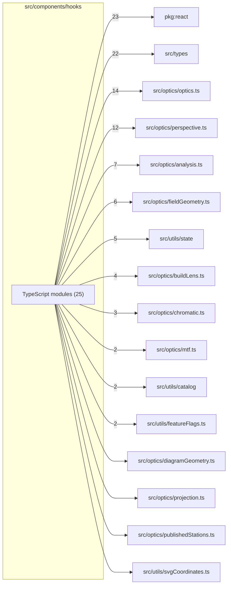

# src/components/hooks

This folder viewer computation and interaction hooks for layout, ray tracing, overlays, zoom, and responsive state.

Generated `readme.md` and `improvementsuggestions.md` files are intentionally omitted from the per-file inventory so this document stays focused on source relationships.

## Relationship Diagram

## Directory Overview

- Direct source files: 25
- Direct subfolders: 0
- Main outbound areas: package:react (23), src/types (22), same folder (15), src/optics/optics.ts (14), src/optics/perspective.ts (12), src/optics/analysis.ts (7), src/optics/fieldGeometry.ts (6), src/utils/state (5), +9 more
- External consumers: src/benchmarks, src/comparison, src/components/controls, src/components/display, src/components/layout, src/components/relationshipMap, src/components/search, src/pages/UniversalRelationshipMapPage.tsx

## Files

| File | Role | Imports from | Imported by | Exports |
| --- | --- | --- | --- | --- |
| `mtf.worker.ts` | Mtf helper module | src/optics/mtf.ts (2), src/types (2), same folder, src/optics/analysis.ts, src/optics/buildLens.ts, +1 more | none | none |
| `mtfWorkerClient.ts` | Mtf Worker Client helper module | src/optics/buildLens.ts (2), src/types (2) | same folder (2) | MtfJob, MtfWorkerRequest, MtfWorkerReply, MtfWorkerPort, MtfWorkerClient |
| `offAxisRayUtils.ts` | Off Axis Ray Utils helper module | src/types (2), src/optics/analysis.ts, src/optics/fieldGeometry.ts, src/optics/optics.ts, src/optics/projection.ts, +1 more | same folder (2), src/benchmarks | OffAxisTraceGeometry, computeOffAxisTraceGeometry |
| `raySegmentUtils.ts` | Ray Segment Utils helper module | same folder, src/optics/chromatic.ts, src/types | same folder (3), src/benchmarks | compileRaySegment, filterChannels |
| `useBalancedColumns.ts` | React hook module | package:react | src/components/relationshipMap (2), src/pages/UniversalRelationshipMapPage.tsx | balancedColumns, WidthClass, widthClass, balancedRowStyle, balancedItemStyle, default, useBalancedColumns |
| `useChromaticRays.ts` | React hook module | src/optics/optics.ts (4), same folder (3), src/optics/perspective.ts (3), src/optics/analysis.ts (2), src/optics/chromatic.ts (2), +3 more | same folder, src/benchmarks, src/components/layout | ChromaticRaySegment, default, useChromaticRays |
| `useDismissableDropdown.ts` | React hook module | package:react | src/components/layout, src/components/relationshipMap, src/components/search | default, useDismissableDropdown |
| `useDispatchAdapters.ts` | React hook module | src/types (2), src/utils/state (2), package:react | src/comparison, src/components/layout | DispatchAdapters, default, useDispatchAdapters |
| `useFlashOverlay.ts` | React hook module | package:react | src/components/layout | default, useFlashOverlay |
| `useHeaderHeight.ts` | React hook module | package:react (2) | src/components/layout | default, useHeaderHeight |
| `useInteractionSignal.ts` | React hook module | package:react | src/components/controls | InteractionSignal, default, useInteractionSignal |
| `useLensAnalysisMarkdown.ts` | React hook module | package:react, src/utils/catalog, src/utils/featureFlags.ts | src/components/layout | default, useLensAnalysisMarkdown |
| `useLensComputation.ts` | React hook module | src/optics/optics.ts (4), src/optics/perspective.ts (4), src/optics/analysis.ts (2), src/optics/fieldGeometry.ts (2), package:react, +5 more | src/components/layout | default, useLensComputation |
| `useModalDialog.ts` | React hook module | package:react | src/components/layout (2) | default, useModalDialog |
| `useMtfComputation.ts` | React hook module | src/types (2), package:react, same folder, src/optics/analysis.ts | src/components/display | MtfComputation, useMtfComputation |
| `useMtfDataWarning.ts` | React hook module | package:react, src/types, src/utils/state | src/components/display | useMtfDataWarning |
| `useMtfPreferences.ts` | React hook module | package:react, src/utils/state | src/components/display | useMtfPreferences |
| `useOffAxisRays.ts` | React hook module | same folder (3), src/optics/optics.ts (2), src/optics/perspective.ts (2), src/types (2), package:react, +1 more | same folder | default, useOffAxisRays |
| `useOnAxisRays.ts` | React hook module | src/optics/optics.ts (2), src/optics/perspective.ts (2), src/types (2), package:react, same folder | same folder (4), src/benchmarks, src/components/layout | RaySegment, default, useOnAxisRays |
| `useOverlays.ts` | React hook module | package:react, src/types, src/utils/state | src/components/layout | default, useOverlays |
| `useOverlayState.ts` | React hook module | package:react | src/components/layout | OverlayState, default, useOverlayState |
| `useRayTracing.ts` | React hook module | same folder (5), src/types (2), package:react, src/optics/fieldGeometry.ts, src/optics/perspective.ts | src/components/layout | default, useRayTracing |
| `useSideLayoutDetection.ts` | React hook module | package:react (2) | src/components/layout | default, useSideLayoutDetection |
| `useSvgViewport.ts` | React hook module | package:react, src/utils/svgCoordinates.ts | src/components/relationshipMap (2) | default, useSvgViewport |
| `useViewBoxZoom.ts` | React hook module | package:react | src/components/relationshipMap (4), src/components/display, src/components/layout | ViewBoxState, ViewBoxZoomResult, ViewBoxZoomOptions, default, useViewBoxZoom |
