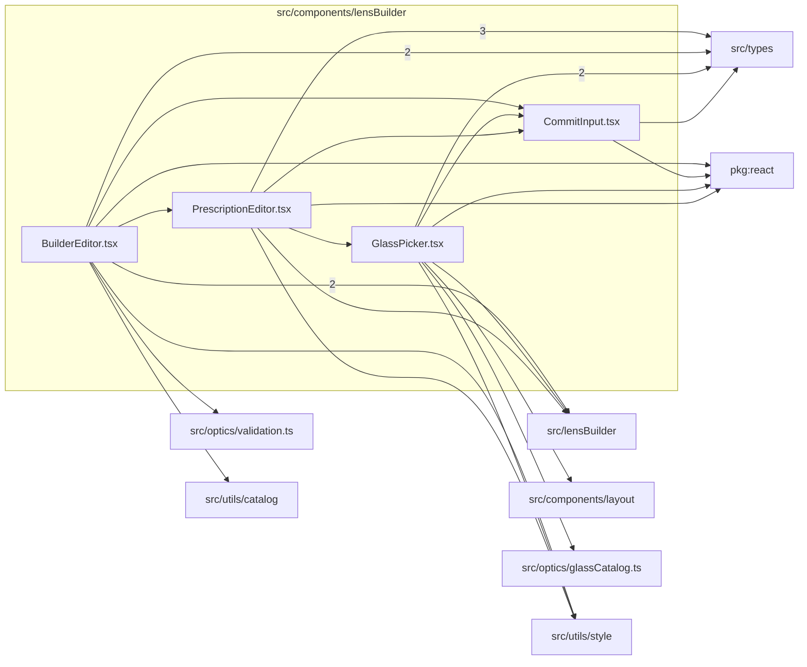

# src/components/lensBuilder

This folder src/components/lensBuilder source folder.

Generated `readme.md` and `improvementsuggestions.md` files are intentionally omitted from the per-file inventory so this document stays focused on source relationships.

## Relationship Diagram

## Directory Overview

- Direct source files: 4
- Direct subfolders: 0
- Main outbound areas: src/types (8), same folder (5), package:react (4), src/lensBuilder (4), src/utils/style (3), src/components/layout, src/optics/glassCatalog.ts, src/optics/validation.ts, +1 more
- External consumers: src/pages/LensBuilderPage.tsx

## Files

| File | Role | Imports from | Imported by | Exports |
| --- | --- | --- | --- | --- |
| `BuilderEditor.tsx` | React component module | same folder (2), src/lensBuilder (2), src/types (2), package:react, src/optics/validation.ts, +2 more | src/pages/LensBuilderPage.tsx | default, BuilderEditor |
| `CommitInput.tsx` | React component module | package:react, src/types | same folder (3) | builderInputStyle, builderCaptionStyle, default, CommitInput |
| `GlassPicker.tsx` | React component module | src/types (2), package:react, same folder, src/components/layout, src/lensBuilder, +2 more | same folder | default, GlassPicker |
| `PrescriptionEditor.tsx` | React component module | src/types (3), same folder (2), package:react, src/lensBuilder, src/utils/style | same folder | default, PrescriptionEditor, sectionTitle |
