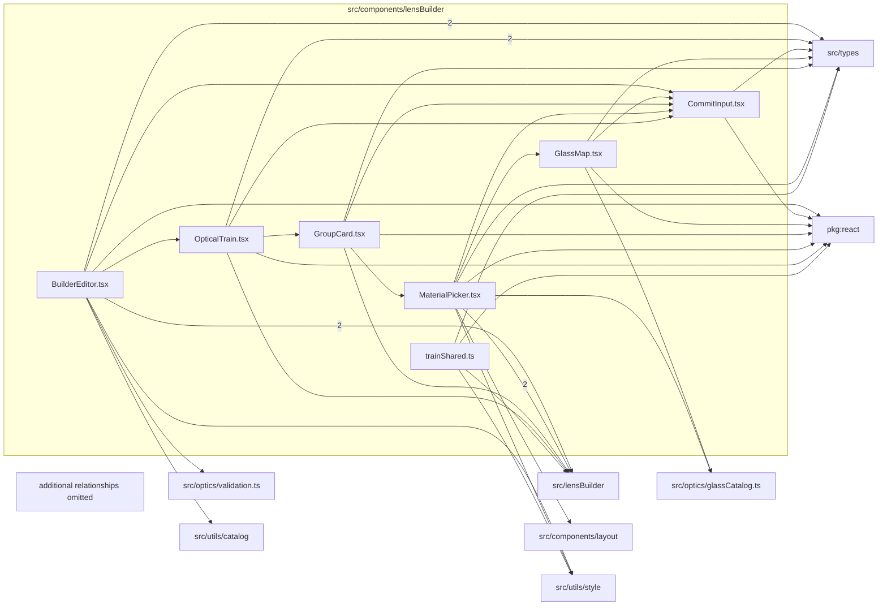

# src/components/lensBuilder

This folder src/components/lensBuilder source folder.

Generated `readme.md` and `improvementsuggestions.md` files are intentionally omitted from the per-file inventory so this document stays focused on source relationships.

## Relationship Diagram

## Directory Overview

- Direct source files: 7
- Direct subfolders: 0
- Main outbound areas: same folder (12), src/types (9), package:react (7), src/lensBuilder (7), src/utils/style (3), src/optics/glassCatalog.ts (2), src/components/layout, src/optics/validation.ts, +1 more
- External consumers: src/pages/LensBuilderPage.tsx

## Files

| File | Role | Imports from | Imported by | Exports |
| --- | --- | --- | --- | --- |
| `BuilderEditor.tsx` | React component module | same folder (2), src/lensBuilder (2), src/types (2), package:react, src/optics/validation.ts, +2 more | src/pages/LensBuilderPage.tsx | default, BuilderEditor |
| `CommitInput.tsx` | React component module | package:react, src/types | same folder (5) | BuilderTouchContext, builderInputStyle, builderCaptionStyle, sectionTitle, default, CommitInput |
| `GlassMap.tsx` | React component module | package:react, same folder, src/optics/glassCatalog.ts, src/types | same folder | default, GlassMap |
| `GroupCard.tsx` | React component module | same folder (3), package:react, src/lensBuilder, src/types | same folder | default, GroupCard |
| `MaterialPicker.tsx` | React component module | same folder (3), src/lensBuilder (2), package:react, src/components/layout, src/optics/glassCatalog.ts, +2 more | same folder | glassLine, default, MaterialPicker |
| `OpticalTrain.tsx` | React component module | same folder (3), src/types (2), package:react, src/lensBuilder | same folder | deriveElementModel, default, OpticalTrain |
| `trainShared.ts` | Train Shared helper module | package:react, src/lensBuilder, src/types, src/utils/style | same folder (3) | SurfaceField, TrainCtx, formatMm, formatCoefficient, formatFocal, sentenceCase, shapeOf, outlinedButton, +3 more |
