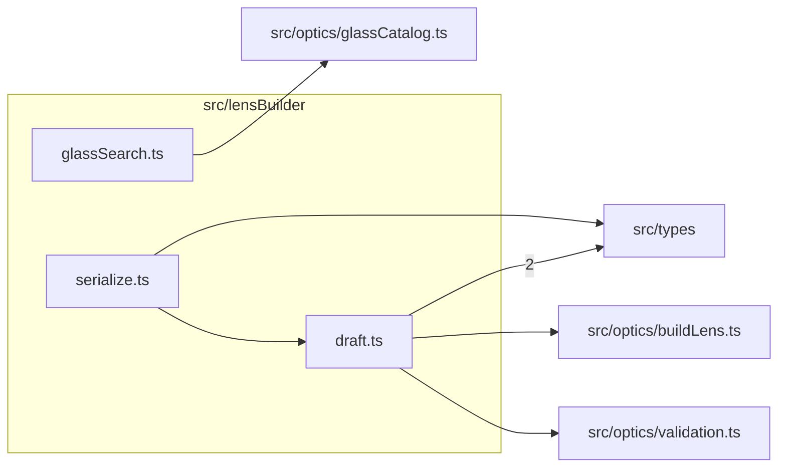

# src/lensBuilder

This folder src/lensBuilder source folder.

Generated `readme.md` and `improvementsuggestions.md` files are intentionally omitted from the per-file inventory so this document stays focused on source relationships.

## Relationship Diagram

## Directory Overview

- Direct source files: 3
- Direct subfolders: 0
- Main outbound areas: src/types (3), same folder, src/optics/buildLens.ts, src/optics/glassCatalog.ts, src/optics/validation.ts
- External consumers: src/components/lensBuilder, src/pages/LensBuilderPage.tsx

## Files

| File | Role | Imports from | Imported by | Exports |
| --- | --- | --- | --- | --- |
| `draft.ts` | Draft helper module | src/types (2), src/optics/buildLens.ts, src/optics/validation.ts | src/components/lensBuilder (2), same folder, src/pages/LensBuilderPage.tsx | createTemplate, cloneDraft, copyCatalogInput, DraftValidation, validateDraft, setSurfaceField, setElementField, insertElement, +5 more |
| `glassSearch.ts` | Glass Search helper module | src/optics/glassCatalog.ts | src/components/lensBuilder | searchGlass, nearestGlass |
| `serialize.ts` | Serialize helper module | same folder, src/types | src/components/lensBuilder, src/pages/LensBuilderPage.tsx | exportDataTs, exportJson, importJson, draftFilename |
