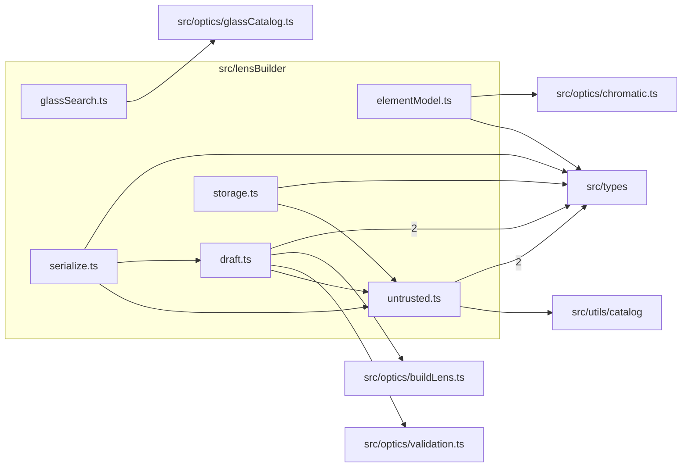

# src/lensBuilder

This folder src/lensBuilder source folder.

Generated `readme.md` and `improvementsuggestions.md` files are intentionally omitted from the per-file inventory so this document stays focused on source relationships.

## Relationship Diagram

## Directory Overview

- Direct source files: 6
- Direct subfolders: 0
- Main outbound areas: src/types (7), same folder (4), src/optics/buildLens.ts, src/optics/chromatic.ts, src/optics/glassCatalog.ts, src/optics/validation.ts, src/utils/catalog
- External consumers: src/components/lensBuilder, src/pages/LensBuilderPage.tsx

## Files

| File | Role | Imports from | Imported by | Exports |
| --- | --- | --- | --- | --- |
| `draft.ts` | Draft helper module | src/types (2), same folder, src/optics/buildLens.ts, src/optics/validation.ts | same folder, src/components/lensBuilder, src/pages/LensBuilderPage.tsx | createTemplate, cloneDraft, copyCatalogInput, DraftValidation, validateDraft |
| `elementModel.ts` | Element Model helper module | src/optics/chromatic.ts, src/types | src/components/lensBuilder (4) | BuilderSurface, BuilderMaterial, BuilderElement, BuilderGroup, BuilderStop, BuilderItem, BuilderGap, BuilderModel, +20 more |
| `glassSearch.ts` | Glass Search helper module | src/optics/glassCatalog.ts | src/components/lensBuilder | searchGlass, nearestGlass, commonGlasses, findGlass |
| `serialize.ts` | Serialize helper module | same folder (2), src/types | src/components/lensBuilder, src/pages/LensBuilderPage.tsx | exportDataTs, exportJson, importJson, draftFilename |
| `storage.ts` | Storage helper module | same folder, src/types | src/pages/LensBuilderPage.tsx | STORAGE_KEY, BACKUP_KEY, RestoredDraft, restoreDraft |
| `untrusted.ts` | Untrusted helper module | src/types (2), src/utils/catalog | same folder (3), src/components/lensBuilder (3), src/pages/LensBuilderPage.tsx | MAX_DRAFT_BYTES, MAX_DRAFT_NUMBER, DraftStringRule, draftStringLimit, draftStringIssue, UntrustedDraftResult, parseUntrustedDraft, requireUntrustedDraft, +2 more |
