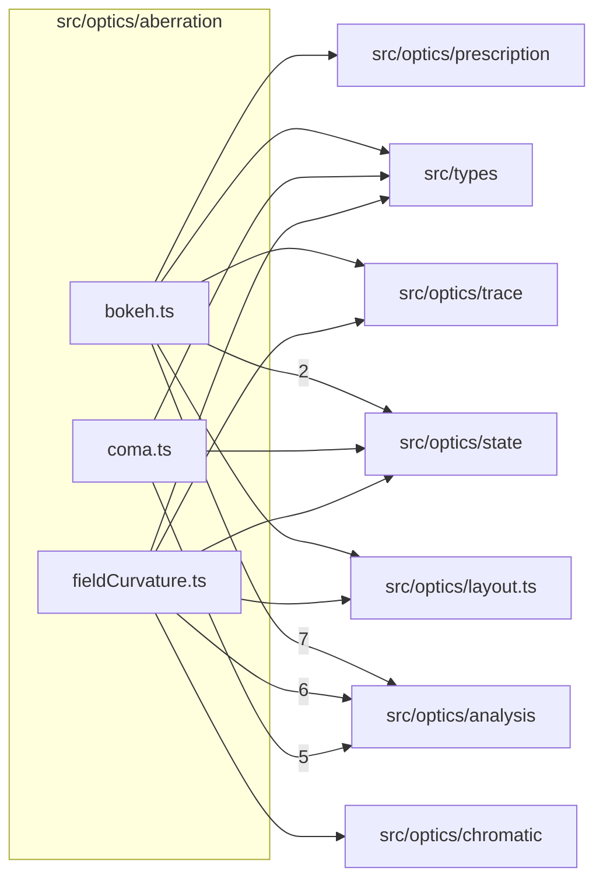

# src/optics/aberration

This folder coma, field-curvature and bokeh orchestration awaiting request migration.

Generated `readme.md` and `improvementsuggestions.md` files are intentionally omitted from the per-file inventory so this document stays focused on source relationships.

## Relationship Diagram

## Directory Overview

- Direct source files: 3
- Direct subfolders: 0
- Main outbound areas: src/optics/analysis (18), src/optics/state (4), src/types (3), src/optics/layout.ts (2), src/optics/trace (2), src/optics/chromatic, src/optics/prescription
- External consumers: src/optics/aberrationAnalysis.ts, src/optics/analysis

## Files

| File | Role | Imports from | Imported by | Exports |
| --- | --- | --- | --- | --- |
| `bokeh.ts` | Bokeh helper module | src/optics/analysis (7), src/optics/state (2), src/optics/layout.ts, src/optics/prescription, src/optics/trace, +1 more | src/optics/aberrationAnalysis.ts, src/optics/analysis | computeBokehFieldFootprint, buildBokehDensityGrid, describeBokehDefocusSide, computeBokehPreview, computeBokehPreviewPair |
| `coma.ts` | Coma helper module | src/optics/analysis (5), src/optics/state, src/types | src/optics/aberrationAnalysis.ts | computeMeridionalComa, computeComaPreview, computeSagittalComa, computeComaPointCloudPreview, computeComaAnalysis |
| `fieldCurvature.ts` | Field Curvature helper module | src/optics/analysis (6), src/optics/chromatic, src/optics/layout.ts, src/optics/state, src/optics/trace, +1 more | src/optics/aberrationAnalysis.ts | FieldCurvatureBundleResult, computeFieldCurvatureBundle, computeFieldCurvature |
