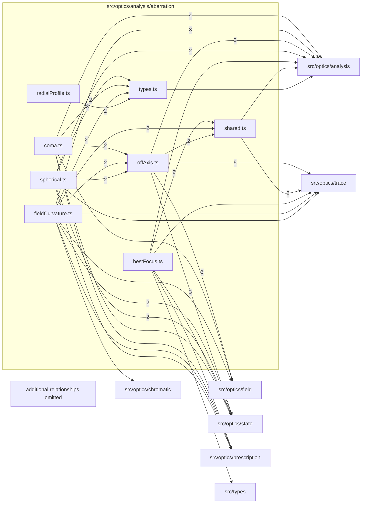

# src/optics/analysis/aberration

This folder request-based spherical and best-focus analysis with shared aberration leaves.

Generated `readme.md` and `improvementsuggestions.md` files are intentionally omitted from the per-file inventory so this document stays focused on source relationships.

## Relationship Diagram

## Directory Overview

- Direct source files: 8
- Direct subfolders: 0
- Main outbound areas: src/optics/analysis (37), src/optics/trace (10), src/optics/state (9), src/types (6), src/optics/field (5), src/optics/prescription (4), src/optics/chromatic
- External consumers: src/optics/analysis, src/optics/analysis.ts, src/optics/perspective

## Files

| File | Role | Imports from | Imported by | Exports |
| --- | --- | --- | --- | --- |
| `bestFocus.ts` | Best Focus helper module | src/optics/analysis (3), src/optics/prescription, src/optics/state, src/optics/trace, src/types | src/optics/analysis (2), src/optics/analysis.ts | computeImagePlaneZAtFocus, computeBestFocusZFromLayout, computeBestFocusZ |
| `coma.ts` | Coma helper module | src/optics/analysis (8), src/optics/field, src/optics/prescription, src/optics/state, src/types | src/optics/analysis, src/optics/analysis.ts | computeMeridionalComa, computeComaPreview, computeSagittalComa, computeComaPointCloudPreview, computeComaAnalysis |
| `fieldCurvature.ts` | Field Curvature helper module | src/optics/analysis (9), src/optics/state (2), src/optics/chromatic, src/optics/field, src/optics/prescription, +2 more | src/optics/analysis, src/optics/analysis.ts | FieldCurvatureBundleResult, computeFieldCurvatureBundle, computeFieldCurvature, ChromaticChannelSpan, ChromaticFieldFocusFieldSummary, ChromaticFieldFocusSummary, summarizeChromaticFieldFocus |
| `offAxis.ts` | Off Axis helper module | src/optics/trace (5), src/optics/analysis (4), src/optics/field (3), src/optics/state (3), src/types | src/optics/analysis (6), src/optics/analysis.ts | OffAxisFanOrientation, OffAxisDirection, OffAxisFieldGeometry, OffAxisVectorFieldGeometry, ProjectionAwareOffAxisFieldGeometry, OffAxisChiefRaySample, OffAxisTracedSample, OffAxisBundle, +10 more |
| `radialProfile.ts` | Radial Profile helper module | src/optics/analysis (2) | src/optics/analysis (2), src/optics/analysis.ts, src/optics/perspective | emptyRadialProfile, buildBokehRadialProfile, classifyBokehBrightnessCharacter |
| `shared.ts` | Shared helper module | src/optics/trace (2), src/optics/analysis, src/types | src/optics/analysis (4) | MARGINAL_FRACS, PROFILE_FRACS, SymmetricRealSample, TransverseFocusHit, RealRayHit, axialIntercept, imagePlaneIntercept, meridionalImagePlaneCoordinate, +9 more |
| `spherical.ts` | Spherical helper module | src/optics/analysis (9), src/optics/state (2), src/optics/prescription, src/optics/trace | src/optics/analysis, src/optics/analysis.ts | computeSphericalAberration, computeSAProfile, computeSphericalAberrationBlurCharacter |
| `types.ts` | Shared TypeScript types | src/optics/analysis, src/types | src/optics/analysis (5), src/optics/perspective (2), src/optics/analysis.ts | SAProfilePoint, SphericalAberrationBlurCharacterSample, SphericalAberrationBlurCharacterResult, SphericalAberrationResult, MeridionalComaSample, MeridionalComaResult, SagittalComaSample, SagittalComaResult, +34 more |
