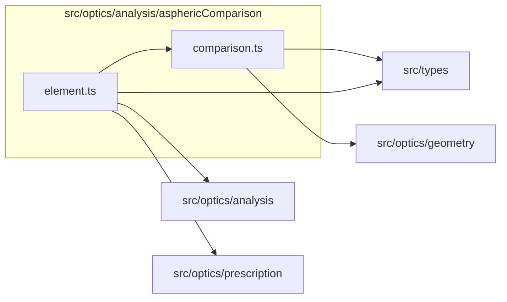

# src/optics/analysis/asphericComparison

This folder src/optics/analysis/asphericComparison source folder.

Generated `readme.md` and `improvementsuggestions.md` files are intentionally omitted from the per-file inventory so this document stays focused on source relationships.

## Relationship Diagram

## Directory Overview

- Direct source files: 2
- Direct subfolders: 0
- Main outbound areas: src/optics/analysis (2), src/types (2), src/optics/geometry, src/optics/prescription
- External consumers: src/optics/analysis.ts, src/optics/compat.ts

## Files

| File | Role | Imports from | Imported by | Exports |
| --- | --- | --- | --- | --- |
| `comparison.ts` | Comparison helper module | src/optics/geometry, src/types | src/optics/analysis, src/optics/analysis.ts, src/optics/compat.ts | DepartureSample, computeAsphericDepartureFromProfiles, computeAsphericDeparture, computeDepartureProfile, computeBestFitSphereR, computeDepartureProfileFromProfiles, computeBestFitSphereRFromProfiles, peakAbsDeparture, +2 more |
| `element.ts` | Element helper module | src/optics/analysis (2), src/optics/prescription, src/types | src/optics/analysis.ts | SurfaceComparison, computeAsphericElementComparison |
