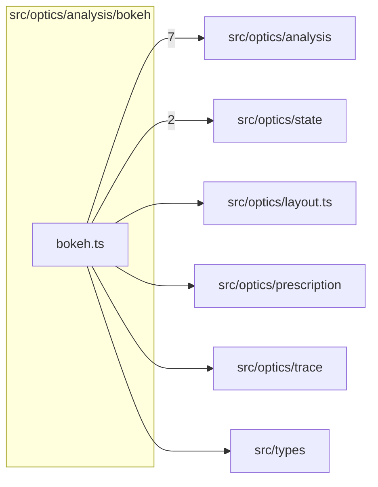

# src/optics/analysis/bokeh

This folder request-based bokeh previews, field footprints and density reductions.

Generated `readme.md` and `improvementsuggestions.md` files are intentionally omitted from the per-file inventory so this document stays focused on source relationships.

## Relationship Diagram

## Directory Overview

- Direct source files: 1
- Direct subfolders: 0
- Main outbound areas: src/optics/analysis (7), src/optics/state (2), src/optics/layout.ts, src/optics/prescription, src/optics/trace, src/types
- External consumers: src/optics/aberrationAnalysis.ts, src/optics/analysis, src/optics/analysis.ts, src/optics/compat.ts

## Files

| File | Role | Imports from | Imported by | Exports |
| --- | --- | --- | --- | --- |
| `bokeh.ts` | Bokeh helper module | src/optics/analysis (7), src/optics/state (2), src/optics/layout.ts, src/optics/prescription, src/optics/trace, +1 more | src/optics/aberrationAnalysis.ts, src/optics/analysis, src/optics/analysis.ts, src/optics/compat.ts | computeBokehFieldFootprint, buildBokehDensityGrid, describeBokehDefocusSide, computeBokehPreview, computeBokehPreviewPair |
