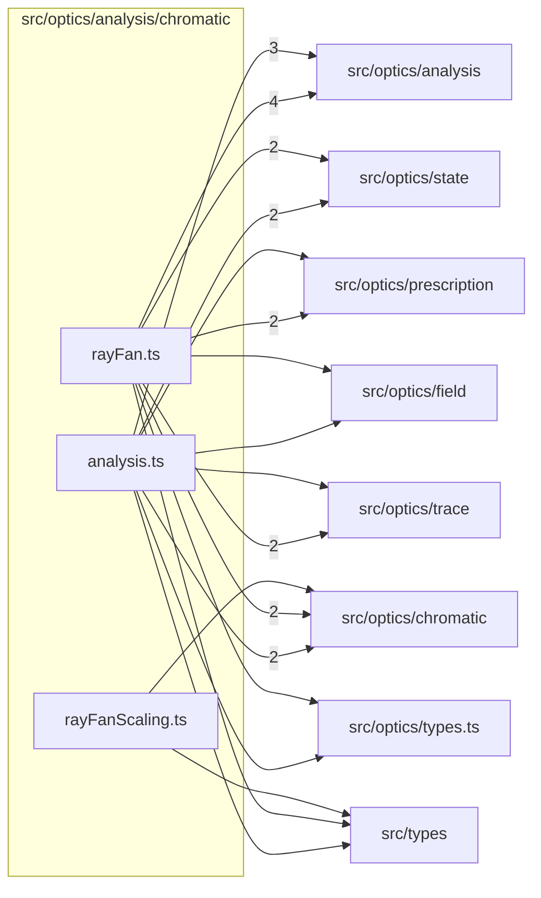

# src/optics/analysis/chromatic

This folder src/optics/analysis/chromatic source folder.

Generated `readme.md` and `improvementsuggestions.md` files are intentionally omitted from the per-file inventory so this document stays focused on source relationships.

## Relationship Diagram

## Directory Overview

- Direct source files: 3
- Direct subfolders: 0
- Main outbound areas: src/optics/analysis (7), src/optics/chromatic (5), src/optics/state (4), src/optics/prescription (3), src/optics/trace (3), src/types (3), src/optics/field (2), src/optics/types.ts (2)
- External consumers: src/optics/analysis, src/optics/analysis.ts

## Files

| File | Role | Imports from | Imported by | Exports |
| --- | --- | --- | --- | --- |
| `analysis.ts` | Analysis helper module | src/optics/analysis (3), src/optics/chromatic (2), src/optics/state (2), src/optics/field, src/optics/prescription, +3 more | src/optics/analysis (2), src/optics/analysis.ts | DEFAULT_CHROMATIC_ANALYSIS_CHANNELS, DEFAULT_LONGITUDINAL_CHROMATIC_FRACTIONS, DEFAULT_LATERAL_COLOR_FIELD_FRACTIONS, ChromaticAnalysisOptions, LongitudinalChromaticFocusSample, LongitudinalChromaticFocusResult, LateralColorChannelSample, LateralColorFieldSample, +5 more |
| `rayFan.ts` | Ray Fan helper module | src/optics/analysis (4), src/optics/chromatic (2), src/optics/prescription (2), src/optics/state (2), src/optics/trace (2), +3 more | src/optics/analysis, src/optics/analysis.ts | ChromaticRayFanAnalysisOptions, ChromaticRayFanAnalysis, computeChromaticRayFanAnalysis |
| `rayFanScaling.ts` | Ray Fan Scaling helper module | src/optics/chromatic, src/types | src/optics/analysis.ts | REFERENCE_LOCA_MM, REFERENCE_FAN_IMAGE_HEIGHT_SPREAD_MM, ChromaticBarResult, computeChromaticBarOffsets, computeLocaBarOffsets |
