# src/optics/analysis/mtf

This folder src/optics/analysis/mtf source folder.

Generated `readme.md` and `improvementsuggestions.md` files are intentionally omitted from the per-file inventory so this document stays focused on source relationships.

## Relationship Diagram

```mermaid
flowchart LR
  subgraph n_src_optics_analysis_mtf["src/optics/analysis/mtf"]
    n_src_optics_analysis_mtf_src_optics_analysis_mtf_mtf_ts["mtf.ts"]
    n_src_optics_analysis_mtf_src_optics_analysis_mtf_mtfAperture_ts["mtfAperture.ts"]
    n_src_optics_analysis_mtf_src_optics_analysis_mtf_mtfConjugates_ts["mtfConjugates.ts"]
    n_src_optics_analysis_mtf_src_optics_analysis_mtf_mtfConstants_ts["mtfConstants.ts"]
    n_src_optics_analysis_mtf_src_optics_analysis_mtf_mtfDataLimitations_ts["mtfDataLimitations.ts"]
    n_src_optics_analysis_mtf_src_optics_analysis_mtf_mtfFields_ts["mtfFields.ts"]
    n_src_optics_analysis_mtf_src_optics_analysis_mtf_mtfFocus_ts["mtfFocus.ts"]
    n_src_optics_analysis_mtf_src_optics_analysis_mtf_mtfFootprint_ts["mtfFootprint.ts"]
    n_src_optics_analysis_mtf_src_optics_analysis_mtf_mtfMath_ts["mtfMath.ts"]
    n_src_optics_analysis_mtf_src_optics_analysis_mtf_mtfRayClassification_ts["mtfRayClassification.ts"]
    n_src_optics_analysis_mtf_src_optics_analysis_mtf_mtfShearedOtf_ts["mtfShearedOtf.ts"]
    n_src_optics_analysis_mtf_src_optics_analysis_mtf_mtfSupport_ts["mtfSupport.ts"]
    n_src_optics_analysis_mtf_src_optics_analysis_mtf_mtfTracing_ts["mtfTracing.ts"]
    n_src_optics_analysis_mtf_src_optics_analysis_mtf_mtfWavefront_ts["mtfWavefront.ts"]
  end
  n_external_src_optics_trace["src/optics/trace"]
  n_external_src_optics_analysis["src/optics/analysis"]
  n_external_src_optics_chromatic["src/optics/chromatic"]
  n_external_src_optics_field["src/optics/field"]
  n_external_src_optics_first_order["src/optics/first-order"]
  n_external_src_optics_layout_ts["src/optics/layout.ts"]
  n_external_src_optics_math["src/optics/math"]
  n_external_src_optics_prescription["src/optics/prescription"]
  n_external_src_optics_spectralLines_ts["src/optics/spectralLines.ts"]
  n_external_src_optics_state["src/optics/state"]
  n_external_src_optics_types_ts["src/optics/types.ts"]
  n_external_src_types["src/types"]
  n_src_optics_analysis_mtf_src_optics_analysis_mtf_mtfTracing_ts --> |3| n_external_src_optics_trace
  n_src_optics_analysis_mtf_src_optics_analysis_mtf_mtfRayClassification_ts --> |2| n_external_src_optics_trace
  n_src_optics_analysis_mtf_src_optics_analysis_mtf_mtfSupport_ts --> |2| n_src_optics_analysis_mtf_src_optics_analysis_mtf_mtfConstants_ts
  n_src_optics_analysis_mtf_src_optics_analysis_mtf_mtfTracing_ts --> |2| n_src_optics_analysis_mtf_src_optics_analysis_mtf_mtfRayClassification_ts
  n_src_optics_analysis_mtf_src_optics_analysis_mtf_mtf_ts --> n_external_src_optics_analysis
  n_src_optics_analysis_mtf_src_optics_analysis_mtf_mtfSupport_ts --> n_external_src_optics_analysis
  n_src_optics_analysis_mtf_src_optics_analysis_mtf_mtfTracing_ts --> n_external_src_optics_chromatic
  n_src_optics_analysis_mtf_src_optics_analysis_mtf_mtfConjugates_ts --> n_external_src_optics_field
  n_src_optics_analysis_mtf_src_optics_analysis_mtf_mtfFields_ts --> n_external_src_optics_field
  n_src_optics_analysis_mtf_src_optics_analysis_mtf_mtfFocus_ts --> n_external_src_optics_first_order
  n_src_optics_analysis_mtf_src_optics_analysis_mtf_mtfFields_ts --> n_external_src_optics_layout_ts
  n_src_optics_analysis_mtf_src_optics_analysis_mtf_mtfFocus_ts --> n_external_src_optics_layout_ts
  n_src_optics_analysis_mtf_src_optics_analysis_mtf_mtfFields_ts --> n_external_src_optics_math
  n_src_optics_analysis_mtf_src_optics_analysis_mtf_mtfTracing_ts --> n_external_src_optics_math
  n_src_optics_analysis_mtf_src_optics_analysis_mtf_mtfConjugates_ts --> n_external_src_optics_prescription
  n_src_optics_analysis_mtf_src_optics_analysis_mtf_mtfFields_ts --> n_external_src_optics_prescription
  n_src_optics_analysis_mtf_src_optics_analysis_mtf_mtfFocus_ts --> n_external_src_optics_prescription
  n_src_optics_analysis_mtf_src_optics_analysis_mtf_mtfTracing_ts --> n_external_src_optics_prescription
  n_src_optics_analysis_mtf_src_optics_analysis_mtf_mtfFocus_ts --> n_external_src_optics_spectralLines_ts
  n_src_optics_analysis_mtf_src_optics_analysis_mtf_mtfSupport_ts --> n_external_src_optics_spectralLines_ts
  n_src_optics_analysis_mtf_src_optics_analysis_mtf_mtfFields_ts --> n_external_src_optics_state
  n_src_optics_analysis_mtf_src_optics_analysis_mtf_mtfTracing_ts --> n_external_src_optics_state
  n_src_optics_analysis_mtf_src_optics_analysis_mtf_mtfAperture_ts --> n_external_src_optics_trace
  n_src_optics_analysis_mtf_src_optics_analysis_mtf_mtfFields_ts --> n_external_src_optics_trace
  n_src_optics_analysis_mtf_src_optics_analysis_mtf_mtf_ts --> n_external_src_optics_types_ts
  n_src_optics_analysis_mtf_src_optics_analysis_mtf_mtfAperture_ts --> n_external_src_optics_types_ts
  n_src_optics_analysis_mtf_src_optics_analysis_mtf_mtfConjugates_ts --> n_external_src_optics_types_ts
  n_src_optics_analysis_mtf_src_optics_analysis_mtf_mtfDataLimitations_ts --> n_external_src_optics_types_ts
  n_src_optics_analysis_mtf_src_optics_analysis_mtf_mtfFields_ts --> n_external_src_optics_types_ts
  n_src_optics_analysis_mtf_src_optics_analysis_mtf_mtfFocus_ts --> n_external_src_optics_types_ts
  n_src_optics_analysis_mtf_src_optics_analysis_mtf_mtfRayClassification_ts --> n_external_src_optics_types_ts
  n_src_optics_analysis_mtf_src_optics_analysis_mtf_mtfSupport_ts --> n_external_src_optics_types_ts
  n_src_optics_analysis_mtf_src_optics_analysis_mtf_mtfTracing_ts --> n_external_src_optics_types_ts
  n_src_optics_analysis_mtf_src_optics_analysis_mtf_mtfWavefront_ts --> n_external_src_optics_types_ts
  n_src_optics_analysis_mtf_src_optics_analysis_mtf_mtf_ts --> n_external_src_types
  n_src_optics_analysis_mtf_src_optics_analysis_mtf_mtfAperture_ts --> n_external_src_types
  n_src_optics_analysis_mtf_truncated["additional relationships omitted"]
```

## Directory Overview

- Direct source files: 14
- Direct subfolders: 0
- Main outbound areas: src/optics/analysis (31), src/optics/types.ts (10), src/types (9), src/optics/trace (7), src/optics/prescription (4), src/optics/field (2), src/optics/layout.ts (2), src/optics/math (2), +5 more
- External consumers: src/optics/mtf.ts

## Files

| File | Role | Imports from | Imported by | Exports |
| --- | --- | --- | --- | --- |
| `mtf.ts` | Mtf helper module | src/optics/analysis (10), src/optics/types.ts, src/types | src/optics/mtf.ts | MtfJobCache, emptyMtfField, MtfUnresolvedFlux, assessUnresolvedFlux, MtfGridOutcome, refineMtfField, resolveMtfGeometry, computeMtfSteps, +1 more |
| `mtfAperture.ts` | Mtf Aperture helper module | src/optics/analysis (2), src/optics/trace, src/optics/types.ts, src/types | src/optics/analysis | resolveMtfAperture |
| `mtfConjugates.ts` | Mtf Conjugates helper module | src/optics/field, src/optics/prescription, src/optics/types.ts, src/types | src/optics/analysis (2) | mtfFiniteConjugate, mtfFiniteObjectPoint |
| `mtfConstants.ts` | Mtf Constants helper module | src/types | src/optics/analysis (3) | MTF_GRID_LADDER, MTF_GRID_CAPS, MTF_DEFAULT_GRID_CAP, MTF_FOCUS_MODES, MTF_CONVERGENCE_TOLERANCE, MTF_CONVERGENCE_BAND_LPMM, MTF_MAX_FIELDS, MTF_MAX_FREQUENCIES, +12 more |
| `mtfDataLimitations.ts` | Mtf Data Limitations helper module | src/optics/analysis, src/optics/types.ts, src/types | src/optics/mtf.ts | MtfDataLimitationInput, assessMtfDataLimitations |
| `mtfFields.ts` | Mtf Fields helper module | src/optics/analysis, src/optics/field, src/optics/layout.ts, src/optics/math, src/optics/prescription, +5 more | src/optics/analysis | MtfFieldTarget, MtfChiefHeight, MtfBeyondChiefClip, mtfModeledHalfField, declaredFormatRadiusMm, resolveMtfFieldGeometry, resolveMtfFieldTargets, mtfChiefHeight, +2 more |
| `mtfFocus.ts` | Mtf Focus helper module | src/optics/analysis (3), src/optics/first-order, src/optics/layout.ts, src/optics/prescription, src/optics/spectralLines.ts, +2 more | src/optics/analysis | MtfFocusBundle, MtfBestFocus, MtfImagePlaneOffset, mtfImagePlaneOffset, mtfNearestImagePlaneZ, findAxialBestFocus, landingPoints |
| `mtfFootprint.ts` | Mtf Footprint helper module | src/optics/analysis | src/optics/analysis (3) | MtfFootprint, MtfLaunchClassifier, findMtfFootprint, expandMtfFootprint |
| `mtfMath.ts` | Mtf Math helper module | none | src/optics/analysis (5) | MtfSpot, ComplexOtf, geometricOtf, otfMagnitude, combineOtfs |
| `mtfRayClassification.ts` | Mtf Ray Classification helper module | src/optics/trace (2), src/optics/types.ts | src/optics/analysis (2) | MtfRayClass, mtfTraceClassification, provesApertureMiss |
| `mtfShearedOtf.ts` | Mtf Sheared Otf helper module | src/optics/analysis (2) | src/optics/analysis | MtfShearedOtf, shearedOtf, latticeCosineSlope |
| `mtfSupport.ts` | Mtf Support helper module | src/optics/analysis (4), src/optics/spectralLines.ts, src/optics/types.ts, src/types | src/optics/analysis (2), src/optics/mtf.ts | MTF_FIELDS, MTF_FREQUENCIES, MTF_CDF_LINES, MTF_PHOTOPIC_LINES, MTF_SPECTRUM_LABELS, MtfScaleDifference, mtfPrescriptionScale, mtfScaleNeedsNote, +6 more |
| `mtfTracing.ts` | Mtf Tracing helper module | src/optics/analysis (5), src/optics/trace (3), src/optics/chromatic, src/optics/math, src/optics/prescription, +3 more | src/optics/analysis (6) | mtfTraceClassification, MtfPupilRay, MtfOpenBorders, MtfBundle, MtfFieldLaunch, mtfImagePoint, mtfIndexResolver, mtfTraceOptions, +8 more |
| `mtfWavefront.ts` | Mtf Wavefront helper module | src/optics/analysis (2), src/optics/types.ts | none | launchPhaseMm, rayOpticalPathToImageMm, MtfWaveLattice, mtfWaveLattice, waveLatticePhaseStep, waveLatticeOtf |
