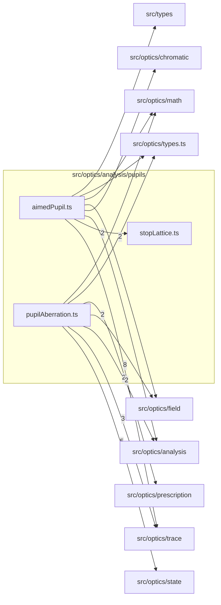

# src/optics/analysis/pupils

This folder src/optics/analysis/pupils source folder.

Generated `readme.md` and `improvementsuggestions.md` files are intentionally omitted from the per-file inventory so this document stays focused on source relationships.

## Relationship Diagram

## Directory Overview

- Direct source files: 3
- Direct subfolders: 0
- Main outbound areas: src/optics/trace (11), src/optics/analysis (5), src/optics/state (5), src/optics/field (3), src/optics/types.ts (3), src/optics/math (2), src/optics/prescription (2), src/optics/chromatic, +1 more
- External consumers: src/optics/analysis, src/optics/analysis.ts, src/optics/perspective

## Files

| File | Role | Imports from | Imported by | Exports |
| --- | --- | --- | --- | --- |
| `aimedPupil.ts` | Aimed Pupil helper module | src/optics/trace (8), src/optics/analysis (3), src/optics/chromatic, src/optics/field, src/optics/math, +2 more | src/optics/analysis (9), src/optics/analysis.ts, src/optics/perspective | AIMED_PUPIL_RESIDUAL_TOLERANCE, AIMED_PUPIL_MAX_ITERATIONS, AIMED_PUPIL_POLISH_TOLERANCE, AimedPupilUnaimedReason, AimedPupilLaunchSurface, AimedPupilSampleInput, AimedObjectPlaneField, AimedBoundingSphereField, +22 more |
| `pupilAberration.ts` | Pupil Aberration helper module | src/optics/state (5), src/optics/trace (3), src/optics/analysis (2), src/optics/field (2), src/optics/prescription (2), +2 more | src/optics/analysis, src/optics/analysis.ts | PupilAberrationSample, PupilAberrationProfile, ExitPupilAberrationSample, ExitPupilAberrationProfile, PUPIL_ABERRATION_SAMPLE_COUNT, computePupilAberrationProfile, computeExitPupilAberrationProfile, BothPupilAberrationProfiles, +1 more |
| `stopLattice.ts` | Stop Lattice helper module | none | src/optics/analysis (2) | StopLatticeCell, stopLattice |
