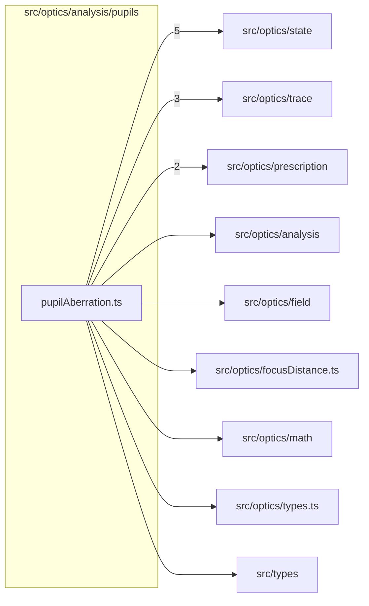

# src/optics/analysis/pupils

This folder src/optics/analysis/pupils source folder.

Generated `readme.md` and `improvementsuggestions.md` files are intentionally omitted from the per-file inventory so this document stays focused on source relationships.

## Relationship Diagram

## Directory Overview

- Direct source files: 1
- Direct subfolders: 0
- Main outbound areas: src/optics/state (5), src/optics/trace (3), src/optics/prescription (2), src/optics/analysis, src/optics/field, src/optics/focusDistance.ts, src/optics/math, src/optics/types.ts, +1 more
- External consumers: src/optics/analysis, src/optics/analysis.ts, src/optics/compat.ts

## Files

| File | Role | Imports from | Imported by | Exports |
| --- | --- | --- | --- | --- |
| `pupilAberration.ts` | Pupil Aberration helper module | src/optics/state (5), src/optics/trace (3), src/optics/prescription (2), src/optics/analysis, src/optics/field, +4 more | src/optics/analysis, src/optics/analysis.ts, src/optics/compat.ts | PupilAberrationSample, PupilAberrationProfile, ExitPupilAberrationSample, ExitPupilAberrationProfile, PUPIL_ABERRATION_SAMPLE_COUNT, PUPIL_ABERRATION_SAMPLE_COUNT_2, computePupilAberrationProfile, computeExitPupilAberrationProfile, +2 more |
