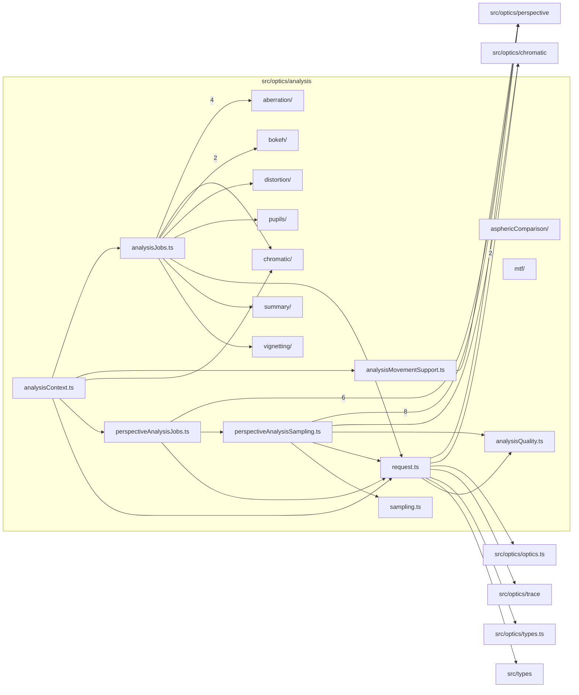

# src/optics/analysis

This folder prepared-state analysis adapters and grouped analysis facades.

Generated `readme.md` and `improvementsuggestions.md` files are intentionally omitted from the per-file inventory so this document stays focused on source relationships.

## Relationship Diagram

## Directory Overview

- Direct source files: 8
- Direct subfolders: 9
- Main outbound areas: same folder (23), src/optics/perspective (17), src/optics/chromatic (2), src/optics/optics.ts, src/optics/trace, src/optics/types.ts, src/types
- External consumers: src/benchmarks, src/components/layout, src/optics/analysis, src/optics/analysis.ts, src/optics/compat.ts, src/optics/optics.ts, src/optics/perspective

## Subfolders

| Folder | Role |
| --- | --- |
| [aberration/](aberration/readme.md) | request-based spherical and best-focus analysis with shared aberration leaves |
| [asphericComparison/](asphericComparison/readme.md) | src/optics/analysis/asphericComparison source folder |
| [bokeh/](bokeh/readme.md) | request-based bokeh previews, field footprints and density reductions |
| [chromatic/](chromatic/readme.md) | src/optics/analysis/chromatic source folder |
| [distortion/](distortion/readme.md) | src/optics/analysis/distortion source folder |
| [mtf/](mtf/readme.md) | src/optics/analysis/mtf source folder |
| [pupils/](pupils/readme.md) | src/optics/analysis/pupils source folder |
| [summary/](summary/readme.md) | src/optics/analysis/summary source folder |
| [vignetting/](vignetting/readme.md) | src/optics/analysis/vignetting source folder |

## Files

| File | Role | Imports from | Imported by | Exports |
| --- | --- | --- | --- | --- |
| `analysisContext.ts` | Analysis Context helper module | same folder (5) | src/optics/analysis.ts, src/optics/compat.ts | AnalysisComputationContextParams, AnalysisComputationContext, createAnalysisComputationContext |
| `analysisJobs.ts` | Analysis Jobs helper module | same folder (12) | same folder, src/optics/compat.ts | analysisJobs2, analysisJobsForState2 |
| `analysisMovementSupport.ts` | Analysis Movement Support helper module | src/optics/perspective | same folder, src/optics/compat.ts | AnalysisSectionId, AnalysisSectionMode, AnalysisSectionAvailability, AnalysisSectionUnavailableError, analysisSectionAvailability, assertAnalysisSectionAvailable, assertCenteredAnalysisSectionAvailable |
| `analysisQuality.ts` | Analysis Quality helper module | none | same folder (5), src/benchmarks, src/components/layout | AnalysisQuality, AnalysisSamplingOptions, INTERACTIVE_ANALYSIS_SAMPLING, analysisSamplingForQuality |
| `perspectiveAnalysisJobs.ts` | Perspective Analysis Jobs helper module | src/optics/perspective (6), same folder (2) | same folder | PerspectiveAnalysisJobs, createPerspectiveAnalysisJobs |
| `perspectiveAnalysisSampling.ts` | Perspective Analysis Sampling helper module | src/optics/perspective (8), same folder (3), src/optics/chromatic | src/optics/perspective (6), same folder | PerspectiveAnalysisSamplingPlan, perspectiveAnalysisSamplingPlan |
| `request.ts` | Request helper module | src/optics/perspective (2), same folder, src/optics/chromatic, src/optics/optics.ts, src/optics/trace, +2 more | same folder (21), src/optics/perspective (7), src/optics/analysis.ts, src/optics/compat.ts | AnalysisRequestParams, AnalysisRequest, createAnalysisRequest |
| `sampling.ts` | Sampling helper module | none | same folder (13), src/optics/perspective (6), src/optics/optics.ts | MARGINAL_PUPIL_FRACTIONS, PREVIEW_FIELD_FRACTIONS, FULL_FIELD_FRACTIONS, CHROMATIC_PUPIL_FRACTIONS, uniformFieldFraction, evenlySpacedSigned, signedVerticalSensorUvs, OrthogonalPupilSample, +6 more |
