# src/optics/analysis

This folder prepared-state analysis adapters and grouped analysis facades.

Generated `readme.md` and `improvementsuggestions.md` files are intentionally omitted from the per-file inventory so this document stays focused on source relationships.

## Relationship Diagram

```mermaid
flowchart LR
  subgraph n_src_optics_analysis["src/optics/analysis"]
    n_src_optics_analysis_src_optics_analysis_aberration["aberration/"]
    n_src_optics_analysis_src_optics_analysis_asphericComparison["asphericComparison/"]
    n_src_optics_analysis_src_optics_analysis_bokeh["bokeh/"]
    n_src_optics_analysis_src_optics_analysis_chromatic["chromatic/"]
    n_src_optics_analysis_src_optics_analysis_distortion["distortion/"]
    n_src_optics_analysis_src_optics_analysis_pupils["pupils/"]
    n_src_optics_analysis_src_optics_analysis_summary["summary/"]
    n_src_optics_analysis_src_optics_analysis_vignetting["vignetting/"]
    n_src_optics_analysis_TypeScript_modules["TypeScript modules (22)"]
  end
  n_external_src_optics_perspective["src/optics/perspective"]
  n_external_src_optics_types_ts["src/optics/types.ts"]
  n_external_src_types["src/types"]
  n_external_src_optics_trace["src/optics/trace"]
  n_external_src_optics_prescription["src/optics/prescription"]
  n_external_src_optics_chromatic["src/optics/chromatic"]
  n_external_src_optics_field["src/optics/field"]
  n_external_src_optics_layout_ts["src/optics/layout.ts"]
  n_external_src_optics_math["src/optics/math"]
  n_external_src_optics_spectralLines_ts["src/optics/spectralLines.ts"]
  n_external_src_optics_state["src/optics/state"]
  n_external_src_optics_first_order["src/optics/first-order"]
  n_external_src_optics_optics_ts["src/optics/optics.ts"]
  n_external_src_utils_catalog["src/utils/catalog"]
  n_src_optics_analysis_TypeScript_modules --> |17| n_external_src_optics_perspective
  n_src_optics_analysis_TypeScript_modules --> |11| n_external_src_optics_types_ts
  n_src_optics_analysis_TypeScript_modules --> |10| n_external_src_types
  n_src_optics_analysis_TypeScript_modules --> |8| n_external_src_optics_trace
  n_src_optics_analysis_TypeScript_modules --> |4| n_external_src_optics_prescription
  n_src_optics_analysis_TypeScript_modules --> |4| n_src_optics_analysis_src_optics_analysis_aberration
  n_src_optics_analysis_TypeScript_modules --> |3| n_external_src_optics_chromatic
  n_src_optics_analysis_TypeScript_modules --> |3| n_src_optics_analysis_src_optics_analysis_chromatic
  n_src_optics_analysis_TypeScript_modules --> |2| n_external_src_optics_field
  n_src_optics_analysis_TypeScript_modules --> |2| n_external_src_optics_layout_ts
  n_src_optics_analysis_TypeScript_modules --> |2| n_external_src_optics_math
  n_src_optics_analysis_TypeScript_modules --> |2| n_external_src_optics_spectralLines_ts
  n_src_optics_analysis_TypeScript_modules --> |2| n_external_src_optics_state
  n_src_optics_analysis_TypeScript_modules --> n_external_src_optics_first_order
  n_src_optics_analysis_TypeScript_modules --> n_external_src_optics_optics_ts
  n_src_optics_analysis_TypeScript_modules --> n_external_src_utils_catalog
  n_src_optics_analysis_TypeScript_modules --> n_src_optics_analysis_src_optics_analysis_bokeh
  n_src_optics_analysis_TypeScript_modules --> n_src_optics_analysis_src_optics_analysis_distortion
  n_src_optics_analysis_TypeScript_modules --> n_src_optics_analysis_src_optics_analysis_pupils
  n_src_optics_analysis_TypeScript_modules --> n_src_optics_analysis_src_optics_analysis_summary
  n_src_optics_analysis_TypeScript_modules --> n_src_optics_analysis_src_optics_analysis_vignetting
```

## Directory Overview

- Direct source files: 22
- Direct subfolders: 8
- Main outbound areas: same folder (51), src/optics/perspective (17), src/optics/types.ts (11), src/types (10), src/optics/trace (8), src/optics/prescription (4), src/optics/chromatic (3), src/optics/field (2), +7 more
- External consumers: src/benchmarks, src/components/layout, src/optics/analysis, src/optics/analysis.ts, src/optics/compat.ts, src/optics/mtf.ts, src/optics/optics.ts, src/optics/perspective

## Subfolders

| Folder | Role |
| --- | --- |
| [aberration/](aberration/readme.md) | request-based spherical and best-focus analysis with shared aberration leaves |
| [asphericComparison/](asphericComparison/readme.md) | src/optics/analysis/asphericComparison source folder |
| [bokeh/](bokeh/readme.md) | request-based bokeh previews, field footprints and density reductions |
| [chromatic/](chromatic/readme.md) | src/optics/analysis/chromatic source folder |
| [distortion/](distortion/readme.md) | src/optics/analysis/distortion source folder |
| [pupils/](pupils/readme.md) | src/optics/analysis/pupils source folder |
| [summary/](summary/readme.md) | src/optics/analysis/summary source folder |
| [vignetting/](vignetting/readme.md) | src/optics/analysis/vignetting source folder |

## Files

| File | Role | Imports from | Imported by | Exports |
| --- | --- | --- | --- | --- |
| `analysisContext.ts` | Analysis Context helper module | same folder (5) | src/optics/analysis.ts, src/optics/compat.ts | AnalysisComputationContextParams, AnalysisComputationContext, createAnalysisComputationContext |
| `analysisJobs.ts` | Analysis Jobs helper module | same folder (12) | same folder, src/optics/compat.ts | analysisJobs2, analysisJobsForState2 |
| `analysisMovementSupport.ts` | Analysis Movement Support helper module | src/optics/perspective | same folder, src/optics/compat.ts | AnalysisSectionId, AnalysisSectionMode, AnalysisSectionAvailability, AnalysisSectionUnavailableError, analysisSectionAvailability, assertAnalysisSectionAvailable, assertCenteredAnalysisSectionAvailable |
| `analysisQuality.ts` | Analysis Quality helper module | none | same folder (5), src/benchmarks, src/components/layout | AnalysisQuality, AnalysisSamplingOptions, INTERACTIVE_ANALYSIS_SAMPLING, analysisSamplingForQuality |
| `mtf.ts` | Mtf helper module | same folder (9), src/optics/types.ts, src/types | src/optics/mtf.ts | MtfJobCache, emptyMtfField, MtfUnresolvedFlux, assessUnresolvedFlux, MtfGridOutcome, refineMtfField, resolveMtfGeometry, computeMtfSteps, +1 more |
| `mtfAperture.ts` | Mtf Aperture helper module | same folder (2), src/optics/trace, src/optics/types.ts, src/types | same folder | resolveMtfAperture |
| `mtfConjugates.ts` | Mtf Conjugates helper module | src/optics/field, src/optics/prescription, src/optics/types.ts, src/types | same folder (2) | mtfFiniteConjugate, mtfFiniteObjectPoint |
| `mtfConstants.ts` | Mtf Constants helper module | src/types | same folder (3) | MTF_GRID_LADDER, MTF_GRID_CAPS, MTF_DEFAULT_GRID_CAP, MTF_FOCUS_MODES, MTF_CONVERGENCE_TOLERANCE, MTF_CONVERGENCE_BAND_LPMM, MTF_MAX_FIELDS, MTF_MAX_FREQUENCIES, +12 more |
| `mtfDataLimitations.ts` | Mtf Data Limitations helper module | same folder, src/optics/types.ts, src/types | src/optics/mtf.ts | MtfDataLimitationInput, assessMtfDataLimitations |
| `mtfFields.ts` | Mtf Fields helper module | same folder, src/optics/field, src/optics/layout.ts, src/optics/math, src/optics/prescription, +5 more | same folder | MtfFieldTarget, MtfChiefHeight, MtfBeyondChiefClip, mtfModeledHalfField, declaredFormatRadiusMm, resolveMtfFieldGeometry, resolveMtfFieldTargets, mtfChiefHeight, +2 more |
| `mtfFocus.ts` | Mtf Focus helper module | same folder (3), src/optics/first-order, src/optics/layout.ts, src/optics/prescription, src/optics/spectralLines.ts, +2 more | same folder | MtfFocusBundle, MtfBestFocus, MtfImagePlaneOffset, mtfImagePlaneOffset, mtfNearestImagePlaneZ, findAxialBestFocus, landingPoints |
| `mtfFootprint.ts` | Mtf Footprint helper module | same folder | same folder (3) | MtfFootprint, MtfLaunchClassifier, findMtfFootprint, expandMtfFootprint |
| `mtfMath.ts` | Mtf Math helper module | none | same folder (5) | MtfSpot, ComplexOtf, geometricOtf, otfMagnitude, combineOtfs |
| `mtfRayClassification.ts` | Mtf Ray Classification helper module | src/optics/trace (2), src/optics/types.ts | same folder (2) | MtfRayClass, mtfTraceClassification, provesApertureMiss |
| `mtfShearedOtf.ts` | Mtf Sheared Otf helper module | same folder (2) | same folder | MtfShearedOtf, shearedOtf, latticeCosineSlope |
| `mtfSupport.ts` | Mtf Support helper module | same folder (3), src/optics/spectralLines.ts, src/optics/types.ts, src/types | same folder (2), src/optics/mtf.ts | MTF_FIELDS, MTF_FREQUENCIES, MTF_CDF_LINES, MTF_PHOTOPIC_LINES, MTF_SPECTRUM_LABELS, MtfScaleDifference, mtfPrescriptionScale, mtfScaleNeedsNote, +5 more |
| `mtfTracing.ts` | Mtf Tracing helper module | same folder (5), src/optics/trace (3), src/optics/chromatic, src/optics/math, src/optics/prescription, +3 more | same folder (6) | mtfTraceClassification, MtfPupilRay, MtfOpenBorders, MtfBundle, MtfFieldLaunch, mtfImagePoint, mtfIndexResolver, mtfTraceOptions, +8 more |
| `mtfWavefront.ts` | Mtf Wavefront helper module | same folder (2), src/optics/types.ts | none | launchPhaseMm, rayOpticalPathToImageMm, MtfWaveLattice, mtfWaveLattice, waveLatticePhaseStep, waveLatticeOtf |
| `perspectiveAnalysisJobs.ts` | Perspective Analysis Jobs helper module | src/optics/perspective (7), same folder (2) | same folder | PerspectiveAnalysisJobs, createPerspectiveAnalysisJobs |
| `perspectiveAnalysisSampling.ts` | Perspective Analysis Sampling helper module | src/optics/perspective (7), same folder (2), src/optics/chromatic | src/optics/perspective (2), same folder | PerspectiveAnalysisSamplingPlan, perspectiveAnalysisSamplingPlan |
| `request.ts` | Request helper module | src/optics/perspective (2), same folder, src/optics/chromatic, src/optics/optics.ts, src/optics/trace, +2 more | same folder (19), src/optics/perspective (2), src/optics/analysis.ts, src/optics/compat.ts | AnalysisRequestParams, AnalysisRequest, createAnalysisRequest |
| `sampling.ts` | Sampling helper module | none | same folder (6), src/optics/perspective (2), src/optics/optics.ts | OrthogonalPupilSample, CircularPupilSample, DEFAULT_ORTHOGONAL_PUPIL_FAN_SAMPLE_COUNT, DEFAULT_CIRCULAR_PUPIL_RING_SAMPLES, sampleOrthogonalPupilFan, sampleCircularPupil |
