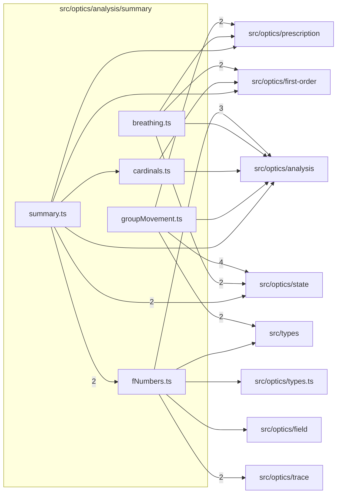

# src/optics/analysis/summary

This folder src/optics/analysis/summary source folder.

Generated `readme.md` and `improvementsuggestions.md` files are intentionally omitted from the per-file inventory so this document stays focused on source relationships.

## Relationship Diagram

## Directory Overview

- Direct source files: 5
- Direct subfolders: 0
- Main outbound areas: src/optics/analysis (10), src/optics/state (8), src/optics/first-order (4), src/optics/prescription (4), src/types (3), src/optics/trace (2), src/optics/field, src/optics/types.ts
- External consumers: src/optics/analysis, src/optics/analysis.ts, src/optics/state

## Files

| File | Role | Imports from | Imported by | Exports |
| --- | --- | --- | --- | --- |
| `breathing.ts` | Breathing helper module | src/optics/first-order (2), src/optics/state (2), src/optics/analysis, src/optics/prescription | src/optics/analysis.ts | computeFocusEFL, BreathingSample, computeFocusBreathingSeries |
| `cardinals.ts` | Cardinals helper module | src/optics/analysis, src/optics/first-order | src/optics/analysis, src/optics/analysis.ts | computeCardinalElements |
| `fNumbers.ts` | F Numbers helper module | src/optics/analysis (3), src/optics/trace (2), src/optics/field, src/optics/types.ts, src/types | src/optics/analysis (2), src/optics/analysis.ts | WorkingFNumberResult, computeWorkingFNumber |
| `groupMovement.ts` | Group Movement helper module | src/optics/state (4), src/optics/prescription (2), src/types (2), src/optics/analysis | src/optics/analysis.ts, src/optics/state | LensMovementGroup, GroupMovementPoint, GroupMovementSeries, GroupMovementAvailability, GroupMovementProfile, getGroupMovementAvailability, isGroupMovementModeAvailable, firstAvailableGroupMovementMode, +2 more |
| `summary.ts` | Summary helper module | src/optics/analysis (4), src/optics/state (2), src/optics/first-order, src/optics/prescription | src/optics/analysis, src/optics/analysis.ts | OpticalSummaryMetrics, computeOpticalSummary |
