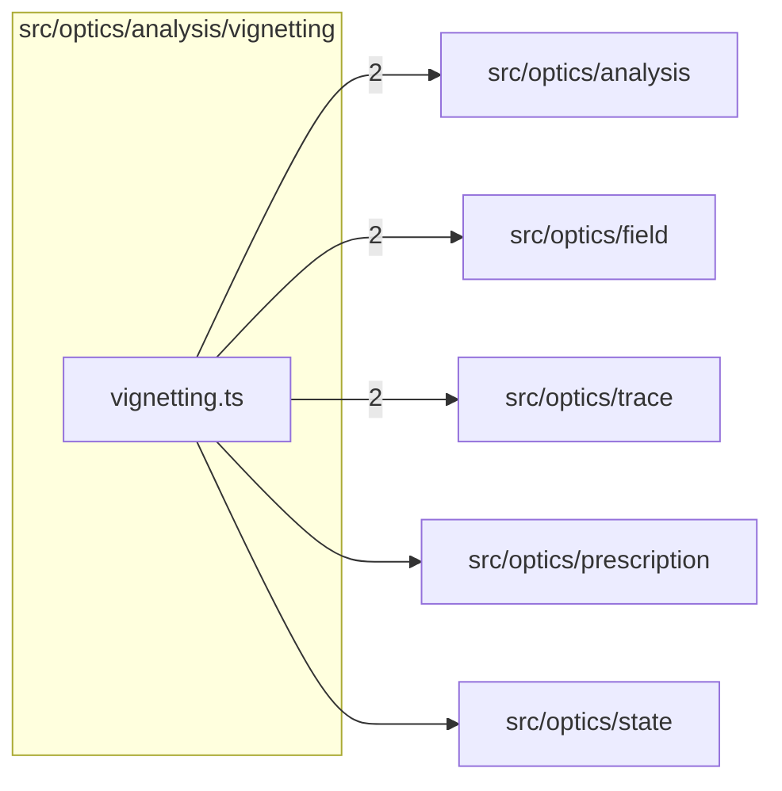

# src/optics/analysis/vignetting

This folder src/optics/analysis/vignetting source folder.

Generated `readme.md` and `improvementsuggestions.md` files are intentionally omitted from the per-file inventory so this document stays focused on source relationships.

## Relationship Diagram

## Directory Overview

- Direct source files: 1
- Direct subfolders: 0
- Main outbound areas: src/optics/analysis (2), src/optics/field (2), src/optics/trace (2), src/optics/prescription, src/optics/state
- External consumers: src/optics/analysis, src/optics/analysis.ts

## Files

| File | Role | Imports from | Imported by | Exports |
| --- | --- | --- | --- | --- |
| `vignetting.ts` | Vignetting helper module | src/optics/analysis (2), src/optics/field (2), src/optics/trace (2), src/optics/prescription, src/optics/state | src/optics/analysis, src/optics/analysis.ts | VignettingSample, computeVignettingCurve |
