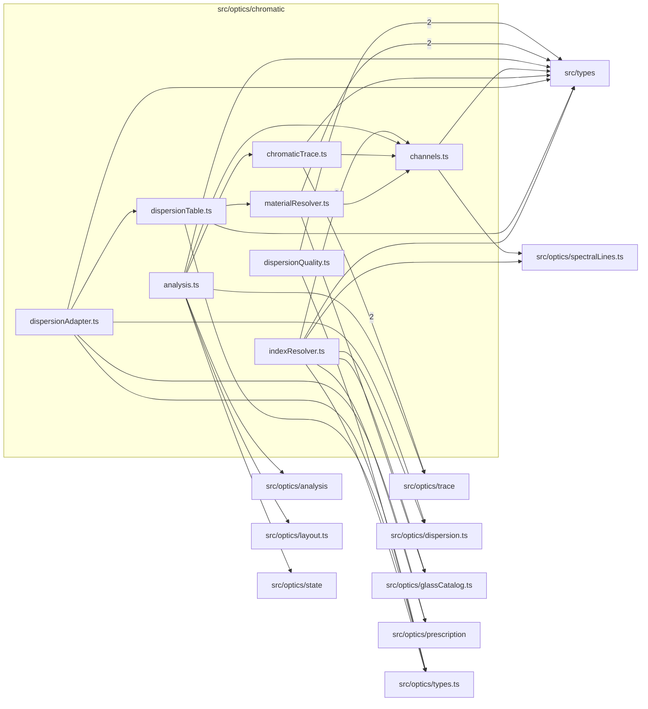

# src/optics/chromatic

This folder chromatic channel, trace, dispersion, and quality helpers.

Generated `readme.md` and `improvementsuggestions.md` files are intentionally omitted from the per-file inventory so this document stays focused on source relationships.

## Relationship Diagram

## Directory Overview

- Direct source files: 8
- Direct subfolders: 0
- Main outbound areas: src/types (10), same folder (8), src/optics/types.ts (4), src/optics/trace (3), src/optics/dispersion.ts (2), src/optics/glassCatalog.ts (2), src/optics/prescription (2), src/optics/spectralLines.ts (2), +3 more
- External consumers: src/components/controls, src/components/diagram, src/components/display, src/components/hooks, src/components/layout, src/optics/aberration, src/optics/analysis, src/optics/buildLens.ts, +6 more

## Files

| File | Role | Imports from | Imported by | Exports |
| --- | --- | --- | --- | --- |
| `analysis.ts` | Analysis helper module | same folder (2), src/optics/analysis, src/optics/layout.ts, src/optics/state, src/optics/trace, +1 more | src/optics/analysis (2) | DEFAULT_CHROMATIC_ANALYSIS_CHANNELS, DEFAULT_LONGITUDINAL_CHROMATIC_FRACTIONS, DEFAULT_LATERAL_COLOR_FIELD_FRACTIONS, ChromaticAnalysisOptions, LongitudinalChromaticFocusSample, LongitudinalChromaticFocusResult, LateralColorChannelSample, LateralColorFieldSample, +5 more |
| `channels.ts` | Channels helper module | src/optics/spectralLines.ts, src/types | src/optics/analysis (6), src/components/display (5), same folder (4), src/components/diagram (3), src/components/controls (2), +6 more | ChromaticChannelMetadata, CHROMATIC_CHANNEL_ORDER, CHROMATIC_CHANNEL_METADATA, CHROMATIC_CHANNEL_WAVELENGTH_NM, E_LINE_CHANNEL_WAVELENGTH_NM, lensChromaticReference, chromaticChannelWavelengthLabel, chromaticChannelDescription, +2 more |
| `chromaticTrace.ts` | Chromatic Trace helper module | src/optics/trace (2), same folder, src/types | same folder, src/optics/analysis, src/optics/compat.ts | computeChromaticRayFanSpread2, traceRayChromatic2, traceRayVectorChromatic2, traceSkewRayChromatic2, traceSkewRayVectorChromatic2, VectorRayTraceInput2, ChromaticChannel, ChromaticRayFanSpread, +2 more |
| `dispersionAdapter.ts` | Dispersion Adapter helper module | same folder, src/optics/dispersion.ts, src/optics/prescription, src/optics/types.ts, src/types | src/optics/compat.ts | compileSurfaceDispersions, makeSurfaceDispersion2, dispersionTableFromRuntime2 |
| `dispersionQuality.ts` | Dispersion Quality helper module | src/types (2), src/optics/types.ts | src/optics/compat.ts, src/optics/dispersion.ts | summarizeDispersionQualityForLens2, summarizeDispersionQualityForState2, summarizeDispersionQuality2 |
| `dispersionTable.ts` | Dispersion Table helper module | same folder, src/optics/types.ts, src/types | same folder, src/optics/buildLens.ts, src/optics/dispersion.ts, src/optics/prescription | compileSurfaceDispersions, buildVdIndex, buildSpectralIndex, resolveMaterialTable, compiledDispersionTable |
| `indexResolver.ts` | Index Resolver helper module | same folder (2), src/optics/dispersion.ts, src/optics/glassCatalog.ts, src/optics/prescription, src/optics/spectralLines.ts, +2 more | src/optics/analysis, src/optics/compat.ts, src/optics/perspective | CHROMATIC_CHANNELS_2, CHANNEL_WAVELENGTH_NM_2, SurfaceIndexResolver2, wavelengthNd2, indexAtPreparedSurface2, indexAtRuntimeSurface2, channelIndexResolverForState2, anchoredIndexAtWavelength, +1 more |
| `materialResolver.ts` | Material Resolver helper module | src/types (2), same folder, src/optics/glassCatalog.ts | same folder, src/optics/dispersion.ts | normalLinePgF, normalLinePdC, normalLinePeC, normalLinePgFPrime, abbeLineIndices, makeSurfaceDispersion |
