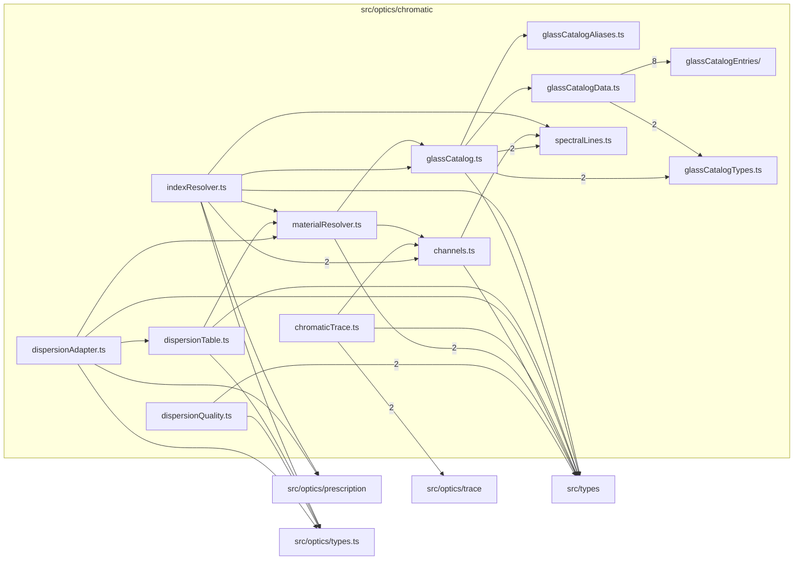

# src/optics/chromatic

This folder chromatic channel, trace, dispersion, and quality helpers.

Generated `readme.md` and `improvementsuggestions.md` files are intentionally omitted from the per-file inventory so this document stays focused on source relationships.

## Relationship Diagram

## Directory Overview

- Direct source files: 12
- Direct subfolders: 1
- Main outbound areas: same folder (28), src/types (10), src/optics/types.ts (4), src/optics/prescription (2), src/optics/trace (2)
- External consumers: src/optics/analysis, src/optics/chromatic, src/optics/chromatic.ts, src/optics/field, src/optics/glassCatalog.ts, src/optics/math, src/optics/perspective, src/optics/prescription, +2 more

## Subfolders

| Folder | Role |
| --- | --- |
| [glassCatalogEntries/](glassCatalogEntries/readme.md) | src/optics/chromatic/glassCatalogEntries source folder |

## Files

| File | Role | Imports from | Imported by | Exports |
| --- | --- | --- | --- | --- |
| `channels.ts` | Channels helper module | same folder, src/types | src/optics/analysis (6), same folder (3), src/optics/perspective (2), src/optics/chromatic.ts, src/optics/field, +2 more | ChromaticChannelMetadata, CHROMATIC_CHANNEL_ORDER, CHROMATIC_CHANNEL_METADATA, CHROMATIC_CHANNEL_WAVELENGTH_NM, E_LINE_CHANNEL_WAVELENGTH_NM, lensChromaticReference, chromaticChannelWavelengthLabel, chromaticChannelDescription, +2 more |
| `chromaticTrace.ts` | Chromatic Trace helper module | src/optics/trace (2), same folder, src/types | src/optics/analysis (2), src/optics/chromatic.ts | computeChromaticRayFanSpread, traceRayChromatic, traceRayVectorChromatic, traceSkewRayChromatic, traceSkewRayVectorChromatic, VectorRayTraceInput, ChromaticChannel, ChromaticRayFanSpread, +2 more |
| `dispersionAdapter.ts` | Dispersion Adapter helper module | same folder (2), src/optics/prescription, src/optics/types.ts, src/types | src/optics/chromatic.ts | compileSurfaceDispersions, makeSurfaceDispersionForRuntimeSurface, dispersionTableFromRuntime |
| `dispersionQuality.ts` | Dispersion Quality helper module | src/types (2), src/optics/types.ts | src/optics/chromatic.ts | summarizeDispersionQualityForLens, summarizeDispersionQualityForState, summarizeDispersionQuality |
| `dispersionTable.ts` | Dispersion Table helper module | same folder, src/optics/types.ts, src/types | same folder, src/optics/chromatic.ts, src/optics/prescription | compileSurfaceDispersions, buildVdIndex, buildSpectralIndex, resolveMaterialTable, compiledDispersionTable |
| `glassCatalog.ts` | Glass Catalog helper module | same folder (6), src/types | same folder (2), src/optics/glassCatalog.ts | GlassEntry, LINE_NM, GLASS_ND_TOLERANCE, GLASS_CATALOG_ND_TOLERANCE, GLASS_CATALOG_VD_TOLERANCE, GLASS_VD_TOLERANCE, CatalogGlassCompatibility, GlassResolutionMatchSource, +16 more |
| `glassCatalogAliases.ts` | Glass Catalog Aliases helper module | none | same folder, src/optics/glassCatalog.ts | GlassAliasKind, GlassAliasRecord, ALIAS_RECORDS, ALIASES |
| `glassCatalogData.ts` | Glass Catalog Data helper module | same folder (10) | same folder, src/optics/glassCatalog.ts | GlassEntry, DUPLICATE_CODE6_PRECEDENCE, RAW_CATALOG |
| `glassCatalogTypes.ts` | Glass Catalog Types helper module | none | same folder (10), src/optics/glassCatalog.ts, src/optics/types.ts | GlassEntry |
| `indexResolver.ts` | Index Resolver helper module | same folder (5), src/optics/prescription, src/optics/types.ts, src/types | src/optics/analysis, src/optics/chromatic.ts, src/optics/perspective | CHROMATIC_CHANNELS, CHANNEL_WAVELENGTH_NM, SurfaceIndexResolver, wavelengthNd, indexAtPreparedSurface, indexAtRuntimeSurface, channelIndexResolverForState, anchoredIndexAtWavelength, +1 more |
| `materialResolver.ts` | Material Resolver helper module | same folder (2), src/types (2) | same folder (3), src/optics/chromatic.ts | normalLinePgF, normalLinePdC, normalLinePeC, normalLinePgFPrime, abbeLineIndices, makeSurfaceDispersion |
| `spectralLines.ts` | Spectral Lines helper module | none | same folder (3), src/optics/analysis (2), src/optics/chromatic.ts, src/optics/math | LINE_NM |
