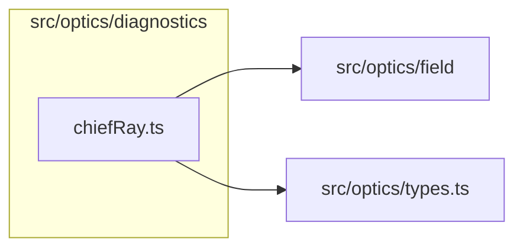

# src/optics/diagnostics

This folder bounded diagnostic snapshots keyed by compiled prescription identity.

Generated `readme.md` and `improvementsuggestions.md` files are intentionally omitted from the per-file inventory so this document stays focused on source relationships.

## Relationship Diagram

## Directory Overview

- Direct source files: 1
- Direct subfolders: 0
- Main outbound areas: src/optics/field, src/optics/types.ts
- External consumers: src/optics/field, src/optics/fieldGeometry.ts

## Files

| File | Role | Imports from | Imported by | Exports |
| --- | --- | --- | --- | --- |
| `chiefRay.ts` | Chief Ray helper module | src/optics/field, src/optics/types.ts | src/optics/field, src/optics/fieldGeometry.ts | ChiefRayStatus, ChiefRayDiagnostics, reportChiefRayFallback, getChiefRayDiagnostics, resetChiefRayDiagnostics |
