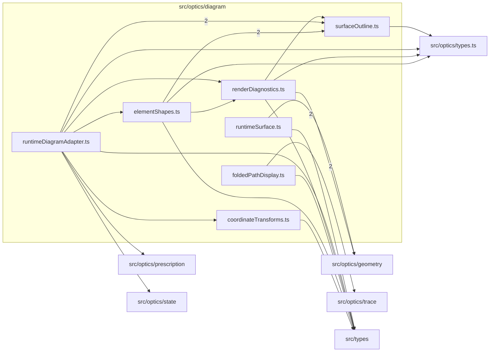

# src/optics/diagram

This folder pure SVG-ready diagram geometry helpers used by React diagram layers.

Generated `readme.md` and `improvementsuggestions.md` files are intentionally omitted from the per-file inventory so this document stays focused on source relationships.

## Relationship Diagram

## Directory Overview

- Direct source files: 7
- Direct subfolders: 0
- Main outbound areas: same folder (9), src/types (6), src/optics/types.ts (4), src/optics/geometry (3), src/optics/trace (2), src/optics/prescription, src/optics/state
- External consumers: src/optics/diagramGeometry.ts

## Files

| File | Role | Imports from | Imported by | Exports |
| --- | --- | --- | --- | --- |
| `coordinateTransforms.ts` | Coordinate Transforms helper module | src/types | same folder, src/optics/diagramGeometry.ts | createCoordinateTransforms |
| `elementShapes.ts` | Element Shapes helper module | same folder (3), src/optics/types.ts, src/types | same folder, src/optics/diagramGeometry.ts | computeElementShapesForState |
| `foldedPathDisplay.ts` | Folded Path Display helper module | src/optics/trace (2), src/types | src/optics/diagramGeometry.ts | foldedHitOrderLabelsForDisplay |
| `renderDiagnostics.ts` | Render Diagnostics helper module | src/optics/geometry (2), same folder, src/optics/types.ts, src/types | same folder (2), src/optics/diagramGeometry.ts | computeElementRenderDiagnosticsForState |
| `runtimeDiagramAdapter.ts` | Runtime Diagram Adapter helper module | same folder (5), src/optics/prescription, src/optics/state, src/optics/types.ts, src/types | src/optics/diagramGeometry.ts | createCoordinateTransforms, computeElementRenderDiagnostics, computeElementShapes, stateForRuntimeDiagram, computeStandaloneMirrorPaths |
| `runtimeSurface.ts` | Runtime Surface helper module | src/optics/geometry, src/types | src/optics/diagramGeometry.ts | renderSag, sagSlope, gapTrimHeight, slopeTrimHeight |
| `surfaceOutline.ts` | Surface Outline helper module | src/optics/types.ts | same folder (3), src/optics/diagramGeometry.ts | SVG_PATH_SUBDIVISIONS, DiagramPointTransform, surfaceSag, renderedSurfaceZ, surfacePathD, surfaceMaterialPathD |
