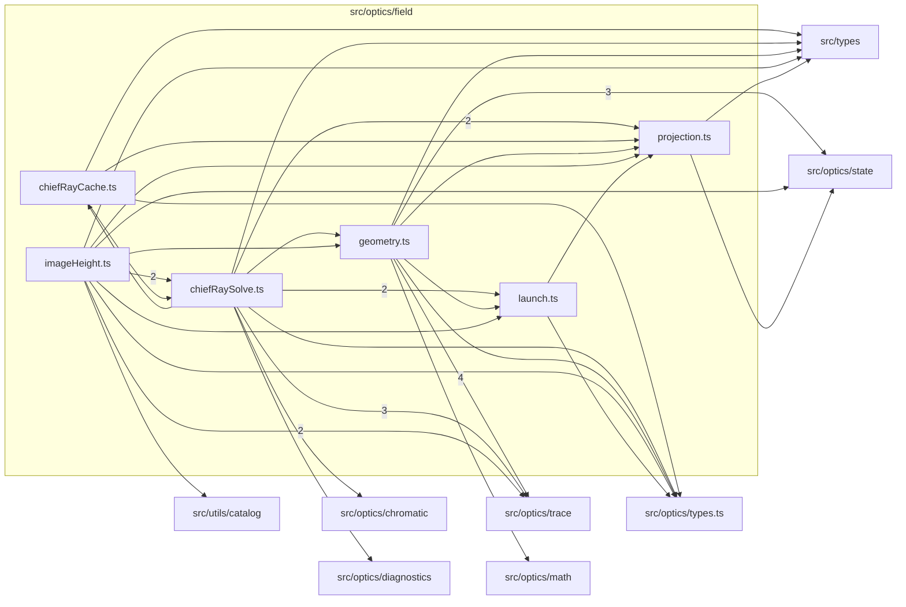

# src/optics/field

This folder engine-native field geometry, chief-ray solving, projection, and launch helpers.

Generated `readme.md` and `improvementsuggestions.md` files are intentionally omitted from the per-file inventory so this document stays focused on source relationships.

## Relationship Diagram

## Directory Overview

- Direct source files: 6
- Direct subfolders: 0
- Main outbound areas: same folder (16), src/optics/trace (9), src/optics/state (5), src/optics/types.ts (5), src/types (5), src/optics/chromatic, src/optics/diagnostics, src/optics/math, +1 more
- External consumers: src/optics/analysis, src/optics/diagnostics, src/optics/fieldGeometry.ts, src/optics/first-order, src/optics/perspective, src/optics/prescription, src/optics/projection.ts, src/optics/state

## Files

| File | Role | Imports from | Imported by | Exports |
| --- | --- | --- | --- | --- |
| `chiefRayCache.ts` | Chief Ray Cache helper module | same folder (2), src/optics/types.ts, src/types | same folder | chiefRayCacheKey, getCachedChiefRaySolve, setCachedChiefRaySolve |
| `chiefRaySolve.ts` | Chief Ray Solve helper module | same folder (6), src/optics/trace (3), src/optics/chromatic, src/optics/diagnostics, src/optics/types.ts, +1 more | same folder (2), src/optics/diagnostics, src/optics/fieldGeometry.ts, src/optics/state | ChiefRaySolveResult, solveChiefRay, solveChiefRayBoundingSphere, computeChiefRaySolve, solveChiefRayFromSeed, solvesChiefRay, ChiefRayRequest |
| `geometry.ts` | Geometry helper module | src/optics/trace (4), src/optics/state (3), same folder (2), src/optics/math, src/optics/types.ts, +1 more | same folder (2), src/optics/fieldGeometry.ts, src/optics/state | EntrancePupilState, computeFieldGeometry, traceParaxialRay, entrancePupil, conjugateK, paraxialObjectVergence, prepareStateSurfacesReal |
| `imageHeight.ts` | Image Height helper module | same folder (5), src/optics/trace (2), src/optics/state, src/optics/types.ts, src/types, +1 more | src/optics/analysis, src/optics/fieldGeometry.ts, src/optics/state | ImageHeightInversionResult, computeAnalysisFieldGeometry, traceChiefRayAtAngle, chiefRayImageHeight, chiefRayImageHeightAccurate, solveFieldAngleForImageHeightAccurate, solveFieldAnglesForImageHeightsAccurate, invertChiefRayImageHeights, +1 more |
| `launch.ts` | Launch helper module | same folder, src/optics/types.ts | src/optics/analysis (9), same folder (3), src/optics/fieldGeometry.ts, src/optics/state | FieldGeometryState, VectorFieldRayLaunch, OffsetVectorFieldRay, computeBoundingSphereLaunchRadiusMm, computeBoundingSphereVectorFieldLaunch, offsetVectorFieldRay |
| `projection.ts` | Projection helper module | src/optics/state, src/types | src/optics/analysis (6), same folder (5), src/optics/perspective (2), src/optics/first-order, src/optics/prescription, +1 more | ProjectionReferenceKind, ProjectionReference, ProjectionFieldSlopes, ProjectionLaunchSlope, ProjectionAngularLaunch, BoundingSphereLaunch, MAX_FIELD_LAUNCH_DEG, ABSOLUTE_HALF_FIELD_CEILING, +17 more |
