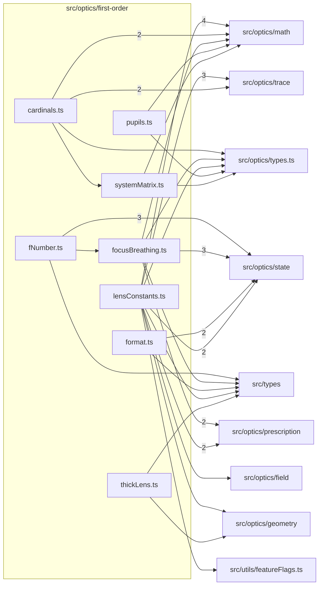

# src/optics/first-order

This folder first-order optical calculations for cardinals, pupils, f-number, focus breathing, and system matrices.

Generated `readme.md` and `improvementsuggestions.md` files are intentionally omitted from the per-file inventory so this document stays focused on source relationships.

## Relationship Diagram

## Directory Overview

- Direct source files: 8
- Direct subfolders: 0
- Main outbound areas: src/optics/state (10), src/optics/math (9), src/optics/trace (5), src/optics/types.ts (5), src/types (5), src/optics/prescription (4), same folder (2), src/optics/geometry (2), +2 more
- External consumers: src/optics/analysis, src/optics/analysis.ts, src/optics/optics.ts, src/optics/perspective, src/optics/prescription

## Files

| File | Role | Imports from | Imported by | Exports |
| --- | --- | --- | --- | --- |
| `cardinals.ts` | Cardinals helper module | src/optics/math (2), src/optics/trace (2), same folder, src/optics/types.ts | src/optics/analysis (2), src/optics/analysis.ts | CardinalPoint, CardinalDistance, CardinalElements, computeCardinalElementsFromState, buildCardinalElementsFromMatrix, computeCardinalElementsWithLayout |
| `fNumber.ts` | F Number helper module | src/optics/state (3), same folder, src/types | src/optics/optics.ts | effectiveFNumber |
| `focusBreathing.ts` | Focus Breathing helper module | src/optics/state (3), src/optics/prescription (2), src/optics/math, src/optics/types.ts, src/types | same folder, src/optics/analysis, src/optics/optics.ts, src/optics/perspective | eflAtFocus, eflAtPreparedState |
| `format.ts` | Format helper module | src/optics/state (2), src/types | src/optics/analysis, src/optics/optics.ts | formatFNumber, marketedApertureNote, formatDist, formatPetzvalRadius |
| `lensConstants.ts` | Lens Constants helper module | src/optics/math (4), src/optics/trace (3), src/optics/prescription (2), src/optics/state (2), src/optics/field, +4 more | src/optics/optics.ts, src/optics/prescription | computeLensConstants, paraxialTrace, realTraceToStop |
| `pupils.ts` | Pupils helper module | src/optics/math, src/optics/types.ts | src/optics/perspective | FirstOrderPupilState, entrancePupilFromStop, paraxialPupilGeometry |
| `systemMatrix.ts` | System Matrix helper module | src/optics/math, src/optics/types.ts | same folder | FirstOrderSystemMatrix, computeSystemMatrix |
| `thickLens.ts` | Thick Lens helper module | src/optics/geometry, src/types | src/optics/optics.ts | thickLensFocalLength, computeElementFocalLength |
