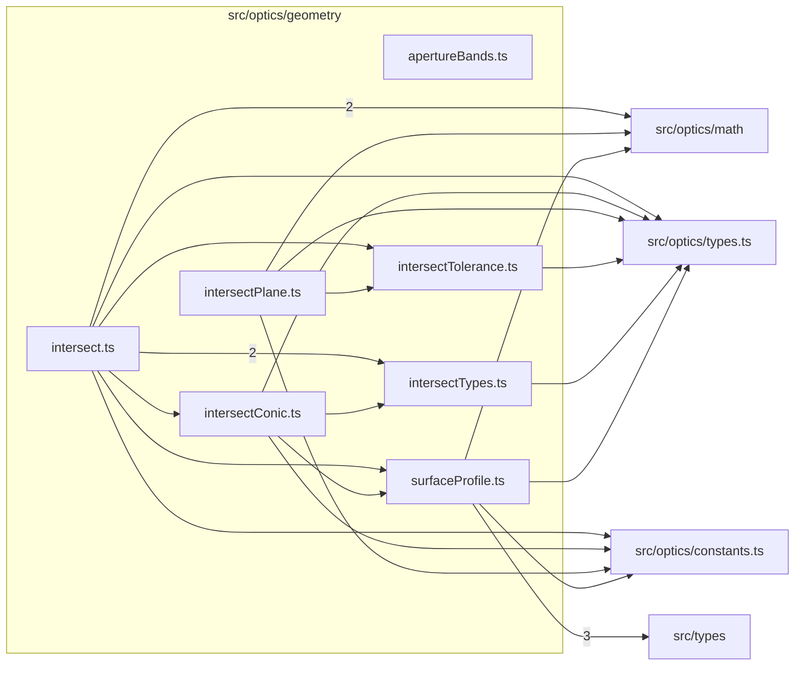

# src/optics/geometry

This folder the single implementation of surface sag, slope, and profiles, with the profile normal, conic domain, and slope bound, and the ray-surface intersection kernel with its roundoff envelopes and plane landings.

Generated `readme.md` and `improvementsuggestions.md` files are intentionally omitted from the per-file inventory so this document stays focused on source relationships.

## Relationship Diagram

## Directory Overview

- Direct source files: 7
- Direct subfolders: 0
- Main outbound areas: same folder (8), src/optics/types.ts (6), src/optics/constants.ts (4), src/optics/math (4), src/types (3)
- External consumers: src/optics/analysis, src/optics/diagram, src/optics/first-order, src/optics/geometry.ts, src/optics/layout.ts, src/optics/math, src/optics/perspective, src/optics/prescription, +1 more

## Files

| File | Role | Imports from | Imported by | Exports |
| --- | --- | --- | --- | --- |
| `apertureBands.ts` | Aperture Bands helper module | none | src/optics/prescription (3), src/optics/diagram | ApertureBandSurface, ApertureBand, materialBandForSurface, sharedMaterialBand, centralOpeningSemiDiameter, surfaceFitsInsideCentralOpening |
| `intersect.ts` | Intersect helper module | same folder (5), src/optics/math (2), src/optics/constants.ts, src/optics/types.ts | src/optics/trace (2) | ClosedFormFallbackReason, SeedRefusal, SurfaceIntersectionFailure, SurfaceIntersectionFailureReason, SurfaceIntersectionOptions, SurfaceIntersectionResult, SurfaceIntersectionSuccess, intersectSurfaceProfile, +1 more |
| `intersectConic.ts` | Intersect Conic helper module | same folder (2), src/optics/constants.ts, src/optics/types.ts | same folder | MAX_ROOT_MOVE, MAX_NORMAL_MOVE, intersectConicClosedForm, baseConicRoot |
| `intersectPlane.ts` | Intersect Plane helper module | same folder, src/optics/constants.ts, src/optics/math, src/optics/types.ts | src/optics/perspective (3), src/optics/trace | RayPlaneIntersection, RayPlaneIntersectionOptions, intersectRayPlane |
| `intersectTolerance.ts` | Intersect Tolerance helper module | src/optics/types.ts | same folder (2) | capCoordinateTolerance, sagResidualRoundoff, planeResidualRoundoff |
| `intersectTypes.ts` | Intersect Types helper module | src/optics/types.ts | same folder (2), src/optics/trace | SurfaceIntersectionFailureReason, ClosedFormFallbackReason, SeedRefusal, SurfaceIntersectionOptions, SurfaceIntersectionSuccess, SurfaceIntersectionFailure, SurfaceIntersectionResult, ParameterInterval |
| `surfaceProfile.ts` | Surface Profile helper module | src/types (3), src/optics/constants.ts, src/optics/math, src/optics/types.ts | src/optics/prescription (7), same folder (2), src/optics/first-order (2), src/optics/analysis, src/optics/diagram, +4 more | FLAT_R_THRESHOLD, MAX_RIM_SLOPE_TAN, DEFAULT_MAX_RIM_ANGLE_DEG, MAX_TERM_POWER, sag, conicPolySag, sagSlopeRaw, normalFromSlope, +6 more |
