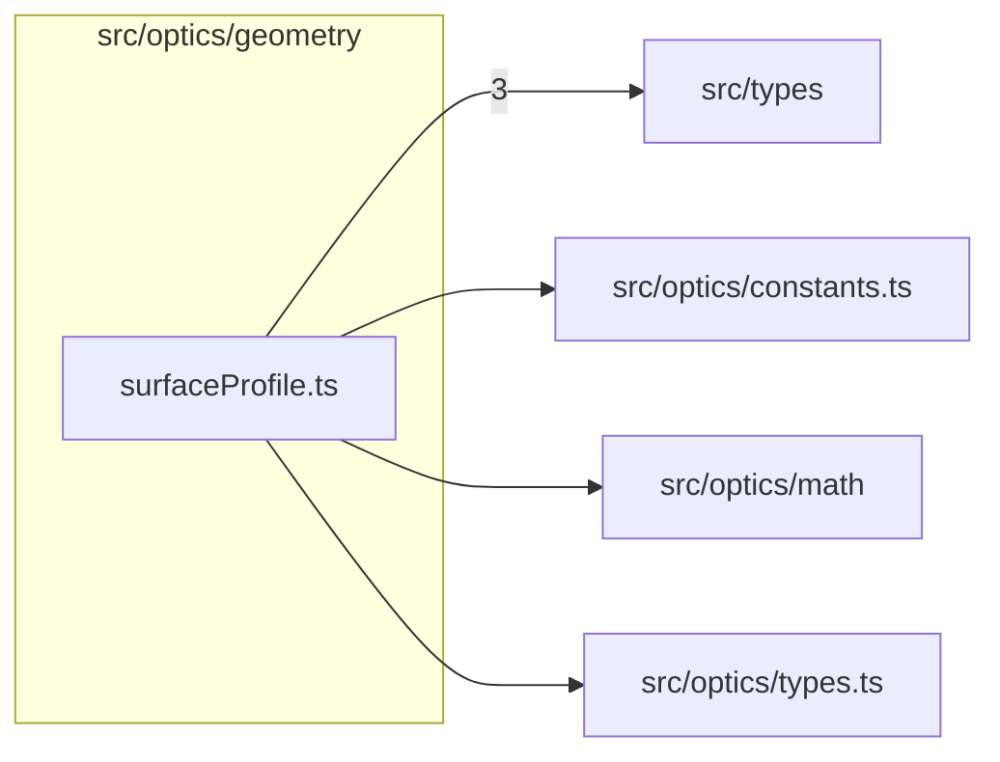

# src/optics/geometry

This folder the single implementation of surface sag, slope, and profiles, with the profile normal, conic domain, and slope bound.

Generated `readme.md` and `improvementsuggestions.md` files are intentionally omitted from the per-file inventory so this document stays focused on source relationships.

## Relationship Diagram

## Directory Overview

- Direct source files: 1
- Direct subfolders: 0
- Main outbound areas: src/types (3), src/optics/constants.ts, src/optics/math, src/optics/types.ts
- External consumers: src/optics/analysis, src/optics/asphericComparison.ts, src/optics/diagram, src/optics/geometry.ts, src/optics/internal, src/optics/layout.ts, src/optics/math, src/optics/prescription, +3 more

## Files

| File | Role | Imports from | Imported by | Exports |
| --- | --- | --- | --- | --- |
| `surfaceProfile.ts` | Surface Profile helper module | src/types (3), src/optics/constants.ts, src/optics/math, src/optics/types.ts | src/optics/internal (2), src/optics/analysis, src/optics/asphericComparison.ts, src/optics/diagram, src/optics/geometry.ts, +6 more | FLAT_R_THRESHOLD, MAX_RIM_SLOPE_TAN, DEFAULT_MAX_RIM_ANGLE_DEG, sag, conicPolySag, sagSlopeRaw, normalFromSlope, conicFiniteRadiusLimit, +5 more |
