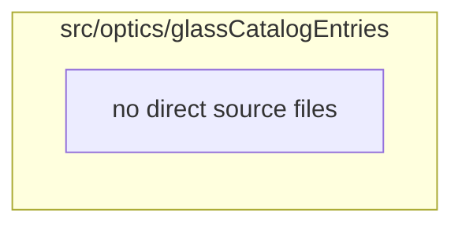

# src/optics/glassCatalogEntries

This folder src/optics/glassCatalogEntries source folder.

Generated `readme.md` and `improvementsuggestions.md` files are intentionally omitted from the per-file inventory so this document stays focused on source relationships.

## Relationship Diagram

## Directory Overview

- Direct source files: 0
- Direct subfolders: 0
- Main outbound areas: none
- External consumers: none

## Files

No direct source files are present in this folder.
