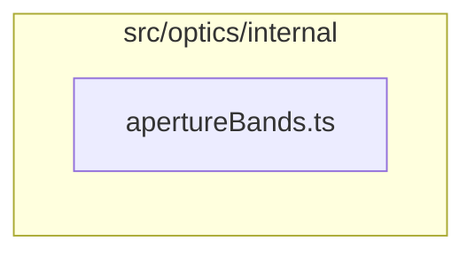

# src/optics/internal

This folder private exact surface-tracing implementation details for the optics engine.

Generated `readme.md` and `improvementsuggestions.md` files are intentionally omitted from the per-file inventory so this document stays focused on source relationships.

## Relationship Diagram

## Directory Overview

- Direct source files: 1
- Direct subfolders: 0
- Main outbound areas: none
- External consumers: src/optics/diagram, src/optics/validateLensData.ts

## Files

| File | Role | Imports from | Imported by | Exports |
| --- | --- | --- | --- | --- |
| `apertureBands.ts` | Aperture Bands helper module | none | src/optics/diagram, src/optics/validateLensData.ts | ApertureBandSurface, ApertureBand, materialBandForSurface, sharedMaterialBand, centralOpeningSemiDiameter, surfaceFitsInsideCentralOpening |
