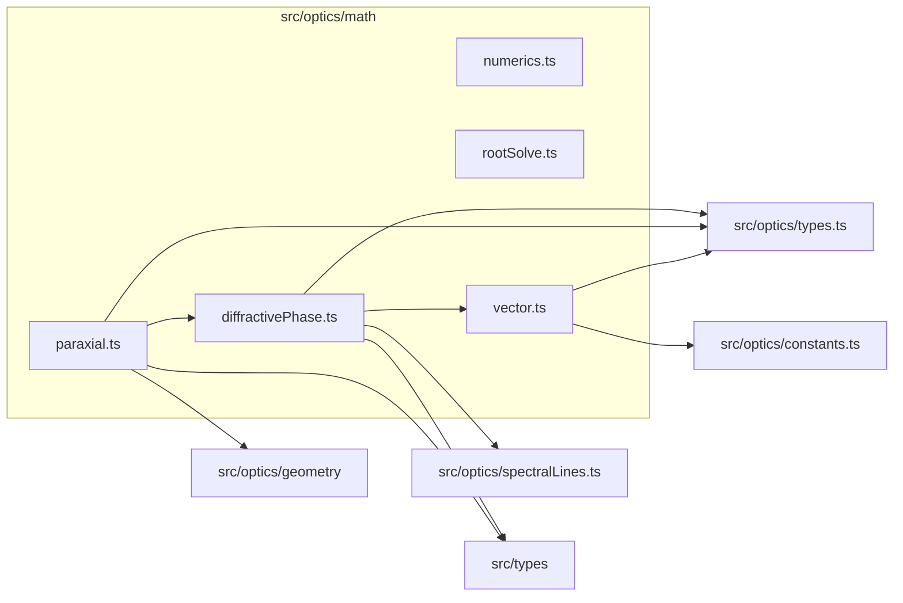

# src/optics/math

This folder low-level vector, numerical, and paraxial math.

Generated `readme.md` and `improvementsuggestions.md` files are intentionally omitted from the per-file inventory so this document stays focused on source relationships.

## Relationship Diagram

## Directory Overview

- Direct source files: 5
- Direct subfolders: 0
- Main outbound areas: src/optics/types.ts (3), same folder (2), src/types (2), src/optics/constants.ts, src/optics/geometry, src/optics/spectralLines.ts
- External consumers: src/components/display, src/optics/analysis, src/optics/field, src/optics/first-order, src/optics/geometry, src/optics/internal, src/optics/perspective, src/optics/prescription, +4 more

## Files

| File | Role | Imports from | Imported by | Exports |
| --- | --- | --- | --- | --- |
| `diffractivePhase.ts` | Diffractive Phase helper module | same folder, src/optics/spectralLines.ts, src/optics/types.ts, src/types | src/optics/trace (3), same folder, src/optics/internal, src/optics/prescription, src/optics/runtimeLens.ts | DEFAULT_PHASE_WAVELENGTH_NM, compileDiffractivePhase, radialPhaseOpticalPath, radialPhaseDerivative, diffractiveWavelengthScale, radialPhaseKick, diffractiveRefractedDirection, diffractiveParaxialPower, +1 more |
| `numerics.ts` | Numerics helper module | none | src/optics/perspective (3), src/optics/geometry, src/optics/prescription, src/optics/state | isFiniteNumber, clamp, clamp01, lerp, nearlyEqual, normalizeControlT, formatCacheNumber, ulpOf |
| `paraxial.ts` | Paraxial helper module | same folder, src/optics/geometry, src/optics/types.ts, src/types | src/optics/first-order (4), src/optics/field, src/optics/internal, src/optics/perspective, src/optics/runtimeLens.ts | ParaxialSurface, ParaxialState, ParaxialTraceOptions, ParaxialTraceResult, transferParaxialRay2, interactParaxialSurface2, traceParaxialSurfaces2 |
| `rootSolve.ts` | Root Solve helper module | none | src/optics/analysis (2), src/optics/perspective (2) | ScalarRootEvaluation, ScalarRootSolveStatus, ScalarRootSolveOptions, ScalarRootSolveResult, solveScalarRoot |
| `vector.ts` | Vector helper module | src/optics/constants.ts, src/optics/types.ts | src/optics/perspective (11), src/optics/geometry (3), src/optics/trace (3), same folder, src/components/display, +3 more | vec3, add, subtract, scale, dot, cross, length, normalize, +5 more |
