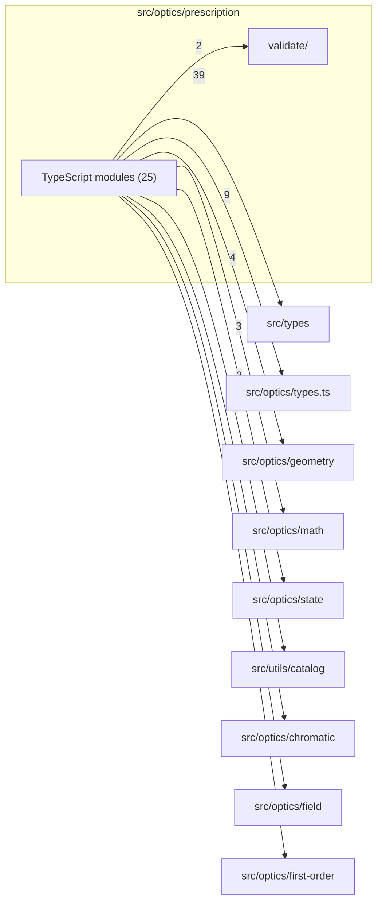

# src/optics/prescription

This folder canonical prescription ingest, compilation, composition, identity ownership, and control helpers.

Generated `readme.md` and `improvementsuggestions.md` files are intentionally omitted from the per-file inventory so this document stays focused on source relationships.

## Relationship Diagram

## Directory Overview

- Direct source files: 25
- Direct subfolders: 1
- Main outbound areas: same folder (68), src/types (39), src/optics/types.ts (9), src/optics/geometry (4), src/optics/math (3), src/optics/state (3), src/utils/catalog (3), src/optics/chromatic, +2 more
- External consumers: src/optics/analysis, src/optics/buildLens.ts, src/optics/chromatic, src/optics/compat.ts, src/optics/diagram, src/optics/first-order, src/optics/lensDataConversion.ts, src/optics/perspective, +5 more

## Subfolders

| Folder | Role |
| --- | --- |
| [validate/](validate/readme.md) | authored shape, canonical facts, diagnostic paths, and compiled geometry validation |

## Files

| File | Role | Imports from | Imported by | Exports |
| --- | --- | --- | --- | --- |
| `canonical.ts` | Canonical helper module | src/types (2), same folder, src/utils/catalog | same folder (15), src/optics/buildLens.ts, src/optics/compat.ts, src/optics/lensDataConversion.ts | FLAT_RADIUS, CanonicalRadius, CanonicalAsphere, CanonicalMediumRef, CanonicalMedium, CanonicalSurface, CanonicalElement, CanonicalRearPlate, +30 more |
| `canonicalInput.ts` | Canonical Input helper module | same folder (4), src/types (2) | same folder (2) | assertValidLensData, canonicalInput |
| `compile.ts` | Compile helper module | same folder (7), src/types (2), src/optics/types.ts | src/optics/analysis, src/optics/chromatic, src/optics/compat.ts, src/optics/diagram, src/optics/first-order, +3 more | compiledLensFromRuntime, withLensDefaults, compileLens, compileLensData |
| `compileAspheres.ts` | Compile Aspheres helper module | same folder, src/types | same folder (3) | compileAspheres, buildAsphereIndex |
| `compileCanonical.ts` | Compile Canonical helper module | same folder (4), src/optics/first-order, src/optics/types.ts, src/types | same folder | compileCanonicalUncached, compilePrescription, completeCompilation |
| `compileConstruction.ts` | Compile Construction helper module | same folder (6), src/types (2), src/optics/chromatic, src/optics/types.ts | same folder | compileConstruction, LensConstruction |
| `compileControls.ts` | Compile Controls helper module | same folder, src/types | same folder (3) | compileVariableGaps, compileVariableLabels, buildVarIndex, firstInfinityThickness |
| `compileGroups.ts` | Compile Groups helper module | same folder, src/optics/types.ts, src/types | same folder | compileElements, compileAnnotations |
| `compileLabels.ts` | Compile Labels helper module | src/types | same folder (6) | Optics2LensNormalizationError, buildSurfaceLabelMap, resolveLabel, buildLabelIndex |
| `composeTeleconverter.ts` | Compose Teleconverter helper module | same folder (2), src/types (2) | same folder | composeTeleconverter |
| `defaults.ts` | Defaults helper module | src/optics/geometry, src/types | same folder (6) | SchemaDefault, LENS_SCHEMA_DEFAULTS, ELEMENT_SCHEMA_DEFAULTS, REAR_PLATE_SCHEMA_DEFAULTS, takesDefault, defaultValue, v1CatalogDefaults |
| `identity.ts` | Identity helper module | same folder, src/optics/types.ts, src/types | same folder (7), src/optics/analysis, src/optics/buildLens.ts, src/optics/chromatic, src/optics/state | associateCanonical, canonicalForView, associateRuntime, compiledLensFromRuntime, canonicalLensFromRuntime |
| `ingestCommon.ts` | Ingest Common helper module | same folder (3), src/types (2) | same folder (2) | Untyped, IngestContext, sourcePathsFor, recordReads, copy, has, put, isNumberList, +8 more |
| `ingestV1.ts` | Ingest V1 helper module | same folder (4), src/types (2), src/optics/geometry | same folder (6), src/optics/buildLens.ts, src/optics/lensDataConversion.ts | V1_FLAT_RADIUS, ingestLensV1, ingestTeleconverterV1 |
| `ingestV2.ts` | Ingest V2 helper module | same folder (5), src/types (3), src/optics/geometry | same folder (3), src/optics/buildLens.ts, src/optics/lensDataConversion.ts | LENS_DATA_V2_SCHEMA, ingestLensV2, ingestTeleconverterV2, isV1File, lensDataVersion, ingestLens, ingestTeleconverter |
| `interactions.ts` | Interactions helper module | src/optics/math, src/optics/types.ts, src/types | same folder (3), src/optics/first-order | yzNormalToVec3, compileSurfaceInteraction, resolvedImagePlaneToPlane3, imagePlaneDataToPlane3 |
| `rearPlates.ts` | Rear Plates helper module | same folder (5), src/types, src/utils/catalog | same folder (4), src/optics/buildLens.ts | REAR_PLATE_LABEL_PATTERN, rearPlateSurfaceLabels, rearPlateAirEquivalentMm, ExpandedCanonicalLens, expandCanonicalRearPlates, expandedConstruction, expandRearPlates, lastLensSurfaceIndex |
| `runtimeView.ts` | Runtime View helper module | same folder, src/optics/types.ts, src/types | src/optics/analysis (14), src/optics/compat.ts, src/optics/first-order, src/optics/perspective | associateRuntimeView, runtimeView |
| `sourcePaths.ts` | Source Paths helper module | none | same folder (6), src/optics/lensDataConversion.ts | memberPath, itemPath, labelPath, childPath, parentPath, pathBelow, extendPath, inverse, +1 more |
| `surfaces.ts` | Surfaces helper module | same folder, src/optics/geometry, src/optics/math, src/optics/types.ts, src/types | same folder (2), src/optics/first-order | compileSurfaces |
| `teleconverter.ts` | Teleconverter helper module | same folder (9), src/optics/state (2), src/types (2), src/optics/field, src/optics/math, +1 more | same folder, src/optics/teleconverter.ts | TeleconverterAttachError, teleconverterSurfaceLabel, teleconverterGroupLabel, mergeTeleconverterPrescription, attachTeleconverter |
| `teleconverterCompatibility.ts` | Teleconverter Compatibility helper module | src/types (2) | same folder (6), src/optics/teleconverter.ts | TELECONVERTER_LABEL_PREFIX, MIN_TELECONVERTER_GAP_MM, TeleconverterHost, rearPlateAirEquivalentMm, teleconverterGeometry, teleconverterCompatibility |
| `toLensData.ts` | To Lens Data helper module | same folder (4), src/types (3), src/optics/state, src/optics/types.ts | same folder (6), src/optics/buildLens.ts, src/optics/lensDataConversion.ts | V1_PRINT_ORDER, V1_GROUP_STARTS, V1_ROW_LISTS, V1FileOptions, toLensData, canonicalConstructionData, toLensDataInput, toTeleconverterData |
| `toLensDataV2.ts` | To Lens Data V2 helper module | same folder (3), src/types (2) | same folder, src/optics/lensDataConversion.ts | V2Writes, v2Writes, V2_GROUP_STARTS, V2_ROW_LISTS, toLensDataV2Input, toTeleconverterDataV2Input, DroppedStopRadius, DroppedValue, +3 more |
| `v1SourceMap.ts` | V1 Source Map helper module | same folder (5), src/types (2) | src/optics/lensDataConversion.ts | V1DroppedValue, V1SourceMap, v1StopRadius, v1SourceMap |
