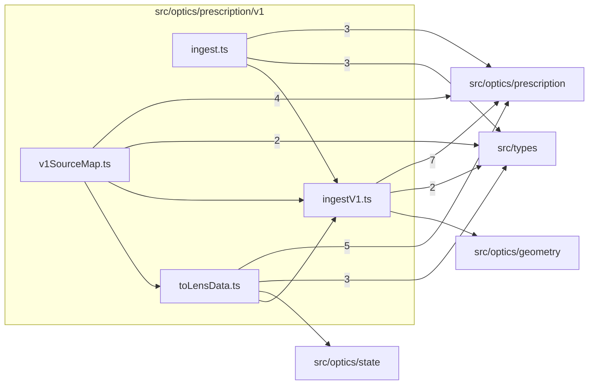

# src/optics/prescription/v1

This folder converter-only V1 ingest, printers, and source-path mapping.

Generated `readme.md` and `improvementsuggestions.md` files are intentionally omitted from the per-file inventory so this document stays focused on source relationships.

## Relationship Diagram

## Directory Overview

- Direct source files: 4
- Direct subfolders: 0
- Main outbound areas: src/optics/prescription (23), src/types (10), src/optics/geometry, src/optics/state
- External consumers: src/optics/lensDataConversion.ts

## Files

| File | Role | Imports from | Imported by | Exports |
| --- | --- | --- | --- | --- |
| `ingest.ts` | Ingest helper module | src/optics/prescription (4), src/types (3) | src/optics/lensDataConversion.ts | ingestLens, ingestTeleconverter |
| `ingestV1.ts` | Ingest V1 helper module | src/optics/prescription (7), src/types (2), src/optics/geometry | src/optics/prescription (3), src/optics/lensDataConversion.ts | V1_FLAT_RADIUS, ingestLensV1, ingestTeleconverterV1 |
| `toLensData.ts` | To Lens Data helper module | src/optics/prescription (6), src/types (3), src/optics/state | src/optics/lensDataConversion.ts, src/optics/prescription | V1_PRINT_ORDER, V1_GROUP_STARTS, V1_ROW_LISTS, V1FileOptions, toLensData, toLensDataInput, toTeleconverterData |
| `v1SourceMap.ts` | V1 Source Map helper module | src/optics/prescription (6), src/types (2) | src/optics/lensDataConversion.ts | V1DroppedValue, V1SourceMap, v1StopRadius, v1SourceMap |
