# src/optics/prescription/validate

This folder authored shape, canonical facts, diagnostic paths, and compiled geometry validation.

Generated `readme.md` and `improvementsuggestions.md` files are intentionally omitted from the per-file inventory so this document stays focused on source relationships.

## Relationship Diagram

```mermaid
flowchart LR
  subgraph n_src_optics_prescription_validate["src/optics/prescription/validate"]
    n_src_optics_prescription_validate_src_optics_prescription_validate_aperture_ts["aperture.ts"]
    n_src_optics_prescription_validate_src_optics_prescription_validate_context_ts["context.ts"]
    n_src_optics_prescription_validate_src_optics_prescription_validate_controls_ts["controls.ts"]
    n_src_optics_prescription_validate_src_optics_prescription_validate_diffractive_ts["diffractive.ts"]
    n_src_optics_prescription_validate_src_optics_prescription_validate_folded_ts["folded.ts"]
    n_src_optics_prescription_validate_src_optics_prescription_validate_geometry_ts["geometry.ts"]
    n_src_optics_prescription_validate_src_optics_prescription_validate_index_ts["index.ts"]
    n_src_optics_prescription_validate_src_optics_prescription_validate_patent_ts["patent.ts"]
    n_src_optics_prescription_validate_src_optics_prescription_validate_paths_ts["paths.ts"]
    n_src_optics_prescription_validate_src_optics_prescription_validate_references_ts["references.ts"]
    n_src_optics_prescription_validate_src_optics_prescription_validate_schema_ts["schema.ts"]
    n_src_optics_prescription_validate_src_optics_prescription_validate_teleconverter_ts["teleconverter.ts"]
  end
  n_external_src_optics_prescription["src/optics/prescription"]
  n_external_src_optics_geometry["src/optics/geometry"]
  n_external_src_types["src/types"]
  n_external_src_optics_math["src/optics/math"]
  n_external_src_optics_state["src/optics/state"]
  n_external_src_optics_trace["src/optics/trace"]
  n_external_src_utils_catalog["src/utils/catalog"]
  n_src_optics_prescription_validate_src_optics_prescription_validate_index_ts --> |5| n_external_src_optics_prescription
  n_src_optics_prescription_validate_src_optics_prescription_validate_schema_ts --> |4| n_external_src_optics_prescription
  n_src_optics_prescription_validate_src_optics_prescription_validate_teleconverter_ts --> |4| n_external_src_optics_prescription
  n_src_optics_prescription_validate_src_optics_prescription_validate_folded_ts --> |3| n_external_src_optics_prescription
  n_src_optics_prescription_validate_src_optics_prescription_validate_aperture_ts --> |2| n_external_src_optics_geometry
  n_src_optics_prescription_validate_src_optics_prescription_validate_geometry_ts --> |2| n_external_src_optics_geometry
  n_src_optics_prescription_validate_src_optics_prescription_validate_paths_ts --> |2| n_external_src_optics_prescription
  n_src_optics_prescription_validate_src_optics_prescription_validate_references_ts --> |2| n_external_src_types
  n_src_optics_prescription_validate_src_optics_prescription_validate_teleconverter_ts --> |2| n_external_src_types
  n_src_optics_prescription_validate_src_optics_prescription_validate_folded_ts --> n_external_src_optics_geometry
  n_src_optics_prescription_validate_src_optics_prescription_validate_references_ts --> n_external_src_optics_geometry
  n_src_optics_prescription_validate_src_optics_prescription_validate_teleconverter_ts --> n_external_src_optics_math
  n_src_optics_prescription_validate_src_optics_prescription_validate_controls_ts --> n_external_src_optics_prescription
  n_src_optics_prescription_validate_src_optics_prescription_validate_geometry_ts --> n_external_src_optics_prescription
  n_src_optics_prescription_validate_src_optics_prescription_validate_references_ts --> n_external_src_optics_prescription
  n_src_optics_prescription_validate_src_optics_prescription_validate_folded_ts --> n_external_src_optics_state
  n_src_optics_prescription_validate_src_optics_prescription_validate_folded_ts --> n_external_src_optics_trace
  n_src_optics_prescription_validate_src_optics_prescription_validate_folded_ts --> n_external_src_types
  n_src_optics_prescription_validate_src_optics_prescription_validate_geometry_ts --> n_external_src_types
  n_src_optics_prescription_validate_src_optics_prescription_validate_index_ts --> n_external_src_types
  n_src_optics_prescription_validate_src_optics_prescription_validate_schema_ts --> n_external_src_types
  n_src_optics_prescription_validate_src_optics_prescription_validate_patent_ts --> n_external_src_utils_catalog
  n_src_optics_prescription_validate_src_optics_prescription_validate_schema_ts --> n_external_src_utils_catalog
  n_src_optics_prescription_validate_src_optics_prescription_validate_index_ts --> n_src_optics_prescription_validate_src_optics_prescription_validate_aperture_ts
  n_src_optics_prescription_validate_src_optics_prescription_validate_references_ts --> n_src_optics_prescription_validate_src_optics_prescription_validate_aperture_ts
  n_src_optics_prescription_validate_src_optics_prescription_validate_aperture_ts --> n_src_optics_prescription_validate_src_optics_prescription_validate_context_ts
  n_src_optics_prescription_validate_src_optics_prescription_validate_controls_ts --> n_src_optics_prescription_validate_src_optics_prescription_validate_context_ts
  n_src_optics_prescription_validate_src_optics_prescription_validate_folded_ts --> n_src_optics_prescription_validate_src_optics_prescription_validate_context_ts
  n_src_optics_prescription_validate_src_optics_prescription_validate_geometry_ts --> n_src_optics_prescription_validate_src_optics_prescription_validate_context_ts
  n_src_optics_prescription_validate_src_optics_prescription_validate_index_ts --> n_src_optics_prescription_validate_src_optics_prescription_validate_context_ts
  n_src_optics_prescription_validate_src_optics_prescription_validate_patent_ts --> n_src_optics_prescription_validate_src_optics_prescription_validate_context_ts
  n_src_optics_prescription_validate_src_optics_prescription_validate_references_ts --> n_src_optics_prescription_validate_src_optics_prescription_validate_context_ts
  n_src_optics_prescription_validate_src_optics_prescription_validate_schema_ts --> n_src_optics_prescription_validate_src_optics_prescription_validate_context_ts
  n_src_optics_prescription_validate_src_optics_prescription_validate_index_ts --> n_src_optics_prescription_validate_src_optics_prescription_validate_controls_ts
  n_src_optics_prescription_validate_src_optics_prescription_validate_schema_ts --> n_src_optics_prescription_validate_src_optics_prescription_validate_diffractive_ts
  n_src_optics_prescription_validate_src_optics_prescription_validate_index_ts --> n_src_optics_prescription_validate_src_optics_prescription_validate_folded_ts
  n_src_optics_prescription_validate_truncated["additional relationships omitted"]
```

## Directory Overview

- Direct source files: 12
- Direct subfolders: 0
- Main outbound areas: src/optics/prescription (43), src/types (8), src/optics/geometry (6), src/utils/catalog (2), src/optics/math, src/optics/state, src/optics/trace
- External consumers: src/optics/prescription, src/optics/validateLensData.ts, src/optics/validateTeleconverterData.ts

## Files

| File | Role | Imports from | Imported by | Exports |
| --- | --- | --- | --- | --- |
| `aperture.ts` | Aperture helper module | src/optics/geometry (2), src/optics/prescription | src/optics/prescription (2) | annularNestedOpeningForSpan, isEmbeddedStop, isAllowedAnnularNestedSurface, isAllowedFoldedRadialSplitSurface, isAllowedFoldedSpanInternalSurface, validatePairedInnerSdConsistency, validateStop |
| `context.ts` | Context helper module | none | src/optics/prescription (8) | UntrustedLensData, ExplicitElementSpan |
| `controls.ts` | Controls helper module | src/optics/prescription (2) | src/optics/prescription | isStationIndexList, validatePublishedStations, validateStations, validateControls |
| `diffractive.ts` | Diffractive helper module | none | src/optics/prescription | validateDiffractivePhase |
| `folded.ts` | Folded helper module | src/optics/prescription (4), src/optics/geometry, src/optics/state, src/optics/trace, src/types | src/optics/prescription (2) | validateImagePlane, validateOpticalPath, validateYzNormal, normalizedNormal, samePlaneNormal, validateTiltedMirrorBackingNormals, validateFoldedImagePlaneReachability |
| `geometry.ts` | Geometry helper module | src/optics/geometry (2), src/optics/prescription (2), src/types | src/optics/prescription | validateGeometry |
| `index.ts` | Barrel/registry module | src/optics/prescription (14), src/types | src/optics/prescription (3), src/optics/validateLensData.ts | default, validateLensData, validateLensInput, validateCanonicalLens |
| `patent.ts` | Patent helper module | src/optics/prescription, src/utils/catalog | src/optics/prescription | validatePatentMetadata |
| `paths.ts` | Paths helper module | src/optics/prescription (2) | src/optics/prescription | authoredMessages |
| `references.ts` | References helper module | src/optics/prescription (3), src/types (2), src/optics/geometry | src/optics/prescription (2) | validateSourceErrata, validateAttachedTeleconverter, validateReferences, validateSpans, validateAnnotations |
| `schema.ts` | Schema helper module | src/optics/prescription (8), src/types, src/utils/catalog | src/optics/prescription (2), src/optics/validateLensData.ts | validateNumberRange, isEnabledMovementRange, validatePerspectiveControlTiltPivot, validatePerspectiveControl, validateOpticalConfiguration, validateProjection, validateRearPlates, validateLensMounts, +6 more |
| `teleconverter.ts` | Teleconverter module with default export | src/optics/prescription (6), src/types (2), src/optics/math | src/optics/validateTeleconverterData.ts | default, validateTeleconverterData |
