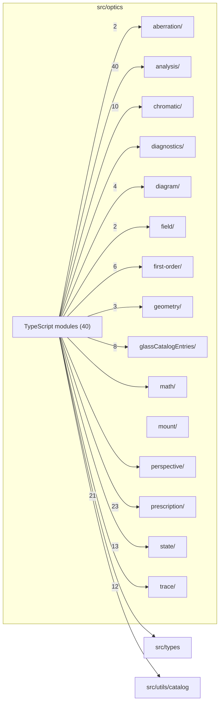

# src/optics

This folder pure optical engine, runtime-lens construction, tracing, analysis, projection, glass, mount rendering, and diagram geometry.

Generated `readme.md` and `improvementsuggestions.md` files are intentionally omitted from the per-file inventory so this document stays focused on source relationships.

## Relationship Diagram

## Directory Overview

- Direct source files: 40
- Direct subfolders: 15
- Main outbound areas: src/optics/analysis (40), src/optics/prescription (23), src/types (21), src/optics/state (13), src/optics/trace (12), src/optics/compat.ts (11), src/optics/chromatic (10), src/optics/glassCatalogEntries (8), +24 more
- External consumers: src/benchmarks, src/comparison, src/components/controls, src/components/diagram, src/components/display, src/components/hooks, src/components/layout, src/optics/aberration, +16 more

## Subfolders

| Folder | Role |
| --- | --- |
| [aberration/](aberration/readme.md) | coma, field-curvature and bokeh orchestration awaiting request migration |
| [analysis/](analysis/readme.md) | prepared-state analysis adapters and grouped analysis facades |
| [chromatic/](chromatic/readme.md) | chromatic channel, trace, dispersion, and quality helpers |
| [diagnostics/](diagnostics/readme.md) | bounded diagnostic snapshots keyed by compiled prescription identity |
| [diagram/](diagram/readme.md) | pure SVG-ready diagram geometry helpers used by React diagram layers |
| [field/](field/readme.md) | engine-native field geometry, chief-ray solving, projection, and launch helpers |
| [first-order/](first-order/readme.md) | first-order optical calculations for cardinals, pupils, f-number, focus breathing, and system matrices |
| [geometry/](geometry/readme.md) | the single implementation of surface sag, slope, and profiles, with the profile normal, conic domain, and slope bound, and the ray-surface intersection kernel with its roundoff envelopes and plane landings |
| [glassCatalogEntries/](glassCatalogEntries/readme.md) | src/optics/glassCatalogEntries source folder |
| [math/](math/readme.md) | low-level vector, numerical, and paraxial math |
| [mount/](mount/readme.md) | pure mount-diagram geometry, SVG document emission, validation, styling, and JSON helpers |
| [perspective/](perspective/readme.md) | src/optics/perspective source folder |
| [prescription/](prescription/readme.md) | canonical prescription ingest, compilation, composition, identity ownership, and control helpers |
| [state/](state/readme.md) | engine-native prepared optical state and cache helpers |
| [trace/](trace/readme.md) | exact tracing adapters, path planning, folded diagnostics, stop tracing, and aperture/interactions primitives |

## Files

| File | Role | Imports from | Imported by | Exports |
| --- | --- | --- | --- | --- |
| `aberrationAnalysis.ts` | Aberration Analysis helper module | src/optics/analysis (6), src/optics/aberration (2) | src/components/display (18), src/optics/analysis | re-export *, computeSAProfile, computeSphericalAberration, computeSphericalAberrationBlurCharacter, computeComaAnalysis, computeComaPointCloudPreview, computeComaPreview, computeMeridionalComa, +12 more |
| `analysis.ts` | Analysis helper module | src/optics/analysis (12), src/optics/state | src/components/display (6), src/comparison (3), src/benchmarks, src/components/controls, src/components/hooks | createAnalysisRequest, AnalysisRequest, AnalysisRequestParams, createAnalysisComputationContext, AnalysisComputationContext, computeOpticalSummary, OpticalSummaryMetrics2, computeCardinalElements, +30 more |
| `aperture.ts` | Aperture helper module | src/optics/compat.ts, src/types | src/comparison, src/components/hooks | fNumberAtStopdown |
| `apertureStop.ts` | Aperture Stop helper module | src/optics/state | src/benchmarks, src/components/diagram, src/components/hooks, src/optics/field, src/optics/state | wideOpenStopAtZoom |
| `asphericComparison.ts` | Aspheric Comparison helper module | src/optics/geometry, src/types | src/components/display | DepartureSample, computeAsphericDeparture, computeDepartureProfile, computeBestFitSphereR, peakAbsDeparture, rmsDeparture, nearestSurfaceForClick |
| `buildLens.ts` | Build Lens module with default export | src/optics/prescription (7), src/optics/compat.ts (2), src/optics/chromatic, src/optics/first-order | src/components/hooks (3), src/utils/catalog (2), src/benchmarks, src/comparison | paraxialTrace, realTraceToStop, ingestLensV1, ingestTeleconverterV1, ingestLens, ingestTeleconverter, isV1File, toLensData, +11 more |
| `cameraLayout.ts` | Camera Layout helper module | src/types | src/optics/analysis, src/optics/optics.ts | CameraAnchoredLayout, anchorLayoutToCamera |
| `cardinalElements.ts` | Cardinal Elements helper module | src/optics/compat.ts | src/components/diagram (3), src/components/hooks, src/components/layout | computeCardinalElements, CardinalDistance, CardinalElements, CardinalPoint |
| `chiefRayDiagnostics.ts` | Chief Ray Diagnostics helper module | src/optics/compat.ts | none | getChiefRayDiagnostics, resetChiefRayDiagnostics, ChiefRayStatusCounts, ChiefRayStatus |
| `chromaticRayFanScaling.ts` | Chromatic Ray Fan Scaling helper module | src/optics/chromatic, src/types | src/components/diagram (2) | REFERENCE_LOCA_MM, REFERENCE_FAN_IMAGE_HEIGHT_SPREAD_MM, ChromaticBarResult, computeChromaticBarOffsets, computeLocaBarOffsets |
| `compat.ts` | Compat helper module | src/optics/analysis (14), src/optics/chromatic (4), src/optics/diagram (4), src/optics/state (4), src/optics/first-order (3), +6 more | src/components/display (13), src/components/hooks (2), src/components/layout (2), src/benchmarks, src/comparison, +7 more | buildLens2, buildCanonicalLens, engineLensFromRuntime, prepareRuntimeState, doLayout2, thick2, eflAtZoom2, epAtZoom2, +162 more |
| `constants.ts` | Constants helper module | src/optics/chromatic | src/optics/geometry (4), src/optics/field, src/optics/math, src/optics/trace | VECTOR_EPSILON, INTERSECTION_TOLERANCE, INTERSECTION_MAX_ITERATIONS, INTERSECTION_BRACKET_SAMPLES, CHROMATIC_CHANNEL_WAVELENGTH_NM |
| `diagramGeometry.ts` | Diagram Geometry helper module | src/optics/compat.ts | src/benchmarks, src/components/diagram, src/components/hooks | computeElementRenderDiagnostics, computeElementShapes, computeStandaloneMirrorPaths, createCoordinateTransforms, DiagramPointTransform |
| `dispersion.ts` | Dispersion helper module | src/optics/chromatic (3), src/types | src/components/diagram (7), src/components/display (2), src/optics/chromatic (2), src/components/hooks, src/components/layout | normalLinePgF, normalLinePdC, normalLinePeC, normalLinePgFPrime, abbeLineIndices, makeSurfaceDispersion, buildSurfaceDispersionIndex, DispersionQuality, +3 more |
| `distortionAnalysis.ts` | Distortion Analysis helper module | src/optics/optics.ts (2), src/optics/analysis, src/optics/projection.ts, src/optics/raySampling.ts, src/optics/trace, +2 more | src/components/display (2), src/optics/analysis | DistortionSample, DistortionCurveResult, DistortionGridPoint, DistortionGridLine, DistortionFieldGridResult, computeDistortionCurve, computeDistortionFieldGrid |
| `fieldGeometry.ts` | Field Geometry helper module | src/optics/compat.ts | none | chiefRayImageHeight, chiefRayImageHeightAccurate, invertChiefRayImageHeights, ImageHeightInversionResult, computeAnalysisFieldGeometryAtState, computeBoundingSphereLaunchRadiusMm, computeBoundingSphereVectorFieldLaunch, computeFieldGeometryAtState, +15 more |
| `focusDistance.ts` | Focus Distance helper module | src/optics/state (2), src/types | src/optics/first-order (2), src/comparison, src/components/controls, src/optics/analysis, src/optics/field, +4 more | FOCUS_INFINITY_CUTOFF, focusDistanceAt, remapFocusDistance, closeFocusAtZoom |
| `foldedPathDisplay.ts` | Folded Path Display helper module | src/optics/raySampling.ts, src/optics/trace, src/types | src/components/layout | foldedHitOrderLabelsForDisplay |
| `geometry.ts` | Geometry helper module | src/optics/geometry | src/components/display | DEFAULT_MAX_RIM_ANGLE_DEG, FLAT_R_THRESHOLD, MAX_RIM_SLOPE_TAN, conicPolySag, sag, sagSlopeRaw |
| `glassCatalog.ts` | Glass Catalog helper module | src/optics/glassCatalogTypes.ts (2), src/optics/spectralLines.ts (2), src/optics/glassCatalogAliases.ts, src/optics/glassCatalogData.ts, src/types | src/optics/chromatic (2), src/optics/types.ts, src/types | GlassEntry, LINE_NM, GLASS_ND_TOLERANCE, GLASS_CATALOG_ND_TOLERANCE, GLASS_CATALOG_VD_TOLERANCE, GLASS_VD_TOLERANCE, CatalogGlassCompatibility, GlassResolutionMatchSource, +16 more |
| `glassCatalogAliases.ts` | Glass Catalog Aliases helper module | none | src/optics/glassCatalog.ts | GlassAliasKind, GlassAliasRecord, ALIAS_RECORDS, ALIASES |
| `glassCatalogData.ts` | Glass Catalog Data helper module | src/optics/glassCatalogEntries (8), src/optics/glassCatalogTypes.ts (2) | src/optics/glassCatalog.ts | GlassEntry, DUPLICATE_CODE6_PRECEDENCE, RAW_CATALOG |
| `glassCatalogTypes.ts` | Glass Catalog Types helper module | none | src/optics/glassCatalogEntries (8), src/optics/glassCatalog.ts, src/optics/glassCatalogData.ts | GlassEntry |
| `layout.ts` | Layout helper module | src/optics/first-order (2), src/optics/state (2), src/optics/focusDistance.ts, src/optics/geometry, src/types | src/optics/analysis (7), src/optics/aberration, src/optics/chromatic, src/optics/optics.ts, src/optics/opticsFormat.ts, +1 more | SVG_PATH_SUBDIVISIONS, FOCUS_INFINITY_CUTOFF, renderSag, sagSlope, gapTrimHeight, slopeTrimHeight, thick, doLayout, +13 more |
| `lensDataConversion.ts` | Lens Data Conversion helper module | src/optics/prescription (7) | none | ingestLens, ingestTeleconverter, lensDataVersion, V1_FLAT_RADIUS, V1_GROUP_STARTS, V1_PRINT_ORDER, V1_ROW_LISTS, toLensDataInput, +12 more |
| `lensMovement.ts` | Lens Movement helper module | src/optics/perspective, src/types | src/optics/perspective (3), src/comparison (2), src/benchmarks, src/components/controls, src/components/diagram, +3 more | LensMovementState, ResolvedLensMovement, LensMovementTransform, MOVEMENT_SHIFT_ENVELOPE_MM, MOVEMENT_TILT_ENVELOPE_DEG, isMovementAxisEnabled, ZERO_LENS_MOVEMENT, perspectiveControlSteps, +5 more |
| `mtf.ts` | Mtf helper module | src/optics/analysis (3) | src/components/display, src/components/hooks | assessMtfSupport, MTF_FIELDS, MTF_FREQUENCIES, MTF_PHOTOPIC_LINES, resolveMtfSpectrum, computeMtf, computeMtfSteps, resolveMtfGeometry, +3 more |
| `optics.ts` | Optics helper module | src/optics/compat.ts (4), src/optics/trace (3), src/optics/analysis (2), src/optics/cameraLayout.ts, src/optics/layout.ts, +3 more | src/components/display (12), src/optics/analysis (7), src/components/hooks (6), src/comparison (3), src/components/controls (3), +7 more | traceChiefRelativeSkewRay, traceChiefRelativeSkewRayChromatic, anchorLayoutToCamera, CameraAnchoredLayout, FOCUS_INFINITY_CUTOFF, SVG_PATH_SUBDIVISIONS, bAtZoom, epZRelStopAtZoom, +73 more |
| `opticsFormat.ts` | Optics Format helper module | src/optics/focusDistance.ts, src/optics/layout.ts, src/types | src/optics/analysis, src/optics/optics.ts | formatFNumber, marketedApertureNote, formatDist, formatPetzvalRadius |
| `projection.ts` | Projection helper module | src/optics/field | src/components/controls (2), src/components/hooks, src/components/layout, src/optics/distortionAnalysis.ts, src/optics/pupilAberration.ts, +1 more | ABSOLUTE_HALF_FIELD_CEILING, MAX_FIELD_LAUNCH_DEG, TRACING_SAFETY_FACTOR, boundingSphereLaunchVector, distortionProjectionReferenceForLens, fisheyeProjectionFocalLengthAtZoom, fisheyeProjectionMaxTraceFieldAtZoom, isFisheyeProjection, +16 more |
| `publishedStations.ts` | Published Stations helper module | src/optics/analysis, src/optics/focusDistance.ts, src/optics/state, src/types | src/components/controls (2), src/components/hooks | STATION_COORDINATE_TOLERANCE, PublishedStationSource, PublishedStationCoordinate, PublishedStationGrid, PublishedZoomStation, PublishedFocusStation, PublishedStationLimitKind, PublishedStationLimit, +8 more |
| `pupilAberration.ts` | Pupil Aberration helper module | src/optics/trace (3), src/optics/optics.ts (2), src/optics/math, src/optics/prescription, src/optics/projection.ts, +3 more | src/components/display, src/optics/analysis | PupilAberrationSample, PupilAberrationProfile, ExitPupilAberrationSample, ExitPupilAberrationProfile, PUPIL_ABERRATION_SAMPLE_COUNT, computePupilAberrationProfile, computeExitPupilAberrationProfile, BothPupilAberrationProfiles, +1 more |
| `raySampling.ts` | Ray Sampling helper module | src/types (2), src/optics/stopObstruction.ts | src/components/hooks (3), src/benchmarks, src/components/layout, src/optics/distortionAnalysis.ts, src/optics/field, +2 more | isHeavyLensForRayWork, rayFractionsForDensity, obstructionAwareRayFractionsForDensity, raySampleCountForDensity |
| `spectralLines.ts` | Spectral Lines helper module | none | src/optics/analysis (2), src/optics/chromatic (2), src/optics/glassCatalog.ts, src/optics/math | LINE_NM |
| `stopObstruction.ts` | Stop Obstruction helper module | src/types | src/optics/optics.ts, src/optics/raySampling.ts | stopInnerBlockedSemiDiameter |
| `teleconverter.ts` | Teleconverter helper module | src/optics/prescription (2), src/optics/validateTeleconverterData.ts | src/components/diagram, src/utils/catalog | attachTeleconverter, TeleconverterAttachError, teleconverterGroupLabel, teleconverterSurfaceLabel, MIN_TELECONVERTER_GAP_MM, TELECONVERTER_LABEL_PREFIX, teleconverterCompatibility, teleconverterGeometry, +1 more |
| `types.ts` | Shared TypeScript types | src/types (2), src/optics/glassCatalog.ts, src/optics/trace | src/optics/perspective (20), src/optics/analysis (19), src/components/display (14), src/optics/trace (12), src/optics/prescription (9), +12 more | Vec3, Ray3, Plane3, SagSlope, SurfaceProfile, CompiledSurfaceInteraction, CompiledRadialPhaseTerm, CompiledDiffractivePhase, +22 more |
| `validateLensData.ts` | Validate Lens Data module with default export | src/optics/prescription (2) | src/utils/state | default, validateLensInput, validateCanonicalLens, LENS_KEY_PATTERN, validateLensMounts, validateRearPlates |
| `validateTeleconverterData.ts` | Validate Teleconverter Data module with default export | src/optics/prescription | src/optics/teleconverter.ts | default |
| `vignetteAnalysis.ts` | Vignette Analysis helper module | src/optics/optics.ts (2), src/optics/analysis, src/optics/projection.ts, src/optics/raySampling.ts, src/optics/trace, +1 more | src/components/display, src/optics/analysis | VignettingSample, computeVignettingCurve |
