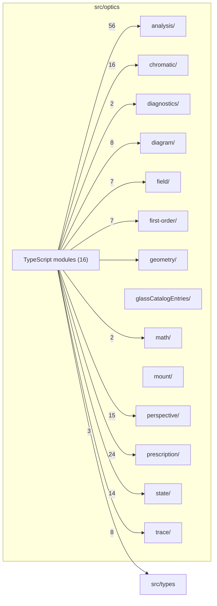

# src/optics

This folder pure optical engine, runtime-lens construction, tracing, analysis, projection, glass, mount rendering, and diagram geometry.

Generated `readme.md` and `improvementsuggestions.md` files are intentionally omitted from the per-file inventory so this document stays focused on source relationships.

## Relationship Diagram

## Directory Overview

- Direct source files: 16
- Direct subfolders: 14
- Main outbound areas: src/optics/analysis (56), src/optics/prescription (24), src/optics/chromatic (16), src/optics/perspective (15), src/optics/state (14), src/optics/diagram (8), src/optics/trace (8), src/optics/field (7), +6 more
- External consumers: src/benchmarks, src/comparison, src/components/controls, src/components/diagram, src/components/display, src/components/hooks, src/components/layout, src/optics/analysis, +14 more

## Subfolders

| Folder | Role |
| --- | --- |
| [analysis/](analysis/readme.md) | prepared-state analysis adapters and grouped analysis facades |
| [chromatic/](chromatic/readme.md) | chromatic channel, trace, dispersion, and quality helpers |
| [diagnostics/](diagnostics/readme.md) | bounded diagnostic snapshots keyed by compiled prescription identity |
| [diagram/](diagram/readme.md) | pure SVG-ready diagram geometry helpers used by React diagram layers |
| [field/](field/readme.md) | engine-native field geometry, chief-ray solving, projection, and launch helpers |
| [first-order/](first-order/readme.md) | first-order optical calculations for cardinals, pupils, f-number, focus breathing, and system matrices |
| [geometry/](geometry/readme.md) | the single implementation of surface sag, slope, and profiles, with the profile normal, conic domain, and slope bound, and the ray-surface intersection kernel with its roundoff envelopes and plane landings |
| [glassCatalogEntries/](glassCatalogEntries/readme.md) | src/optics/glassCatalogEntries source folder |
| [math/](math/readme.md) | low-level vector, numerical, and paraxial math |
| [mount/](mount/readme.md) | pure mount-diagram geometry, SVG document emission, validation, styling, and JSON helpers |
| [perspective/](perspective/readme.md) | src/optics/perspective source folder |
| [prescription/](prescription/readme.md) | canonical prescription ingest, compilation, composition, identity ownership, and control helpers |
| [state/](state/readme.md) | engine-native prepared optical state and cache helpers |
| [trace/](trace/readme.md) | exact tracing adapters, path planning, folded diagnostics, stop tracing, and aperture/interactions primitives |

## Files

| File | Role | Imports from | Imported by | Exports |
| --- | --- | --- | --- | --- |
| `analysis.ts` | Analysis helper module | src/optics/analysis (44), src/optics/first-order (2), src/optics/state | src/components/display (39), src/components/diagram (5), src/components/hooks (5), src/comparison (3), src/components/layout (3), +2 more | computeBestFocusZ, computeImagePlaneZAtFocus, computeComaAnalysis, computeComaPointCloudPreview, computeComaPreview, computeMeridionalComa, computeSagittalComa, computeFieldCurvature, +155 more |
| `buildLens.ts` | Build Lens module with default export | src/optics/prescription (10), src/optics/state | src/utils/catalog (4), src/components/hooks (3), src/comparison | compileLens, canonicalInput, CanonicalTeleconverter, buildCanonicalLens, buildLens, CanonicalLens, IngestedPrescription, canonicalLensFromRuntime, +10 more |
| `chromatic.ts` | Chromatic helper module | src/optics/chromatic (9), src/types | src/components/diagram (7), src/components/display (5), src/components/controls (2), src/components/hooks (2), src/components/layout (2) | CHROMATIC_CHANNEL_METADATA, CHROMATIC_CHANNEL_ORDER, CHROMATIC_CHANNEL_WAVELENGTH_NM, chromaticChannelDescription, chromaticChannelIndexLabel, chromaticChannelLineList, chromaticChannelWavelengthLabel, lensChromaticReference, +25 more |
| `diagramGeometry.ts` | Diagram Geometry helper module | src/optics/diagram (8) | src/components/diagram, src/components/hooks, src/components/layout | createCoordinateTransforms, computeElementShapesForState, foldedHitOrderLabelsForDisplay, computeElementRenderDiagnosticsForState, computeElementRenderDiagnostics, computeElementShapes, computeStandaloneMirrorPaths, stateForRuntimeDiagram, +7 more |
| `fieldGeometry.ts` | Field Geometry helper module | src/optics/field (5), src/optics/diagnostics (2), src/optics/state | src/components/display (9), src/components/hooks (5), src/components/layout (2), src/benchmarks | getChiefRayDiagnostics, resetChiefRayDiagnostics, ChiefRayDiagnostics, ChiefRayStatus, ChiefRaySolveResult, EntrancePupilState, ImageHeightInversionResult, offsetVectorFieldRay, +20 more |
| `geometry.ts` | Geometry helper module | src/optics/math (2), src/optics/geometry | src/components/display (2) | DEFAULT_MAX_RIM_ANGLE_DEG, FLAT_R_THRESHOLD, MAX_RIM_SLOPE_TAN, conicPolySag, sag, sagSlopeRaw, INTERSECTION_BRACKET_SAMPLES, INTERSECTION_MAX_ITERATIONS, +4 more |
| `glassCatalog.ts` | Glass Catalog helper module | src/optics/chromatic (6) | src/types | GLASS_CATALOG_ND_TOLERANCE, GLASS_CATALOG_VD_TOLERANCE, GLASS_ND_TOLERANCE, GLASS_VD_TOLERANCE, UNRESOLVED_MARKER, allEntries, assertCatalogConsistent, assessCatalogGlassCompatibility, +21 more |
| `lensDataConversion.ts` | Lens Data Conversion helper module | src/optics/prescription (7) | none | ingestLens, ingestTeleconverter, lensDataVersion, V1_FLAT_RADIUS, V1_GROUP_STARTS, V1_PRINT_ORDER, V1_ROW_LISTS, toLensData, +13 more |
| `mtf.ts` | Mtf helper module | src/optics/analysis (12) | src/components/display, src/components/hooks | computeMtf, computeMtfSteps, resolveMtfGeometry, MtfJobCache, MTF_ESTIMATED_DISPERSION_MAX_VD, MTF_FIELDS, MTF_FREQUENCIES, assessMtfDataLimitations, +17 more |
| `optics.ts` | Optics helper module | src/optics/state (8), src/optics/trace (7), src/optics/first-order (5), src/optics/projection.ts | src/components/display (9), src/components/hooks (6), src/comparison (3), src/components/controls (3), src/components/diagram (3), +2 more | effectiveFNumber, eflAtFocus, formatDist, formatFNumber, formatPetzvalRadius, marketedApertureNote, paraxialTrace, realTraceToStop, +53 more |
| `perspective.ts` | Perspective helper module | src/optics/perspective (15) | src/components/display (10), src/components/hooks (5), src/comparison (2), src/components/layout (2), src/benchmarks, +3 more | PerspectiveChromaticAnalysis, PerspectiveChromaticChannelSample, PerspectiveChromaticFieldSample, PerspectiveChromaticRayFanSample, PerspectiveDistortionAnalysis, PerspectiveDistortionSample, PerspectiveComaFieldSample, PerspectiveComaRaySample, +28 more |
| `projection.ts` | Projection helper module | src/optics/field (2) | src/components/controls (2), src/components/hooks, src/components/layout, src/optics/optics.ts | ProjectionReferenceKind, ABSOLUTE_HALF_FIELD_CEILING, MAX_FIELD_LAUNCH_DEG, TRACING_SAFETY_FACTOR, boundingSphereLaunchVector, distortionProjectionReferenceForLens, fisheyeProjectionFocalLengthAtZoom, fisheyeProjectionMaxTraceFieldAtZoom, +16 more |
| `publishedStations.ts` | Published Stations helper module | src/optics/state (2) | src/components/controls (2), src/components/hooks | STATION_COORDINATE_TOLERANCE, isOnPublishedStation, nearestPublishedStation, nearestStationInGrid, publishedFocusStations, publishedStationAvailability, publishedStationGrid, publishedZoomStations, +8 more |
| `teleconverter.ts` | Teleconverter helper module | src/optics/prescription (3) | src/components/diagram, src/utils/catalog | teleconverterCompatibility, TeleconverterAttachError, attachTeleconverter, teleconverterGroupLabel, teleconverterSurfaceLabel, MIN_TELECONVERTER_GAP_MM, TELECONVERTER_LABEL_PREFIX, teleconverterGeometry |
| `types.ts` | Shared TypeScript types | src/types (2), src/optics/chromatic, src/optics/prescription, src/optics/state, src/optics/trace | src/optics/perspective (20), src/components/display (14), src/optics/analysis (12), src/optics/trace (12), src/optics/prescription (9), +10 more | Vec3, Ray3, Plane3, SagSlope, SurfaceProfile, CompiledSurfaceInteraction, CompiledRadialPhaseTerm, CompiledDiffractivePhase, +25 more |
| `validation.ts` | Validation helper module | src/optics/prescription (3) | src/utils/state | validateLensData, validateCanonicalLens, validateLensInput, LENS_KEY_PATTERN, validateLensMounts, validateRearPlates, validateTeleconverterData |
