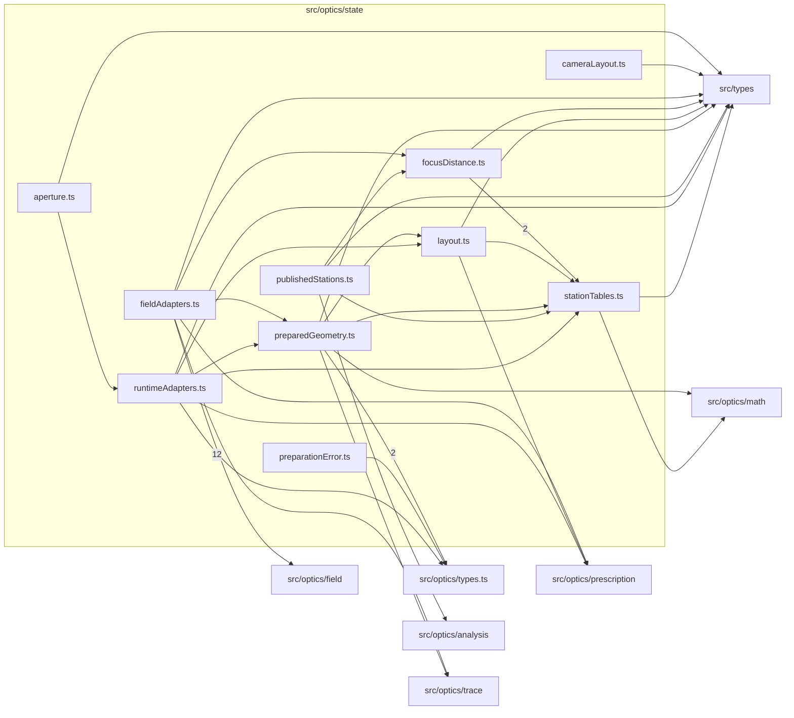

# src/optics/state

This folder engine-native prepared optical state and cache helpers.

Generated `readme.md` and `improvementsuggestions.md` files are intentionally omitted from the per-file inventory so this document stays focused on source relationships.

## Relationship Diagram

## Directory Overview

- Direct source files: 10
- Direct subfolders: 0
- Main outbound areas: same folder (13), src/optics/field (12), src/types (9), src/optics/types.ts (4), src/optics/prescription (3), src/optics/math (2), src/optics/trace (2), src/optics/analysis
- External consumers: src/optics/analysis, src/optics/analysis.ts, src/optics/buildLens.ts, src/optics/diagram, src/optics/field, src/optics/fieldGeometry.ts, src/optics/first-order, src/optics/optics.ts, +5 more

## Files

| File | Role | Imports from | Imported by | Exports |
| --- | --- | --- | --- | --- |
| `aperture.ts` | Aperture helper module | same folder, src/types | src/optics/optics.ts | fNumberAtStopdown |
| `cameraLayout.ts` | Camera Layout helper module | src/types | src/optics/analysis, src/optics/optics.ts | CameraAnchoredLayout, anchorLayoutToCamera |
| `fieldAdapters.ts` | Field Adapters helper module | src/optics/field (12), same folder (2), src/optics/prescription, src/optics/trace, src/types | src/optics/analysis (11), src/optics/fieldGeometry.ts | computeFieldGeometryAtState, computeAnalysisFieldGeometryAtState, traceChiefRayAtAngleForRuntimeLens, traceParaxialRayForRuntimeLens, chiefRayImageHeightForRuntimeLens, solveChiefRayForRuntimeLens, solveChiefRayBoundingSphereForRuntimeLens, chiefRayImageHeightAccurateForRuntimeLens, +16 more |
| `focusDistance.ts` | Focus Distance helper module | same folder (2), src/types | src/optics/first-order (3), same folder (2), src/optics/analysis (2), src/optics/field, src/optics/optics.ts | FOCUS_INFINITY_CUTOFF, focusDistanceAt, remapFocusDistance, closeFocusAtZoom |
| `layout.ts` | Layout helper module | same folder, src/optics/prescription, src/types | src/optics/analysis (9), same folder (2), src/optics/prescription (2), src/optics/first-order, src/optics/optics.ts | resolveControlledThickness, buildStateSurfaces, sumSurfaceThicknesses, buildZPositions, layoutFromPrepared, thick, doLayout, stateSurfaces |
| `preparationError.ts` | Preparation Error helper module | src/optics/types.ts | src/optics/types.ts | Optics2PreparationError |
| `preparedGeometry.ts` | Prepared Geometry helper module | same folder (2), src/optics/types.ts (2), src/optics/math, src/optics/trace, src/types | src/optics/analysis (6), same folder (2), src/optics/field (2), src/optics/analysis.ts, src/optics/diagram, +4 more | prepareState, prepareStateUncached, stateWithZ |
| `publishedStations.ts` | Published Stations helper module | same folder (2), src/optics/analysis, src/types | src/optics/publishedStations.ts | STATION_COORDINATE_TOLERANCE, PublishedStationSource, PublishedStationCoordinate, PublishedStationGrid, PublishedZoomStation, PublishedFocusStation, PublishedStationLimitKind, PublishedStationLimit, +8 more |
| `runtimeAdapters.ts` | Runtime Adapters helper module | same folder (3), src/optics/prescription, src/optics/types.ts, src/types | same folder, src/optics/buildLens.ts, src/optics/optics.ts | engineLensFromRuntime, prepareRuntimeState, doLayoutForRuntimeLens, thickOrZero, eflAtZoomClamped, epAtZoomClamped, fopenAtZoomClamped |
| `stationTables.ts` | Station Tables helper module | src/optics/math, src/types | src/optics/analysis (7), same folder (5), src/optics/first-order (3), src/optics/field (2), src/optics/prescription (2), +2 more | DEFAULT_FOCUS_POSITIONS, clampStationControl, stationSegment, interpolateStationTable, resolveVariableThickness, resolveAberrationThickness, zoomIndexToT, eflAtZoom, +11 more |
