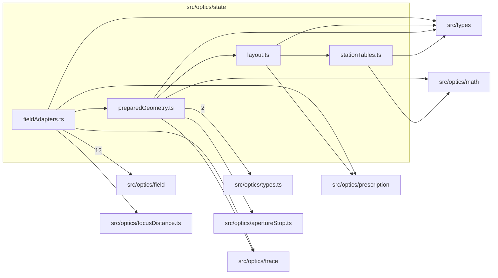

# src/optics/state

This folder engine-native prepared optical state and cache helpers.

Generated `readme.md` and `improvementsuggestions.md` files are intentionally omitted from the per-file inventory so this document stays focused on source relationships.

## Relationship Diagram

## Directory Overview

- Direct source files: 4
- Direct subfolders: 0
- Main outbound areas: src/optics/field (12), src/types (4), same folder (3), src/optics/math (2), src/optics/prescription (2), src/optics/trace (2), src/optics/types.ts (2), src/optics/apertureStop.ts, +1 more
- External consumers: src/optics/aberration, src/optics/analysis, src/optics/apertureStop.ts, src/optics/chromatic, src/optics/compat.ts, src/optics/diagram, src/optics/field, src/optics/first-order, +9 more

## Files

| File | Role | Imports from | Imported by | Exports |
| --- | --- | --- | --- | --- |
| `fieldAdapters.ts` | Field Adapters helper module | src/optics/field (12), same folder, src/optics/focusDistance.ts, src/optics/prescription, src/optics/trace, +1 more | src/optics/aberration (5), src/optics/analysis (3), src/optics/chromatic, src/optics/compat.ts | computeFieldGeometryAtState2, computeAnalysisFieldGeometryAtState2, traceChiefRayAtAngle2, traceParaxialRay2, chiefRayImageHeight2, solveChiefRay2, solveChiefRayBoundingSphere2, chiefRayImageHeightAccurate2, +15 more |
| `layout.ts` | Layout helper module | same folder, src/optics/prescription, src/types | src/optics/prescription (2), same folder, src/optics/compat.ts, src/optics/first-order, src/optics/layout.ts | resolveControlledThickness, buildStateSurfaces, sumSurfaceThicknesses, buildZPositions, layoutFromPrepared, thick, doLayout, stateSurfaces |
| `preparedGeometry.ts` | Prepared Geometry helper module | src/optics/types.ts (2), same folder, src/optics/apertureStop.ts, src/optics/math, src/optics/trace, +1 more | src/optics/field (2), src/optics/first-order (2), same folder, src/optics/analysis, src/optics/compat.ts, +4 more | prepareState, prepareStateUncached, stateWithZ |
| `stationTables.ts` | Station Tables helper module | src/optics/math, src/types | src/optics/first-order (3), src/optics/prescription (2), same folder, src/optics/apertureStop.ts, src/optics/compat.ts, +7 more | DEFAULT_FOCUS_POSITIONS, clampStationControl, stationSegment, interpolateStationTable, resolveVariableThickness, resolveAberrationThickness, zoomIndexToT, eflAtZoom, +11 more |
