# src/pages

This folder route-level React pages and page-specific lens-index feature module.

Generated `readme.md` and `improvementsuggestions.md` files are intentionally omitted from the per-file inventory so this document stays focused on source relationships.

## Relationship Diagram

```mermaid
flowchart LR
  subgraph n_src_pages["src/pages"]
    n_src_pages_src_pages_lensIndex["lensIndex/"]
    n_src_pages_React_components["React components (23)"]
    n_src_pages_TypeScript_modules["TypeScript modules (1)"]
  end
  n_external_src_utils_catalog["src/utils/catalog"]
  n_external_src_components_content["src/components/content"]
  n_external_src_components_layout["src/components/layout"]
  n_external_src_utils_seo["src/utils/seo"]
  n_external_src_components_SEOHead_tsx["src/components/SEOHead.tsx"]
  n_external_src_utils_style["src/utils/style"]
  n_external_pkg_react_router["pkg:react-router"]
  n_external_src_components_relationshipMap["src/components/relationshipMap"]
  n_external_pkg_react["pkg:react"]
  n_external_src_utils_text_ts["src/utils/text.ts"]
  n_external_src_utils_state["src/utils/state"]
  n_external_src_utils_content["src/utils/content"]
  n_external_src_components_homepage["src/components/homepage"]
  n_external_src_components_ClientOnly_tsx["src/components/ClientOnly.tsx"]
  n_external_src_types["src/types"]
  n_external_src_utils_theme["src/utils/theme"]
  n_external_src_components_search["src/components/search"]
  n_external_src_lensBuilder["src/lensBuilder"]
  n_external_src_components_errors["src/components/errors"]
  n_external_src_utils_useMediaQuery_ts["src/utils/useMediaQuery.ts"]
  n_external_src_comparison["src/comparison"]
  n_external_src_components_controls["src/components/controls"]
  n_external_src_components_hooks["src/components/hooks"]
  n_external_src_components_lensBuilder["src/components/lensBuilder"]
  n_external_src_components_markdown["src/components/markdown"]
  n_external_src_components_mount["src/components/mount"]
  n_external_src_mounts["src/mounts"]
  n_external_src_utils_featureFlags_ts["src/utils/featureFlags.ts"]
  n_src_pages_React_components --> |67| n_external_src_utils_catalog
  n_src_pages_React_components --> |34| n_external_src_components_content
  n_src_pages_React_components --> |24| n_external_src_components_layout
  n_src_pages_React_components --> |24| n_external_src_utils_seo
  n_src_pages_React_components --> |23| n_external_src_components_SEOHead_tsx
  n_src_pages_React_components --> |23| n_external_src_utils_style
  n_src_pages_React_components --> |21| n_external_pkg_react_router
  n_src_pages_React_components --> |20| n_src_pages_src_pages_lensIndex
  n_src_pages_React_components --> |18| n_external_src_components_relationshipMap
  n_src_pages_React_components --> |13| n_external_pkg_react
  n_src_pages_React_components --> |12| n_external_src_utils_text_ts
  n_src_pages_React_components --> |8| n_external_src_utils_state
  n_src_pages_React_components --> |7| n_external_src_utils_content
  n_src_pages_React_components --> |6| n_external_src_components_homepage
  n_src_pages_TypeScript_modules --> |5| n_external_src_utils_catalog
  n_src_pages_React_components --> |4| n_external_src_components_ClientOnly_tsx
  n_src_pages_React_components --> |4| n_external_src_types
  n_src_pages_React_components --> |4| n_external_src_utils_theme
  n_src_pages_React_components --> |3| n_external_src_components_search
  n_src_pages_React_components --> |3| n_external_src_lensBuilder
  n_src_pages_React_components --> |2| n_external_src_components_errors
  n_src_pages_React_components --> |2| n_external_src_utils_useMediaQuery_ts
  n_src_pages_React_components --> n_external_src_comparison
  n_src_pages_React_components --> n_external_src_components_controls
  n_src_pages_React_components --> n_external_src_components_hooks
  n_src_pages_React_components --> n_external_src_components_lensBuilder
  n_src_pages_React_components --> n_external_src_components_markdown
  n_src_pages_React_components --> n_external_src_components_mount
  n_src_pages_React_components --> n_external_src_mounts
  n_src_pages_React_components --> n_external_src_utils_featureFlags_ts
  n_src_pages_TypeScript_modules --> n_src_pages_src_pages_lensIndex
  n_src_pages_React_components --> n_src_pages_TypeScript_modules
```

## Directory Overview

- Direct source files: 24
- Direct subfolders: 1
- Main outbound areas: src/utils/catalog (72), src/components/content (34), src/components/layout (24), src/utils/seo (24), src/components/SEOHead.tsx (23), src/utils/style (23), package:react-router (21), src/pages/lensIndex (21), +22 more
- External consumers: src/routes

## Subfolders

| Folder | Role |
| --- | --- |
| [lensIndex/](lensIndex/readme.md) | lens library catalog filtering, URL state, grouping, results, and filter-panel UI |

## Files

| File | Role | Imports from | Imported by | Exports |
| --- | --- | --- | --- | --- |
| `ArticlePage.tsx` | Route-level React page | package:react (2), package:react-router, src/components/content, src/components/layout, src/components/markdown, +4 more | src/routes | default, ArticlePage |
| `ArticlesPage.tsx` | Route-level React page | src/components/content (2), src/utils/content (2), package:react, src/components/layout, src/components/SEOHead.tsx, +3 more | src/routes | default, ArticlesPage |
| `AuthorPage.tsx` | Route-level React page | src/components/content (5), src/utils/catalog (5), src/utils/style (2), package:react, package:react-router, +6 more | src/routes | default, AuthorPage |
| `AuthorsIndexPage.tsx` | Route-level React page | src/utils/catalog (5), src/utils/style (2), package:react, package:react-router, src/components/controls, +5 more | src/routes | default, AuthorsIndexPage |
| `ComparePage.tsx` | Route-level React page | src/utils/catalog (2), package:react-router, src/comparison, src/components/ClientOnly.tsx, src/components/layout, +1 more | src/routes | default, ComparePage |
| `FormatPage.tsx` | Route-level React page | src/utils/catalog (3), src/pages/lensIndex (2), package:react-router, src/components/layout, src/components/SEOHead.tsx, +3 more | src/routes | default, FormatPage |
| `FormatsIndexPage.tsx` | Route-level React page | src/components/content (2), src/utils/catalog (2), package:react-router, src/components/layout, src/components/SEOHead.tsx, +4 more | src/routes | default, FormatsIndexPage |
| `HomePage.tsx` | Route-level React page | src/components/homepage (6), src/utils/catalog (2), src/utils/seo (2), package:react, package:react-router, +8 more | src/routes | default, HomePage |
| `LensBuilderPage.tsx` | Route-level React page | src/utils/state (4), src/lensBuilder (3), src/components/layout (2), src/utils/theme (2), package:react, +7 more | src/routes | LensBuilder, default, LensBuilderPage |
| `LensIndexPage.tsx` | Route-level React page | src/pages/lensIndex (11), src/components/content (2), src/utils/catalog (2), package:react, package:react-router, +5 more | src/routes | default, LensIndexPage |
| `LensPage.tsx` | Route-level React page | src/utils/catalog (3), package:react-router, src/components/ClientOnly.tsx, src/components/content, src/components/layout, +3 more | src/routes | default, LensPage |
| `MakerPage.tsx` | Route-level React page | src/utils/catalog (6), src/components/content (3), package:react-router, src/components/layout, src/components/SEOHead.tsx, +3 more | src/routes | default, MakerPage |
| `MakersIndexPage.tsx` | Route-level React page | src/utils/catalog (4), src/components/content (2), package:react-router, src/components/layout, src/components/SEOHead.tsx, +3 more | src/routes | default, MakersIndexPage |
| `MountPage.tsx` | Route-level React page | src/utils/catalog (5), src/components/content (2), src/pages/lensIndex (2), package:react-router, src/components/layout, +6 more | src/routes | default, MountPage |
| `MountsIndexPage.tsx` | Route-level React page | src/components/content (2), src/utils/catalog (2), package:react-router, src/components/layout, src/components/SEOHead.tsx, +4 more | src/routes | default, MountsIndexPage |
| `NotFoundPage.tsx` | Route-level React page | package:react-router, src/components/layout, src/components/SEOHead.tsx, src/utils/catalog | src/routes | default, NotFoundPage |
| `PatentsIndexPage.tsx` | Route-level React page | src/components/content (5), src/utils/catalog (2), src/utils/style (2), src/components/layout, src/components/SEOHead.tsx, +4 more | src/routes | default, PatentsIndexPage |
| `RelationshipMapPage.tsx` | Route-level React page | src/components/relationshipMap (7), src/utils/catalog (6), src/utils/seo (2), src/utils/state (2), src/utils/style (2), +6 more | src/routes | default, RelationshipMapPage |
| `SearchPage.tsx` | Route-level React page | src/components/search (2), package:react, package:react-router, src/components/layout, src/components/SEOHead.tsx, +3 more | src/routes | default, SearchPage |
| `teleconverterIndex.ts` | Teleconverter Index helper module | src/utils/catalog (5), src/pages/lensIndex | src/pages/TeleconvertersIndexPage.tsx | TeleconverterGroupMode, TELECONVERTER_GROUP_OPTIONS, TeleconverterGroup, parseTeleconverterGroupMode, groupTeleconverters |
| `TeleconverterPage.tsx` | Route-level React page | src/utils/catalog (5), src/components/content (3), src/utils/seo (2), package:react-router, src/components/layout, +4 more | src/routes | default, TeleconverterPage |
| `TeleconvertersIndexPage.tsx` | Route-level React page | src/utils/catalog (3), src/components/content (2), src/utils/style (2), package:react, package:react-router, +5 more | src/routes | default, TeleconvertersIndexPage |
| `UniversalRelationshipMapPage.tsx` | Route-level React page | src/components/relationshipMap (11), src/utils/catalog (3), src/utils/seo (2), src/utils/style (2), package:react, +8 more | src/routes | default, UniversalRelationshipMapPage |
| `UpdatesPage.tsx` | Route-level React page | src/utils/catalog (2), src/utils/content (2), package:react, package:react-router, src/components/content, +4 more | src/routes | default, UpdatesPage |
