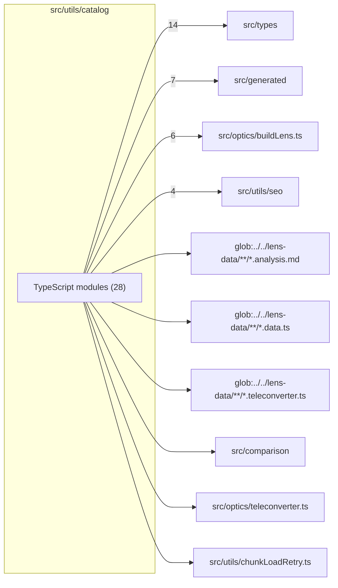

# src/utils/catalog

This folder lens, maker, mount, image-format, and metadata catalog helpers.

Generated `readme.md` and `improvementsuggestions.md` files are intentionally omitted from the per-file inventory so this document stays focused on source relationships.

## Relationship Diagram

## Directory Overview

- Direct source files: 28
- Direct subfolders: 0
- Main outbound areas: same folder (58), src/types (14), src/generated (7), src/optics/buildLens.ts (6), src/utils/seo (4), glob:../../lens-data/**/*.analysis.md, glob:../../lens-data/**/*.data.ts, glob:../../lens-data/**/*.teleconverter.ts, +3 more
- External consumers: src/benchmarks, src/comparison, src/components/content, src/components/controls, src/components/display, src/components/homepage, src/components/hooks, src/components/layout, +37 more

## Files

| File | Role | Imports from | Imported by | Exports |
| --- | --- | --- | --- | --- |
| `assigneeCatalog.ts` | Assignee Catalog helper module | src/types (2), src/generated | same folder (3), src/components/relationshipMap (2), src/pages/RelationshipMapPage.tsx | AssigneeMetadata, ASSIGNEES, getAssigneeBySlug, getAssigneeByName |
| `assigneeCorporateHistory.ts` | Assignee Corporate History helper module | src/types | none | ASSIGNEE_CORPORATE_HISTORY, corporateRelationshipsForAssignee |
| `authorAssignees.ts` | Author Assignees helper module | same folder (3) | src/pages/AuthorsIndexPage.tsx | ALL_AUTHOR_ASSIGNEES, UNASSIGNED_AUTHORS, AuthorDirectoryEntry, AuthorAssigneeStratum, AUTHOR_DIRECTORY_ENTRIES, AUTHOR_ASSIGNEE_STRATA, UNASSIGNED_AUTHOR_COUNT, filterAuthorsByAssignee |
| `authorBiographies.ts` | Author Biographies helper module | none | src/pages/AuthorPage.tsx, src/pages/AuthorsIndexPage.tsx | AuthorBiographySource, AuthorBiography, AUTHOR_BIOGRAPHIES, getAuthorBiography |
| `authorCatalog.ts` | Author Catalog helper module | same folder (5), src/generated, src/types, src/utils/seo | same folder (4), src/components/relationshipMap (2), src/components/content, src/pages/AuthorPage.tsx, src/pages/AuthorsIndexPage.tsx, +1 more | AuthorMetadata, AuthorPatentLens, AuthorPatent, AuthorGroupMode, AuthorPatentGroup, AUTHORS, getAuthorBySlug, getAuthorByName, +4 more |
| `collation.ts` | Collation helper module | none | same folder (13), src/components/relationshipMap (6), src/pages/lensIndex (3), src/pages/AuthorsIndexPage.tsx, src/pages/MakersIndexPage.tsx, +3 more | catalogCollator |
| `groupByNamedParty.ts` | Group By Named Party helper module | same folder | same folder (2), src/pages/lensIndex, src/pages/teleconverterIndex.ts | NamedPartyGroup, groupByNamedParty |
| `imageFormatDetails.ts` | Image Format Details helper module | same folder | src/pages/FormatPage.tsx, src/pages/FormatsIndexPage.tsx | ImageFormatDetails, IMAGE_FORMAT_DETAILS, getImageFormatDetails |
| `inventorAffiliations.ts` | Inventor Affiliations helper module | same folder (2) | src/components/relationshipMap (2), same folder | InventorAffiliation, InventorAffiliationRecord, InventorAffiliationNetwork, buildInventorAffiliations |
| `lensCatalog.ts` | Lens Catalog helper module | src/optics/buildLens.ts (2), src/types (2), glob:../../lens-data/**/*.analysis.md, glob:../../lens-data/**/*.data.ts, same folder, +1 more | src/components/layout (4), src/utils/state (3), same folder, src/benchmarks, src/components/hooks, +4 more | OpticalConfigurationOption, LENS_CATALOG, lensNameForKey, ALL_CATALOG_KEYS, CATALOG_KEYS, COMPARISON_CATALOG_KEYS, DEBUG_CATALOG_KEYS, isDebugLensKey, +7 more |
| `lensMetadata.ts` | Lens Metadata helper module | same folder (2), src/generated (2), src/comparison, src/optics/buildLens.ts, src/utils/seo | same folder, src/components/homepage, src/components/layout, src/components/SEOHead.tsx, src/pages/ArticlePage.tsx, +24 more | MakerInfo, deriveMaker, allMakerSlugs, makerDisplayName, lensPageTitle, lensPageDescription, lensCanonicalURL, makerCanonicalURL, +18 more |
| `lensPatentMetadata.ts` | Lens Patent Metadata helper module | src/optics/buildLens.ts, src/types | same folder, src/components/controls, src/pages/TeleconverterPage.tsx | LensPatentAttribution, patentExampleSuffix, lensPatentAttribution, lensDisplaySubtitle, lensPatentReference |
| `lensSummaries.ts` | Lens Summaries helper module | src/generated (2), same folder, src/types | same folder (5), src/components/homepage (2), src/pages/lensIndex (2), src/pages/HomePage.tsx, src/pages/LensIndexPage.tsx, +6 more | LensSummary, LENS_SUMMARIES, ALL_SUMMARY_KEYS, SUMMARY_KEYS, DEBUG_SUMMARY_KEYS, isDebugSummaryKey, ALL_LENSES_BY_DATE, RECENT_LENS_KEYS, +1 more |
| `lensTaxonomy.ts` | Lens Taxonomy helper module | none | src/pages/lensIndex (7), src/types (5), same folder (4), src/optics/prescription (4), src/optics/analysis (2), +12 more | LENS_MOUNTS, LensMountId, LensMountMetadata, LENS_MOUNT_BY_ID, isLensMountId, IMAGE_FORMATS, ImageFormatId, ImageFormatMetadata, +4 more |
| `makerDetails.ts` | Maker Details helper module | none | src/pages/lensIndex, src/pages/MakerPage.tsx, src/pages/MakersIndexPage.tsx | MakerDetails, MAKER_DETAILS, getMakerDetails |
| `mountDetails.ts` | Mount Details helper module | same folder | src/pages/MountPage.tsx, src/pages/MountsIndexPage.tsx | MountDetails, MOUNT_DETAILS, getMountDetails |
| `patentCatalog.ts` | Patent Catalog helper module | same folder (8), src/types | src/pages/PatentsIndexPage.tsx | aggregatePatentRecords, espacenetPatentUrl, isPatentPublicationNumber, patentJurisdiction, PatentJurisdiction, PatentRecord, PatentLens, PatentAssigneeGroup, +6 more |
| `patentRecords.ts` | Patent Records helper module | same folder (2), src/types | same folder (3), src/components/content, src/optics/prescription | PatentJurisdiction, PatentRecord, AggregatePatentOptions, isPatentPublicationNumber, docdbPublicationNumber, espacenetPatentUrl, patentJurisdiction, aggregatePatentRecords |
| `relationshipCatalog.ts` | Relationship Catalog helper module | same folder (2) | src/pages/RelationshipMapPage.tsx, src/pages/UniversalRelationshipMapPage.tsx | getRelationshipCatalog |
| `relationshipGraph.ts` | Relationship Graph helper module | same folder (3), src/types | src/components/relationshipMap (4), same folder (2), src/pages/RelationshipMapPage.tsx | PartyRef, GraphPatentNode, GraphPartyNode, RelationshipGraph, resolveFocusParam, buildRelationshipGraph |
| `relationshipInsights.ts` | Relationship Insights helper module | same folder (4) | src/components/relationshipMap (4), same folder | RelationshipInsights, buildRelationshipInsights, companyBridge, companyConnections, inventorCollaborators |
| `searchCatalog.ts` | Search Catalog helper module | same folder (8), src/utils/seo | src/components/relationshipMap (2), src/components/search (2), same folder | LensNameSearchMatch, TeleconverterSearchMatch, PatentSearchMatch, AuthorSearchMatch, CatalogSearchResults, CatalogSearchMatch, normalizeSearchText, normalizeLensSearchText, +3 more |
| `slugText.ts` | Slug Text helper module | none | same folder, src/pages/lensIndex | transliterateCatalogText, stableHash |
| `teleconverterCatalog.ts` | Teleconverter Catalog helper module | same folder (2), src/optics/buildLens.ts (2), glob:../../lens-data/**/*.teleconverter.ts, src/optics/teleconverter.ts, src/types | src/components/layout (5), src/comparison (2), src/utils/state (2), src/components/controls, src/components/hooks | TeleconverterOption, TELECONVERTER_CATALOG, ALL_TELECONVERTER_KEYS, TELECONVERTER_KEYS, teleconverterOptionsForLens, resolveTeleconverterKey, resolveLensSystemData, lensSystemKey |
| `teleconverterSummaries.ts` | Teleconverter Summaries helper module | same folder, src/generated, src/types, src/utils/seo | same folder, src/components/homepage, src/pages/lensIndex, src/pages/LensPage.tsx, src/pages/teleconverterIndex.ts, +2 more | TeleconverterSummary, ALL_TELECONVERTER_SUMMARY_LIST, TELECONVERTER_SUMMARIES, TELECONVERTER_SUMMARY_KEYS, TELECONVERTER_SUMMARY_LIST, teleconverterSummariesForLens, teleconverterLensPath |
| `universalConnectionPaths.ts` | Universal Connection Paths helper module | same folder | src/components/relationshipMap | UniversalConnectionPath, UniversalConnectionResult, findUniversalConnectionPaths, universalConnectionDescription |
| `universalRelationshipGraph.ts` | Universal Relationship Graph helper module | same folder (7), src/types | src/components/relationshipMap (11), same folder (5) | UniversalNodeKind, UniversalPartyNode, UniversalPatentNode, UniversalCorporateNode, UniversalMakerNode, UniversalLensNode, UniversalRelationshipNode, UniversalEdgeKind, +7 more |
| `universalRelationshipSearch.ts` | Universal Relationship Search helper module | same folder (3) | src/components/relationshipMap | buildUniversalSearchIndex, searchUniversalNodes |
